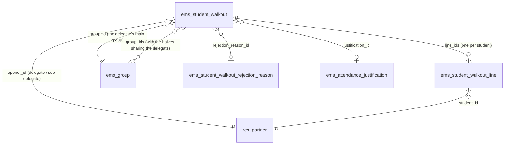
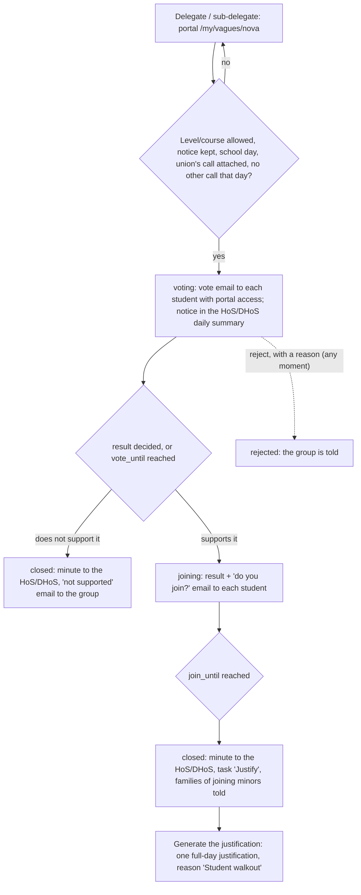

# Technical Reference: `ems.student_walkout`

## Overview

A **student walkout** is a strike called by a students' union ("vaga"/"huelga"). A group's delegate
or sub-delegate calls the vote from the portal, attaching the union's call, with no review first:

1. every student of the group with portal access votes whether the group supports the walkout
   (anonymous: only the counts are kept);
2. if it does, each student says whether they join it (by name, changeable until the phase ends);
3. the minute (a PDF in the centre language) goes to the group's Head of Studies / Deputy Head of
   Studies at least the notice before the walkout, and they generate one attendance justification
   of the walkout day for the students who join.

The Head of Studies is told of every call in their daily summary and can reject it with a reason at
any moment, even once justified.

**Naming.** In English the feature is always *walkout*, never *strike*: `ems.strike` is the
disciplinary record (Coexistence → Strikes). Catalan and Spanish say "vaga"/"huelga".

**Module files:** `models/attendance/student_walkout.py` (`ems.student_walkout`, its lines, the
rejection reasons and the reject wizard), `models/attendance/student_walkout_partner.py` (the
`res.partner` portal helpers), `models/contacts/group.py` (`_ems_walkout_allowed`,
`_ems_school_send_time`), `models/shared/datetime_utils.py` (school hours),
`models/curriculum/level.py` (which levels may call one), `models/settings/company.py` (the calendar settings),
`controllers/portal_student_walkout.py`, `views/portal/portal_student_walkout.xml`,
`views/attendance/student_walkout/`, `views/settings/walkout_levels.xml`,
`reports/attendance/report_student_walkout.xml`, `mails/attendance/student_walkout.xml`.

---

## The calendar

Counted in **school hours**: every hour of a school day (a weekday that is no public holiday nor
school break, `resource.calendar.leaves._ems_holiday_dates`), the night included, and no hour of a
weekend, holiday or break. 24 school hours from a Friday at 13:00 end on the Monday at 13:00
(`ems.datetime_utils.ems_add_school_hours()` / `ems_school_hours_between()`, on the centre's wall
clock). Two settings (Settings → *Student Walkout Settings* → *Calendar*, `res.company`) set it,
and each call keeps the values it was opened with (`phase_hours`, `notice_hours`):

| Setting | Default | Meaning |
|---------|---------|---------|
| `walkout_phase_hours` | 24 | How long the group vote lasts, and then the joining |
| `walkout_notice_hours` | 48 | How long before the walkout (its 00:00) the Head of Studies gets the minute |

| Phase | State | From | Until |
|-------|-------|------|-------|
| The group votes whether it supports it | `voting` | `vote_start`: when the email reaches the group | `vote_until` = `vote_start` + phase, or earlier once the result is decided |
| Each student says whether they join | `joining` | `join_start`: when the result email reaches the group | `join_until` = `join_start` + phase |
| The minute goes to the Head of Studies | `closed` | `join_until` (or the vote's end, if not supported) | — |

**A phase starts when its email reaches the students** (`_ems_send_moment`: now during the group's
classes, otherwise the start of its next ones, the latest of a split group's halves; see "Student
emails during school hours" below). A vote called on Friday at 20:00 runs from Monday 8:00 to
Tuesday 8:00. The portal lets students answer before the start too (e.g. over the weekend):
`_ems_phase_open()` only checks the end.

**Notice.** When opening, `_ems_projected_calendar()` works out the worst case (the vote taking its
whole phase) and `_ems_check_request_date()` requires at least `notice_hours` school hours from that
`join_until` to the walkout's 00:00, and the walkout day to be a school day. With the defaults, a
call opened on Monday at 10:00 votes until Tuesday 10:00, joins until Wednesday 10:00, and its first
possible walkout day is the next Monday (Friday would only give 38 school hours). The portal form
shows that calendar and the first possible day (`_ems_first_walkout_day()`) before sending.

**The vote ends early** (`_ems_vote_decided()`, after each vote) once the votes still to come cannot
change the result: everybody voted, more yes than no plus the votes to come, or yes plus the votes
to come no more than no (a tie does not support it). The joining starts then, so the minute only
ever comes earlier than projected.

**Deadlines.** Each phase change wakes the cron `_cron_ems_walkout_deadlines()` exactly at its end
(`ir.cron._trigger(at=...)`); its hourly run is only the safety net. It ends a vote past
`vote_until` and closes a joining past `join_until`.

---

## Data model

### `ems.student_walkout`

| Field | Type | Notes |
|-------|------|-------|
| `name` | `Char` (computed, stored) | "Group - date" |
| `group_id` / `group_ids` | `Many2one` / `Many2many → ems.group` | The opener's main group, and every half of a split group sharing that delegate or sub-delegate |
| `opener_id` | `Many2one → res.partner` | The delegate or sub-delegate who called it |
| `course_id` | `Many2one → ems.course` | The current course when called |
| `walkout_date` / `walkout_start` | `Date` / `Datetime` (computed) | The walkout day (the only date the delegate gives), and its 00:00 in the centre |
| `phase_hours` / `notice_hours` | `Integer` | The settings when it was opened |
| `vote_start` / `vote_until` / `join_start` / `join_until` | `Datetime` | The calendar above; the joining ones once it starts |
| `notes` | `Text` | What the delegate says about it |
| `attachment_ids` | `Many2many → ir.attachment` | The union's call: at least one file |
| `state` | `Selection` | `voting` → `joining` → `closed` → `justified`; or `rejected`, `cancelled` (by the delegate). A group vote that does not support it goes from `voting` to `closed` |
| `head_of_studies_id` | `Many2one → hr.employee` | Who is told of it and gets the minute |
| `rejected_by_id` / `rejected_datetime` | `Many2one → res.users` / `Datetime` | Who rejected it, and when |
| `rejection_reason_id` / `rejection_details` | `Many2one → ems.student_walkout.rejection_reason` / `Text` | Why it was rejected; details are required for a reason with `requires_details` ("Other reasons") |
| `rejected_from_state` | `Selection` | The state it was rejected from: once closed, the families told their child joins are told too |
| `group_yes_count` / `group_no_count` / `group_abstain_count` | `Integer` | The anonymous group vote: only these counters, never who voted what |
| `group_supports` | `Boolean` (computed) | More yes than no among the votes cast (a tie does not support it) |
| `joining_student_ids` | `Many2many` (computed) | The students whose line says they join |
| `pdf_attachment_id` | `Many2one → ir.attachment` | The minute, rendered on closing |
| `justification_id` | `Many2one → ems.attendance_justification` | Created by *Generate the justification* |

### `ems.student_walkout.line`

| Field | Type | Notes |
|-------|------|-------|
| `walkout_id`, `student_id` | `Many2one` | One line per student of `group_ids` when the vote is called |
| `has_portal` | `Boolean` | Whether the student had portal access then; only they answer |
| `voted` / `vote_date` | `Boolean` / `Datetime` | The group vote was cast (it never says which way) |
| `join_answered` / `joins` / `join_date` | `Boolean` / `Boolean` / `Datetime` | Whether they said if they join, and what |

**Anonymity and concurrency.** The group vote only adds one to a counter of the call
(`_ems_portal_vote`) and marks the line as `voted`, so nothing links a student to their answer. Two
answers at the same time update the same rows: PostgreSQL refuses the second one (Odoo runs in
REPEATABLE READ) and Odoo retries the request, so no vote is lost or counted twice.

### `ems.student_walkout.rejection_reason`

The catalog the Head of Studies picks from (Student's Attendances → Configuration → Student walkouts
→ Rejection reasons; academic administrators and Heads of Studies), like the justification reasons:
`name` (translatable), `sequence`, `active`, `requires_details`. Seeded with `noupdate="1"` (the
centre edits it): no official call that day, the attached document is not a valid call, the call
does not include the group's level or studies, another sector (not students), another autonomous
community, duplicate call, and "Other reasons" (`requires_details`). The rejection is made from
`ems.student_walkout.reject.wizard`.

---

## Who may call one: levels and courses

An allowlist on `ems.level` (empty = nobody), edited in Settings → *Student Walkout Settings* →
*Levels and courses* (an editable list of the levels):

| Field | Meaning |
|-------|---------|
| `walkout_allowed` | The level's groups may call a walkout |
| `walkout_course_from` / `walkout_course_to` | Optional limits on the group's `course` (empty = no limit) |

`ems.group._ems_walkout_allowed()` applies them. Seeded once, by level acronym, from the law
(LODE art. 8: the collective decision not to attend is recognised from the 3rd year of ESO): ESO
from the 3rd year, and BTX, CFGB, CFGM, CFGS and EFPS in full (`ems.level._ems_seed_walkout_levels()`,
from `post_init_hook` and `migrations/18.0.0.48.0/post-migrate.py`). It is not catalog data
(`data/cat/`), so an upgrade never undoes the centre's choice.

---

## Flow

- **Call** (`_ems_portal_open(partner, vals, files)`): the partner must be a student with portal
  access who is the delegate or sub-delegate of their main group, and that group must be allowed.
  Lines for every active student of `group_ids`. The vote starts at once (`_ems_start_voting`):
  each student with portal access gets `email_template_student_walkout_call`, and the Head of
  Studies a notice in their daily summary (`ems.info_notice`: no action asked, they may reject it)
  saying when the minute will reach them at the latest (`_ems_latest_minute`).
- **Group vote** (`_ems_portal_vote(partner, group_vote)`): once per student, yes/no/abstain. When
  it ends (`_ems_end_group_vote`): if the group supports it, `joining` (its own phase from when the
  email reaches the group), and each student gets
  `email_template_student_walkout_join` (the result and that they can join until `join_until`);
  otherwise the call closes and each student gets `email_template_student_walkout_result`.
- **Join** (`_ems_portal_join(partner, joins)`): while `joining`, changeable.
- **Close** (`_ems_close`): renders the minute (`ems.report_student_walkout`, centre language), emails
  it to the Head of Studies right away (`email_template_student_walkout_head`: the walkout is a few
  days off, so not in the daily summary) and, when the group supports it and somebody joins,
  schedules the quiet task "Justify the student walkout" and tells the family of each joining minor
  (or adult sharing with it) (`email_template_student_walkout_family`). The Head of Studies is
  `group.tutor_id.find_head_of_studies()`; failing that, the academic administrators.
- **Reject** (`action_open_reject_wizard()` → `_ems_reject(reason, details)`), at any moment
  (`REJECTABLE_STATES`): every student with portal access is told
  (`email_template_student_walkout_rejected`) and still sees the call and the reason on the portal;
  once closed, the families that were told their child joins get
  `email_template_student_walkout_family_rejected`. A justification already generated is deleted
  (as the user rejecting it: its absences go back to unjustified), and the justify task is removed.
- **Cancel** (`_ems_portal_cancel(partner)`): the opener or the group's delegates, while voting or
  joining; the group no longer sees it. Nobody closes a phase by hand.
- **Generate the justification** (`action_generate_justification()`): Head of Studies / Deputy /
  Director in the tutor scope of every joining student, or an administrator. Creates an
  `ems.attendance_justification` with `ems.attendance_justification_reason_walkout`, the walkout day
  and the joining students not already justified that day (the ones skipped are noted in the
  chatter), marks the task as done and moves the call to `justified`.
- **Student emails during school hours.** Every email to students goes through
  `_ems_mail_students`, which sets `mail.mail.scheduled_date` (Odoo's own mail queue sends it then)
  to `ems.group._ems_school_send_time()` of the student's main group: now during its classes,
  otherwise the start of its next classes, skipping weekends, public holidays and school breaks
  (`resource.calendar.leaves._ems_holiday_dates`). The group's day is from its first to its last
  class of that weekday in its schedule (`resource.calendar.attendance.group_ids`): one search per
  group, not one per student. A group with no schedule gets it at once. Staff and family emails are
  sent at once.

---

## Access control

Portal users have no ACL on these models: the controller works with `sudo()` and always takes the
student from the logged-in user (`request.env.user.partner_id`, `contact_type == 'student'`; a
family never acts here).

| Role | Read | Reject, generate the justification | Rejection reasons |
|------|:----:|:--:|:--:|
| Tutor (and the chain above, `tutor_scope_user_ids`) | ✓ (their groups) | — | read |
| Head of Studies / Deputy Head of Studies / Director | ✓ (their branch, tutor scope) | ✓ | read, write, create |
| Administrator (`ems.group_academic_admin`, `base.group_system`) | ✓ (all) | ✓ | all |

Nobody edits a call or its lines by hand in the backend: they come from the portal and the
call's own methods.
