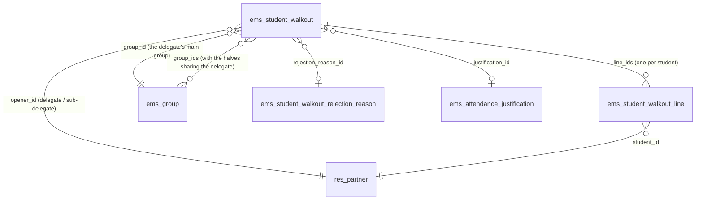
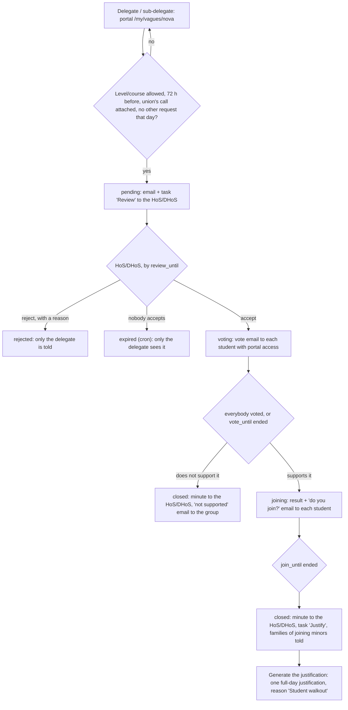

# Technical Reference: `ems.student_walkout`

## Overview

A **student walkout** is a strike called by a students' union ("vaga"/"huelga"). A group's delegate
or sub-delegate requests one from the portal, attaching the union's call, at least 72 hours before
the walkout. Then, on a fixed calendar:

1. the group's Head of Studies / Deputy Head of Studies accepts it, or rejects it with a reason
   (before the group hears of it, only the delegate is told, so a misuse of the tool reaches nobody
   else);
2. once accepted, every student of the group with portal access votes whether the group supports
   the walkout (anonymous: only the counts are kept);
3. if it does, each student says whether they join it (by name, changeable until the phase ends);
4. the minute (a PDF in the centre language) goes to the Head of Studies, who generates one
   attendance justification of the walkout day for the students who join.

The Head of Studies can still reject it at any later moment, even once justified.

**Naming.** In English the feature is always *walkout*, never *strike*: `ems.strike` is the
disciplinary record (Coexistence → Strikes). Catalan and Spanish say "vaga"/"huelga".

**Module files:** `models/attendance/student_walkout.py` (`ems.student_walkout`, its lines, the
rejection reasons and the reject wizard), `models/attendance/student_walkout_partner.py` (the
`res.partner` portal helpers), `models/contacts/group.py` (`_ems_walkout_allowed`,
`_ems_school_send_time`), `models/curriculum/level.py` (which levels may request one),
`controllers/portal_student_walkout.py`, `views/portal/portal_student_walkout.xml`,
`views/attendance/student_walkout/`, `views/settings/walkout_levels.xml`,
`reports/attendance/report_student_walkout.xml`, `mails/attendance/student_walkout.xml`.

---

## The calendar

Fixed, in the centre's days, counted back from the walkout day `W` (constants in
`student_walkout.py`). Each phase starts as soon as the one before ends; its last day is fixed.

| Phase | State | Last day | Field |
|-------|-------|----------|-------|
| The delegate requests it | — | `W − 4` (at least 72 h before the walkout) | `REQUEST_DAYS_BEFORE` |
| The Head of Studies accepts or rejects it | `pending` | `W − 3` | `review_until` |
| The group votes whether it supports it | `voting` | `W − 2` | `vote_until` |
| Each student says whether they join | `joining` | `W − 1` | `join_until` |
| The minute goes to the Head of Studies | `closed` | first hour of `W` | — |

Example, a walkout on Friday: the request by Monday, accepted by Tuesday, the group vote by
Wednesday, joining on Thursday. The group vote also ends as soon as everybody with portal access
has voted. The hourly cron `_cron_ems_walkout_deadlines()` acts at each deadline: a request still
`pending` after `review_until` becomes `expired` (only its delegate sees it, on the portal); a group
vote past `vote_until` ends; a joining past `join_until` closes.

---

## Data model

### `ems.student_walkout`

| Field | Type | Notes |
|-------|------|-------|
| `name` | `Char` (computed, stored) | "Group - date" |
| `group_id` / `group_ids` | `Many2one` / `Many2many → ems.group` | The opener's main group, and every half of a split group sharing that delegate or sub-delegate |
| `opener_id` | `Many2one → res.partner` | The delegate or sub-delegate who requested it |
| `course_id` | `Many2one → ems.course` | The current course when requested |
| `walkout_date` | `Date` | The walkout day: the only date the delegate gives |
| `review_until` / `vote_until` / `join_until` | `Date` (computed) | The calendar above |
| `notes` | `Text` | What the delegate says about it |
| `attachment_ids` | `Many2many → ir.attachment` | The union's call: at least one file |
| `state` | `Selection` | `pending` → `voting` → `joining` → `closed` → `justified`; or `rejected`, `expired`, `cancelled` (by the delegate). A group vote that does not support it goes from `voting` to `closed` |
| `head_of_studies_id` | `Many2one → hr.employee` | Who reviews it and gets the minute |
| `decided_by_id` / `decision_datetime` | `Many2one → res.users` / `Datetime` | Who accepted or rejected it, and when |
| `rejection_reason_id` / `rejection_details` | `Many2one → ems.student_walkout.rejection_reason` / `Text` | Why it was rejected; details are required for a reason with `requires_details` ("Other reasons") |
| `rejected_from_state` | `Selection` | The state it was rejected from: decides who is told and whether the group still sees it on the portal |
| `group_yes_count` / `group_no_count` / `group_abstain_count` | `Integer` | The anonymous group vote: only these counters, never who voted what |
| `group_supports` | `Boolean` (computed) | More yes than no among the votes cast (a tie does not support it) |
| `joining_student_ids` | `Many2many` (computed) | The students whose line says they join |
| `pdf_attachment_id` | `Many2one → ir.attachment` | The minute, rendered on closing |
| `justification_id` | `Many2one → ems.attendance_justification` | Created by *Generate the justification* |

### `ems.student_walkout.line`

| Field | Type | Notes |
|-------|------|-------|
| `walkout_id`, `student_id` | `Many2one` | One line per student of `group_ids` when the walkout is requested |
| `has_portal` | `Boolean` | Whether the student had portal access then; only they answer |
| `voted` / `vote_date` | `Boolean` / `Datetime` | The group vote was cast (it never says which way) |
| `join_answered` / `joins` / `join_date` | `Boolean` / `Boolean` / `Datetime` | Whether they said if they join, and what |

**Anonymity and concurrency.** The group vote only adds one to a counter of the call
(`_ems_portal_vote`) and marks the line as `voted`, so nothing links a student to their answer. Two
answers at the same time update the same rows: PostgreSQL refuses the second one (Odoo runs in
REPEATABLE READ) and Odoo retries the request, so no vote is lost or counted twice.

### `ems.student_walkout.rejection_reason`

The catalog the Head of Studies picks from (Student's Attendances → Configuration → Student walkouts
→ Rejection reasons; academic administrators and Heads of Studies), like the justification reasons:
`name` (translatable), `sequence`, `active`, `requires_details`. Seeded with `noupdate="1"` (the
centre edits it): no official call that day, the attached document is not a valid call, the call
does not include the group's level or studies, another sector (not students), another autonomous
community, duplicate call, and "Other reasons" (`requires_details`). The rejection is made from
`ems.student_walkout.reject.wizard`.

---

## Who may request one: levels and courses

An allowlist on `ems.level` (empty = nobody), edited in Settings → *Student Walkout Settings* →
*Levels and courses* (an editable list of the levels):

| Field | Meaning |
|-------|---------|
| `walkout_allowed` | The level's groups may request a walkout |
| `walkout_course_from` / `walkout_course_to` | Optional limits on the group's `course` (empty = no limit) |

`ems.group._ems_walkout_allowed()` applies them. Seeded once, by level acronym, from the law
(LODE art. 8: the collective decision not to attend is recognised from the 3rd year of ESO): ESO
from the 3rd year, and BTX, CFGB, CFGM, CFGS and EFPS in full (`ems.level._ems_seed_walkout_levels()`,
from `post_init_hook` and `migrations/18.0.0.48.0/post-migrate.py`). It is not catalog data
(`data/cat/`), so an upgrade never undoes the centre's choice.

---

## Flow

- **Request** (`_ems_portal_open(partner, vals, files)`): the partner must be a student with portal
  access who is the delegate or sub-delegate of their main group, and that group must be allowed.
  Lines for every active student of `group_ids`. The Head of Studies gets an email at once
  (`email_template_student_walkout_review`) and a quiet task "Review the student walkout call" due
  `review_until`. Nobody in the group sees it yet, except its delegate
  (`res.partner._ems_walkout_calls`).
- **Accept** (`action_accept()`, Actions dropdown, only while `pending` and not after
  `review_until`): the group vote opens at once; each student with portal access gets
  `email_template_student_walkout_call`.
- **Group vote** (`_ems_portal_vote(partner, group_vote)`): once per student, yes/no/abstain. When
  it ends (`_ems_end_group_vote`): if the group supports it, `joining`, and each student gets
  `email_template_student_walkout_join` (the result and that they can join until `join_until`);
  otherwise the call closes and each student gets `email_template_student_walkout_result`.
- **Join** (`_ems_portal_join(partner, joins)`): while `joining`, changeable.
- **Close** (`_ems_close`): renders the minute (`ems.report_student_walkout`, centre language), emails
  it to the Head of Studies right away (`email_template_student_walkout_head`: the walkout is the
  next day, so not in the daily summary) and, when the group supports it and somebody joins,
  schedules the quiet task "Justify the student walkout" and tells the family of each joining minor
  (or adult sharing with it) (`email_template_student_walkout_family`). The Head of Studies is
  `group.tutor_id.find_head_of_studies()`; failing that, the academic administrators.
- **Reject** (`action_open_reject_wizard()` → `_ems_reject(reason, details)`), at any moment
  (`REJECTABLE_STATES`): while `pending`, only the opener is told
  (`email_template_student_walkout_rejected`) and the group never sees it; later, every student
  with portal access is told too and still sees the call and the reason on the portal; once closed,
  the families that were told their child joins get `email_template_student_walkout_family_rejected`.
  A justification already generated is deleted (as the user rejecting it: its absences go back to
  unjustified), and the review and justify tasks are removed.
- **Cancel** (`_ems_portal_cancel(partner)`): the opener or the group's delegates, while pending,
  voting or joining. The calendar is fixed: nobody closes a phase by hand.
- **Generate the justification** (`action_generate_justification()`): Head of Studies / Deputy /
  Director in the tutor scope of every joining student, or an administrator. Creates an
  `ems.attendance_justification` with `ems.attendance_justification_reason_walkout`, the walkout day
  and the joining students not already justified that day (the ones skipped are noted in the
  chatter), marks the task as done and moves the call to `justified`.
- **Student emails during school hours.** Every email to students goes through
  `_ems_mail_students`, which sets `mail.mail.scheduled_date` (Odoo's own mail queue sends it then)
  to `ems.group._ems_school_send_time()` of the student's main group: now during its classes,
  otherwise the start of its next classes, skipping weekends, public holidays and school breaks
  (`resource.calendar.leaves._ems_holiday_dates`). The group's day is from its first to its last
  class of that weekday in its schedule (`resource.calendar.attendance.group_ids`): one search per
  group, not one per student. A group with no schedule gets it at once. Staff and family emails are
  sent at once.

---

## Access control

Portal users have no ACL on these models: the controller works with `sudo()` and always takes the
student from the logged-in user (`request.env.user.partner_id`, `contact_type == 'student'`; a
family never acts here).

| Role | Read | Accept / reject, generate the justification | Rejection reasons |
|------|:----:|:--:|:--:|
| Tutor (and the chain above, `tutor_scope_user_ids`) | ✓ (their groups) | — | read |
| Head of Studies / Deputy Head of Studies / Director | ✓ (their branch, tutor scope) | ✓ | read, write, create |
| Administrator (`ems.group_academic_admin`, `base.group_system`) | ✓ (all) | ✓ | all |

Nobody edits a call or its lines by hand in the backend: they come from the portal and the
call's own methods.
