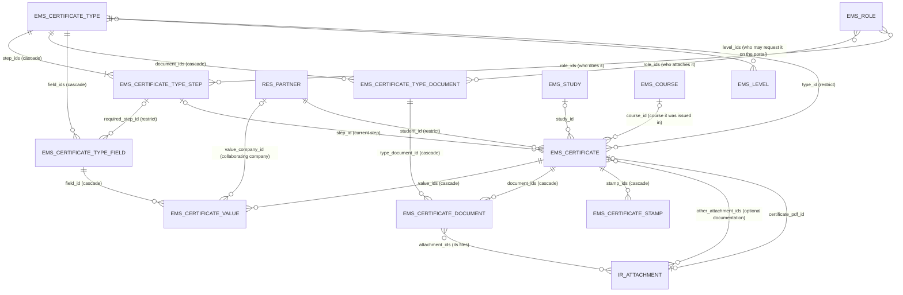
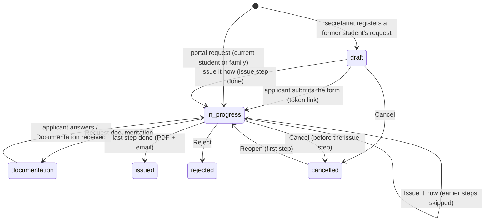

# Technical Reference: `ems.certificate`

## Overview

A **certificate request** is a student (or former student) asking the centre to certify something
about them. The centre issues it as a numbered PDF, stamped in EMS by whoever issued and approved
it. Each request belongs to a **certificate type** (`ems.certificate.type`), which defines the
**data** the certificate needs (`field_ids`), the **text** it prints (`certificate_text`) and the
**approval circuit**: an ordered list of steps, each one done by whoever
holds one of its positions of the centre (`ems.role`; one or more per step). The administrator configures the types and their
circuits from Academic management > Configuration > Certificates > Certificate types.

Nothing in the code is specific to one kind of certificate: a new type is configured entirely from
the UI (its data, its text, its documents and its circuit). EMS ships one type, **FCT** (Formació en
Centres de Treball), defined as data: it certifies that the student completed a number of hours of
workplace training at a collaborating company. Its circuit:

1. the **VET coordinator** (`ems.role_vetcoord`) completes the company's details (company, VAT
   number, period, hours, agreement registration number);
2. the **Secretary** (`ems.role_secretary`) issues it: it gets its number and the "Issued" stamp;
3. the **Director** (`ems.role_director`) approves it ("Vist i plau"): the final PDF is generated,
   with the pages of the required documents appended (FCT: the agreement), and sent to the applicant.

How a request starts:

- **Current students** (or their family, under the same rule as convalidations,
  `res.partner._ems_can_file_requests_for`) request it from the portal (`/my/certificats`) when their
  study's level is one of the type's levels.
- **Former students** have no portal (the course transition revokes it). The secretariat registers
  the request in the backend (the contact if they are in EMS; otherwise just their full name and
  email, no contact needed) and presses **Send form**. If the secretariat already wrote every
  mandatory detail, sending the form also hands the request to the first step. Either way the applicant gets an email with a link
  carrying an access token (`portal.mixin`, `/my/certificats/<id>?access_token=...`) to the same form,
  no login needed. The same link later shows how far the request has got and downloads the
  certificate.

The applicant's details common to every type (full name, identity document, study) are always
mandatory. Each datum of the type says whether the applicant is asked for it (mandatory, optional or
not asked) and, optionally, the step of the circuit that must have it filled in before it is done. FCT
asks for the school year (mandatory) and, optionally, the company, period, hours and agreement number,
since the applicant rarely has them: the VET coordinator's step requires the company, the period and
the hours.

**Why not Odoo's `fields.Properties`.** Properties (fields defined on a parent record) would store
the data, but their labels are not translatable (the portal is trilingual) and a definition only
accepts Odoo's own keys (`PropertiesDefinition.ALLOWED_KEYS`): there is nowhere to say who fills a
datum in, whether it is mandatory or by which step. So the type keeps its own definition lines
(`ems.certificate.type.field`) and the request one value line per datum (`ems.certificate.value`).

**Documentation.** A type may require documents (**Required attached documentation**, with one line
per document: e.g. FCT requires the *FCT agreement*). Each line says who may attach it: the
applicant, positions of the circuit, or - nobody ticked - anyone taking part; the administrator
always. Every required document must be attached before the issuing step, and a line with **Add to
the certificate** has its pages appended to the PDF. Besides, any request takes **Other
documentation**: optional files anyone taking part attaches, never added to the certificate.

> **Not a qualified electronic signature:** the stamps are EMS's own record of who issued and approved
> the certificate (`ems.report_validation_stamp`, as in minutes and convalidation resolutions).

**Module files:** `models/certificates/certificate.py`, `models/certificates/certificate_type.py`,
`models/certificates/certificate_wizard.py`, `models/contacts/portal.py`
(`_ems_can_file_requests_for`, `_ems_certificate_portal_visible`), `models/contacts/contact.py`
(`contact_type` `company`), `controllers/portal_certificate.py`,
`reports/certificates/report_certificate.xml`, `mails/certificates/certificate.xml`,
`data/main/ems.certificate.type.xml`, `data/main/mail.activity.type.csv`,
`data/main/res.partner.category.csv`, `data/cat/ems.role.csv` (`role_vetcoord` → `group_vet_coordinator`),
`security/groups.xml`, `security/rules/certificates.xml`, `security/ir.model.access.csv`,
`views/academic_management/certificates/`, `views/academic_management/certificate_type/`,
`views/community/contact/company.xml`, `views/portal/portal_certificates.xml`,
`tests/test_certificate.py`, `tests/test_portal_certificate.py`, `tests/test_certificate_tour.py`,
`static/tests/tours/certificate_tour.js`, `tests/test_docs_screenshots_certificates.py` (the manuals'
screenshots)

## Hierarchy and relations

### `ems.certificate.type`

| Field | Type | Notes |
|-------|------|-------|
| `name` | Char, translatable | E.g. "FCT (Formació en Centres de Treball)". |
| `field_ids` | O2m `ems.certificate.type.field` | The data the certificate needs, besides the common ones, by `sequence`. |
| `certificate_text` | Text, translatable | What the certificate says after "CERTIFIES:". `{key}` prints a datum in bold; text between `[` and `]` prints only when every datum inside has a value; a blank line starts a new paragraph. Mandatory in the form; `_check_certificate_text` refuses an unknown key or an unbalanced bracket, in every installed language. |
| `placeholder_help` | Html, computed | The keys the text may use, listed under it in the form. |
| `level_ids` | M2m `ems.level` | Levels whose current students may request it from the portal (FCT: CFGM, CFGS). Empty: never offered on the portal (the secretariat still registers it). |
| `requires_documents` | Boolean | "Required attached documentation": the `document_ids` lines are required before the issuing step (FCT: yes). Ticked with no line is refused (`_check_documents`). |
| `document_ids` | O2m `ems.certificate.type.document` | The required documents, by `sequence`. |
| `step_ids` | O2m `ems.certificate.type.step` | The approval circuit, by `sequence`. |
| `active` | Boolean | Archived types are no longer offered. |

### `ems.certificate.type.document`

| Field | Type | Notes |
|-------|------|-------|
| `sequence`, `name` | Integer, Char (translatable) | Order and the document's name ("FCT agreement"). |
| `applicant_uploads` | Boolean | The applicant may attach it (portal or form link). |
| `role_ids` | M2m `ems.role` | Positions whose holders may attach it (the type form offers the circuit's). Neither the applicant nor a position ticked: anyone taking part. |
| `append_to_certificate` | Boolean | Its pages are appended to the PDF. |

Seeded in `data/main/ems.certificate.type.xml` with `noupdate="1"`: the centre configures the circuit
from the UI and no upgrade reverts it.

### `ems.certificate.type.field` (a datum of the type)

| Field | Type | Notes |
|-------|------|-------|
| `sequence`, `name`, `help` | Integer, Char (translatable), Char (translatable) | Order, label and the hint (what to write and how, with an example) the applicant reads under it and the staff next to it in the request. |
| `key` | Char | What the text writes between braces: lowercase letters, digits and `_`, unique in the type (`_sql_constraints`), never one of the common ones (`name`, `document`, `study`) nor ending in `_vat`. Renaming it rewrites `{old}` (and `{old_vat}` for a company) in the type's text in every language at once (`write()` → `_ems_rename_text_key`, through `update_field_translations`), so the text check, which reads every language, does not refuse a key renamed from a form in another language. |
| `field_type` | Selection | `char` (short text), `text` (long text), `number` (a number with decimals, never negative; shown without trailing zeros and with the language's decimal separator), `date`, `boolean` (yes/no), `school_year` (short text written as `2024-25` or `2024-2025`, consecutive years, stored as `2024-25`; the portal suggests the courses EMS has) and `company` (a collaborating company: the applicant writes its name and VAT number as text, the centre links the contact; the text prints `{key}` and `{key_vat}`). |
| `applicant_input` | Selection | `required`, `optional` or `none` (only the centre fills it in). |
| `after_field_id` | M2o `ems.certificate.type.field` (set null) | A date only: another date of the same type it cannot be earlier than (FCT: `end` not before `start`). `copy()` points it at the copy's own date. |
| `required_step_id` | M2o `ems.certificate.type.step` (restrict) | The step that must have it filled in before it is done (and so every later step, and *Issue it now*). Empty: never required by the circuit. A `company` datum required by a step needs the contact linked, not just the text written. |

### `ems.certificate.type.step`

| Field | Type | Notes |
|-------|------|-------|
| `sequence`, `name` | Integer, Char (translatable) | Order and label ("Complete the company's details"). |
| `role_ids` | M2m `ems.role`, at least one (`_check_roles`) | Whose step it is: the holders of any of them get the task and may act (`_ems_users()`); the first to do it closes everybody's task. The administrator may always act too. EMS seeds FCT's completing step with the VET coordinator and the secretary technicians (`ems.role_secretary_technician`, a catalog position that brings `ems.group_secretary`), so the secretariat's staff get the task without holding the Secretary's post. |
| `action` | Selection | `complete` ("Complete the data": fills in data, moves on), `issue` ("Issue the certificate": number + "Issued" stamp), `approve` ("Approve": "Approved" stamp). The labels are full phrases on purpose: a bare "Issue" or "Complete" would take another screen's translation ("Incident"). |

Constraints (`_check_steps` on the type): at least one step, exactly one `issue` step, and every
`approve` step after it. The last step finishes the request: the PDF is generated and sent.

### `ems.certificate` (request)

| Field | Type | Notes |
|-------|------|-------|
| `name` | Char | `CERT-<start>-<end, two digits>-<4-digit counter>` (e.g. `CERT-2026-27-0001`), assigned by the `issue` step (`ems.base.next_course_number`, code `ems.certificate.course.<id>`), in the course current on that day (`course_id`). Empty before: a cancelled or rejected request uses no number. |
| `type_id` | M2o | Only changes in draft: the request's value and document lines follow it. |
| `state` | Selection | `draft` (waiting for the applicant's form, former students only), `in_progress`, `documentation` (waiting for the applicant), `issued`, `rejected`, `cancelled`. Written by the actions only (`write()` refuses it outside `sudo`). |
| `step_id` | M2o `ems.certificate.type.step` | The current step while `in_progress`/`documentation`. |
| `student_id`, `requester_id` | M2o `res.partner` | The student (or former student) in EMS, and who filed it on the portal. `student_id` takes a current student, an alumnus, a withdrawal or an expelled student; the form's dropdown runs with `active_test=False`, since the last three are archived. Optional: a former student who is not in EMS is opened with only their full name (`student_name`) and email (`_check_applicant`), and fills in the rest in the form. |
| `origin` | Selection | `portal` or `secretariat`. |
| `applicant_email` | Char | Where a former student's form link, requests for documentation and the certificate go. Choosing the student fills it with their personal `email`, or leaves it empty when that is still a legacy corporate address (`_ems_student_defaults`). Portal requests use `student_id._ems_informed_recipients()`. |
| `student_name`, `student_document`, `study_id` | Char, Char, M2o | The applicant's details common to every type, mandatory on submission. Prefilled from the contact when known. `study_id` must belong to one of the type's levels (`_check_study_level`; the form and the portal only offer those). |
| `value_ids` | O2m `ems.certificate.value` | One line per datum of the type, created with the request (`_ems_sync_values`, again when the type changes in draft or a datum is added to a type with open requests). |
| `document_ids` | O2m `ems.certificate.document` | One line per required document of the type, created with the request (`_ems_sync_documents`, again if the type changes while in draft). Each must have files before the `issue` step. |
| `other_attachment_ids` | M2m `ir.attachment` | Optional documentation, anyone taking part. Never appended. |
| `stamp_ids` | O2m `ems.certificate.stamp` | One per finished step: step, action, user, date. The PDF prints those of `issue` and `approve` steps. |
| `certificate_pdf_id` | M2o `ir.attachment` | The final PDF. |
| `applicant_form_open` | Boolean | The applicant may still edit their form from the link: set when the form is sent or the portal request filed, cleared as soon as someone of the centre writes the request (or one of its documents) or acts on it (step done, return, request documentation, reject, cancel). `_ems_portal_can_edit()`: in draft, or in progress with this flag. While open, the portal shows the form with **Save changes** (`_ems_portal_fill` updates and leaves a note). |
| `info_request`, `return_reason`, `reject_reason`, `cancel_reason` | Text | Last request for documentation, the last return to the previous step, why it was rejected or cancelled. |
| `step_user_ids` | M2m `res.users`, computed, searchable | Holders of any of the current step's positions. `is_pending_for_me` (searchable) = the current user is one of them, or is the administrator and the request is in progress. `can_act` = may press the step's button. `can_manage` = may reject, cancel or mark the documentation received: the secretariat (and the administrator) or a holder of the current step. `can_issue_now` = may issue it right away (`action_issue_now`): a holder of one of the `issue` step's positions, or the administrator, while the request is in draft or before that step. The form only offers each button to whoever can use it. |

### `ems.certificate.value` (a datum of a request)

| Field | Type | Notes |
|-------|------|-------|
| `field_id` | M2o `ems.certificate.type.field` (cascade) | Label, type, order and who fills it in come from it. |
| `value_char`, `value_text`, `value_number`, `value_date`, `value_boolean` | | The value, in the column of its type (`VALUE_COLUMNS`). |
| `value_company_id`, `value_char`, `value_vat` | M2o `res.partner`, Char, Char | A `company` datum: the contact, and the name and VAT number the applicant wrote (the form never creates contacts). **Create company** (`action_create_company`) creates one from them, or links the one with that VAT number. |
| `hint` | Char, related | `field_id.help`. |
| `display_value` | Char, computed | The value as the portal, the request's form and the certificate show it (dates in the reader's language). |
| `is_pending` | Boolean, computed | Required by now (by the applicant, or by the current or an earlier step) and still empty: the form marks it. |

`write()` follows the request: refused once it is closed, and it closes the applicant's form, as
writing the request itself does. It also stores a school year as `2024-25`.

**Validation (issue #858).** `ems.certificate.value._ems_detail_errors()` is the one check for the
backend and the portal: a school year that is not one, and a date earlier than its `after_field_id`.
The backend runs it as a constraint on the lines (`_check_values` → `ems.certificate._ems_check_details`)
and again before any step (`_ems_check_step_data`), for a value written before the check existed;
the portal runs it on the submitted form, merged with what the request already holds
(`_ems_portal_detail_errors`), and sends the applicant back with `error=invalid` instead of writing
it. The portal's school-year input also carries an HTML `pattern`.

**The form's tab.** The *Certificate details* tab is a read-only list (detail, hint, value); a click
opens a dialog with only the input of the line's data type (and, for a company, the name and VAT
number written by the applicant plus *Create company*). Not an inline editable list: a list column
holds one field, so every data type would need its own column, mostly empty, or a custom widget.

### `ems.certificate.document` (a required document of a request)

| Field | Type | Notes |
|-------|------|-------|
| `type_document_id` | M2o `ems.certificate.type.document` | Name, order, who attaches it and whether it is appended come from it. |
| `attachment_ids` | M2m `ir.attachment` | Its files (PDF or images), tied to the line by `ems.attachment_link_mixin`, so they follow the request's access rights. |
| `uploaders`, `is_attached`, `can_upload` | computed | Who attaches it ("Anyone", or the applicant and positions); whether it has files; whether the current user may attach them (administrator, anyone-line, or holder of one of its positions, while the request is open). `write()` only accepts `attachment_ids`, and only from who `can_upload`. |

On the portal, the applicant gets one file input per required document they may attach
(`document_<ems.certificate.type.document id>`) and one for other documentation (`documents`);
`_ems_portal_attach` ignores a document the applicant may not attach.

## CRUD flow

- `action_done_step()`: checks the step's data (`_ems_check_step_data`), records the stamp, assigns
  the number on `issue`, and moves to the next step (task to the holders of its positions) or finishes.
- `action_issue_now()`: whoever holds one of the `issue` step's positions (or the administrator,
  `can_issue_now`) issues the certificate while the request is still in draft or on an earlier
  step, when they already have every detail. It runs the issuing step's checks first
  (`_ems_check_step_data(action='issue')`: applicant, data required up to the issuing step, required documents), so
  nothing moves while something mandatory is missing; then it closes the earlier steps' tasks,
  posts a note naming the skipped steps and their skipper, puts the request on the `issue` step and
  calls `action_done_step()`. A skipped `complete` step leaves no stamp (it is never printed
  anyway); approvals after the issue step are never skipped.
- Every step change closes the previous task and schedules the next one quietly
  (`mail_activity_quick_update`): the holders find it in their daily summary.
- `ems.certificate.wizard` (`mode`: `info`, `return`, `reject`, `cancel`) asks for the text and runs
  the matching method.
- The PDF (`ems.report_certificate`, in the centre language, `CENTRE_LANG_REPORTS`) is one page: a
  header band in the company's colour (as minutes' headings) with the number, the text with wider
  side margins than the letterhead, and the signature boxes anchored at the foot of the page. It prints its
  paragraphs from `_ems_report_paragraphs()`: the issuer's sentence and "CERTIFIES:" (common), the
  type's `certificate_text` in the centre language with every `{key}` replaced and escaped
  (`_ems_render_text`), and the closing sentence and the place and date (common). The type's text is
  one translatable value per language, so each language keeps its own word order. The files of the required
  documents marked *Add to the certificate* are appended by `_ems_generate_pdf()` with `odoo.tools.pdf.merge_pdf`, an image becoming one page
  (Pillow).

### Emails

The four emails (`mails/certificates/certificate.xml`: the form for a former student, a request for
documentation, the certificate issued, the request rejected) use the card layout of EMS emails, as
the Google account ones (`ems.mail_layout_certificate`, built on `ems.mail_layout_card` in
`views/shared/mail_layout/card.xml`). Its button opens the request with its access token and says
what to do there by the request's state: fill in the form, answer the centre, download the
certificate, or see the request.

## Performance

Measured on a synthetic fixture of 300 requests (rolled back), as a holder of the VET coordinator
position: list *Pending for me* (80 rows) 24 ms / 16 queries cold, 14 ms / 4 warm; list without
filter 14 ms / 6 cold; form read 18 ms / 23 cold, 1 ms warm; the documentation lines' `can_upload`
14 ms / 15 cold. A centre issues FCT certificates in the order of tens to a few hundred a year.

- The list (filter *Pending for me*): one query on `ems_role` (the user's positions) and one search
  of `ems_certificate` by `state` (indexed) and `step_id`; then `step_user_ids` reads the holders
  once per distinct step on the page (three at most for FCT), not once per row.
- The record rule for staff joins `ems_certificate_type` → steps → positions → employees: a few
  rows each, whatever the number of requests.
- The portal page: one search by `student_id` (indexed).
- Generating the PDF happens once per certificate; its memory is bounded by the appended documents'
  files (a few MB), merged in memory once.
- The certificate's data: a type has a handful of details, so a request a handful of value lines.
  Measured on this box (FCT, six details): the form's read of a request with its details, cold, 2.5 ms
  / 4 queries (0.2 ms / 0 warm); rendering the certificate text 2.4 ms / 5 queries cold. Adding a
  detail to a type searches its open requests once (by `type_id` and the indexed `state`) to give
  them the new line.
- The documentation tab: a type requires a handful of documents; `can_upload` reads each position's
  holders once per request page (memoized per role), not once per line.

### Permission audit (2026-11-17)

Every role of `ROLE_GROUP_XMLIDS`, in a rolled-back `odoo shell` transaction: menus Certificates,
Certificate types and Collaborating companies, ACL, readable records and what the views offer. 0
mismatches: the Certificates menu shows to the administrator, the secretariat, the Director and the
VET coordinator (Academic management shows to the VET coordinator for it, and nothing else of that
menu); the types to the administrator only; the companies to the administrator, the secretariat,
Heads of Studies and the VET coordinator. The data lines (`ems.certificate.type.field`,
`ems.certificate.value`) follow the same ACL and record rules as the documents. A user given the VET coordinator group without holding the
position reads no request: the group comes from the position, and the record rule reads its holders.

## Access control

| Role | `ems.certificate` | Types and steps | Notes |
|------|-------------------|-----------------|-------|
| Administrator (`group_academic_admin`) | rwcu | rwcu | May act on any step. |
| Secretariat (`group_secretary`) | rwc, every request | r | Registers former students' requests, sends the form, follows every request up. Acts on the steps of the roles it holds, and, holding the `issue` step's, may issue a request right away, skipping the steps before it (`action_issue_now`). |
| Director (`group_director`) | rw, every request | r | Acts on the `approve` step (role holder). |
| VET coordinator (`group_vet_coordinator`, given by `role_vetcoord`) | rw, requests of types with a step of a role they hold | r | Acts on the `complete` step. |
| Any teacher (`group_teacher`) | rw, same rule | r | A role holder of a step without the menu (any role an administrator puts in a circuit) reaches it from the task. |
| Portal | none (controller with `sudo`) | none | Only the student's own requests (`get_portal_student`), or the one the token opens. |

## Collaborating companies

`res.partner.contact_type` gains `company` ("Collaborating company"), with its category
(`ems.partner_category_company`) and the menu Educational Community > Collaborating companies. It
behaves as a provider contact (company fields, VAT, addresses, child contacts such as the company
tutor) but is a separate list, so suppliers and training companies never mix.
