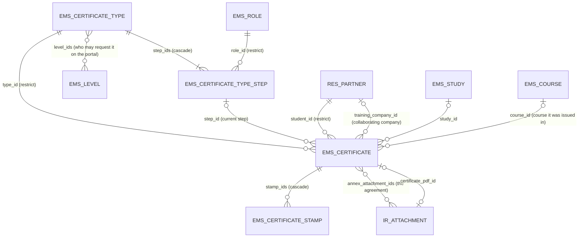
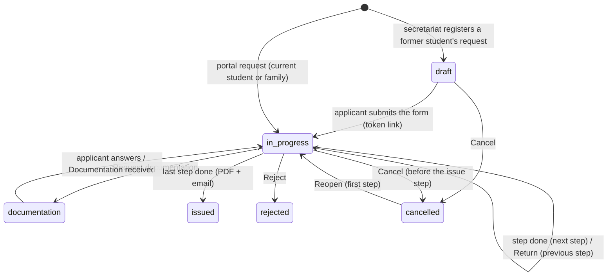

# Technical Reference: `ems.certificate`

## Overview

A **certificate request** is a student (or former student) asking the centre to certify something
about them. The centre issues it as a numbered PDF, stamped in EMS by whoever issued and approved
it. Each request belongs to a **certificate type** (`ems.certificate.type`), which defines what the
certificate says and the **approval circuit**: an ordered list of steps, each one done by whoever
holds a position of the centre (`ems.role`). The administrator configures the types and their
circuits from Academic management > Configuration > Certificates > Certificate types.

EMS ships one type, **FCT** (Formació en Centres de Treball): it certifies that the student completed
a number of hours of workplace training at a collaborating company. Its circuit:

1. the **VET coordinator** (`ems.role_vetcoord`) completes the company's details (company, VAT
   number, period, hours, agreement registration number);
2. the **Secretary** (`ems.role_secretary`) issues it: it gets its number and the "Issued" stamp;
3. the **Director** (`ems.role_director`) approves it ("Vist i plau"): the final PDF is generated,
   with the agreement's pages appended, and sent to the applicant.

How a request starts:

- **Current students** (or their family, under the same rule as convalidations,
  `res.partner._ems_can_file_requests_for`) request it from the portal (`/my/certificats`) when their
  study's level is one of the type's levels.
- **Former students** have no portal (the course transition revokes it). The secretariat registers
  the request in the backend and presses **Send form**: the applicant gets an email with a link
  carrying an access token (`portal.mixin`, `/my/certificats/<id>?access_token=...`) to the same form,
  no login needed. The same link later shows how far the request has got and downloads the
  certificate.

The applicant's details (name, identity document, study, school year of the FCT) are mandatory; the
company's (name, VAT number, period, hours, agreement number and the agreement file) are optional,
since the applicant rarely has them: the VET coordinator completes them.

> **Not a qualified electronic signature:** the stamps are EMS's own record of who issued and approved
> the certificate (`ems.report_validation_stamp`, as in minutes and convalidation resolutions).

**Module files:** `models/certificates/certificate.py`, `models/certificates/certificate_type.py`,
`models/certificates/certificate_wizard.py`, `models/contacts/portal.py`
(`_ems_can_file_requests_for`, `_ems_certificate_portal_visible`), `models/contacts/contact.py`
(`contact_type` `company`), `controllers/portal_certificate.py`,
`reports/certificates/report_certificate.xml`, `mails/certificates/certificate.xml`,
`data/main/ems.certificate.type.xml`, `data/main/mail.activity.type.csv`,
`data/main/res.partner.category.csv`, `data/cat/ems.role.csv` (`role_vetcoord` → `group_vet_coordinator`),
`security/groups.xml`, `security/rules/certificates.xml`, `security/ir.model.access.csv`,
`views/academic_management/certificates/`, `views/academic_management/certificate_type/`,
`views/community/contact/company.xml`, `views/portal/portal_certificates.xml`,
`tests/test_certificate.py`, `tests/test_portal_certificate.py`, `tests/test_certificate_tour.py`,
`static/tests/tours/certificate_tour.js`

## Hierarchy and relations

### `ems.certificate.type`

| Field | Type | Notes |
|-------|------|-------|
| `name` | Char, translatable | E.g. "FCT (Formació en Centres de Treball)". |
| `kind` | Selection | What the certificate says and which data it needs: only `fct` for now. Each kind has its own report body and form fields. |
| `level_ids` | M2m `ems.level` | Levels whose current students may request it from the portal (FCT: CFGM, CFGS). Empty: never offered on the portal (the secretariat still registers it). |
| `requires_annex` | Boolean | The agreement file must be attached before the issuing step (FCT: yes). |
| `step_ids` | O2m `ems.certificate.type.step` | The approval circuit, by `sequence`. |
| `active` | Boolean | Archived types are no longer offered. |

Seeded in `data/main/ems.certificate.type.xml` with `noupdate="1"`: the centre configures the circuit
from the UI and no upgrade reverts it.

### `ems.certificate.type.step`

| Field | Type | Notes |
|-------|------|-------|
| `sequence`, `name` | Integer, Char (translatable) | Order and label ("Complete the company's details"). |
| `role_id` | M2o `ems.role` | Whose step it is: its holders get the task and may act. The administrator may always act too. |
| `action` | Selection | `complete` (fills in data, moves on), `issue` (number + "Issued" stamp), `approve` ("Approved" stamp). |

Constraints (`_check_steps` on the type): at least one step, exactly one `issue` step, and every
`approve` step after it. The last step finishes the request: the PDF is generated and sent.

### `ems.certificate` (request)

| Field | Type | Notes |
|-------|------|-------|
| `name` | Char | `CERT-<start>-<end, two digits>-<4-digit counter>` (e.g. `CERT-2026-27-0001`), assigned by the `issue` step (`ems.base.next_course_number`, code `ems.certificate.course.<id>`), in the course current on that day (`course_id`). Empty before: a cancelled or rejected request uses no number. |
| `type_id`, `kind` | M2o, related | |
| `state` | Selection | `draft` (waiting for the applicant's form, former students only), `in_progress`, `documentation` (waiting for the applicant), `issued`, `rejected`, `cancelled`. Written by the actions only (`write()` refuses it outside `sudo`). |
| `step_id` | M2o `ems.certificate.type.step` | The current step while `in_progress`/`documentation`. |
| `student_id`, `requester_id` | M2o `res.partner` | The student (or former student) and who filed it on the portal. |
| `origin` | Selection | `portal` or `secretariat`. |
| `applicant_email` | Char | Where a former student's form link, requests for documentation and the certificate go. Portal requests use `student_id._ems_informed_recipients()`. |
| `student_name`, `student_document`, `study_id`, `fct_school_year` | Char, Char, M2o, Char | The applicant's details, mandatory on submission. Prefilled from the contact when known. |
| `training_company_id` | M2o `res.partner` | Collaborating company (`contact_type = 'company'`). Required by the `complete` step and after. |
| `company_name`, `company_vat` | Char | What the applicant wrote, kept as text: the form never creates contacts. **Create company** (`action_create_company`) creates one from them. |
| `period_start`, `period_end`, `hours`, `agreement_reference` | Date, Date, Integer, Char | The workplace training; the first three required by the `complete` step. |
| `annex_attachment_ids` | M2m `ir.attachment` | The agreement (PDF or images). Required by the `issue` step when the type `requires_annex`. Appended to the certificate's PDF (images become pages). |
| `stamp_ids` | O2m `ems.certificate.stamp` | One per finished step: step, action, user, date. The PDF prints those of `issue` and `approve` steps. |
| `certificate_pdf_id` | M2o `ir.attachment` | The final PDF. |
| `info_request`, `return_reason`, `reject_reason`, `cancel_reason` | Text | Last request for documentation, the last return to the previous step, why it was rejected or cancelled. |
| `step_user_ids` | M2m `res.users`, computed, searchable | Holders of the current step's role. `is_pending_for_me` (searchable) = the current user is one of them, or is the administrator and the request is in progress. `can_act` = may press the step's button. `can_manage` = may reject, cancel or mark the documentation received: the secretariat (and the administrator) or a holder of the current step. The form only offers each button to whoever can use it. |

## CRUD flow

- `action_done_step()`: checks the step's data (`_ems_check_step_data`), records the stamp, assigns
  the number on `issue`, and moves to the next step (task to its role holders) or finishes.
- Every step change closes the previous task and schedules the next one quietly
  (`mail_activity_quick_update`): the holders find it in their daily summary.
- `ems.certificate.wizard` (`mode`: `info`, `return`, `reject`, `cancel`) asks for the text and runs
  the matching method.
- The PDF (`ems.report_certificate`, in the centre language, `CENTRE_LANG_REPORTS`) prints its
  sentences from `_ems_report_paragraphs()`: each one a single translatable string with named
  placeholders, so Catalan and Spanish keep their own word order (a sentence written in QWeb around
  `t-esc` nodes is split into fragments that can't be translated well). The agreement's files are
  appended by `_ems_generate_pdf()` with `odoo.tools.pdf.merge_pdf`, an image becoming one page
  (Pillow).

## Performance

Measured on nothing: no certificate exists on this box yet, so this is the cost analysis. A
centre issues FCT certificates in the order of tens to a few hundred a year.

- The list (filter *Pending for me*): one query on `ems_role` (the user's positions) and one search
  of `ems_certificate` by `state` (indexed) and `step_id`; then `step_user_ids` reads the holders
  once per distinct position on the page (three at most for FCT), not once per row.
- The record rule for staff joins `ems_certificate_type` → steps → positions → employees: a few
  rows each, whatever the number of requests.
- The portal page: one search by `student_id` (indexed).
- Generating the PDF happens once per certificate; its memory is bounded by the agreement's files
  (a few MB), merged in memory once.

## Access control

| Role | `ems.certificate` | Types and steps | Notes |
|------|-------------------|-----------------|-------|
| Administrator (`group_academic_admin`) | rwcu | rwcu | May act on any step. |
| Secretariat (`group_secretary`) | rwc, every request | r | Registers former students' requests, sends the form, follows every request up. Acts on the steps of the roles it holds. |
| Director (`group_director`) | rw, every request | r | Acts on the `approve` step (role holder). |
| VET coordinator (`group_vet_coordinator`, given by `role_vetcoord`) | rw, requests of types with a step of a role they hold | r | Acts on the `complete` step. |
| Any teacher (`group_teacher`) | rw, same rule | r | A role holder of a step without the menu (any role an administrator puts in a circuit) reaches it from the task. |
| Portal | none (controller with `sudo`) | none | Only the student's own requests (`get_portal_student`), or the one the token opens. |

## Collaborating companies

`res.partner.contact_type` gains `company` ("Collaborating company"), with its category
(`ems.partner_category_company`) and the menu Educational Community > Collaborating companies. It
behaves as a provider contact (company fields, VAT, addresses, child contacts such as the company
tutor) but is a separate list, so suppliers and training companies never mix.
