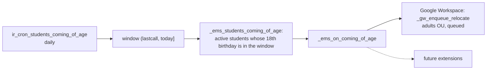

# Students coming of age

`models/contacts/coming_of_age.py` (`ResPartnerComingOfAge`, issue #690). One daily check finds
the students who just turned 18 and calls a hook on them, so every feature that has to *do*
something that day plugs into the same place instead of growing its own cron.

## Live checks vs. actions on the day

Most of EMS needs nothing from this: it reads `is_adult` (`res.partner`, computed from
`birth_date` against the company's today, never stored) at the moment it runs, so it follows
the birthday on its own:

| Reads `is_adult` when it runs | Where |
|---|---|
| Who gets attendance, coexistence and notice emails (the family while a minor or with `auth_share`) | `attendance_session.py`, `strike.py`, `notice.py`, `portal.py` (`_ems_notification_recipients`) |
| Who acts for the student on the portal, who files requests | `portal.py` (`_ems_portal_can_act_for` and neighbours) |
| Contact data request: what is required, who receives it | `contact_data_request.py` |
| Convalidation resolution and authorization recipients | `convalidation.py`, `authorization_send_wizard.py` |

What the hook is for is state kept somewhere else, or a one-off action that has to happen that
day: the Google account's OU (already wired), and later things such as telling the student and
the family what changes, or asking the student for the authorization to share with the family.

## Flow



- `_ems_cron_coming_of_age()` takes the window from `lastcall`, the previous successful run
  Odoo passes to every cron job in the context (`ir.cron.lastcall`'s own help says so): a failed
  or skipped run widens the next window instead of leaving a student behind, and a second run on
  the same day finds nobody. Without it (the cron's first run, a call from code) only today's
  birthdays count.
- `_ems_students_coming_of_age(since, today)` is one search: active `contact_type = 'student'`,
  `birth_date` in `(since - 18 years, today - 18 years]` (`relativedelta`, so a 29 February
  birthday falls on 1 March in a non-leap year, the same day `is_adult` flips). A few
  milliseconds on the centre's data.
- `_ems_on_coming_of_age()` does nothing in the base. `ADULT_AGE` is shared with
  `_compute_is_adult` so the two can never disagree.

## Adding an action

Extend the hook on `res.partner` and call `super()`:

```python
def _ems_on_coming_of_age(self):
    super()._ems_on_coming_of_age()
    self.filtered(...)._my_feature_action()  # filter out whoever it does not apply to
```

- The base lives in a file imported right after `contact.py` (`models/contacts/__init__.py`), so
  every extension sits above it in the MRO and reaches it through `super()`. An extension in
  another module folder loads after it anyway.
- The hook runs inside the cron's transaction as `base.user_root`: anything slow or calling an
  external service should be enqueued (`with_delay`), as the Google relocation is.
- It receives each student once. An action that must not repeat (an email) can rely on that;
  one that can be retried safely (Google's OU patch) does not need to.

## Tests

`tests/test_coming_of_age.py` (`TestComingOfAge`): today's birthdays (minors, archived students
and non-students left out), the catch-up after missed runs and the no-repeat window. They patch
the hook, so no feature's action runs on the development data the test shards clone. Each
extension tests its own part: `test_coming_of_age_relocates_the_account` in
`tests/test_student_google_workspace.py`.
