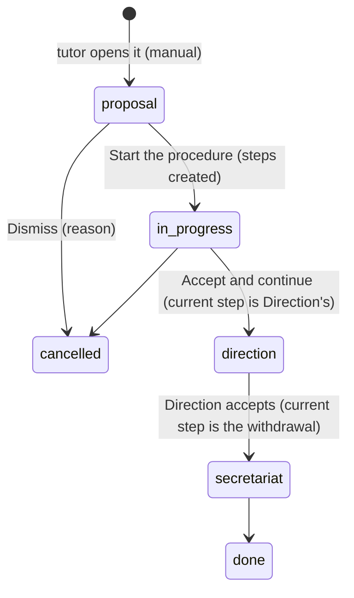

# Ex officio withdrawal (baixa d'ofici)

Issue #726. A student who stops coming to the centre loses their place after a term set by the
regulation (Resolució EDF/293/2026, point 8.6) and the centre's communication plan (*Pla de
comunicació*, table "Baixes d'alumnat"). EMS keeps one **case file** per student that walks every
step of that protocol, with who did it and when.

Implemented in phases (see the issue). This page describes what exists now.

## Circuits

The circuit a student follows comes from their level: `ems.level.withdrawal_circuit`
(`compulsory` / `post_compulsory` / empty), seeded in `data/cat/ems.level.csv`.

| Level | Circuit |
|---|---|
| CFGB, ESO | Compulsory |
| CFGM, CFGS, EFPS, PFI, BTX | Post-compulsory |

A level without a circuit gets no case files.

## Steps and deadlines

The steps are a catalog in code (`STEP_CATALOG`, `models/contacts/ex_officio_withdrawal.py`), one
tuple per circuit, created when the procedure starts. Every deadline counts from the first day of
absence (D0) and is computed in one place, `ems.ex_officio_withdrawal._ems_due_date()`:

- **School days** (post-compulsory, as Direction decided: never less margin than the regulation's
  15 days): the N-th school day of absence, D0 included. A school day is Monday to Friday and not
  covered by a public holiday or school break (`resource.calendar.leaves` with no resource, read in
  one search by `resource.calendar.leaves._ems_holiday_dates()`).
- **Calendar days and months** (compulsory): D0 plus the offset (`relativedelta`).

Example: D0 = Tuesday 15 December 2026 with the Christmas break from 21 December to 7 January: the
15th school day is 22 January 2027.

**Post-compulsory**

| Step | Responsible | Deadline | Off-EMS checks |
|---|---|---|---|
| Contact with the family | Tutor | 5 school days | Phone call |
| Ex officio withdrawal warning | Secretariat | 10 school days | eNotum |
| Green light from Direction | Direction | 15 school days | - |
| Withdrawal | Secretariat | 15 school days | Esfera, SAGA, eNotum |

**Compulsory**

| Step | Responsible | Deadline | Off-EMS checks |
|---|---|---|---|
| Contact with the family | Tutor | 7 days | Phone call |
| Contact by Coexistence | COCOBE / management team | 15 days | Phone call |
| Notice to the family | Secretariat | 1 month | - |
| Notice to Social Services | COCOBE / management team | 1 month | External email sent |
| Ex officio withdrawal warning | Secretariat | 1.5 months | eNotum |
| Direction approval | Direction | 2 months | External email sent (Inspection) |
| Withdrawal | Secretariat | 2 months | Esfera |

## Case file

The state follows the current step (the first one not done, `current_step_id`): `direction` while
it is Direction's green light, `secretariat` while it is the withdrawal, `in_progress` otherwise
(`STATE_BY_STEP`, `_ems_move_on()`). `secretariat` → `done` and the cancellations during the
circuit come with the next phases.

- `ems.ex_officio_withdrawal`: registration number `BO-<course start>-<end>-NNNN` (one
  `ir.sequence` per course, `ems.base.next_course_number()`, shared with convalidations), student,
  group, level and circuit (taken from the student's main group when created), tutor (the
  student's current one), first day of absence, origin (`manual` / `detected`), state, cancel
  reason and note. One open case file per student (`_check_one_open_per_student`).
- `ems.ex_officio_withdrawal.step`: step code, responsible, due date, off-EMS checks (only the
  ones the step asks for are shown: `needs_*`), notes, done by / on.
- The state and the student never change by plain write: only through the buttons, which write
  with `sudo()` after checking who acts. A step only lets its own checks and notes be written, and
  only by whoever may do it while it is the current one (`ems.ex_officio_withdrawal.step.write()`).

## Advancing and tasks

- **Accept and continue** (`action_accept_step`) closes the current step: never before its due date
  (the company's today, `get_local_today()`), and only with every check it asks for ticked. It
  records who and when, logs the step (and its notes) in the chatter, closes the pending tasks and
  hands over to the next step. Nothing advances on its own.
- The withdrawal step is not done with this button: it is made from the student's withdrawal
  wizard (phase 4).
- **Tasks** (`mail.activity`, so they show in *My tasks* and in the daily summary):
  - *Decide ex officio withdrawal proposal* (`ems.mail_activity_ex_officio_withdrawal_proposal`)
    for the tutor, from the moment the case file is created until it is started or dismissed.
  - *Ex officio withdrawal step* (`ems.mail_activity_ex_officio_withdrawal_step`) for the current
    step's responsible, due on the step's date. It is scheduled **on that date**, not when the
    previous step is accepted, since the step can't be done earlier and the daily summary lists
    every pending task: the hourly cron `_cron_ems_due_step_tasks()` (one search on the steps not
    done, not yet scheduled and due) and `_ems_move_on()` after every start or acceptance.
    `task_scheduled` on the step keeps it from being scheduled twice.
  - The summary (step and student) is written in each recipient's language. Scheduled with
    `mail_activity_quick_update`: the task is the notice, no "assigned you an activity" email.
- **Who gets each task** (`_ems_responsible_users()`, positions of the centre, so not in Task
  Assignment, the same choice as convalidations):

| Responsible | Task goes to |
|---|---|
| Tutor | The student's tutor |
| Coexistence | The Coexistence coordinator (`ems.role_coexistence`) under the tutor's Head or Deputy Head of Studies (`hr.employee._ems_coexistence_coordinators()`, shared with strikes); every coordinator when none is |
| Secretariat | The whole secretariat, the administrators left out (`ems.base.secretariat_task_users()`, shared with convalidations) |
| Direction | The Director (`ems.role_director`, `ems.base.role_task_users()`) |

- **Who may do each step** (`can_accept_step`, non-stored, `depends_context('uid')`, checked again
  on the server by `_ems_user_acts_as()`): the administrators always; the tutor's steps, the tutor
  scope and the Head of Studies (the Director included); Coexistence's steps, the coordinators
  who get the task and the Head of Studies; the Secretariat's, `ems.group_secretary`;
  Direction's, `ems.group_director`.

## Access

| Role | Sees | Does |
|---|---|---|
| Tutor (and the chain above them: `tutor_scope_user_ids`) | Their students' case files | Opens one, starts or dismisses it |
| Coexistence (COCOBE), Guidance | All | Read; the Coexistence coordinator does its steps |
| Head of Studies / Deputy, Director | All | Open, start, dismiss; the tutor's and Coexistence's steps; the Director, Direction's |
| Secretariat | All | Its steps |
| Academic administrator | All | Everything, deletion included |
| Other teachers | None | - |

Record rules: `security/rules/ex_officio_withdrawal.xml` (tutor scope for `ems.group_tutor`,
everything for `ems.group_student_data_reader`, `ems.group_secretary` and
`ems.group_academic_admin`). Who may start or dismiss a proposal: `can_decide_proposal`
(non-stored, `depends_context('uid')`), checked again on the server.

## Screens

- *Academic management > Ex officio withdrawals*: list (open ones by default), form with the
  Actions dropdown (Start the procedure, Dismiss, Accept and continue) and the steps, the current
  one in bold and editable (its checks and notes) by whoever may do it.
- Student form: smart button with the student's case files.
- Level form: the circuit.
