# Ex officio withdrawal (baixa d'ofici)

Issue #726. A student who stops coming to the centre loses their place after a term set by the
regulation (Resolució EDF/293/2026, point 8.6) and the centre's communication plan (*Pla de
comunicació*, table "Baixes d'alumnat"). EMS keeps one **case file** per student that walks every
step of that protocol, with who did it and when.

Implemented in phases (see the issue). This page describes what exists now.

## Circuits

Every level says which educational stage it belongs to, as the regulation sets it:
`ems.level.education_stage` (`compulsory` / `post_compulsory`), part of EMS's catalog
(`data/cat/ems.level.csv`, re-applied on every upgrade) and read-only on the level's form. EMS
decides with it what applies to the level's students; for this protocol, the case file picks its
circuit from the stage of the level the student is enrolled in (`CIRCUIT_BY_STAGE`,
`_ems_circuit_for_level()`, the student's main group: its study's level, or the group's own), and
keeps it (`circuit`) for the rest of the procedure.

| Level | Educational stage, circuit |
|---|---|
| CFGB, ESO | Compulsory |
| CFGM, CFGS, EFPS, PFI, BTX | Post-compulsory |

A level with no stage gets no case files.

## Steps and deadlines

The steps are a catalog in code (`STEP_CATALOG`, `models/contacts/ex_officio_withdrawal.py`), one
tuple per circuit, created when the procedure starts. Every deadline counts from the first day of
absence (D0) and is computed in one place, `ems.ex_officio_withdrawal._ems_due_date()`:

- **School days** (post-compulsory, as Direction decided: never less margin than the regulation's
  15 days): the N-th school day of absence, D0 included. A school day is Monday to Friday and not
  covered by a public holiday or school break (`resource.calendar.leaves` with no resource, read in
  one search by `resource.calendar.leaves._ems_holiday_dates()`).
- **Calendar days and months** (compulsory): D0 plus the offset (`relativedelta`).

Example: D0 = Tuesday 15 December 2026 with the Christmas break from 21 December to 7 January: the
15th school day is 22 January 2027.

**The protocol's waits are always kept.** Those are the protocol's days (`planned_date`). A step
accepted later than its day moves the pending ones (`_ems_shift_pending_steps()`, called by *Accept
and continue*): each pending step is due (`due_date`) on the later of its protocol day and the
previous step's day plus the protocol's wait between them (`_ems_after_wait()`), counted from the
day the step is accepted in EMS (never from a tick box's day, which can be backdated). The wait is
the difference of their school days in a school-day circuit, the calendar days between their
protocol days otherwise; two steps on the same protocol day (Social Services and the notice to the
family; the withdrawal and Direction's green light) have no wait between them. So a tutor who
contacts the family a month late does not let the Secretariat warn it the same day, nor Direction
approve the withdrawal: each still gets its own wait.

Example (post-compulsory, D0 17 December 2041, break 23 December to 7 January): the tutor's step,
due 8 January, accepted on Monday 20 January moves the Secretariat to 27 January (5 school days)
and Direction and the withdrawal to 3 February (5 more).

**Post-compulsory**

| Step | Responsible | Day | Confirms |
|---|---|---|---|
| Contact with the family | Tutor | 5 school days | Phone call, email to the family |
| Ex officio withdrawal warning | Secretariat | 10 school days | Email to the family, eNotum |
| Green light from Direction | Direction | 15 school days | Green light |
| Withdrawal | Secretariat | 15 school days | Esfera, SAGA, eNotum, email to the family |

**Compulsory**

| Step | Responsible | Day | Confirms |
|---|---|---|---|
| Contact with the family | Tutor | 7 days | Phone call (how it went) |
| Contact by Coexistence | COCOBE / management team | 15 days | Phone call (how it went) |
| Notice to the family | Secretariat | 1 month | Email to the family |
| Notice to Social Services | COCOBE / management team | 1 month | Email to Social Services |
| Ex officio withdrawal warning | Secretariat | 1.5 months | Email to the family, eNotum |
| Direction approval | Direction | 2 months | Green light, email to the Inspection |
| Withdrawal | Secretariat | 2 months | Esfera |

A phone call wherever the protocol asks to contact the family (it is mandatory, as Direction
decided); an email to the family wherever it asks to write to them. The emails are sent by hand
for now: phase 3 sends them from templates.

## Case file

```mermaid
stateDiagram-v2
    [*] --> proposal: tutor opens it (manual)
    proposal --> in_progress: Start the procedure (steps created)
    proposal --> cancelled: Dismiss (reason)
    in_progress --> direction: Accept and continue (current step is Direction's)
    direction --> secretariat: Direction accepts (green light; expected withdrawal)
    direction --> cancelled: Close without a withdrawal (came back / justified)
    secretariat --> done: Process the withdrawal (withdrawal wizard, ex officio)
    in_progress --> cancelled: the student leaves otherwise (voluntary / expelled)
    direction --> cancelled
    secretariat --> cancelled
```

The state follows the current step (the first one not done, `current_step_id`): `direction` while
it is Direction's green light, `secretariat` while it is the withdrawal, `in_progress` otherwise
(`STATE_BY_STEP`, `_ems_move_on()`).

- `ems.ex_officio_withdrawal`: registration number `BO-<course start>-<end>-NNNN` (one
  `ir.sequence` per course, `ems.base.next_course_number()`, shared with convalidations), student,
  group, level and circuit (taken from the student's main group when created), tutor (the
  student's current one), first day of absence, origin (`manual` / `detected`), state, cancel
  reason and note, the day it closed (`closed_date`, set by `write()` when it is withdrawn or
  cancelled). One open case file per student (`_check_one_open_per_student`).
- `ems.ex_officio_withdrawal.step`: step code, responsible, protocol day (`planned_date`), day it is
  really due (`due_date`, see above), notes, done by / on,
  `is_current` (stored, from the case file's stored `current_step_id`: the first step not done).
- `ems.ex_officio_withdrawal.check`: one per action a step asks its responsible to confirm
  (`CHECK_CODES`: phone call, email to the family, eNotum, Esfera, SAGA, email to Social Services,
  email to the Inspection, green light), created with the steps from `STEP_CATALOG`. `done` plus
  the `date` it was done (the company's today by default; never in the future nor before the first
  day of absence). `label` is the sentence the responsible confirms ("I confirm I phoned the family
  ... on"), `_check_sentences()`.
- The state and the student never change by plain write: only through the buttons, which write
  with `sudo()` after checking who acts. A step only lets its notes be written, and a check its
  `done` and `date`, only by whoever may do the current step while it is current
  (`write()` of both models).

## Advancing and tasks

- **Accept and continue** (`action_accept_step`) closes the current step: never before its day
  (the company's today, `get_local_today()`), and only once every check is ticked (they can be
  ticked and saved in several goes). It records who and when, logs the step (each check with its
  day, and the notes) in the chatter, closes the pending tasks and hands over to the next step.
  Nothing advances on its own.
- **Direction's step** (`direction_approval`): accepting it is the green light, which also marks the
  student as an expected withdrawal (`res.partner._ems_mark_withdrawal_expected()`, issue #644: off every
  roll-call while the Secretariat processes it). Instead, Direction can **Close without a withdrawal**
  (`can_close_without_withdrawal`, `action_open_close_wizard()` → the dismiss wizard with a `close_reason`,
  *The student came back* / *Absences justified*, and a note; `action_close_without_withdrawal()`): the case
  file is cancelled with that reason and its tasks closed.
- **The withdrawal step** is not accepted: once every action is ticked (Esfera, SAGA, eNotum and, in
  post-compulsory, the email to the family, "withdrawal processed"), **Process the withdrawal**
  (`can_process_withdrawal`, `action_open_withdrawal_wizard()`) opens the student's `ems.withdrawal_wizard`
  filled in as an ex officio withdrawal (`withdrawal_mode`, read-only, and the exit reason naming the case
  file; `ems_ex_officio_withdrawal_id` in the context). Applying it goes through
  `res.partner._ems_register_exit(..., mode)`, which calls `ems.ex_officio_withdrawal._ems_on_student_exit()`:
  the case file it came from is done (its last step signed by whoever processed it); `ex_officio` from
  anywhere else is refused.
- **Any other exit** of a student with an open case file (a voluntary withdrawal, an expulsion, from the
  withdrawal wizard or anywhere else that calls `_ems_register_exit()`) cancels it (`voluntary` /
  `expelled`).
- **Withdrawal mode** (`res.partner.withdrawal_mode`, `voluntary` / `ex_officio`, shown on the student's
  *Former student* tab): set by every withdrawal from now on, `voluntary` unless processed from a case file;
  empty on the withdrawals registered before it existed (unknown, so no migration fills it in).
- **Tasks** (`mail.activity`, so they show in *My tasks* and in the daily summary):
  - *Decide ex officio withdrawal proposal* (`ems.mail_activity_ex_officio_withdrawal_proposal`)
    for the tutor, from the moment the case file is created until it is started or dismissed.
  - *Ex officio withdrawal step* (`ems.mail_activity_ex_officio_withdrawal_step`) for the current
    step's responsible, due on the step's date. It is scheduled **on that date**, not when the
    previous step is accepted, since the step can't be done earlier and the daily summary lists
    every pending task: the hourly cron `_cron_ems_due_step_tasks()` (one search on the steps not
    done, not yet scheduled and due) and `_ems_move_on()` after every start or acceptance.
    `task_scheduled` on the step keeps it from being scheduled twice.
  - The summary (step and student) is written in each recipient's language. Scheduled with
    `mail_activity_quick_update`: the task is the notice, no "assigned you an activity" email.
- **Who gets each task** (`_ems_responsible_users()`, positions of the centre, so not in Task
  Assignment, the same choice as convalidations):

| Responsible | Task goes to |
|---|---|
| Tutor | The student's tutor |
| Coexistence | The Coexistence coordinator (`ems.role_coexistence`) under the tutor's Head or Deputy Head of Studies (`hr.employee._ems_coexistence_coordinators()`, shared with strikes); every coordinator when none is |
| Secretariat | The whole secretariat, the administrators left out (`ems.base.secretariat_task_users()`, shared with convalidations) |
| Direction | The Director (`ems.role_director`, `ems.base.role_task_users()`) |

- **Who may do each step** (`can_accept_step`, non-stored, `depends_context('uid')`, checked again
  on the server by `_ems_user_acts_as()`): the administrators always; the tutor's steps, the tutor
  scope and the Head of Studies (the Director included); Coexistence's steps, the coordinators
  who get the task and the Head of Studies; the Secretariat's, `ems.group_secretary`;
  Direction's, `ems.group_director`.

## Detection in the roll-calls (phase 5)

The hourly cron `_cron_ems_detect()` opens a **proposal** (`origin = 'detected'`) for every student
who has missed `DETECTION_DAYS` (5) whole school days in a row; the first of them is the first day
of absence, and the proposal's task goes to the tutor, like a case file opened by hand. The chatter
logs how many days and which. It only counts up to yesterday, so a day whose roll-calls are still
being taken never counts, and it is idempotent (students with an open case file are skipped):
the first run after midnight opens the proposals, the others find nothing new.

`_ems_absence_runs(since, until)` does the counting, over the roll-call lines of the last
`DETECTION_WINDOW_DAYS` (70, more than the compulsory circuit's two months), in one query grouped
by student and day:

| A day where the student's active lines are... | Effect on the run |
|---|---|
| every one an unjustified miss | counts |
| any attended, minor delay, issue or **severe delay** | breaks it: counting starts again after it |
| any justified miss (all or some), and none attended | skipped: neither counts nor breaks |
| none (no roll-call taken) | skipped |

Only the days after the student's last closed case file (`closed_date`) count, so a dismissed
proposal or a cancelled case file needs a new run of 5 days. Left out: students whose level has
no circuit (`_ems_circuit_student_domain()`, also the new-file student picker's), with an open case
file, an expected withdrawal or an exit.

Measured on the dev database (~62k lines, 556 students, 2026-11-04): the query 56 ms cold, a
first run opening 8 proposals 0.43 s, an hourly run finding nothing new 48 ms. The existing indexes
are enough.

## Roll-calls during the case file (phase 6)

A roll-call of the case file's days (from the first day of absence on) that says otherwise becomes
an `ems.ex_officio_withdrawal.review` (case file, roll-call line, `kind`, `state`), one per line and
kind (`line_kind_unique`). `_ems_collect_reviews()` finds them in one search over the lines of every
open case file, only from **sessions already over** (a line is *attended* by default until its
teacher takes the roll-call). It runs hourly with the detection, when a case file is created and
when its first day of absence changes. A pending review whose line no longer says so (the teacher
corrected the roll-call, or the first day of absence moved past it) is removed.

| `kind` | Line | What happens | The tutor's buttons |
|---|---|---|---|
| `attendance` | attended, minor delay, issue, severe delay | Task *Check an attendance* to the tutor; the case file stops: Start, Accept and Process the withdrawal are refused (`_ems_check_no_attendance_pending()`, `attendance_pending`) | **They did come** (`action_came_back`): cancelled `came_back`. **It was a mistake** (`action_mark_absent`): the line becomes a miss (sudo), with a note naming the case file and who corrected it |
| `justification` | justified miss | Task *Review justified absences*; nothing stops | **Close: the absences are justified** (`action_cancel_justified`): cancelled `justified`. **Go on** (`action_keep_justified`): reviews `kept` |

Applies to proposals too, so a case file opened by hand with attendances after its first day of
absence can't start until they are checked (or the first day moves past them). Who reviews:
`can_review` = `_ems_user_acts_as('tutor')` (the tutor scope, the Head of Studies, the
administrators), checked again on the server; everybody else sees a one-line notice while an
attendance is pending. `_ems_sync_review_tasks()` keeps one task per kind while any is pending and
removes it once none is. A correction to a miss goes through the line's own `write()`, so the
attendance notifications behave as when a teacher corrects the roll-call.

Measured on the dev database (11 open case files, 2026-11-04): 37 ms cold.

## Emails, texts to copy and the case file PDF (phase 3)

- **Emails to the family** (`mails/contacts/ex_officio_withdrawal.xml`, `FAMILY_TEMPLATES` per circuit and step):
  post-compulsory tutor (two: call confirmed / family not reached, both reminding that fifteen school days of
  unjustified absence mean an ex officio withdrawal), Secretariat's warning (both circuits, one template with a
  `t-if` on the circuit), compulsory Secretariat's notice. Every one is required: the step has a `family_email`
  check, which **only sending ticks** (`check.by_button`: read-only in the block, refused by `check.write()` for
  anybody but the superuser), recording which template went (`email_template_id`). One email per step.
- **The contact with the family sits right after what to do**, for whoever may do the current step, from its
  day on, and opens `ems.ex_officio_withdrawal.contact_wizard` (`action_open_contact()`, checked again on the
  server by `_ems_check_contact_open()`):
  - **Every phone call** (every step with a `phone` check: the tutor's in both circuits, Coexistence's) has one
    button per outcome, *I reached them* / *I did not reach them* (`call_outcome` in the context), while it is
    not confirmed (`call_pending`). The window asks the day of the call (`call_date`, today by default) and
    confirming ticks the `phone` check with that day and the outcome (`check.call_outcome`; the check's
    sentence says whether they were reached, and so does the history: "Phone call to the family (did not reach
    them)"); `phone` and `phone_attempt` checks are always `by_button`. Where the step also writes to the family
    (the post-compulsory tutor's), the window carries **its own** email (reached: the confirmation; not reached:
    the notice) and confirming sends it too; otherwise the window has no email and confirming just logs the
    call. *I did not reach them* also offers **I will try again tomorrow** (`action_try_again()` →
    `_ems_try_call_again()`): nothing sent, a `phone_attempt` check (done, with the call's day) stays in the
    case file and the history, a chatter line says when it will be tried again, and the step moves to the next
    school day: its `due_date` changes, its task is closed and scheduled again on that day (`task_scheduled`
    reset), so the block is read-only until then.
  - **A step with an email and no phone call** (the Secretariat's) has one button, *Send the email to the
    family*, with a short intro (`family_email_state`: `ready`, then `sent` with the day and which text,
    `family_email_sent`).
  - The window offers no choice of text: the template comes from the button, rendered in the recipients'
    language, subject and body editable.
- Recipients: `res.partner._ems_informed_recipients()` (the student, plus the family while a minor or
  with `auth_share`), the ones with an email address (the others are named in a warning). Sending sends one email
  per recipient with `send_mail()` (the edited text through `email_values`, inside the template's layout), ticks
  the checks with their days and logs the text sent in the chatter.
- **Texts to copy** (`COPY_TEMPLATES`): Social Services (compulsory, Coexistence) and the Inspection
  (compulsory, Direction), rendered in the centre language (`res.company.ems_lang`) as plain text
  (`copy_text`), listing the steps done (`_ems_done_step_lines()`), shown in the step's block with a copy button.
- **Case file PDF** (`reports/contacts/report_ex_officio_withdrawal.xml`, `action_print_case_file()`): every step
  with its due day, who did it and when, the checks with their days and the notes, in the centre language (`CENTRE_LANG_REPORTS`).
  Offered in the Actions dropdown once the case file is over (withdrawn, or cancelled after starting), so that while it runs the dropdown only offers the next thing to do, and in Direction's block of the compulsory
  circuit (`can_print_for_inspection`), to attach to the Inspection's email.

## Access

| Role | Sees | Does |
|---|---|---|
| Tutor (and the chain above them: `tutor_scope_user_ids`) | Their students' case files | Opens one for their students, starts or dismisses it, their steps, reviews the roll-calls |
| Coexistence (COCOBE), Guidance | All | Read; the Coexistence coordinator does its steps |
| Head of Studies / Deputy, Director | All | Open one only within their own chain (tutor scope); start, dismiss, review the roll-calls and do the tutor's and Coexistence's steps of any case file; the Director, Direction's |
| Secretariat | All | Its steps; processes the withdrawal |
| Academic administrator, Settings administrator (`base.group_system`) | All | Everything, deletion included; processing the withdrawal needs the withdrawal wizard (academic administrator) |
| Other teachers | None | - |

Record rules: `security/rules/ex_officio_withdrawal.xml` (tutor scope for `ems.group_tutor`,
read and write, not create, for `ems.group_student_data_reader` and `ems.group_secretary`, and
everything for `ems.group_academic_admin` and `base.group_system`). Who may open one:
`_ems_user_may_open_for()` (the request button, the new-file picker); who may start or dismiss a
proposal or review its roll-calls: `can_decide_proposal`, `can_review` (non-stored,
`depends_context('uid')`, `_ems_user_acts_as('tutor')`), checked again on the server. The
administrators: `_ems_user_is_admin()`. Audited 2026-11-04 with one user per role of
`tests/common.py` against every button the case file offers: 0 mismatches.

## Screens

- *Academic management > Ex officio withdrawals*: list (open ones by default; the current step by
  its name, the step's `display_name`) and form, with the Actions dropdown (Start the procedure,
  Dismiss, Accept and continue, Process the withdrawal, Close without a withdrawal, Print the case
  file; a single applicable entry shows as a button of its own). The form has these parts under
  the header:
  - **The roll-calls to review** (phase 6, above the rest): the attendances to check, a warning
    with *They did come* / *It was a mistake* on each row (for whoever `can_review`; a one-line
    notice for everybody else), and the justified absences, with *Close: the absences are
    justified* / *Go on* below them. The two row buttons take the place of a status column and
    stay whole side by side through `static/src/css/backend/ex_officio_withdrawal.css`: without
    it Odoo caps a list's button cells at 32px and their text wraps word by word.
  - **The responsible's block** (`can_accept_step`): `current_step_instructions`, what to do
    (`_step_instructions()`, per circuit and step), from which day and before which one (the next
    step's day), and whether it is not open yet or late; the current step's checks
    (`current_check_ids`, an editable list: ticked, sentence, day) and its notes
    (`current_step_notes`). Before the step's day (`current_step_open`) the block only informs:
    the checks and notes are read-only and *Accept and continue* is hidden (the writes and the
    button are refused server-side too, `_ems_current_step_open()`).
  - **Whose turn it is**, for everybody else (`waiting_message`): the responsible, the step and its
    day; on a proposal, that the tutor decides.
  - **The history** (`history_html`, read-only): every step in order with its due day (and, below it
    in grey, the protocol's day when a late step moved it) and when it was really done and by whom,
    each check with its day and the notes; the current one in bold and the pending ones greyed out.
- A new case file only offers the students the user may open one for (`student_domain`, as ids
  found with sudo, so the picker needs no read access to groups and levels): their tutor scope's
  students (the Head of Studies' too: only within their chain; all of them for the
  administrators) whose level has a circuit.
- Student form: smart button with the student's case files, and *Request ex officio withdrawal*
  in its Actions dropdown (`res.partner.can_request_ex_officio_withdrawal`: a student whose level
  has a circuit and no open case file, for the same people who may open one; checked again by
  `action_request_ex_officio_withdrawal()`), which opens a new case file for them.
- Level form: the educational stage, read-only.
