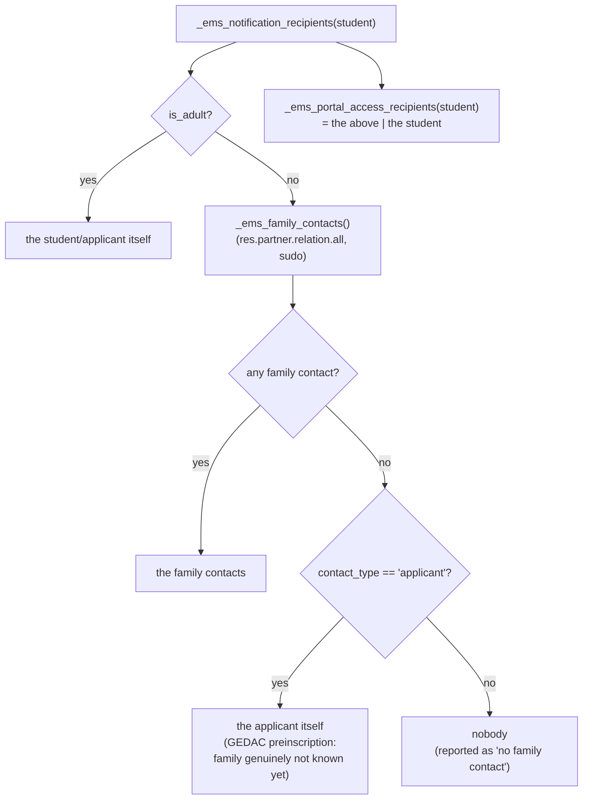
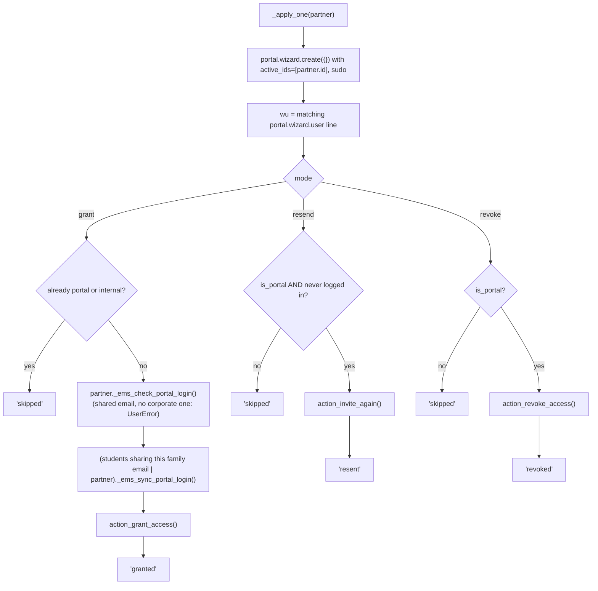
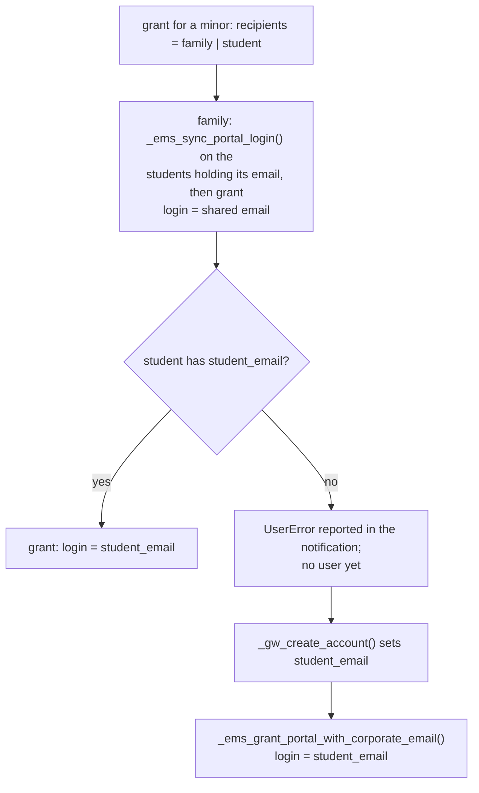

# Technical Reference: `ems.portal.access.wizard`

## Overview

`ems.portal.access.wizard` is the admin/secretary/tutor-facing bulk action for granting, revoking or re-inviting **portal access** for one or more students — wrapping Odoo's native `portal.wizard`/`portal.wizard.user` (from the `portal` module) with EMS-specific recipient resolution (who actually gets the access: the student, or their family) and permission scoping (a tutor can only manage their own tutorands).

**Module file:** `models/contacts/portal_access_wizard.py` (`EmsPortalAccessWizard`, `EmsPortalAccessWizardLine`)

**Not the family/portal-facing side** — the end-user experience of *using* portal access once granted is documented separately for families/tutors (`docs/en/families/manual-portal-alumne.md`, `docs/en/tutors/acces-portal.md`). This doc covers only the admin-side wizard that grants/revokes it.

---

## Recipient resolution — who gets the access

Two rules, both in `models/contacts/portal.py`, deliberately kept apart:

- `_ems_notification_recipients()`: who **acts** on the student's behalf. It is also used for
  authorizations, so it never includes a minor who has a family. Convalidations have their own
  rules (`_ems_can_file_requests_for()`, `_ems_informed_recipients()`), see
  [`convalidation.md`](../grades/convalidation.md#portal).
- `_ems_portal_access_recipients()`: who gets a **portal account**, which is the above plus
  the student himself. A minor gets his own, view-only account (see below) next to his
  family's.

A minor's family contacts are found via `res.partner.relation.all` (`this_partner_id = student`, `other_partner_id.contact_type = 'family'`), run with `sudo()` since a tutor may lack read rights on the relation records of a family they don't otherwise manage.

A minor student with no family on file therefore still gets his own (view-only) account; the
missing family is reported as an issue and as the note on his preview line, but no longer
stops the grant. A minor with no personal email is reported as "has no email" while his
family is still granted.

**Age comes before contact type.** An earlier version keyed the first branch on `applicant`, giving every applicant their own login whatever their age, on the grounds that "at preinscription the family contacts are not known yet". That stopped being true once a returning ex-student became an applicant (see below): their family relations survive a withdrawal, so a 15-year-old coming back would have been emailed their own credentials, the opposite of what a `student` of the same age gets. Testing for the family contacts themselves, rather than for the contact type, keeps a real GEDAC preinscription (which has none on file) behaving exactly as before.

---

## Who sees and who acts on the portal

**Who sees.** `res.partner.get_portal_students()` is the single point every portal page reads a
family's students from. It leaves out an adult child who has not authorized sharing with the
family (`auth_share`, the accepted *share* authorization for the course in force). Nothing is
revoked: the family keeps its portal user, loses the child from the portal the day they turn 18
(`is_adult` is computed from `birth_date` on every read, so no cron is involved), and sees them
again, only to consult, as soon as `auth_share` is set. A family left with no child to see gets
a notice on the home (`ems-portal-no-students`) and only the consulting entries.

**Who acts.** `res.partner._ems_portal_can_act_for(student)`: whoever the centre contacts on the
student's behalf (`_ems_notification_recipients()`). That is the student himself when adult (or
the minor GEDAC applicant with no family on file), or his family while he is a minor. A family
never acts for itself, which is what `get_portal_student()` returns when it has no child left.

**View-only.** `res.partner._ems_portal_is_view_only()` is
`not _ems_portal_can_act_for(get_portal_student())`, so it depends on the student currently
selected, not only on the logged-in partner:

| Logged-in partner | Looking at | View-only |
|---|---|:---:|
| Adult student, or minor GEDAC applicant with no family | himself | no |
| Minor student (with or without family) | himself | yes |
| Family | a minor child | no |
| Family | an adult child with `auth_share` | yes |
| Family | nobody (every child adult without `auth_share`) | yes |

A student who turns 18 stops being view-only on the same day and gets every section, provided
he already has his own portal user (granted to minors too, see above). One who has none gets it
from this wizard; nothing grants it automatically.

| Portal page | Acts for the student | View-only |
|---|:---:|:---:|
| Home, Attendance (schedule), Grades, Profile | ✓ | ✓ |
| Communications | ✓ (all threads) | only messages addressed to the student (`partner_ids`), plus the convalidation threads when it may file them |
| Enrollment and authorizations, Documentation | ✓ | hidden, route redirects to `/my/home` |
| Convalidations | own rule, see [`convalidation.md`](../grades/convalidation.md#portal): the minor reads his own, the family of an adult who shares files them | |
| Native `/my/quotes`, `/my/orders[/<id>...]`, `/my/invoices[/<id>]` | native rules | empty lists, documents refused |

Enforced server side in `controllers/portal_view_only.py`:
- `@ems_portal_manage_required`, placed under `@http.route` on every enrollment,
  authorization and documentation route (GET and POST). The convalidation routes check
  `_ems_can_file_requests_for()` / `_ems_convalidation_portal_visible()` instead.
- `_document_check_access()` refuses `sale.order`/`account.move`, and the quotation/order/
  invoice list domains are emptied, because a minor is the customer (`partner_id`) of his own
  enrollment, so the native portal rules would otherwise let him open, sign or decline it.
- The header menu (`views/portal/portal_header.xml`) and the home cards
  (`views/portal/portal_main.xml`) hide the same entries. The header sits inside a `t-cache`
  block, so its cache key includes `request.env.user.id`, the selected student, the visible
  students and `_ems_portal_is_view_only()`: a per-user menu must never be served from another
  user's cache entry, and it changes without any write when a child turns 18.

## Modes

| Mode | Native call | Applies to |
|------|-------------|------------|
| `grant` | `portal.wizard.user.action_grant_access()` | Recipients without portal access (or archived from a previous revoke) |
| `revoke` | `action_revoke_access()` | Recipients with active portal access |
| `resend` | `action_invite_again()` | Recipients with portal access who **never logged in** (`login_date` empty) — an expired/lost invitation |

`grant`/`resend` both end up calling Odoo's native `_send_email()` (`force_send=True`, real synchronous SMTP) — any test exercising either mode must mock `IrMailServer.send_email` (see `tests/test_portal_access_wizard.py`).

### `_apply_one(partner)` — the shared per-recipient application

Runs entirely under `sudo()` — tutors have no `res.users` creation/write rights of their own, but must still be able to grant/revoke access for their own tutorands. Called from two places outside this wizard's own `action_apply`:
- `res.partner._apply_portal_email_change()` (`contact.py`) — revoke at the old email, then grant at the new one, whenever a student/family's main email changes while they hold active portal access.
- `res.partner._ems_revoke_student_portal()` (`portal.py`) — used by the graduation/withdrawal flow and by a data migration backfill.

### `res.partner._ems_sync_portal_login()` — stale login after a re-grant

Revoking access archives the `res.users` record rather than deleting it, so it keeps its old login. If the partner's email changed while access was revoked, a plain re-grant would silently reactivate the user with the **stale** login. `_ems_sync_portal_login` (`portal.py`) realigns the portal user's `login` with `_ems_portal_login()` (below) right before granting — unless another user already owns that target login, in which case it leaves the stale login alone and lets the native `_assert_user_email_uniqueness` raise a clean "already registered" error instead of silently colliding. Each `_apply_one` call runs inside a savepoint (in `action_apply` and in `res.partner._ems_apply_portal_access`), so a recipient that fails leaves none of its writes behind.

### A student sharing the main email with the family (issue #833)

A portal login is unique and Odoo's portal wizard uses the partner's main email as login. At enrolment the centre often gets a single address for the whole family, so a student's `email` is frequently a family member's too. The rule:

- **The family wins:** the login with the shared email is always the family member's.
- **The student signs in with the corporate email** (`student_email`): it is the login of their portal user, and "Log in with Google" matches on it too (`google_workspace_student.md`).
- **No collision, no change:** a student with their own personal email keeps it as login.

| Method (`res.partner`, `portal.py`) | Role |
|---|---|
| `_ems_email_shared_with_family()` | The student's (or ex-student's) normalized `email` is one of their family contacts' `email_normalized`, or the login of a family contact's user. |
| `_ems_portal_login(email=None)` | The login the partner's portal user must have: the main email, or the corporate email of a student sharing it (`False` while they have none). |
| `_ems_check_portal_login()` | Raises a `UserError` saying why a student sharing the email gets no user until their Google account exists (replaces Odoo's generic "same email as an existing user"). |
| `_ems_students_sharing_email()` | For a family member: the related students whose email is theirs. Granting the family first realigns them, which takes the shared login back from a student who held it. |
| `_ems_grant_portal_with_corporate_email()` | Called by `_gw_create_account()` once `student_email` is set: grants a student left waiting, only when a family member already has active portal access (that is how the centre granted it for this student) and the student has no user at all (an archived one means access was revoked). Posts a chatter note. |
| `portal_email_shared_with_family` | Non-stored compute behind the yellow warning at the top of the student form. |

`portal.wizard.user` is inherited in `portal_access_wizard.py` so Odoo's own checks use that login: `_get_similar_users_domain`/`_is_portal_similar_than_user` (the "already registered" check) compare against `_ems_portal_login(self.email)` instead of the email, and `_create_user` creates the user with it (the user's `email` stays the shared address, so every email to the student still goes there, the credentials ones included). Every path that grants goes through `_apply_one`, so the rule holds for the wizard, `_apply_portal_email_change`, `_ems_grant_student_portal` (undoing a withdrawal), the contact data request's grant, and Odoo's native "Grant portal access" action. Changing `student_email` realigns the login of a student sharing the email (`portal_google_signin.py`). Coming of age changes nothing: the login does not depend on age.

Odoo itself emails a "login changed" security notice to the user's email (the shared address) whenever a login moves, which tells the family what the student's new login is.

**Existing installations** (migration `18.0.0.49.3/post-migrate.py`): `_ems_students_sharing_email_with_family()` finds every student or ex-student sharing the email, and `_ems_fix_shared_email_portals()` moves the login of those holding the shared one to `student_email`, grants the family members they kept out (only the ones acting for the student, `_ems_notification_recipients`), and grants the students left without a user (same conditions as after the Google account). Failures (e.g. two family members with one email, where the login is already the other's) are logged, not raised. A clean installation has no such data, so `post_init_hook` needs nothing.

---

## `action_apply()` — the wizard's main entry

Loops `student_ids`; per student: re-checks `_user_can_manage` (defense in depth — `student_ids` could in principle be tampered with client-side before submit), then the adult-without-email guard, reports a missing family, then applies per recipient of `_ems_portal_access_recipients()` with a try/except around `_apply_one` so one failure doesn't abort the whole batch. Aggregates into a single `display_notification` (counts of granted/revoked/resent/skipped, plus a bulleted list of issues — `type: 'warning'` and `sticky: True` if there were any issues, `'success'` otherwise).

---

## Preview (`line_ids`) — `default_get` / `_onchange_mode` / `_build_lines`

The form shows a **read-only preview** of who will be affected before the user clicks Apply — `_build_lines` resolves recipients per selected student and computes `has_portal`/`connected` (from `recipient.user_ids[:1]`, `active_test=False` so an archived/revoked user is still found) and a `note` (`"Recipient without email"` if the recipient has none, otherwise `"No family contact found"` on the student's own line when `_ems_notification_recipients()` came back empty, otherwise, for a student sharing the email with the family, the corporate email they sign in with or that they have no access until it exists). `default_get` builds the initial preview from `active_ids` (the selected `res.partner` records the wizard was opened from); `_onchange_mode` rebuilds it whenever the mode radio changes, additionally filtering to `has_portal and not connected` when switching to `resend` (only those recipients would actually be affected).

`default_get`/`_build_lines` are **not** re-triggered by a plain ORM `create()` from Python — that's an onchange, which only fires through the web client (or an explicit test call to `_onchange_mode()`); this is a common testing gotcha, not a wizard bug.

---

## Access Control

### `ir.model.access.csv`

| Model | Role | Create | Read | Write | Delete |
|-------|------|:------:|:----:|:-----:|:------:|
| `ems.portal.access.wizard` (+ `.line`) | Academic admin | ✓ | ✓ | ✓ | ✓ |
| | Secretary | ✓ | ✓ | ✓ | ✓ |
| | **`ems.group_tutor`** (not the generic `ems.group_teacher`) | ✓ | ✓ | ✓ | ✓ |

A plain teacher who is not currently tutoring anyone cannot even open this wizard — `ems.group_tutor` is a role-derived group only granted while an employee actually tutors at least one group (see [`ems.group`](group.md)'s `_sync_tutor_role`). `_user_can_manage`'s tutor branch is the **per-student** narrowing on top of that: even a real tutor can only manage their own tutorands, checked both in `default_get` (silently filters the preselection) and again in `action_apply` (reports an explicit issue rather than silently skipping, in case `student_ids` reached the server without going through the normal preselection — e.g. tampered client state).

---

## Views

| View | File | Notes |
|------|------|-------|
| Form | `views/community/contact/portal_access_wizard.xml` | `view_portal_access_wizard_form` — mode radio, readonly recipient preview list, Apply/Cancel footer |
| Bulk entry point | same file | `action_portal_access_bulk` (`ir.actions.server`), bound to the `res.partner` list's cog menu (a student's form has the same method as an entry of its Actions dropdown, see [contact.md](contact.md#student-form-actions-actions-dropdown-cog-menu-or-smart-button)), restricted to `group_academic_admin`/`group_secretary`/`group_teacher` at the action level (the model's own `ir.model.access.csv`/`_user_can_manage` are the real gate for a non-tutoring teacher, as above). Its `code` field is a single call to `res.partner.action_portal_access_bulk()` (`models/contacts/contact.py`), which filters the selection down to `student`/`applicant` and raises a `UserError` when nothing survives. The logic lives in Python, not inline in the action, because `safe_eval`'s context has no `_`: an inline `_("...")` raises `NameError: name '_' is not defined` and the RPC surfaces that traceback instead of the intended message. |

> **How a returning ex-student gets in.** A contact that left is `withdrawal`/`alumni`/`expelled` and cannot hold portal access as such. Sending them a new enrollment converts them to `applicant` (`sale.order._ems_offer_to_ex_student()`, called from `write()`'s "→ `sent`" branch in `models/enrollment/enrollment.py`), which is what makes them eligible here; confirming that enrollment later turns them into a full `student` via `_ems_admit_student()`. The two steps are distinct: an ex-student never goes straight back to `student`. An `expelled` contact is never converted, so it stays out of scope on purpose.
>
> This exists because the four requirements otherwise form a closed loop: portal access needs `student`/`applicant`, becoming a student needs a confirmed enrollment, confirming needs the required authorizations answered, and those are answered *from the portal*. Sending the offer is the only deliberate act that can break it. See `docs/en/developers/enrollment/enrollment.md`.

Registered as a `data` entry in `__manifest__.py` (line ~97), alongside the rest of `views/community/contact/`.
