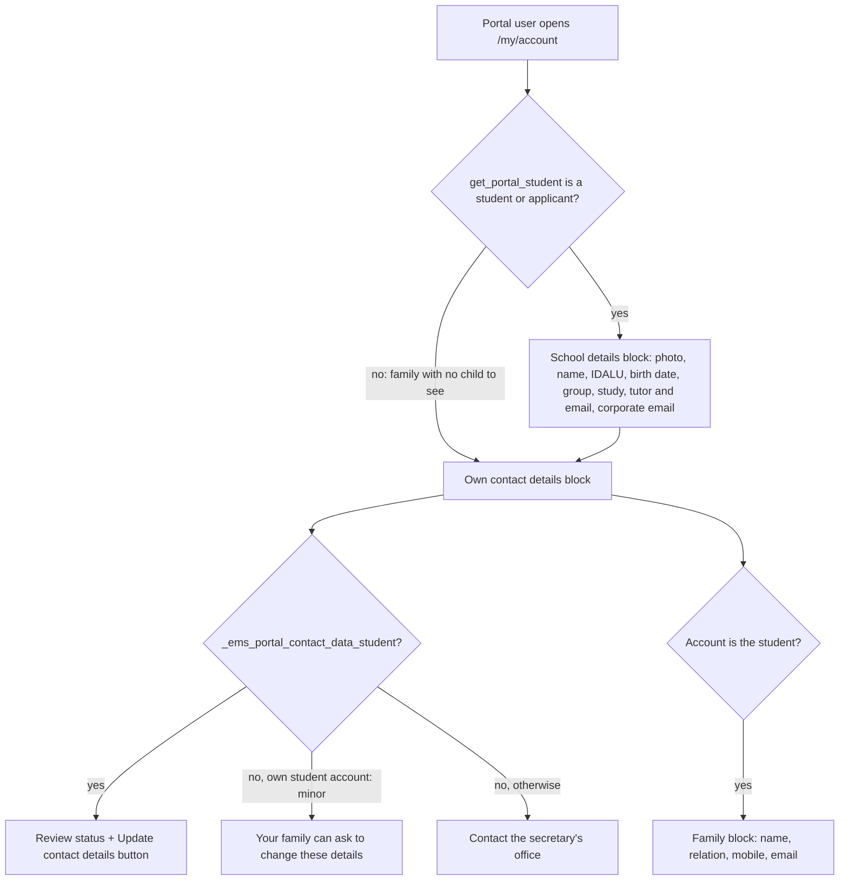

# Portal profile (`/my/account`)

The stock Odoo profile page lets a portal user edit their own name, email, address and VAT. EMS replaces it, for every portal user (students and families), with a read-only page. It shows the student's school data, the account's own contact details and the status of the contact data review (issue #507, issue #736). Internal users keep the stock editable form.

| Piece | Role |
|---|---|
| `controllers/portal_account.py` (`EMSPortalAccount.account`) | Never processes a POST from a portal user (the stock controller writes the partner with `sudo()`, so hiding the inputs would not be enough), renders `portal.portal_my_details` with `ems_profile_readonly` and the values of `_ems_profile_values()` |
| `views/portal/portal_account_readonly.xml` | `portal_my_details_readonly`: hides the stock form and renders the three blocks; `portal_profile_value`: one label/value pair, a dash when empty |
| `res.partner._ems_contact_data_running_request()` | The student's `ems.contact.data.request` of the running academic year, shared with `/my/dades-contacte` and the home banner (`_ems_contact_data_requested()`) |

## What each account sees

- **School details** (`student`): the student the account looks at, `get_portal_student()`, i.e. the account itself for a student or applicant and the selected child for a family (also an adult child who authorized sharing). The group, study and tutor rows only appear when the student has a main group. Nothing here can be changed from the portal.
- **Own contact details** (`partner`): exactly what `/my/dades-contacte` lets the account send for itself: `STUDENT_FIELDS` on a student's account, `FAMILY_FIELDS` on a family contact's account (name, mobile, email, address, document, passport). Fields no portal page can change (VAT, street 2, state, country) are not shown.
- **Review status**: shown only to whoever may send the review (`_ems_portal_contact_data_student()`), from the running year's request: `submitted` = waiting for the review; `pending` with a `rejection_reason` = returned, with the reason; `pending` without one = requested by the school; no request or `done` = nothing.
- **Family**: on the student's own account only, the family contacts of `_ems_contact_data()`.

Everything is read with `sudo()`: a portal user has no rights on the relations, the groups or the tutor's `hr.employee`. The data read is limited to the account itself and the student `get_portal_student()` already authorizes.

## Tests

`tests/test_portal_profile.py` (`TestPortalProfile`): what a minor student, their family and an adult student see, and the three review statuses. The render tour `ems_portal_account_render` (`TestPortalTour`) and the contact data tour (`TestContactDataRequestTour`, which starts from the profile button) cover the browser side.
