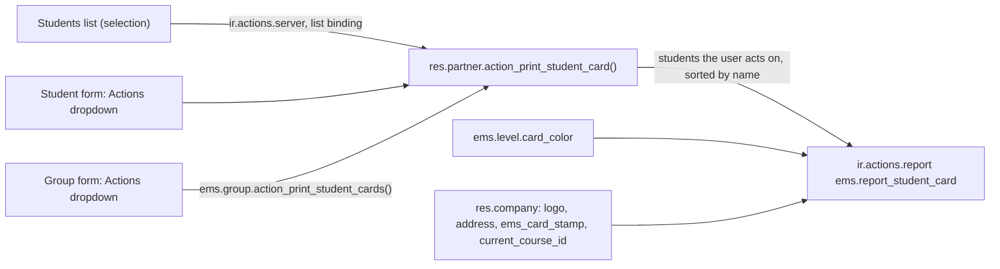

# Technical Reference: Student Card (PDF)

## Overview

The student card (issue #524) is a QWeb PDF on `res.partner` that replaces the card Esfera
generates: an A4 sheet with the cards of the selected students, two columns, cut by hand. Every
card shows:

- The centre: its logo, name, phone and address (`res.company` / its partner).
- The student: photo (`image_1920`, a silhouette when missing; scaled down to fit its 22 x 29 mm
  frame with its proportions kept, since wkhtmltopdf ignores `object-fit`), "Last names, First name",
  identity document (`document_id`, or `passport_id` when there is none), birth date and IDALU
  (`student_id`).
- The **band**, two rounded blocks side by side. On the left, the main group's level acronym (ESO,
  BTX, CFGB, CFGM, CFGS, PFI, EFPS) in big letters on that level's own colour, plus the study and the
  course year. On the right, whether the student **may leave the centre** (`can_leave_centre`), for
  the teacher at the door: "Pot sortir del centre" on green or "No pot sortir del centre" on red. The student may
  leave when they are of age (`is_adult`) **or** the family accepted an authorization whose template
  is of type *Leave the Centre* (`auth_leave`) for the academic year in force. Computed when the
  card is printed: a card printed before the student turns 18, or before the family accepts, keeps
  saying "No" until it is printed again.
- The academic year in force (`res.company.current_course_id`).
- The centre's stamp (`res.company.ems_card_stamp`), or an empty "Segell del centre" box to stamp
  by hand when none was uploaded.
- A Code128 barcode of the IDALU, for a future check-in at the entrance.

The back, alike on every card, carries the Departament d'Educació i Formació Professional's logo
(`static/src/img/departament_educacio.png`, the same logo the Esfera card printed), the centre's
name, address and phone, and a "personal and non-transferable" note.

## Model changes

| Model | Field / method | Notes |
|---|---|---|
| `ems.level` | `card_color` (Selection, stored compute, `readonly=False`) | The level's colour on the card, one of a closed pastel palette (`CARD_PALETTE` in `models/curriculum/level.py`, key → hex). The palette has no red or green, which the card keeps for the exit block, so no level can be confused with it. Computed from the acronym when the level is created (`CARD_COLORS` for the official levels, grey for any other) and editable afterwards in the level form. Not in `data/cat/ems.level.csv`, so an upgrade never reverts a colour the centre changed. |
| `res.company` | `ems_card_stamp` (Image) | The centre's stamp, uploaded in Settings > EMS > Center Data. |
| `res.config.settings` | `ems_card_stamp` (related) | |
| `res.partner` | `can_print_student_card` (Boolean, non-stored, `depends_context('uid')`) | Reads the Actions dropdown entry's `invisible=`. |
| `res.partner` | `can_leave_centre` (Boolean, non-stored) | `is_adult or auth_leave`. Not stored, since `is_adult` depends on today's date. |
| `res.partner` | `auth_leave` (Boolean, stored compute, `contact.py`) | Accepted *Leave the Centre* authorization in the year in force; the same compute as the other `auth_*` flags (see [Authorizations](../enrollment/authorization.md)). |
| `ems.authorization.template` | `auth_type` value `leave` | *Leave the Centre*. The centre creates the template itself (its legal text) from Academic management. |
| `res.partner` | `action_print_student_card()` | Keeps the students (`contact_type == 'student'`) the user acts on, sorted by name, and returns the report action. Raises a `UserError` when none is left. |
| `res.partner` | `_get_student_card_values()` | Per-student values for the template (document, level, study label). |
| `ems.group` | `can_print_student_cards`, `action_print_student_cards()` | Same, for every student whose main group is this one. |

## Access control

Who may print a card is who may act on the student, the same rule as the student's other actions
(`ems.student.scope.mixin._scope_acts_on_student`, issue #483):

| Role | Students |
|---|---|
| Academic admin, Secretary, Head of Studies | Every student |
| Tutor, and the Department/Seminar Chief, Head of Studies and Director above them (`tutor_scope_user_ids`) | That tutor's students |
| Any other teacher | None (the entry is hidden; the server action refuses) |

The check is made again on the server in `action_print_student_card()`: a list selection, or a
group the user isn't the tutor of, never prints a card the user could not print from the form.

## Layout notes

- Paper format `ems.paperformat_student_card`: A4 portrait, small margins, no header/footer
  (`web.basic_layout`, not `external_layout`).
- Cards are laid out with a table (two cells per row), not flexbox or grid: wkhtmltopdf's WebKit
  lays neither out. The band's two blocks are one table with `border-collapse: separate` and a
  horizontal `border-spacing`, each cell with its own `border-radius`.
- Soft colours throughout: pastel backgrounds with dark text (the level and exit blocks), grey labels.
  The report layout borders tables, rows and cells; the card's stylesheet resets all of them. Each row has `page-break-inside: avoid`, so a card is never split across two
  sheets.
- Double-sided printing: each sheet of fronts (up to ten cards) is followed by its sheet of backs,
  flipped on the long edge. A back row lists its cards right to left, so an odd last card's back
  sits on the right, behind its front; left and right margins are equal so the columns line up.
  Cards are `box-sizing: border-box` so five 54 mm rows fit an A4 sheet.
- The barcode uses Odoo's own `barcode` QWeb widget (an inline PNG), Code128, from the IDALU. No
  barcode is printed for a student without IDALU. It is rastered at 400 x 80 px for a 36 x 8 mm print
  (about 280 dpi): drawing it is most of the render time, and 600 x 100 cost a third more for nothing
  a reader can tell apart.
- The centre's address is one sub-template (`ems.report_student_card_address`), shared by both sides.
- Measured on this box's largest group (34 students, cold): access check 0.08 s, action 0.04 s, HTML
  1.0 s, PDF 3.0 s (146 KB), 90 queries for the whole render.

## Manual screenshots

`tests/test_docs_screenshots_student_card.py` (tagged `-standard`) captures the manuals' screens with
invented students and the simulated stamp (`tests/common.py`'s `draw_invented_centre_stamp()`); the
card example in `docs/assets/secretary/student-card-example.png` is cropped from a PDF rendered with
the same kind of fixtures.
