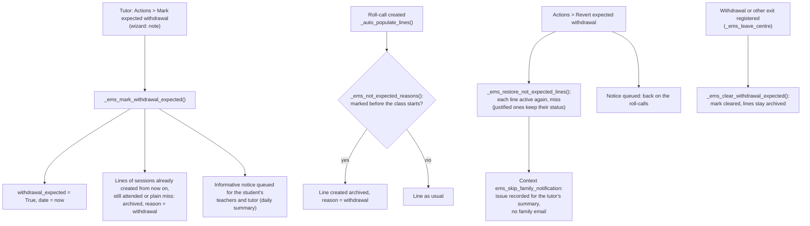

# Technical Reference: Expected Withdrawal

## Overview

When a tutor knows a student won't come back, they ask for the withdrawal, which the secretariat
takes a while to register. Meanwhile the student would keep appearing in every roll-call and piling
up absences. An **expected withdrawal** (issue #644) bridges that gap:

- The student stays a student (not archived, still in their group and subjects).
- Every roll-call created from that moment lists them as **"Not required to attend: expected
  withdrawal"**: the session line is created archived (`active=False`), exactly like a teacher's own
  "Remove from the roll-call" (see [Removing a student from the roll-call](../attendance/attendance_session.md#removing-a-student-from-the-roll-call-active-issue-537)),
  with `not_expected_reason = 'withdrawal'`. Archived lines count neither as attended nor as absent
  and notify nobody.
- If the student comes after all, the teacher restores the line as usual.
- **Reverting** it turns every session the student was taken off for it into an absence (or keeps
  it justified, when the tutor had justified it), without notifying the family: the tutor gets them
  in their [daily summary](../shared/daily_summary.md).
- Registering the withdrawal (or any exit) clears the mark; the archived lines stay as they are.

**Module files:** `models/contacts/withdrawal_expected.py` (`res.partner`,
`ems.withdrawal_expected_wizard`), `models/attendance/attendance_session.py` (line creation,
`not_expected_reason`), `views/community/contact/form.xml`,
`views/community/contact/withdrawal_expected_wizard.xml`, `static/src/js/backend/schedule_grid_readonly_field.js`.

---

## Data Model

### `res.partner` (inherited)

| Field | Type | Description |
|-------|------|-------------|
| `withdrawal_expected` | `Boolean`, readonly, tracked | The mark. |
| `withdrawal_expected_date` | `Datetime`, readonly | When it was marked: roll-calls of classes starting from then leave the student off. |
| `withdrawal_expected_by_id` | `Many2one res.users`, readonly | Who marked it. |
| `withdrawal_expected_note` | `Text`, readonly | Why, as written in the wizard. |
| `can_mark_withdrawal_expected` | `Boolean`, computed (uid) | Whether the current user may mark or revert it (see Access Control). Re-checked server-side. |
| `not_expected_subject_ids` / `not_expected_legend` | computed | For the Schedule tab: the subjects drawn dashed and the legend explaining why (every subject, for an expected withdrawal). |

The ribbon reuses `archived_reason_label`/`_color` (the archived student's Alumni/Withdrawal/Expelled
ribbon): on an active student with the mark it reads "Expected withdrawal", in amber. The shared
ribbon widget now shrinks long texts like the native one (`o_medium`/`o_small`).

### `ems.attendance_session_line` (inherited)

`not_expected_reason` (`Selection`): why the system took the student off the roll-call
(`withdrawal`, or `convalidation` with `convalidation_line_id`, see
[convalidation.md](../grades/convalidation.md#attendance-while-the-request-is-open)); empty when the
teacher did, or when the student is on it. Only lines with a reason are restored when the reason is
undone, by `res.partner._ems_restore_not_expected_lines(domain)`, shared by both.

---

## Flows

- **Which classes:** `res.partner._ems_not_expected_reasons(students, subject, start)` returns the
  session line vals (`active=False`, the reason) for the roster's students not expected at a class
  starting at `start`; one search per session. A roll-call taken late for a class that started
  before the mark keeps the student.
- **Marking takes off the sessions already created later that day**, but only lines still at the
  default (attended) or a plain miss, not justified and without strikes: any other status was set
  on purpose.
- **Lines are written one at a time**: a session line's `write()` works out its notifications for a
  single line.
- **Continuation:** the second period of a double period re-evaluates the reason instead of copying
  the previous line's `active` (a removal by hand still carries over).
- **No family email on revert** (decided by the developer, 2026-10-31): a burst of past-dated
  absence emails would only confuse the family; the tutor already knows. The context key
  `ems_skip_family_notification` makes `create_notification_entries()` skip the family's queue job
  while still recording the issue for the tutor.
- **Notices:** `res.partner._ems_teaching_staff()` finds who teaches the student each subject in the
  group they take it with (`ems.teaching`), plus the tutor; `_ems_queue_staff_notice()` queues one
  `ems.info_notice` per user, written in their language.

---

## Schedule tab

`readonly_schedule_grid` reads `not_expected_subject_ids`/`not_expected_legend` (invisible fields on
the student form, the same "smuggled helper field" pattern as `shift`): blocks of those subjects get
`o_schedule_grid_entry_not_expected` (faded, dashed outline, light stripes) and the legend shows below
the grid. Absent on every other model using the widget.

---

## Access Control

| Who | Mark / revert |
|-----|---------------|
| The student's tutor and everyone above them (tutor scope: Department/Seminar Chief, JE/JEA, Director) | Yes (`ems.base.user_acts_as_tutor`) |
| Secretary, JE/JEA and the Director (`ems.group_head_of_studies`), the administrator (`_ems_user_can_register_exits`) | Yes |
| Any other teacher, a Department Chief of another branch | No (button hidden, `UserError` server-side) |

The writes are done with `sudo()` once the check passes. `ems.withdrawal_expected_wizard` has ACL
rows for `ems.group_tutor` (implied by every role above the tutor), `ems.group_secretary` and
`ems.group_academic_admin`.
