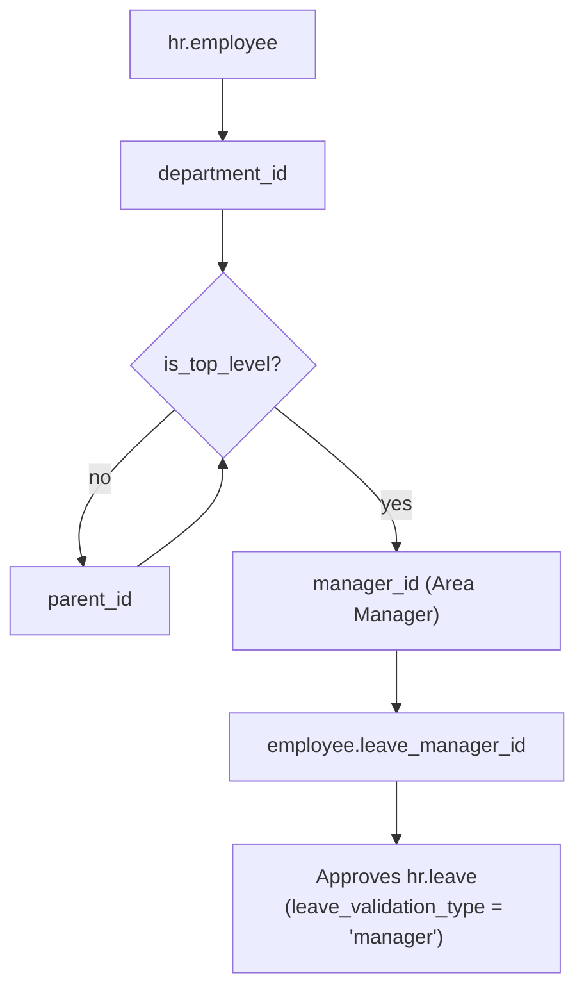
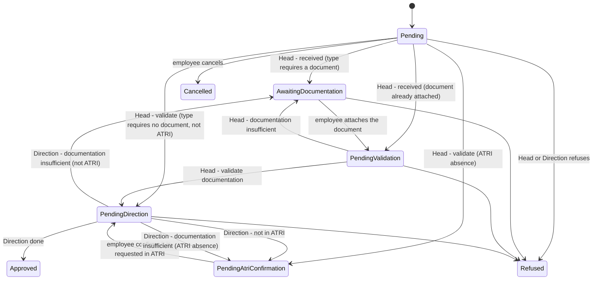
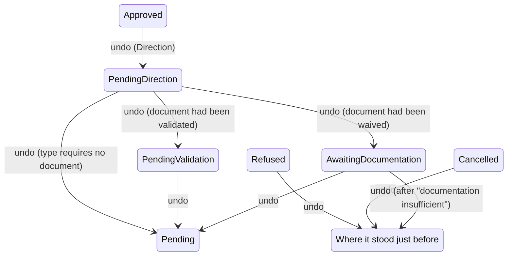
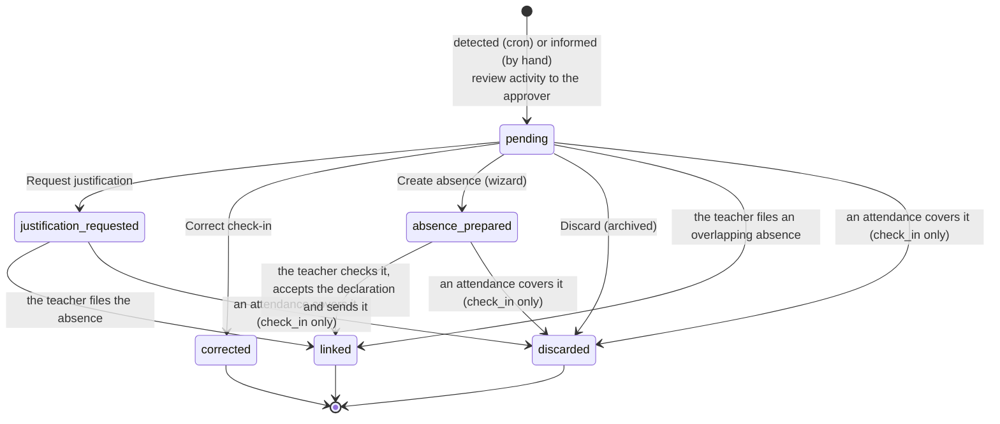
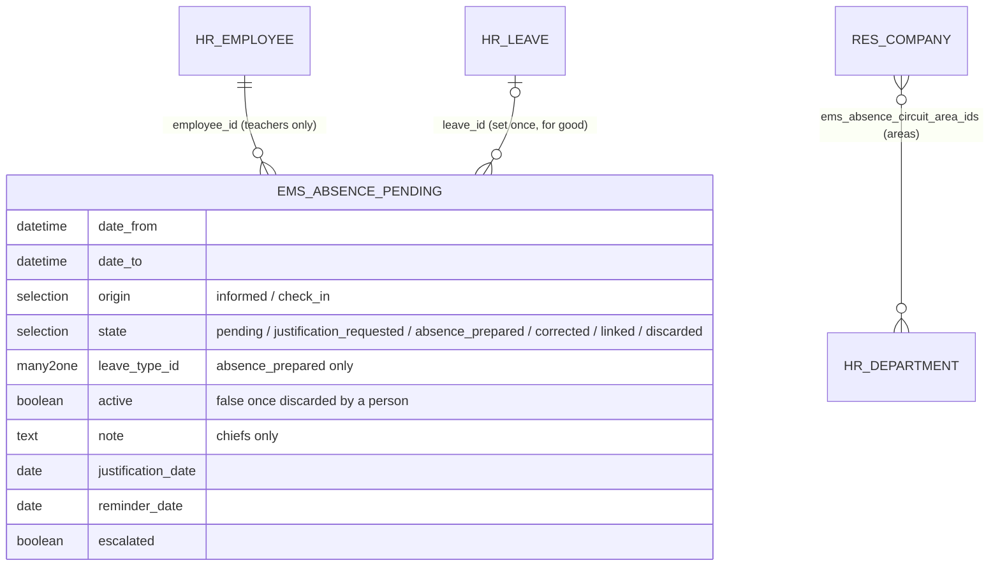
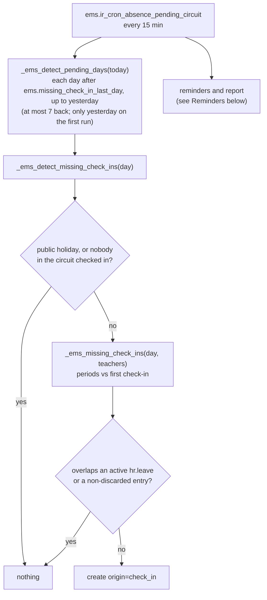
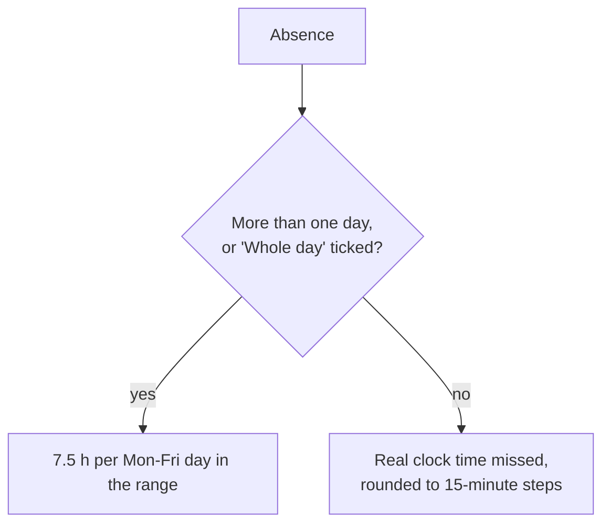
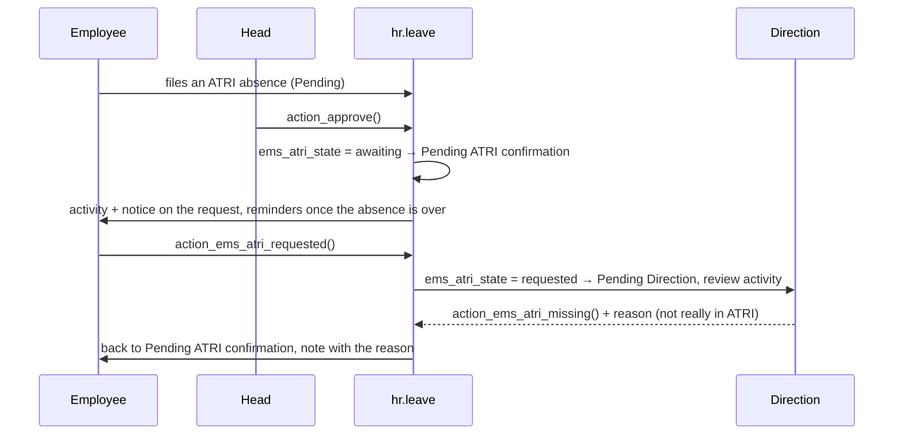
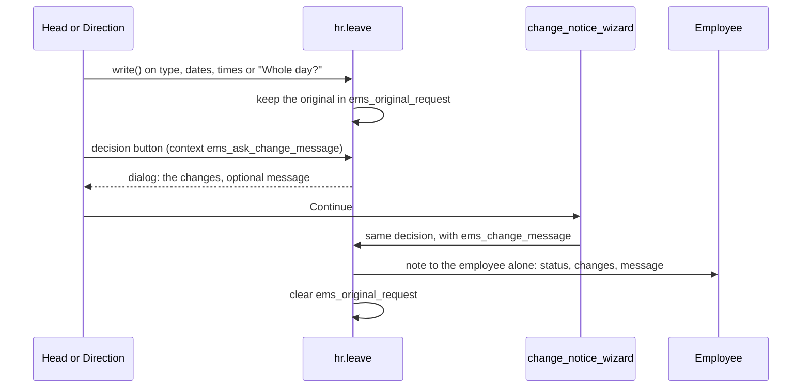
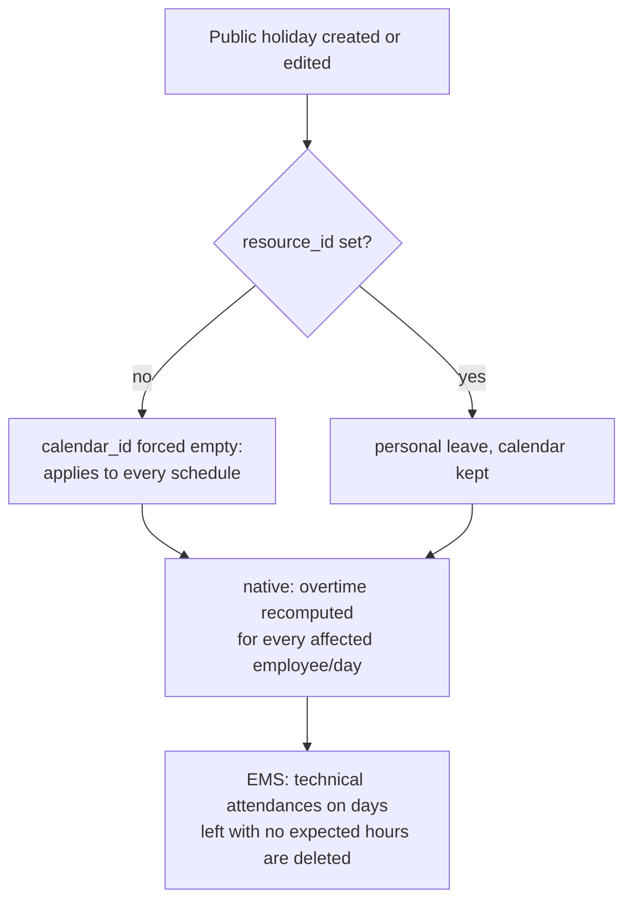

# Staff absences (`hr_holidays` EMS extension)

Replaces the Google Form + Sheet + Apps Script application the centre used to manage staff
absences, with three parallel copies (VET/CCFF, ESO/BTX, ASP) that differed only in who approved
them. EMS builds on Odoo's native `hr_holidays` rather than a bespoke model: the request
workflow, approval, hour computation against the employee's `resource.calendar`, attachments,
calendar event and reporting all come from the framework.

> **Current scope:** the `hr_holidays` dependency, the absence type catalogue, the derived
> approver, the access model (cycle 1), and the EMS request fields, hour rules and health
> allowance (cycle 2). The guard-duty integration and the notification rework land in later
> cycles — see `plans/absence_management.md`.

## Who approves: derived, never configured

The Google sheet held a `Config` tab mapping each department to its "Gestor d'absencies". EMS
already models that relationship: the approver is the **Area Manager of the employee's top-level
department**, which the role hierarchy keeps current on its own (see
[role_hierarchy.md](role_hierarchy.md) and [department.md](department.md)).



| Top-level department | `top_level_role` | EMS role | Approves absences for |
|---|---|---|---|
| VET | `dhos` | Deputy head of studies | Vocational training staff |
| ESO / BTX | `hos` | Head of studies | Secondary and baccalaureate staff |
| ASP | `secretary` | Secretary | Administrative and services staff |

`hr.department._top_level_department()` walks `parent_id` up to the `is_top_level` ancestor.
`ems_employee_base._compute_leave_manager()` overrides the native compute — which follows
`parent_id.user_id`, i.e. the Seminar Chief or Department Chief, the wrong person here — and
resolves that department's `manager_id.user_id` instead. Like `_compute_parent_id()`, it depends
only on `department_id` and is re-triggered explicitly from
`ems_department._cascade_department_heads()`, so replacing an Area Manager re-points every
affected employee in one write.

The field stays `readonly=False` (a stored editable compute, as Odoo defines it), so an
administrator can override a single employee's approver by hand; the override holds until the
next recompute — that employee changing department, or their Area Manager being replaced.

**An Area Manager is the Head of their own absence** (issue #693). Their own `leave_manager_id`
is themselves, like everyone else's in their area: they acknowledge and validate their own
request (supporting document included), and Direction reviews it afterwards exactly as it reviews
anybody else's. Odoo's own approval check already lets a user approve a request whose
`leave_manager_id` they are, and `_ems_check_own_approved_write()` lets through what those steps
write on a request already in effect (`HEAD_DECISION_FIELDS`: the state, the approvers, the
calendar meeting, the document state) and nothing else, so the request stays as closed to its own
editing as anybody's. They still cannot undo a decision on their own absence (see *Undoing the
last decision*); Direction can.

**The approver is a `res.users`, not an `hr.employee`.** An Area Manager with no user account
therefore leaves every employee in their area with an empty `leave_manager_id`, which Odoo
degrades to "approved by an officer" — the Head of Studies chain — rather than failing. Worth
checking when an area's absences appear to have no approver.

## Absence type catalogue

`data/cat/hr.leave.type.csv` — Catalonia-specific, because the catalogue follows the Generalitat's
own staff-absence regulations (ATRI is its personnel portal), same rationale as
`data/cat/hr.job.csv`.

**The nine names are the original form's own option texts, verbatim.** They are long
sentences rather than short labels because several carry the legal wording the employee is
declaring when they pick one ("I was absent from my workplace for health reasons, a
circumstance I reported immediately to the centre's director"). English is the source language;
`i18n/ca_ES.po` holds the Catalan exactly as the Google form had it, character for character.

**No type is preselected.** Odoo ticks the first available one on a new request; here the type
is the legal ground the employee is declaring, so it has to be a deliberate choice. Turned off
through hr_holidays' own `holiday_status_display_name` context switch rather than by picking the
default apart afterwards.

**The form shows them as a radio list, not a dropdown** (`widget="radio"` on
`holiday_status_id`, which Odoo supports on many2one fields), exactly as the Google form did.
That is not decoration: several of the nine options *are* the legal wording the employee is
declaring by choosing them, so they have to be readable in full at the moment of choosing.

**Everywhere else shows a short name.** `hr.leave.type.ems_short_name` is the text up to the
colon - `Salut`, `ATRI`, `Assistència a Consulta mèdica` - which is what the Apps Script itself
displayed in the calendar and its emails (`type.substring(0, colonIndex)`). The absence list
shows it through the related `hr.leave.ems_type_short_name`, and `hr.leave._compute_display_name`
substitutes it into whatever Odoo builds, the calendar chip above all. Deliberately *not* done
by shortening the type's own `display_name`: the radio widget reads exactly that field, so
shortening it there would empty out the one place the full text matters. `ems_short_name` is not
stored, because `name` is translatable and a stored copy would freeze one language.

Odoo's own five types (`Paid Time Off`, `Sick Time Off`, `Unpaid`, `Compensatory Days`, and
`Extra Hours` from `hr_holidays_attendance`) are archived by
`hr.leave.type._ems_deactivate_native_types()`. That has to be code, not a data file: all five
carry `ir_model_data.noupdate = True`, and it is that stored flag - not the loading file's own
context - that decides whether an existing record is written.

| Type | Supporting document | Counts in monthly report | Notes |
|---|---|---|---|
| Baixa laboral | yes | **no** | Formal sick leave; excluded from the monthly hours report (2 of 53 real rows counted) |
| Salut | no | yes | Self-declared health absence; the only type consuming the 15 h/course allowance |
| Assistència a consulta mèdica | yes | yes | |
| Prova mèdica invasiva | yes | yes | Whole day by default |
| Flexibilitat per menstruació o climateri | yes | yes | Its own legal cap (8 h/month) is out of scope |
| Formació | yes | yes | Courses, Erasmus+ |
| Absència justificada | yes | yes | |
| Encàrrec de serveis | yes | yes | Field trips, official travel |
| ATRI | no | yes | Filed by the employee on the Generalitat portal, where it is justified; Direction confirms it |

All nine share `request_unit = 'hour'`, `requires_allocation = 'no'` (the 15 h cap warns, it
never blocks — see the plan) and `leave_validation_type = 'manager'`, which routes approval to
`leave_manager_id` above.

Since issue #440, `hr.employee.attendance_manager_id` (`hr_attendance`'s own approver field,
unrelated to leave requests) is a stored compute that mirrors this same `leave_manager_id`,
except for an Area Manager, whose own attendance corrections go to the Director — see
[My Profile restructuring](user_profile.md) for why and how.

## The request: what EMS adds to `hr.leave`

| Field | Seeded from | Who edits it |
|---|---|---|
| `ems_full_day` "Whole day" | `hr.leave.type.ems_full_day_default` | Employee, while the request is unapproved |
| `ems_counts_hours` "Adds the hours to the monthly report" | `hr.leave.type.ems_counts_hours` | The approver only |
| `ems_needs_atri` "Filed through ATRI" | `hr.leave.type.ems_needs_atri` | Nobody: not shown on the form, only read by an invisible node that shows the ATRI portal notice |
| `ems_responsible_declaration` | — | Employee; required when the type demands it |
| `ems_document_state` "Supporting document status" | set when the Head acknowledges the request | The Head's and Direction's buttons, and the employee attaching the document; never written directly by the employee |
| `ems_document_reminder_date` / `ems_document_escalated` | — | The reminder scheduled action only |
| `ems_direction_state` "Direction status" | — | Read by everyone, set by Direction only (its own buttons); hidden until the request exists |
| `ems_head_state` "Head status" | computed from `state` and `ems_document_state` | read-only |
| `ems_status` "Overall status" | computed | read-only |
| `ems_health_hours_used` / `ems_health_allowance_exceeded` | computed | read-only |

The first three are **stored editable computes**: picking an absence type proposes a value and
any later manual change survives. That is deliberate, and it reproduces what the Apps Script did
— it ticked `Suma Hores?` on submit and left the manager free to correct it afterwards, which
they do, because employees miscategorise their own absences.

The status fields are the steps of the approval and where the request stands between them - see
[The approval, step by step](#the-approval-step-by-step) below.

**The employee never picks the ATRI flag or the monthly-report flag.** Both are derived from the
absence type. The monthly-report flag is shown to the approver, who can override it per request.
The ATRI flag is shown to nobody: its only use is the ATRI portal notice on the form, and when the
employee chose the wrong type the approver changes the type itself, which recomputes both. That
is also why `holiday_status_id` stays editable for the approver (`is_absence_manager`) on a
refused or cancelled request, where Odoo makes it readonly. Not on an approved one: Odoo's
`_check_date_state` refuses any write that touches the dates of a request in effect, and the type
recomputes them, so the field is readonly there and the approver undoes the approval first (see
*Undoing the last decision*).

## The approval, step by step

Every absence goes through the **Head** - the Area Manager who is the employee's
`leave_manager_id` (see above) - and then **Direction** (`ems.group_director`), always in that
order. The Head's side has two steps whenever the absence type requires a supporting document
(`hr.leave.type.support_document`): the document often only exists after the absence, so the
Head first **acknowledges** the request ("Received: pending documentation") and **validates** the
document later, once the employee has attached it. Direction reviews last (for ATRI absences,
that the request was really filed on the Generalitat's portal).



Every decision can be taken back, one step at a time: see *Undoing the last decision*.

Which types require a document is `support_document` in `data/cat/hr.leave.type.csv`: every one
except "Health" (self-declared) and ATRI (justified on the Generalitat's portal). Being `data/cat/`
(`noupdate=False`), the CSV is the source of truth: a change made from the type's own form is
reverted by the next upgrade.

Four fields, three of them a column of the managers' list. The employee sees only the overall
status: their own list (`hr_leave_view_tree_my`) hides the Head's and Direction's columns
(`column_invisible`, so the fields stay loaded), and the form hides the three step badges unless
the reader `is_absence_manager` or `is_absence_direction` - the status bar says it all.

| Field | Values | Source |
|---|---|---|
| `ems_document_state` "Supporting document status" | Not required / Awaiting documentation / Pending validation / Validated / Waived | Set by `action_approve()` from the type and the attachments; moved by attaching the document and by the buttons |
| `ems_head_state` "Head status" | Pending / Awaiting documentation / Pending validation / Approved / Refused | Stored compute over Odoo's `state` and `ems_document_state` |
| `ems_atri_state` "ATRI confirmation" | Not required / Pending ATRI confirmation / Confirmed by the employee | Set by `action_approve()` from the type; moved by the employee's confirmation and by Direction's "Not in ATRI" (see *ATRI absences wait for the employee's confirmation*) |
| `ems_direction_state` "Direction status" | Pending / Done / Refused | Direction's buttons |
| `ems_status` "Overall status" | Pending / Awaiting documentation / Pending validation / Pending ATRI confirmation / Pending Direction / Approved / Refused / Cancelled | Stored compute over the other three and `state` |

`ems_status` is the Head's column until the Head is done (Pending, Awaiting documentation,
Pending validation), then Pending Direction until Direction marks it done, then Approved. Plus
**Refused** whenever `state == 'refuse'`, whoever refused, and **Cancelled** when the employee
cancelled their own request.

**Odoo's own `state` is left exactly as it is, and stays the Head's decision.** No values are
added to it: `hr_holidays` hangs everything off it - `validate` creates the
`resource.calendar.leaves` that the hour balance, the auto check-out and the guard duty board all
read, and `validate1` already means a second approval with a fixed order (manager first, then an
officer), which is not this. So **an absence takes effect when the Head acknowledges it** (both
"Received: pending documentation" and "Validate" are Odoo's own `action_approve()`, only labelled
differently); neither the document nor Direction's review holds back the calendar. The status
columns are built on top of it.

`ems_head_state` follows `state` (`confirm` → Pending, `validate`/`validate1` → the document's
stage while it is awaited or submitted, Approved otherwise, `refuse` → Refused), with two
exceptions where it keeps the value it had: a refusal that was Direction's, and the employee
cancelling. Direction's refusal is recognised because `action_ems_direction_refuse()` sets
`ems_direction_state = 'refused'` *before* calling the native `action_refuse()`, and the compute
reads it without depending on it (the Head's column must not move when only Direction acts).

**The Head's buttons.** On a pending request, Odoo's Approve is relabelled "Validate" for a type
requiring no document, and a second button on the same `action_approve` reads "Received: pending
documentation" for the others (form header, list row as an inbox icon, kanban). `action_approve()`
then sets `ems_document_state`: `not_required`, `submitted` when a file was already attached with
the request, or `awaiting`. Once the document is attached, `action_ems_document_validate` (form
header, list row) moves it to `validated`; `action_ems_document_insufficient` opens a dialog
(`ems.absence.document_return_wizard`) asking for the reason, which is required; confirming it
(`_ems_return_document()`) sends the request back to `awaiting`, stores the reason in
`ems_document_return_reason` and sends the employee a note with it. The reason is shown to the
employee as a warning at the top of the form while the request is Awaiting documentation, and it
is also the note of their new "Attach the absence's supporting document" activity. If the new
document is sent back again before it is validated, the dialog opens with the previous reason
(`default_reason`) to edit. Validating the document (`action_ems_document_validate`) clears the
reason, so a later send-back by Direction starts from an empty one; resetting the request clears
it too.

**Waiving the document (issue #634).** While a request is Awaiting documentation, "Exempt from
supporting document" (`action_ems_document_waive`, an entry of the form's Actions dropdown,
confirming first, no reason asked) lets it go on without one: `ems_document_state` becomes
`waived`, never `validated`, so the list, the filters and the chatter's tracking keep telling a
document nobody checked from one that was. From there it follows the circuit as a validated one
would (Pending ATRI confirmation when it is an ATRI absence, then Pending Direction); the
employee's "attach the document" activity is closed and they get a note saying the document is no
longer needed. Who may waive it is the non-stored `ems_can_waive_document`, re-checked on the
server: the Head (`is_absence_head`), Direction (`is_absence_direction`) and the administrator
(`_ems_is_absence_admin()`). A reason the document had been sent back with is kept, so undoing the
waiver shows it to the employee again. Who counts as the Head is `is_absence_head`: the
employee's `leave_manager_id`, or an officer other than Direction - the same line
`_compute_can_approve()` draws.

**Attaching the document is the employee's step, with no button.** `hr.leave.write()` hands a
request from `awaiting` to `submitted` as soon as its attachment fields are written and it has an
attachment (`_ems_submit_document()`, sudo: the employee may cause the change but never write
`ems_document_state` themselves, which `write()` and `create()` refuse). A file dropped into the
chatter's own attachment box is not a write on the request and does not count - the form's
"Supporting document" field is the place.

**Direction's buttons** are `action_ems_direction_done` (only while Pending Direction:
`UserError` otherwise), `_refuse`, and the same
`action_ems_document_insufficient` as the Head, which sends a request Direction is reviewing back
to the employee (an ATRI absence goes back to its ATRI step instead, see *ATRI absences wait for
the employee's confirmation*). All through plain `write()`s: the existing guard in `hr.leave.write()` is what
keeps them Direction's, for these buttons and any other way in. They are entries of the form's
Actions dropdown and, as icons with their label as tooltip, sit beside the Direction column in
the list; they are hidden in the employee's own list.

**Every action of the form is in its "Actions" dropdown** (`<div name="ems_actions">`, see
`docs/en/developers/shared/actions_dropdown.md`), in the order of the circuit: the Head's steps,
Direction's, refusing, the employee's own Cancel and Undo. Odoo's own Approve, Validate, Refuse
and Cancel are moved in (`position="move"`); its Reset stays where it was, hidden for good,
because Undo replaces it.

**One activity per step.** `_ems_update_activities()`, called from `write()` whenever `state`,
`ems_document_state` or `ems_direction_state` changes, keeps exactly one EMS activity open on the
request, for whoever acts next: "Attach the absence's supporting document" for the employee (due
the day after the absence, so it turns overdue on its own), "Validate the absence's supporting
document" for the Head (`_get_responsible_for_approval()`), "Direction review of the absence" for
the company's Director. The previous step's is marked done; a refused or cancelled request keeps
none. The four activity types live in `data/main/mail.activity.type.csv`.

**Reminders.** The scheduled action `ems.ir_cron_absence_document_reminder` runs
`_cron_ems_document_reminder()` every 15 minutes over every request still awaiting its document
whose last day is past (`ems.datetime_utils.get_local_today()`, the centre's timezone). It posts a
note to the employee every `ems_absence_document_reminder_days` days (default 1: every day;
`ems_document_reminder_date` keeps it to once per interval) and, once
`ems_absence_document_escalation_days` calendar days have passed since the absence (default 3),
a note and an overdue activity to the Head, once (`ems_document_escalated`). **Each message waits
for its reader's working day to start** (issue #696): it goes out on the first run after
`res.users._ems_workday_started()` says so (the start of their `_ems_workday_intervals()` that
day, or of the company's default framework for somebody with no schedule at all), never outside
their working hours and never on a day they don't work, and is written in its reader's language
(the scheduled action runs as OdooBot). Both steps go through two helpers shared with the detected
absences, `mail.thread._ems_remind_at_workday_start()` and `_ems_report_at_workday_start()`. The search only returns what is due
today, so once a request has been dealt with it leaves the search until its next reminder. The note is the
Head's email: the activity is scheduled with `mail_activity_quick_update`, which keeps Odoo from
sending its own "assigned to you" email for the same thing. Both are company
settings under Settings > Staff Absence Settings, with the same fallback-to-default helpers as the
health allowance. The notes are `mail.mt_note` addressed to their recipients only, so the
Department Chief, the Seminar Chief and anyone else following the request are not sent every
reminder. The escalation goes to whoever has the request in hand (`_ems_stage_users()`): the
Head, or the Director when Direction sent an ATRI absence back. Sending the
request back as insufficient resets both markers.

**Upgrade.** `migrations/18.0.0.31.0/post-migrate.py` marks every request the Head had already
approved as `validated` (that is what the approval meant until then), turns Direction's former
"Missing document" into "Awaiting documentation" (Direction back to Pending), recomputes both
stored status columns, and gives the employee the upload activity on those requests.

**A decision taken from the form goes back to the list.** The form is `js_class="ems_absence_form"`
(`static/src/js/backend/absence_form.js`): after any of the Head's or Direction's decisions
(`DECISION_BUTTONS`), it calls the web client's own `historyBack()` - the same call Odoo makes
after deleting a record. Success is read from the record: `state`, `ems_document_state` and
`ems_direction_state` are captured when the button is clicked and compared after the next reload
of the form's model, which comes right after a direct decision or when the dialog a decision
opened first is closed; only a change goes back. A refused confirmation, a cancelled dialog or an
error leaves the reader on the form, as does a form opened on its own (no breadcrumb to return
to, where `historyBack()` would load the home screen). Undo is not one of them: after taking a
decision back, the reader stays on the request to correct it or decide again.

**Direction does not approve on the Head's behalf.** Direction holds the officer group through
Head of Studies, so Odoo would offer it Approve/Refuse on every request - right beside the Head's
column, where clicking decides for the Head instead of recording Direction's review.
`_compute_can_approve()` is overridden to be `False` for `ems.group_director` except where the
Director is the employee's `leave_manager_id` (set by hand, or the Director's own absence when
they manage an area). The list and kanban
Approve/Refuse buttons, which natively look at `state` only, now also require `can_approve`; the
form's already did. It is a screen rule only: server-side, Direction keeps its officer rights.

**"Waiting For Me".** Odoo's own two filters only know the acknowledgement (`state = 'confirm'`),
so both are re-scoped to the Head's two steps (`ems_status` Pending or Pending validation): the
approver's `waiting_for_me` and the officers' `waiting_for_me_manager`, which leaves out the
reader's own requests except those they approve themselves (an Area Manager's). Direction's own
(`ems_waiting_for_direction`, `groups="ems.group_director"`) lists what is Pending Direction, plus
the Head's two steps on the requests Direction handles as the Head (`leave_manager_id = uid`).
The officers' filter, which Direction would otherwise get and which lists the Head's pending work,
is hidden from it (`groups="hr_holidays.group_hr_holidays_user,!ems.group_director"`). The
Management action (`hr_leave_action_action_approve_department`) opens with all three
`search_default_`s set; a filter the reader's groups hide is simply not applied, so each role
lands on its own. "My pending supporting documents" (`ems_my_pending_documents`) is the
employee's. The search panel on the left filters on `ems_status` instead of `state`.

Covered by `TestAbsenceRequest` (the whole sequence, each type family's first step, the document
filed with the request, attaching it, insufficient from the Head and from Direction with its required reason, Direction
blocked before its turn, the activities, the reminders and the escalation with their settings,
refusals and resets, `can_approve`/`is_absence_head` for Director / Head of Studies /
Director-as-approver, who gets subscribed, and the filters' domains) and by these tours:
`ems_absence_direction_review` (Direction's default list, sending a document back from the row with its reason,
validating from the form's Actions, kanban), `ems_absence_head_approval` (Head of Studies acknowledging
from the row, validating a document from the form, kanban), `ems_absence_request` (the form's
columns, and no Direction action before the Head), `ems_absence_employee_view` (the employee's
own list and form, without the approvers' columns and badges) and `ems_absence_document_returned`
(the employee reading why their document was sent back).

## The request form

Three deliberate departures from how Odoo would lay this out, all of them to match the form the
centre already knew:

- **The absence type is a radio list in a full-width block of its own**, moved out of the
  half-width left column with `position="move"`. Nine options, several of them a whole sentence,
  wrapped into half a screen meant scrolling past the question before reaching the dates.
- **Everything below it is laid out in two columns.** The native form puts the whole request in
  a half-width column and leaves the other half empty, so it needed scrolling for no reason: EMS
  widens that column to the full sheet (`col-md-6` → `col-md-12`) and sets `col="4"` on its
  group, which gives two label/field pairs per row. On the manager form the leave-stats widget
  wraps underneath instead of sitting beside it.
- **The short name is bold inside each option.** `ems_absence_type_radio`
  (`static/src/js/backend/absence_type_radio_field.js`) is Odoo's radio field with one change: it
  splits the label at the colon and sets the first half in bold, so there is something to scan
  without losing the declaration that follows. Its template inherits `web.RadioField` in
  **primary** mode - an extension inherit would repaint every radio field in the application.
- **Nothing is filed until the employee presses "Send request".** Odoo saves a form by itself
  after a while, *even one nobody typed into* - so a teacher who merely opened the request screen
  to look at it ended up with a real absence on record. The fix is a field rather than a fight
  with the web client: `ems_submitted` is required by a `@api.constrains`, and the only thing
  that ever sets it is the `ems_absence_submit` widget
  (`static/src/js/backend/absence_submit_widget.js`), behind a confirmation dialog.

  It has to be a widget, not a `type="object"` button: the web client saves the record *before*
  calling a button's method, and at that point the record is not saveable yet. The widget sets
  the field on the record in memory and then saves, in that order.

  The button stays **disabled** until the request is actually sendable - an absence type chosen,
  a real span of time (either "Whole day?" or an end time later than the start), and the
  responsible declaration accepted - and a tooltip says which of those is missing - carried on a wrapper around the
  button, because a disabled button emits no hover events, so neither `title=` nor Odoo's own
  `data-tooltip` would ever fire on the button itself. That is not
  only politeness: pressing it while something was missing used to set the flag, fail to save,
  and then hide the button, stranding the employee on a request they could no longer send. The
  widget also puts the flag back if the save does not go through for any other reason, so a
  server-side refusal cannot strand them either.

  The side effect is deliberate: an autosave on an unsent form now raises a validation message
  telling the reader to use the button or discard, instead of quietly creating a request.

### The first state is "Pending"

Odoo calls it "To Approve", which reads as an instruction to whoever is looking at it; from the
employee's own list it is simply the state their request is in, and the spreadsheet this
replaces called it `Pendent`. Relabelled with `selection_add=[('confirm', 'Pending')]` - for a
value that already exists, `fields.py` merges the added label over the inherited one, so this
renames just that one state and leaves the rest in Odoo's hands.

### The responsible declaration

Carried over verbatim, both halves: the paragraph naming the absence types it covers, and the
sentence the employee signs. **Required for every absence type**, not only the ones the intro
enumerates - it is the employee asserting that the reason they gave is true, which applies
whatever they picked. Enforced by `required=` in the view and by the same `@api.constrains` that
checks the request was sent.

## "Whole day?" is the only control over how an absence is entered

The original form asked for `Data inici` and `Data final` as full datetimes and carried a
`Dia Sencer?` column. EMS reproduces exactly that, with one checkbox:

| `ems_full_day` | The employee gives | Counted as |
|---|---|---|
| unticked (the usual case) | one day, a start time and an end time | the real time missed, rounded to 15 minutes |
| ticked | a start date and an end date | a full working day per working day |

Odoo expresses the same thing the other way round and in two fields, both of which are dropped
from the form: `request_unit_hours` ("Custom Hours") is now **derived** from `ems_full_day`
(`request_unit_hours = not ems_full_day`), and `request_unit_half` ("Half Day") has no use at
the centre. Both stay in the view as invisible fields rather than being removed, because other
parts of the form still reference them in `<label for="...">` and `invisible=` expressions, and
Odoo refuses to validate a view whose label points at a field it does not contain.

Ticking the box copies the start date into the end date
(`_onchange_ems_full_day_dates`), since a whole-day absence is usually a single day - the
employee only touches the end date when they want several.

The type still seeds the flag: `Salut` and `Prova mèdica invasiva` start ticked
(`ems_full_day_default`), reproducing the Apps Script's flat 7.5 h, and the employee unticks it
when they were only away for part of the day.

**Times that cover the whole timetable of the day are a whole day too** (issue #613): not coming
in at all counts the full working day, and an employee who wrote it as "from my first lesson to
my last" would otherwise be counted only those hours. `_ems_covers_working_day()` compares the
requested times of a single-day, unticked request with what the employee was expected to work
that day - `hr.employee._ems_expected_intervals()`, the same reading the automatic check-out
uses, so public holidays and already approved absences are left out - and holds when they start
no later than the first stretch and end no earlier than the last. A day with nothing expected
(no timetable, a weekday off, a holiday) never qualifies. It is applied in two places:
`_onchange_ems_whole_timetable()` ticks the box on the form and says why in a warning, and
`_ems_mark_whole_days()` does the same to the values of a request created any other way that
leave "Whole day?" out. **It is a proposal, like the one the absence type makes, not a rule
enforced on the record:** the onchange does not fire on the box itself, so unticking it stands,
and an explicit `ems_full_day` in `create()` is kept. The day may not really be lost: a teacher
away at the time of their one lesson is exactly whose lesson the guard duty board offers to move
(issue #605), which needs the absence to stay those hours. The Head corrects it either way. The
timetable is read with `sudo()`: a teacher filing their own request has no read access to the
plain employee record. Covered by `TestAbsenceRequest` (exact and wider times, partial ones, a
day without lessons, an explicit answer being kept, the onchange and its warning, a teacher's
own request) and the
`ems_absence_whole_timetable` tour (the form ticking the box and showing the warning).

## Menu

Absences hang from **Employee Attendances**, not a root app menu of their own: staff attendance
and staff absence are the same subject at the centre, and that menu already gathers the guard
schedule and (under its own "Attendance" submenu) the correction requests. `ems.group_secretary`
is added to that parent menu,
because administrative and services staff hold neither the teacher nor the attendance officer
group and would otherwise not be able to reach their own absences at all.

**"Absences" carries the My Time Off action itself, and every entry under it is restricted to
absence managers.** That is not tidiness: Odoo renders a menu entry as a clickable link only when
it has no children the reader can see (`web.NavBar.SectionsMenu`,
`t-if="!section.childrenTree.length"`). So an employee, who can see none of the sub-entries,
gets a single click straight to their own list; a manager sees the sub-entries and therefore the
usual dropdown - which is why My Time Off keeps its own entry there, restricted, rather than
being archived. Department and Seminar Chiefs (`ems.group_department_chief`) see one sub-entry,
Management > Detected absences, so for them too "Absences" is a dropdown and My Time Off is
listed for them as well. A teacher reads their own detected absences only through the link of the
reminder they receive (no menu entry), so their "Absences" stays a single click.

| Entry | Who sees it | Why |
|---|---|---|
| (the "Absences" entry itself) | everyone | Carries the My Time Off action, so one click lands an employee on their own list |
| My Time Off | `group_hr_holidays_responsible`, `ems.group_department_chief` | Only someone who sees a sub-entry needs it as an entry: for them the parent is a dropdown header, not a link |
| Overview | `group_hr_holidays_responsible` | The centre-wide absence calendar: what an absence manager uses to see who is missing. Meaningless to an employee, whose record rules would empty it anyway |
| Management | native groups + `ems.group_department_chief` | A chief reaches it only for Detected absences: every other entry under it is restricted to absence managers |
| Reporting, Configuration | native groups | Unchanged |
| Management > Requested absences | `group_hr_holidays_responsible` | EMS entry on Odoo's own `hr_leave_action_action_approve_department`, replacing `hr_holidays.menu_open_department_leave_approve` ("Time Off"), which is archived: next to the detected absences, the name has to say which of the two kinds it lists. Its group is stated explicitly, since Management itself is now wider |
| Management > Detected absences | `ems.group_department_chief`, `ems.group_academic_admin`, `base.group_system` | Added by EMS, see *Detected absences* |

The action behind My Time Off also drops Odoo's default `search_default_group_date_from`: the
centre's own list is short and already sorted by date, so grouping it by month only buries a
handful of requests under a fold each.

Odoo's own employee dashboard (`hr_leave_menu_new_request`) is archived: it shows the same
records as My Time Off in a calendar, and the centre works from the list. Its parent level
("My Time") is archived with it, since the dashboard and the allocations were all it held.

## The supporting document is asked for on every request, at any time

Odoo shows the attachment only when the absence type carries `support_document`, and only while
the request is `confirm` or `validate1`. EMS drops both conditions from the inherited form
(`invisible="0"` on the label and the field alike).

- **By type.** The flag says which types *require* a justification, not which ones accept one.
  The centre files whatever the employee has for any absence: somebody who can document a
  "Justified absence" or a training day had nowhere to attach it.
- **By state.** The document is attached *after* the Head's acknowledgement - a medical
  certificate is usually handed in days after the absence itself. With the field hidden from the
  moment a request was approved, a request awaiting its document could never leave that state.

The second one needed a matching change in security, because two different mechanisms were
hiding it:

- `hr.leave.write()` already exempts `attachment_ids`, `supported_attachment_ids` and
  `message_main_attachment_id` **by name** from every restriction it puts on an approved or
  already-started request, so Odoo's own intention here is clear.
- Its **record rule** is not, and cannot be, that precise: `hr_leave_rule_employee_update`
  scopes an employee's write access to `state not in ('validate', 'validate1')`, and an
  `ir.rule` cannot name fields. So an employee could see the field on their approved request and
  still be refused when they filed anything into it.

`security/rules/attendance.xml`'s `rule_absence_own_request_write` widens that (rules of the
same group are OR-ed) to the employee's own requests whatever their state, and
`hr.leave._ems_check_own_approved_write()` closes it back down to the attachment fields above -
the field-level half an `ir.rule` cannot express. Everything else about an approved request
stays the approver's to change, and raises an `AccessError` naming the justification as the one
thing still open.

## The chatter entry an employee sees after filing

hr_holidays schedules an approval activity (`mail_act_leave_approval`) on every request awaiting
a decision, and the chatter prints it above everything else. Two things about it were wrong for
this centre, and neither could be fixed with a data file or a translation:

- **The note carried the type's whole legal wording.** It is built inline in `activity_update()`
  as `New %(leave_type)s Request created by %(user)s` from `holiday_status_id.name`, which here
  is a full sentence - so the first thing the employee read after filing was a paragraph of
  legalese. `hr.leave.activity_update()` rewrites the note with `ems_short_name` afterwards
  rather than reimplementing forty lines of state handling and deadline arithmetic that have
  nothing to do with it. The note is read as `str()`, not as the `Markup` the Html field
  returns: `Markup.replace()` escapes both arguments, so a type name carrying an apostrophe
  would stop matching itself.
- **Its Catalan name was machine-translated nonsense**: `Temps de desaprovació` for "Time Off
  Approval" (and `Temps d'apagada de la segona aproximació` for the second approval - "apagada"
  is a power cut, "aproximació" an estimate). `mail.activity.type
  ._ems_fix_approval_activity_names()` replaces both with `Aprovació d'absències` /
  `Segona aprovació d'absències`, leaving English and Spanish alone.

  **A `.po` entry cannot do this**, even though a `.po` reference may name a record another
  module owns: both activity types carry `ir_model_data.noupdate = True`, and
  `TranslationImporter.save()` overwrites an existing translation on such a record only under
  `force_overwrite`, which no module load ever passes (`_load_module_terms` passes plain
  `overwrite`). Same reason `_ems_deactivate_native_types()` has to be code. Called from both
  `post_init_hook` and `migrations/18.0.0.24.0/post-migrate.py`, and a no-op when Catalan is not
  installed.

The activity's **deadline** is Odoo's, untouched: `date_from` minus the type's `delay_count`
(15 days), floored at today - which is why a request filed well in advance shows "Finalitza en
N dies" and one filed for tomorrow shows today.

## Removing a justification asks first

The stock `many2many_binary` widget drops an attachment the moment its "x" is clicked - no
confirmation, no undo. On an absence that file is the justification itself, often the only copy
of a certificate the employee handed in, and the people most likely to click it are working
through dozens of requests in a row. `ems_attachment_confirm`
(`static/src/js/backend/absence_attachment_field.js`) is the same widget with a confirmation
dialog in front of the removal; the form uses it in place of the stock one.

Covered by the `ems_absence_justification` tour, which checks both halves: that the dialog
appears at all, and that cancelling it really leaves the file alone. It runs on a request that
is approved *and* of a type requiring no document, so it doubles as the browser-side proof that
neither condition hides the field any more.

## Refusing asks first

The Refuse button sits next to the approval on three different screens, and on two of them it is
a bare icon in a row; the employee and their department's chiefs are told as soon as the request
is refused. So every Refuse button - the Head's in the form's Actions dropdown, the list row and
the kanban, Direction's (`action_ems_direction_refuse`) in the form and the list - opens a dialog
first: the one that asks for the reason of the refusal (see *Corrections to the request are
reported to the employee*), which refuses nothing until it is confirmed. A refusal by mistake is
taken back with Undo (next section), which also forgets its reason.

Covered by the `ems_absence_refuse_confirm` tour, which cancels the dialog from the list button
and confirms it with a reason from the form's, and by
`test_refusing_a_request_asks_first_on_every_screen`.

## Undoing the last decision

`action_ems_undo()` ("Undo the last decision": an entry of the form's Actions dropdown and an
arrow-back icon at the end of the row in the managers' list, both confirming first) takes back
the last decision on a request, one step at a time. It is the only way back: Odoo's own Reset
button (`action_reset_confirm`) is hidden, since it only reopens a refused or cancelled request
and `_check_approval_update` reserves it to the Time Off Manager group - in practice the one
administrator account `res.users._ems_sync_time_off_groups()` leaves holding it.



- **Forward decisions are undone by the sequence itself** (`_ems_undo()`): Approved clears
  Direction's check; Pending Direction puts the document back to `submitted` when it had been
  validated, and back to `awaiting` when it had been waived (from Pending ATRI confirmation
  too); anything else left is the Head's acknowledgement, which goes back to Pending.
- **A refusal, a cancellation and a document sent back are undone from what was kept.** Nothing
  in the request says where it stood before one of those, so `ems_decision_before` (Json) keeps
  the three `DECISION_FIELDS` (`state`, `ems_document_state`, `ems_direction_state`):
  `hr.leave.write()` fills it whenever `state` goes to `refuse` or `cancel`, whoever does it
  (`_ems_keep_decision_before()`, which also covers the employee's own cancellation), and
  `_ems_return_document()` when a document is sent back. Direction's refusal passes what its
  column was in the context (`ems_direction_before`), since it has already overwritten it by
  then. Every forward decision clears it (`_ems_forget_decision_before()`), the employee
  attaching a new document included: from then on the send-back is no longer the last decision.
  A request refused before this existed has nothing kept and goes back to Pending.
- **Through Odoo's own steps** (`_ems_restore_decisions()`): `action_reset_confirm()` out of a
  refusal or cancellation, `action_validate()` when the request was in effect before it, and a
  plain `state = 'confirm'` write (plus archiving its calendar meeting and clearing the
  approvers) to take back an acknowledgement - that write is what removes the
  `resource.calendar.leaves`, so the absence leaves the calendar, the hour balance and the guard
  duty board until it is acknowledged again. Under `sudo()`: Odoo only lets its Time Off Manager
  reset a request, and the right to undo is EMS's own check.
- **Who can undo** (`_ems_can_undo()`, exposed as the non-stored `ems_can_undo` for the views
  and re-checked by the action): whoever took the decision and anyone above them. The Head
  (`is_absence_head`) the Head's decisions; Direction those and its own (its validation, its
  refusal, a document it sent back after the Head had validated it:
  `_ems_last_decision_is_directions()`); the administrator (`base.group_system`,
  `ems.group_academic_admin`) all of them. Nobody undoes a decision on their own absence unless
  they are Direction or the administrator.
- **Who is told.** When Odoo's `state` changed (the absence went in or out of effect) the employee
  receives the usual summary (`_ems_post_outcome()`), and the Department Chief and the Seminar
  Chief too when a refusal or cancellation is undone; whoever takes the request back gets "It is
  now in your hands." (see "Who gets told"); otherwise a note
  goes to the employee alone with the new status.
- **`action_reset_confirm()` is still overridden**, since undo goes through it: on its own
  Odoo's version only touches `state`, so the override also clears a Direction refusal, the
  document's state and reminders, the return reason and `ems_decision_before`.

Covered by `TestAbsenceRequest` (walking back the whole sequence, a type with no document, the
calendar entry, refusals from each stage, a legacy refusal, a cancellation, a send-back by the
Head and by Direction, a send-back the employee already answered, who may undo what, one's own
absence, who is told, the Actions dropdown holding every button, and an approved request being
corrected by undoing it first) and by the `ems_absence_undo` tour (the Head undoing from the
form's Actions, staying on the form, and from the list row).

## Allocations and accrual plans are hidden

Odoo's allocations grant an employee a quota of a type up front and refuse requests once it runs
out. Every EMS type sets `requires_allocation = 'no'` deliberately - the health allowance warns,
it never blocks - so allocations can only confuse here, and accrual plans (rules that grow an
allocation over time) are meaningless without them. Both menus are archived in
`views/attendance/absence/menu.xml`, and the dashboard's own "Pending Requests / New Allocation
Request" card is removed by an OWL template inherit
(`static/src/xml/backend/absence_dashboard.xml`) - it was the last remaining way into them. The
same file renames the dashboard's create button from a bare "New" to "Absence request".

Both changes are covered by the `ems_absence_dashboard` tour: an OWL template inheritance error
surfaces only in a browser, never in `./upgrade.sh`, which merely checks the XML parses.

## Detected absences

A teacher's absence nobody has requested yet, in `ems.absence_pending`
(`models/employees/absence_pending.py`, issues #509, #696 and #707). It has two origins (`origin`):

- **Informed** (`informed`): the teacher's Department or Seminar Chief, the Head of Studies or
  their Deputy knows a teacher will be away before the teacher files anything (a phone call first
  thing in the morning from a teacher who cannot use EMS, a training day agreed in a meeting) and
  enters it on the teacher's behalf.
- **No check-in** (`check_in`): found once the day is over, from a missing check-in (issue #696,
  see *Missing check-ins* below).

The guard duty board plans around both alike. It is not an `hr.leave`: it has no type, no
approval and no hours to count.

**Reviewed first (issue #707).** Whatever its origin, a new entry waits for the teacher's
attendance approver to review it, and the teacher hears nothing about it, nor sees it, until the
reviewer asks them for a justification. This keeps false positives (a Wednesday meeting slot the
teacher was not convened to, a training, a forgotten check-in) away from staff. Informed entries
go through the review too, even when the reviewer entered them themselves (developer's decision).





| Field | Notes |
|---|---|
| `employee_id` | Required. The picker's domain (`_domain_employee_id`) offers only teachers in the user's own branch, the same domain the record rule enforces, never the user themselves (their own absence they request, and their own entry under review would be hidden from them) |
| `date_from`, `date_to` | Required `Datetime` range (UTC in the database, like every datetime). Default: today 08:00-15:00 in the company's timezone. `date_to > date_from`. Editable while unresolved (`pending`, `justification_requested`, `absence_prepared`) |
| `origin` | `informed` (default: every entry created by hand) or `check_in`. Readonly |
| `note` | Optional, for the author's own reference. `groups="ems.group_department_chief,base.group_system"`: the teacher never reads it |
| `state` | `pending` (*To review*), `justification_requested` (*Justification requested*), `absence_prepared` (*Absence prepared*), `corrected` (*Check-in corrected*), `linked` (*Requested*), `discarded` (*Discarded*). Stored, not computed from `leave_id`. `pending`, `justification_requested` and `absence_prepared` mean "not resolved yet" (`UNRESOLVED_STATES`: the board plans around them); the last two mean "the teacher has been asked to act" (`ASKED_STATES`: the reminders go on) |
| `leave_type_id` | The absence type the reviewer chose with **Create absence**: the teacher's request opens with it |
| `active` | Archived when a person discards the entry (it leaves the default list, still found with the *Archived* filter). A discard by the system (the check-in turned up) leaves it active; the chatter says which of the two it was. `readonly=True`, so Odoo offers no Archive/Unarchive of its own (it only does on an editable `active`): Discard is the only way |
| `is_own` | Non-stored, `@api.depends_context('uid')`: the teacher reading their own entry. Swaps the status bar for one without the *To review* step, which they never see |
| `leave_id` | The teacher's own request it was linked to, or the one the reviewer created. `ondelete='set null'` |
| `justification_date` | *Teacher notified on*: the day the reviewer asked for a justification or prepared the absence. The reminder and report delays count from it |
| `reminder_date`, `escalated` | The reminder markers, as on `hr.leave` (see *Reminders* above) |
| `can_request` | Non-stored, `@api.depends_context('uid')`: the user is the teacher and the entry is in `ASKED_STATES`. Shows **Request the absence** |
| `can_review`, `can_correct_check_in` | Non-stored, `@api.depends_context('uid')`: the entry is `pending` and the user may review it (below); the second also needs the entry to be over (no check-in can be recorded for a time still to come). Drive the four actions' `invisible=` |

### Reviewing

**The review activity.** `create()` schedules `ems.mail_activity_absence_pending_review`
("Review detected absence") on every new entry for the teacher's attendance approvers,
`hr.employee._find_attendance_approvers()` (the nearest Head of Studies or Deputy up the
`parent_id` chain, else the area's `attendance_manager_id`, else the academic administrators), the
same people an attendance correction request goes to, never the teacher themselves (a Head of
Studies' own entry goes to the administrators). No email of its own
(`mail_activity_quick_update`): it reaches them through their activities and the daily
pending-tasks digest ([task_digest.md](../shared/task_digest.md)). It is marked done as soon as the
entry leaves `pending`, whichever way.

**Who may review**, checked on the server for every record (`_ems_can_review()`), not only by the
buttons' visibility: `hr.employee._ems_is_attendance_approver(user)`, shared with the attendance
correction requests (`ems.attendance_correction._check_is_approver`): a Head of Studies or Deputy
above the teacher in the chain of command (`tutor_scope_user_ids`) or managing their area's
attendance, the Director, and the administrators (`base.group_system`, `ems.group_academic_admin`),
who sit above the whole hierarchy. A Head of Studies of another branch may not. A Department or
Seminar Chief reads and enters entries but does not review them.

**The four actions**, each in the form's Actions dropdown and, for several selected entries, as a
server action bound to the list (an act_window for the wizard). All go through
`_ems_review(method)`: the entries the user may review that are still `pending` get the action; the
rest are skipped, and the user is told how many and why (not waiting for review / not theirs to
review / still going on). Nothing eligible raises a `UserError` with the same reasons.

1. **Request justification** (`action_request_justification`): `justification_requested`, with
   `justification_date` = today. From then on it is the circuit issue #696 introduced: the
   teacher is reminded at the start of their working day, every `reminder_days`, and the approver
   gets `ems.mail_activity_absence_not_requested` once `escalation_days` have passed, both counted
   from `justification_date` (see *Reminders* below).
2. **Correct check-in** (`action_correct_check_in`): creates a closed `hr.attendance` for every
   gap of the entry's span not covered by the teacher's attendances (`_ems_uncovered_spans()`):
   the whole span when there was none, the piece before the check-in for a late arrival. The
   teacher's own attendance is never moved, so the real arrival time stays on record; the piece
   created next to it ends exactly where it starts, which `hr.attendance._check_validity` accepts.
   Each created attendance carries `ems_checked_in_by_id` = the reviewer, and a note on the entry
   says who corrected it. Nobody is notified (unlike the guard duty board's "The teacher is in the
   classroom", which calls `_notify_checked_in_by`). The state is set to `corrected` before the
   attendances are created, so `_ems_review_detected_absences` (which reacts to them) no longer
   finds the entry and cannot discard it. Not an accepted `ems.attendance_correction`: that model
   is the teacher's own request about an existing attendance (it needs one, and messages its
   author on every decision); `ems_checked_in_by_id` plus the note already say who recorded what.
   **Part of the entry** (issue #731): on the form the button opens
   `ems.absence_pending.check_in_wizard` (`action_open_correct_check_in`), From/To prefilled with
   the whole entry and constrained within it. The whole entry is the correction above; a part
   (`_ems_correct_check_in`) splits the entry first (`_ems_split`: it keeps what lies before the
   corrected hours, a copy takes what lies after, both still `pending`, the copy with its own review
   task), then creates the attendances of the corrected hours only, which no longer overlap either
   part. The list's bulk action keeps correcting whole entries.
3. **Create absence** (`ems.absence_pending.leave_wizard`, one required absence type for the whole
   selection, the same ones a teacher can choose): prepares the request, never files it
   (`_ems_prepare_absences`). The entry becomes `absence_prepared` with `leave_type_id`, and from
   there it is the same as **Request justification** (same `justification_date`, same reminders,
   with their own wording telling the teacher a request was prepared for them). The teacher opens
   **Request the absence**, which prefills the type as well as the day and hours, checks it,
   accepts the responsible declaration and sends it; `_link_to_leaves` then links the entry. The
   request is the teacher's in every respect: their declaration, their approver, the usual circuit.
   Developer's decision: an absence created on the teacher's behalf must never skip the
   responsible declaration nor be approved before the teacher sends it, so no `hr.leave` exists
   until then. Not a draft state on `hr.leave` either: Odoo 18 has none (requests start at
   `confirm`), and every overlap check, the guard duty board, the hour reports and the linking
   treat any request not refused or cancelled as a real absence.
4. **Discard** (`action_discard`): `discarded` and archived, with a note saying who. Nothing else.

**Talking with the teacher (issue #698).** The entry's followers are whoever entered it (the
creator) and the reviewers (an activity subscribes its assignee). The teacher joins them when they
are asked to act, never before: **Request justification** and **Create absence** both go through
`_ems_ask_teacher()`, which calls `_ems_follow_teacher()` (the teacher's user partner, else their
work contact; one `message_subscribe` per teacher). So a message the reviewer writes on the entry
reaches the teacher, and a teacher's answer reaches the other followers. **Correct check-in** and
**Discard** leave the teacher out, as they are never told. Once following, the teacher stays (also
after the entry is linked). Their ACL is read only, so `_mail_post_access = 'read'` lets them post
on the entries they can read (`rule_absence_pending_own`: their own, never one still `pending`);
they still cannot edit anything. Reminders and the review notes are unaffected: they are notes
(`mail.mt_note`), addressed with `_ems_notify` or to nobody, and followers only get comments. The
upgrade to the version of #698 subscribes the teacher of every entry already in `ASKED_STATES`
(`_ems_follow_asked_teachers()`); a clean install has no entries to fix.

**Existing automatic transitions** keep working at any stage before the entry is resolved: the
teacher filing an overlapping absence links every unresolved entry (`_link_to_leaves`), and a
check-in recorded afterwards reviews unresolved `check_in` entries
(`_ems_review_detected_absences`). Both close the review activity.

**Linking is automatic and final.** `hr.leave.create()` and, when its dates, hours, employee or
state change, `hr.leave.write()` call `ems.absence_pending._link_to_leaves()`: every unresolved
entry of the same employee that overlaps the absence becomes `linked` to it. The absence's range
is read by `hr.leave._ems_utc_range()` exactly as the guard duty board reads it (the requested
hours of a partial one-day absence, whole days in the company's timezone otherwise), not from
Odoo's own `date_from`/`date_to`, which clip a whole day to the employee's working hours. It runs
under `sudo()`, since the teacher filing the absence can only read their own entries.

Only absences in a state the board plans around (`confirm`, `validate1`, `validate`) link. Once
linked, the entry has done its job and stays as history: refusing, cancelling, moving or deleting
the teacher's absence never sends it back, and its employee and dates can no longer be edited
(`write()` raises, for `corrected` and `discarded` too). From then on only the real absence counts.

**Requesting it.** **Request the absence** (in the form's Actions dropdown, for the teacher only,
once a justification was requested or the absence prepared) calls `action_request_absence()`: a new
`hr.leave` form with the employee, the day and, for a one-day entry, the hours as defaults, plus the
type for a prepared one. Saving it links the entry
through the mechanism above.

**On the guard duty board**, `ems.course._get_guard_duty_absence_intervals()` adds every
unresolved entry touching the requested day as a `pending` interval,
clipped to that day in the company's timezone (`_get_local_hours()`). Resolved entries are
ignored. See [guard_duty_board.md](../attendance/guard_duty_board.md).

### The circuit: which teachers

The settings field **Detected absences** (`res.company.ems_absence_circuit_area_ids`, areas =
departments without a parent) decides who goes through the missing check-in detection and the
reminders of this model: the teachers whose `department_id` is `child_of` one of those areas
(`res.company._ems_absence_circuit_domain()`). Empty, the circuit is off: nothing is detected and
nobody is reminded of a detected absence (the board still plans around informed ones). The supporting document reminders of `hr.leave` are
not limited by it.

### Missing check-ins



`_ems_missing_check_ins(day, employees)` reads each teacher's periods that weekday with the guard
duty board's own `_get_guard_duty_board_attendance_ids()` (sections, lunch rows and the other week
of a two-week schedule left out), and their first check-in with
`hr.attendance._ems_first_check_in_hours()` (one `_read_group`, shared with the board's
"not checked in" rows; the technical attendances Odoo's own absence detection creates are not
presence). No check-in at all: the entry spans the first period to the last one. A check-in after
the first period was over: from the first period to the check-in. A check-in during the first
period is no absence. A teacher with no period that weekday (no schedule loaded, or a day they
don't work) is never detected: there is nothing to hold their check-ins against. The company
framework fallback of the reminders only decides when a message goes out, never what is missing. A day only counts once it is over, so the detection runs on the days before
today; the marker `ems.missing_check_in_last_day` (`ir.config_parameter`) keeps each day to one
pass. A day nobody in the circuit checked in is taken as a day off the calendar does not know
about (the summer, a school holiday) and skipped; a public holiday too.

**A check-in recorded afterwards** (from the guard duty board's "The teacher is in the
classroom", entered by the Head of Studies, a correction) goes through
`hr.attendance._ems_review_detected_absences()`, from `create()`/`write()` (employee, check-in or
check-out): every unresolved `check_in` entry of the teacher **the attendance overlaps** keeps only
what is still missed (`_ems_keep_missed_spans`). Missed (`_ems_missed_spans`): the gaps no
attendance covers (`_ems_uncovered_spans`, an open attendance covering up to the entry's end) that
still hold a whole period of the teacher's schedule that day (`_ems_scheduled_periods`, shared with
the detection), the same rule as the detection's late arrival; without a schedule that day, every
gap. Nothing left: `discarded`, with a note. One gap: the entry is narrowed to it, at either end.
Several (an attendance in its middle): `_ems_split`, the entry keeps the first and a copy takes
each of the others, at the same stage of the review (state, type, `justification_date`,
reminders), followed by the same people, with a note saying where it comes from; only a `pending`
copy gets a review task. An entry the attendance does not overlap is never touched (issue #731):
its hours may be the ones the reviewer narrowed it to before asking the teacher, and the
attendance of the hours before them used to discard it. Migration 18.0.0.42.1 reopens the entries
discarded that way (`_ems_reopen_wrongly_discarded`: still active, unlike a reviewer's discard;
back at the stage `leave_type_id`/`justification_date` show, the reminders counting from the
migration day).

### Reminders

The same scheduled action then reminds, for the teachers of the circuit, every
`justification_requested` or `absence_prepared` entry whose end is before today (an entry still `pending` reminds nobody:
its reviewer has not decided yet, issue #707), with the supporting document's two settings
(`ems_absence_document_reminder_days`, `ems_absence_document_escalation_days`) and the same rule
that every message waits for its reader's working day to start (`res.users._ems_workday_started()`,
see *Reminders* above):

- **The teacher** gets a note on the entry (`_ems_notify()`, shared with `hr.leave` through
  `mail.thread`) every `reminder_days`. The wording depends on the origin
  (`_ems_reminder_message()`): a missing check-in tells them to request the absence, or to ask
  their Head of Studies to record the check-in if they were at the centre; an informed absence
  reminds them that it was announced and is still not requested. The email's link opens the entry,
  which they can read.
- **Their Head of Studies** gets a note and the activity `ems.mail_activity_absence_not_requested`,
  once (`escalated`), `escalation_days` after `justification_date`. Who: whoever corrects the
  teacher's attendance, `hr.employee._find_attendance_approvers()` (the nearest Head of Studies or
  Deputy up the teacher's `parent_id` chain, else the area's attendance manager, else the
  administrators), never a Head of Studies of another branch. The activity is marked done when the
  entry is resolved (linked, check-in corrected or discarded).

Both delays count from the day the justification was requested, not from the day of the absence:
an entry reviewed a week late does not reach its Head of Studies the same morning it is asked.

**Cost**, measured on the development database with every area in the circuit (121 teachers),
cold: detecting one day takes 0.06 s (28 queries); the first reminder run of a day 0.4 s; every
later run of the same day 0.07 s, since only what is still due is searched.

**Access.** `ems.group_department_chief` has an ACL on the model (read, write, create; no delete, see below): Department and
Seminar Chiefs hold it, and the Head of Studies, their Deputy and the Director imply it (issue
#604; until then it was the Head of Studies' group). `rule_absence_pending_hierarchy` (`security/rules/attendance.xml`) narrows it
to the teachers (`employee_type = 'teacher'`) the user reaches in any of four ways:

- **Hierarchy:** `('employee_id', 'child_of', user.employee_ids.ids)`, the teachers below the user
  through `parent_id`, i.e. their own branch of the real hierarchy, not every teacher centre-wide.
  The Director sits above every Area Manager, so this alone gives them the whole centre.
- **Managed groups (issue #622):** `employee_id.teaching_ids.group_id.study_id.managing_department_id`
  (or, for a reinforcement group, `...group_id.parent_group_ids.study_id.managing_department_id`)
  `child_of` those same departments: a teacher of any department who teaches a group one of the
  user's departments manages, since its chiefs are the ones who organise that class (see "Who can
  manage" in [guard_duty_board.md](../attendance/guard_duty_board.md)).
- **Also managed by (issue #622):** `employee_id.managing_department_ids` `child_of` those same
  departments: a teacher who names one of them on their form as also managing them.
- **Department (issue #569):** `('employee_id.department_id', 'child_of',
  user.employee_ids.headed_department_ids.ids + user.employee_ids.seminar_department_ids.ids)`,
  the teachers whose own department hangs from a department the user heads or is the seminar they
  lead: their own department for a Department or Seminar Chief, their area (ESO/BTX, VET) for an
  Area Manager. This is what reaches the
  management team: the Area Managers (Head of Studies, Deputy, Secretary) report to the Director
  through `parent_id`, so no other branch contains them, yet each one teaches in a department of
  some area. The Secretary teaching in a VET department is reached by VET's Area Manager and by
  that department's own Department and Seminar Chief; the Director teaching in an ESO/BTX
  department, by ESO/BTX's.

For every other teacher both ways give the same answer (their `parent_id` chain runs through
their Seminar Chief and Department Chief up to their area's manager). So a Department or Seminar
Chief reaches their whole department, and neither reaches another department.

**The teacher** reads their own entries, both origins (issue #696), once they are no longer
waiting for review (issue #707): `ems.group_teacher` has a read-only ACL and
`rule_absence_pending_own`, `[('employee_id.user_id', '=', user.id), ('state', '!=', 'pending')]`.
Rules of different groups are OR-ed, so it only adds their own entries to whatever else the user
reaches; `rule_absence_pending_hierarchy` therefore also leaves out the user's own `pending`
entries (a Department Chief or Head of Studies is in their own branch), and the teacher picker
never offers the user themselves. The note stays out of their reach through the field's `groups`.

**Deleting** is for the administrators only (issue #707): the Department Chief group's ACL has no unlink, so a chief or Head of Studies who entered one by mistake has it discarded instead, which leaves a trace.

**Reviewing** is not a matter of ACL: a Department or Seminar Chief may read, enter and edit the
entries of their branch, but only the teacher's attendance approvers and the administrators may
run the four actions (see *Reviewing* above). The list's server actions and the wizard's act_window
carry `groups_id` = Head of Studies, academic administrator, technical administrator, so a chief
does not see them in the action menu; the wizard (`ems.absence_pending.leave_wizard`) has an ACL for
those same three groups.

| Action | Department / Seminar Chief | Head of Studies / Deputy (own branch) | Director | Administrators | Teacher |
|---|---|---|---|---|---|
| Read the branch's entries | yes | yes | yes | yes | own, once not `pending` |
| Enter / edit an entry | yes | yes | yes | yes | no |
| Delete an entry | no | no | no | yes | no |
| Request justification, Correct check-in, Create absence, Discard | no | yes | yes | yes | no |
| Request the absence | no | no | no | no | own, once asked |

Technical and academic administrators (`base.group_system`, e.g. `admin`, and
`ems.group_academic_admin`) usually have no place in the org chart, so the hierarchy rule alone
would leave them no teacher to choose. They get their own ACL and `rule_absence_pending_system`,
`[('employee_id.employee_type', '=', 'teacher')]`; rules of different groups are OR-ed, so it
widens their reach to every teacher without touching anyone else's. The academic administrators
since issue #707: the review task of a teacher with no Head of Studies above them goes to them,
and so did the "not requested" report already, on a record they could not open. The teacher
picker's domain (`_domain_employee_id`) mirrors both rules.

The menu entry, **Absences > Management > Detected absences**, carries
`groups="ems.group_department_chief,ems.group_academic_admin,base.group_system"`. Management, its parent, opens to
`ems.group_department_chief` for it (see the menu table above).

## Hour computation

Odoo counts a leave against the employee's `resource_calendar_id` — in EMS, their real teaching
timetable. That is the wrong measure here: a teacher with a single lesson on a Tuesday who
misses the whole day would be credited one hour. The centre counts the opposite way, so
`hr.leave._get_durations()` (the method `hr_holidays` itself factored out to be hooked) is
overridden with one rule and no per-type exception:



`Salut` is not special-cased: the Apps Script's flat 7.5 h for it was a shortcut, which is why
the manager hand-corrects it down to 0.5-3 h in 14 of the 41 real rows, whenever the employee
did come in for part of the day. It simply defaults to `ems_full_day_default = True`.

Both quantities are settings, not constants: `res.company.ems_full_day_hours` (7.5) and
`res.company.ems_health_allowance_hours` (15). Read them through `_ems_full_day_hours()` /
`_ems_health_allowance_hours()`, which fall back to the field default — a zero would make every
absence worth nothing and divide by zero in the duration computation.

Public holidays are not deducted from a multi-day range.

## The health allowance

Only types flagged `ems_counts_health_allowance` (just `Salut`) consume it. `ems_health_hours_used`
sums that employee's hours over the current course's window — `ems.course.date_range()`, 1
September to 31 August — and `ems_health_allowance_exceeded` flags going over.

**It warns, it never blocks.** An `@api.onchange` tells the employee they are over the limit and
the request is flagged in the approver's list view, but nothing refuses the request: going over
is the centre's problem to resolve with the employee, not the software's to decide. This is also
why no type uses an `hr.leave.allocation`, whose whole semantics are the block we do not want.

## Translating this feature's JavaScript and Python strings

Worth knowing before adding any string here, because nothing warns you when it is wrong: Odoo
only serves a translation to the browser, or to Python's `_()`, when its `.po` block carries the
right kind marker (`odoo/tools/translate.py::_load_web_translations`, whose filter is
`JAVASCRIPT_TRANSLATION_COMMENT in row['comments']`).

```
#. module: ems
#. odoo-javascript                 <- required for code:addons/ems/static/... references
#: code:addons/ems/static/src/js/backend/absence_submit_widget.js:0
msgid "Send request"
msgstr "Envia la sol·licitud"
```

A block with the reference and the translation but no marker loads into the database, exports
cleanly, and still renders in English. Use `#. odoo-python` for `code:` references outside
`static/`. To check rather than hope:

```python
CodeTranslations().get_web_translations('ems', 'ca_ES')      # what the browser receives
CodeTranslations().get_python_translations('ems', 'ca_ES')   # what _() resolves
```

## The per-employee report

Odoo's "Time Off Analysis" (`hr_holidays.action_hr_available_holidays_report`), reshaped into the
spreadsheet's own `Total per profe` tab: one line per employee with the hours that count against
the health allowance.

| Change | Why |
|---|---|
| `ems_health_hours` column, with `sum=` | The figure the centre has to keep under the yearly allowance. A stored field of its own so the list totals it per employee group - `ems_health_hours_used` on the request is a per-request running total and cannot be aggregated |
| "Current Course" filter, default | Odoo's own "Current Year" is the calendar year, which cuts a school year in half: a September absence and a February one would never be counted together |
| `create="0"` | Filing an absence belongs on the employee's own screen, which is where the send button and its confirmation live |

The filter needs a field to work on, so `hr.leave.ems_course_id` resolves each absence to the
`ems.course` whose window (`date_range()`, 1 September to 31 August) contains its start date. It
is stored, which also makes it groupable. A course created later does not retro-assign old
absences, which is correct: they already carry the course they were filed in.

## The monthly report

`Absences > Reporting > Monthly totals` (`ems.action_absence_monthly_report`), the spreadsheet's
`Totals per mes` tab: absences grouped by month, with the hours that count towards what each
Area Manager reports summed on the column and the number of absences coming from the group
itself.

Its domain is `ems_counts_hours = True` plus a state that is neither refused nor cancelled. That
last part is a deliberate departure: the spreadsheet's `SUMIFS` ignored the status column
entirely, so a cancelled request still contributed hours nobody was ever absent for.

`ems_counted_hours` is the summable counterpart of the flag - the absence's hours when it counts,
zero when it does not - for the same reason `ems_health_hours` exists on the other report: a
per-request figure has to be a stored column of its own before a list can total it per group.

### One compute per field, on purpose

`ems_counts_hours`, `ems_needs_atri` and `ems_full_day` all derive from the absence type and
were once a single compute method. They are three now: **Odoo skips a compute method entirely
for a record whose `create()` values mention any one of the fields it assigns.** Creating a
request with `ems_full_day` set - an import, an API client, the guard-duty automation to come -
therefore left `ems_counts_hours` false and quietly dropped that absence out of the monthly
report. Nothing fails; the number is just wrong.

## Who gets told

Three groups of people hear about a request, each for a different reason, and each only about
what concerns them (issue #632):

- **The employee's Department Chief and Seminar Chief** (`_ems_notify_partners()`) arrange the
  guard duty that covers the absence. They are told it was filed, and afterwards only what
  changes that cover: the absence will not take place (refused, cancelled, withdrawn), takes
  place again (a refusal or cancellation undone) or moves (other dates or another type). Nothing
  else, and they never follow the request.
- **Whoever approves it** (the Head: the employee's Area Manager, i.e. the Head of Studies, the
  Deputy Head of Studies or the Secretary, `_ems_head_users()`) takes it from its filing until
  they validate it and pass it on to Direction.
- **The Director** (`_ems_direction_users()`) takes it from then on, until it is closed.

### The conversation follows the stage

The request's followers are the employee and whoever has the request in hand at its current
stage (`_ems_stage_users()`), and nobody else. A message written on the request ("Send message")
therefore reaches only the other side of the conversation: the Head while the request is theirs,
the Director once it is Direction's.

| Status | In whose hands |
|---|---|
| Pending, Awaiting documentation, Pending validation | The Head |
| Pending ATRI confirmation, after the Head's validation | The Head |
| Pending ATRI confirmation, sent back by Direction (not in ATRI, or its ATRI documentation insufficient) | The Director: it is settled on the ATRI portal and goes straight back to Direction |
| Pending Direction, Approved | The Director |
| Refused, Cancelled | Unchanged: whoever had it when it was closed |

When the Director finds the supporting document of a non-ATRI absence insufficient, the request
goes back to "Awaiting documentation" and the new document is validated by the Head again, so it
is back in the Head's hands. With no Director (none configured, or the Director is the absent
employee), the Head keeps it throughout.

`_ems_sync_followers()` applies this on every status change, from `_ems_update_activities()`
(which `write()` runs whenever a decision field changes): it subscribes whoever now has the
request and unsubscribes the Head or the Director who no longer does. Anybody else who chose to
follow it, or who wrote on it (Odoo subscribes the author of a message), is left alone. Whoever
newly takes the request receives the summary with "It is now in your hands." - unless they are
the one who moved it there - and the activity Odoo would otherwise email them about is scheduled
quietly (`mail_activity_quick_update`), so it is one email, not two.

The chatter is not private: anyone with access to the request can read it. What changes is who
receives each message.

### What is sent, and when

| When | Who | Mechanism |
|---|---|---|
| A request is sent | The approver | Native activity scheduled on the request (`activity_update` → `_get_responsible_for_approval`), and the approver follows it (hr_holidays subscribes them). Its email is EMS's: the `activity_update()` override sends whoever the activity was just assigned to the summary (`_ems_summary()`) with "It is waiting for your approval.", as a note addressed to them alone, and stops Odoo's own (`mail_activity_quick_update`), which names the request and nothing else - no dates, no hours, not even the activity's note |
| A request is sent | The Department Chief and the Seminar Chief | `_ems_announce_request()`, called from `create()`: the summary as a note addressed to them alone (a chief who is also the approver gets the approver's email only). They are not subscribed |
| Approved, refused, or a decision undone that puts it in or out of effect | The employee | `_ems_post_outcome()`: the summary (`_ems_summary()`) - who, which type, the dates, the hours, and the overall status (`ems_status`, e.g. *Pending Direction*) - as a note addressed to them |
| It reaches a new stage owner (e.g. Pending Direction) | The Director, or the Head when it comes back to them | `_ems_sync_followers()`: the summary with "It is now in your hands." |
| Refused, cancelled, withdrawn (deleted while pending), reopened, or its dates or type changed | The Department Chief and the Seminar Chief | `_ems_inform_department()`, from `write()` (and `unlink()`, through `mail.thread.message_notify()`, since the request itself is gone): the summary under a line saying what changed |

Odoo's own note on validation ("Your `<type>` planned on `<date>` has been accepted", with the
type's full legal wording dropped mid-sentence and nothing else) is **suppressed** and replaced
by that summary. It cannot be reworded through translation: `_()` resolves against the module
the string is emitted from, so an entry in EMS's catalogue is never consulted for a sentence
`hr_holidays` prints. Overriding `_validate_leave_request()` outright would mean copying its
calendar-meeting logic, so instead the note alone is stopped, through a context flag read by a
`message_post` override and set only for the duration of that one call.

**One email per person and event.** Nothing the system sends by itself reaches the same person
twice for the same thing (issue #625); a comment somebody writes on the request is a separate
email, and meant to be. Besides the cases above (the approver's email, the new stage owner's
note and the escalation to the Head), `_track_subtype()` keeps the approval's tracking entry
("Status: Pending → Approved") a plain note: hr_holidays gives it the `mt_leave` subtype, which
emailed every follower on top of the summary.

The Department Chief and the Seminar Chief are the one piece Odoo has no notion of. They are
also the reason the Google form asked every employee which department they belonged to: purely
to look up who to copy, the `Informat d'absencies` rows of its `Config` tab. EMS already knows
them, so the question left the form and the answer is derived. Neither is informed of their own
absence.

They are **informed, not given access**: `private_name` still masks the written reason for
anyone who is not the employee, their approver or an officer, and the summary leaves it out. A
Department Chief learns that a colleague is away and of what kind - what covering a department
needs - without the reason behind it.

**Upgrade.** Requests filed before issue #632 had the Department Chief, the Seminar Chief and the
Director as followers from the start. The upgrade's post-migration (`_ems_reset_followers()`)
unsubscribes the Department Chief and the Seminar Chief from every request, unless they have it
in hand, and applies the stage rule above to every request that is not refused or cancelled.

Mail leaves through the company's configured server, which is the other half of what this
replaces: the Apps Script sent from the personal Google account of whoever last ran its
"Identificar-me com a remitent d'emails" menu entry, and stopped working when that person left.

## ATRI absences wait for the employee's confirmation

An ATRI absence is recorded in EMS but granted on the Generalitat's ATRI portal, and Direction,
which checks that last, kept finding requests the employee had never filed there. So once the
Head has validated one it **always** stops at "Pending ATRI confirmation" (`ems_status =
'pending_atri'`) until the employee confirms they have requested it on the portal (issue #619).
There is nothing to tick when filing it: the step cannot be skipped. The status is worded as a
confirmation on purpose - it does not say the absence is missing in ATRI, only that the employee
has to say it is there before the request is passed on to Direction.

**The Head goes first, deliberately:** employees pick ATRI for what is not, and the other way
round, so the type is settled (and corrected, see the next section) before anybody is asked to
confirm anything. The absence takes effect at the Head's validation, as always.



- **`ems_atri_state`** is set by `action_approve()`: `not_required` for any other type,
  `awaiting` for an ATRI one (`ems_needs_atri`) - unless it is already `requested`, which only
  happens when the Head undid their own validation and repeats it: a confirmation already given
  is not asked for twice. Nobody writes it by hand: `write()` refuses it outside `sudo` and
  `create()` drops it.
- **`_compute_ems_status()`**: with the Head done (`ems_head_state == 'approved'`) and Direction
  not, the request is `pending_atri` while `ems_atri_state == 'awaiting'`, `pending_direction`
  otherwise. Direction's `action_ems_direction_done()` only accepts `pending_direction`, so it
  cannot validate around the step either.
- **The employee's step** is `action_ems_atri_requested()` ("I confirm it is requested in ATRI",
  an entry of the form's Actions dropdown), offered when `ems_can_mark_atri`: the employee
  themselves, or whoever manages the absence on their behalf (their Head, Direction, the
  administrator). It writes with `sudo`, because an employee cannot write their own approved
  request. A warning at the top of the form explains what is asked and links to the portal.
- **Direction's send-back** is `action_ems_atri_missing()` ("Not in ATRI": the form's Actions and
  a row icon in the list), on an ATRI absence it is reviewing. It reuses the supporting
  document's dialog (`ems.absence.document_return_wizard` with `kind = 'atri'`): the reason is
  required, `_ems_return_atri()` stores it in `ems_atri_return_reason`, puts the request back to
  `awaiting`, resets the reminders and tells the employee alone. The reason is shown in the
  form's warning and is the note of the employee's new activity; confirming again clears it.
- **"Documentation insufficient" on an ATRI absence** (issue #627) is the same send-back with
  another wording. An ATRI absence is justified on the portal, so what Direction finds
  insufficient is fixed there, never with a file in EMS: `action_ems_document_insufficient()`
  opens the dialog with `kind = 'atri_document'` whenever `_ems_justified_in_atri()` (an ATRI
  absence Pending Direction), and `_ems_return_atri(reason, documentation=True)` puts it back to
  Pending ATRI confirmation, telling the employee to complete the documentation on the portal.
  `ems_document_state` is not touched, so the request never enters the Head's "Awaiting
  documentation" and returns straight to Direction once the employee confirms.
  `_ems_check_can_return_document()` refuses the supporting-document send-back on such a request,
  whatever the way in.
- **Activities and reminders** are the supporting document's own machinery, shared through
  `EMPLOYEE_STEPS` (the two statuses that wait for the employee):
  `_ems_update_activities()` gives the employee "Confirm the absence is requested in ATRI", due
  the day after the absence, and `_cron_ems_document_reminder()` reminds them every
  `ems_absence_document_reminder_days` once the absence is over and tells their Head once after
  `ems_absence_document_escalation_days` ("Absence not confirmed in ATRI"), with their own
  markers (`ems_atri_reminder_date`, `ems_atri_escalated`) and wording
  (`_ems_reminder_messages()`).
- **Undo** needs no rule of its own. From Pending ATRI confirmation the last decision is the
  Head's validation, which goes back to Pending, unless Direction had sent the request back: that
  is kept in `ems_decision_before` like a document sent back, is Direction's to undo and returns
  it to Pending Direction. `ems_atri_state` is one of the `DECISION_FIELDS` kept there but is not
  in `NOT_DECIDED`: undoing the Head's validation leaves what the employee confirmed as it was.
- **No migration:** ATRI requests the Head had validated before this have no `ems_atri_state` and
  stay where they are (Pending Direction or Approved). Direction can still send one of those back
  as not in ATRI, since that only looks at `ems_needs_atri`.

Covered by `TestAbsenceRequest` (always waiting after the validation, other types untouched, a
type corrected into ATRI, the employee confirming, who may confirm and the status never written
by hand, Direction sending it back and who may, the reminders and the report to the Head, and
undoing around the step) and by the tours `ems_absence_atri_requested` (the employee reading the
notice and confirming from the form's Actions) and `ems_absence_atri_missing` (Direction sending
it back from the list row with its reason).

## Corrections to the request are reported to the employee

The Head or Direction can correct what the employee filed - above all the absence type, which
employees get wrong often. The employee is told what was changed together with the next decision
on the request, and whoever decides can add an explanation that reaches the employee alone (not
the chatter, which anyone with access to the request can read).



- **What counts as the request** is `REQUEST_FIELDS` (`models/employees/absence.py`): the type,
  both dates, both times and "Whole day?". `hr.leave.write()` calls
  `_ems_keep_original_request()` before changing any of them: when the writer is not the
  employee themselves, the values about to be replaced are kept in `ems_original_request` (a
  Json field, written with sudo, never set by hand), unless an earlier correction the employee
  has not been told about is already there.
- **What changed** is read back by `_ems_request_changes()`, comparing that original with the
  request as it is now: one line for the type (short names) and one for the dates and times (the
  same wording as every other message, `_ems_format_when()`). A correction that was undone
  therefore reports nothing.
- **The dialog.** Every decision button in the form, list and kanban carries
  `context="{'ems_ask_change_message': 1}"`. With that key, a single request and something to
  report, the decision (`action_approve`, `action_refuse`, `action_ems_document_validate`,
  `action_ems_direction_done`, `action_ems_direction_refuse`) returns the
  `ems.absence.change_notice_wizard` action instead of deciding (`_ems_ask_change_message()`).
  Its "Continue" calls the same method again as the same user, without the key and with the
  message in `ems_change_message`; only the methods in `DECISION_METHODS` can be called through
  it. A decision called from code, or on several requests at once, never asks: it is taken and
  the changes are reported without a message.
- **The notice.** `_ems_notify_request_changes()`, at the end of every decision and of
  `_ems_return_document()`, posts a note addressed to the employee alone (`_ems_notify()`): the
  request's dates, its new status, the list of changes and the message with its author's name.
  It then clears `ems_original_request`.
- **Refusing always opens the dialog**, corrected or not (`refusal=True`), for the reason of the
  refusal: it is the same wizard in its refusal mode (`is_refusal`, from `REFUSAL_METHODS`),
  with a warning instead of the changes notice, the changes listed only when there are any
  (`has_changes`) and a "Refuse" button. The reason is optional. `action_refuse()` stores it in
  `ems_refusal_reason` (sudo, cleared when there is none) and the notice is sent whenever a
  reason was written, saying the request was refused, even with nothing changed. The form shows
  it in a red banner while the request is refused; resetting the request
  (`action_reset_confirm()`) clears it. The summary every follower receives never carries it.
  The dialog replaced the `confirm` attribute the five Refuse buttons used to have (the Head's
  in form, list and kanban, Direction's in form and list): it is now what stands between a
  stray click and a refused request.
- **A request with no decision left** (`CLOSED_STATUSES`: approved, refused, cancelled) is
  reported as soon as the correction is saved, from `write()` itself, with no dialog and so no
  message.
- **Back to the list after the dialog.** `absence_form.js` no longer looks at the record when
  the button returns (with the dialog still open, nothing has changed yet) but after each reload
  of the form's model, which happens both right after a direct decision and when the dialog
  closes.

Covered by `TestAbsenceRequest` (the dialog and the notice with and without a message, a
decision from code, an untouched request, the employee's own edits, a correction undone, a
closed request, Direction refusing, the dialog refusing any other method, and the reason for a
refusal: asked from the button, optional, together with the changes of a corrected request, kept
out of the followers' summary, not asked from code, cleared on reset) and by the tours
`ems_absence_change_message` (the Head validating a corrected request from the form: the
dialog, the message, and back on the list), `ems_absence_refuse_confirm` (the refusal dialog
cancelled from the list and confirmed with a reason from the form) and
`ems_absence_refusal_reason` (the employee reading the reason on their request).

## Public holidays

Public holidays are native `resource.calendar.leaves` rows with no `resource_id`, managed from
**Employee Attendances > Absences > Configuration > Public Holidays** (Time Off Administrator,
which in practice is only `admin`, see *Access control*). Odoo does not ship any holiday
calendar: national, Catalan, local and the centre's own closing days (free-disposal days,
Christmas, Easter...) are all entered by hand. EMS extends the model in
`models/employees/public_holiday.py`.



### A public holiday always applies to every schedule

Natively, a public holiday may be tied to one working schedule (`calendar_id`, "Working Hours")
and then only applies to employees on exactly that schedule. That never fits EMS: every teacher
has a personal schedule (one `resource.calendar` per employee, recreated at every course
transition), so a holiday tied to one of them misses everybody else. The trap is easy to fall
into, because the "Public Time Off" smart button on a schedule's form opens the list with
`default_calendar_id` set to that schedule: the first Diada entered this way was tied to the
default schedule framework, which has no employees, and applied to nobody.

So `create()` and `write()` always leave `calendar_id` empty on a row without `resource_id`
(defaults from the context included), and the "Working Hours" column is hidden from the Public
Holidays list (`view_public_holiday_list_ems`). Personal leaves (`resource_id` set, e.g. an
approved `hr.leave`) keep their calendar untouched.

### Cleaning up the "absence" attendances a holiday makes obsolete

With `res.company.absence_management` on, Odoo's `hr.attendance._cron_absence_detection()`
creates every night a one-second *technical* attendance (`in_mode`/`out_mode` `'technical'`,
shown in red) for each employee who didn't check in the day before, so the missed hours count as
negative overtime. It deletes it right away when that day had no expected hours - a holiday
entered in advance therefore never produces one.

A holiday (or absence) entered *afterwards* is only half handled natively: creating, editing or
deleting a `resource.calendar.leaves` recomputes the overtime of the affected employees and days
(`hr_attendance/models/resource_calendar_leaves.py`), but the red technical attendance stays.
EMS's `_unlink_technical_attendances_without_expected_hours()`, run after `create()` and
`write()`, deletes the technical attendances on the affected days that are now left with no
expected hours (`hr.employee._get_expected_attendances()`, the same computation the native cron
uses). It only ever touches technical attendances, and only on days nothing is expected any more:
a real check-in on a holiday, or a technical attendance on a partial holiday, is kept. The same
applies to a personal leave, so approving a whole-day absence after the fact also clears that
day's red row.

`migrations/18.0.0.30.1/post-migrate.py` detaches the public holidays already tied to a schedule
through the same `write()`, which also clears the technical attendances they had left behind.

## Access control

| Group | `hr.leave` records visible | Reason and attachment | Can |
|---|---|---|---|
| Any employee | Own requests; colleagues' via the native calendar/dashboard | Own only — `private_name` renders as `*****` for everyone else | Create, edit and cancel their own while unapproved; file the supporting document at any time, approved included |
| Area Manager (`hr_holidays.group_hr_holidays_responsible`) | Only employees whose `leave_manager_id` is them, via the native rule `[('employee_id.leave_manager_id', '=', user.id)]` | Yes, for those employees | Approve, refuse, waive a supporting document, undo their own decisions |
| Head of Studies, academic admin (`hr_holidays.group_hr_holidays_user`) | All, centre-wide | Yes | Approve, refuse, waive a supporting document, undo the Head's decisions (the academic admin, as administrator, also Direction's), manage the catalogue |
| Director (`ems.group_director`, implies the row above) | All, centre-wide | Yes | Direction's own approval (done / documentation insufficient / refuse) on any request the Head has validated; waive the supporting document of any request awaiting it; undo any decision, the Head's included; acknowledge/validate/refuse as the Head only where it is the employee's `leave_manager_id` (screens only, see *The approval, step by step*) |

Two native mechanisms carry most of this:

- **`hr.leave.private_name`** (`groups='hr_holidays.group_hr_holidays_user'`) with
  `_compute_description()` masking `name` as `*****` unless the reader is the employee, their
  `leave_manager_id` or an officer. That is the confidentiality requirement — absence *type* is
  public, the written reason is not — with no EMS code at all.
- **`group_hr_holidays_responsible`**, whose record rule is scoped entirely by
  `leave_manager_id`.

EMS adds exactly one record rule of its own here, `rule_absence_own_request_write` (see the
supporting document section above), paired with a field-level check in `write()`. The
detected absences have their own model and rule, see *Detected absences* above.

  **Who holds it is derived from the approval relation, not from a group chain.** The three
  approvers sit in two different EMS chains (`group_head_of_studies` for VET and ESO/BTX, the
  Secretary for ASP), and the ASP one is a single person - not the secretariat as a body, whose
  members are ordinary employees as far as absences go. There is no group that means "approves
  absences", so `res.users._ems_sync_time_off_groups()` grants it to whoever is currently named
  as some employee's `leave_manager_id` and takes it back from everyone else. That stays exact
  on its own as Area Managers change.

Two things about that method are easy to get wrong, and both were:

- **It has to read archived users** (`active_test=False`). `base.default_user` - the template
  `res.users._default_groups()` copies onto every new user - *is* an archived user, and it is
  the record hr_holidays grants its Administrator group to in the first place. Skipping it left
  every account created afterwards born as a Time Off Administrator, able to read every
  colleague's reason and attachment: the exact thing this method exists to prevent, arriving
  through the back door.
- **On upgrade it has to run *after* `leave_manager_id` is recomputed**, which is why
  `migrations/18.0.0.24.0/post-migrate.py` calls `_recompute_leave_managers()` first (archived
  employees included). During that upgrade the field still holds Odoo's own value, derived from
  `parent_id` - the Department or Seminar Chief. Granting the approver group from it before the
  recompute handed the group to every Department Chief and left it there.

### hr_holidays grants the approver group behind EMS's back

Not only on upgrade: `hr.employee.write()` in hr_holidays grants
`group_hr_holidays_responsible` to whoever a **written `parent_id`** names, and takes it back
only from users who were previously somebody's `leave_manager_id`. In EMS `parent_id` is the
Department or Seminar Chief, a stored compute that `_cascade_department_heads()` refreshes
whenever an Area Manager, a Chief or a department's shape changes - and it does so *before*
`_compute_leave_manager()` has said who really approves. The Chief was therefore left holding a
group nothing would ever take back: four of them still had it on the development database, which
means read access to every absence reason and supporting document in their area - the exact
confidentiality rule this feature exists to enforce.

`_cascade_department_heads()` now finishes by calling Odoo's own
`res.users._clean_leave_responsible_users()` on the users that write could have touched, which
removes the group from anyone who is nobody's `leave_manager_id`. Covered by
`test_a_department_chief_never_keeps_the_approver_group`, which fails without it.

### hr_holidays leaks a restricted field into the Teachers screen through a widget

`current_leave_id` (the type of absence an employee is on right now) is declared
`groups="hr.group_hr_user"` on `hr.employee`. hr_holidays also swaps the presence icon on
`hr.hr_kanban_view_employees` to its own `hr_presence_status_private` widget, and that widget's
JavaScript declares `current_leave_id` as a **field dependency**:

```js
Object.assign(hrPresenceStatusPrivate, {
    fieldDependencies: [..., { name: "current_leave_id", type: "many2one" }],
});
```

A widget's field dependencies go straight into the read specification the client sends. They are
never filtered by the group-based node stripping the view postprocessor applies to the arch, so
the field is requested even for a user the arch correctly hid it from. In stock Odoo nothing
notices, because a non-HR user is never shown `hr.employee` at all - they get
`hr.employee.public`, a different model with a different kanban. EMS does show it: its own
"Educational Community > Teachers" and "> ASP" screens are `hr.employee`, and
`security/ir.model.access.csv` grants `ems.group_teacher` read on it. From the moment
hr_holidays became an EMS dependency, every teacher opening either screen got

> You do not have enough rights to access the fields "current_leave_id" on Employee (hr.employee)

instead of the screen.

`views/community/employee/kanban.xml` keeps the private widget for `hr.group_hr_user` and renders
hr's plain `hr_presence_status` - same icon, no leave type, no extra field read - for everyone
else, via a negated group (`groups="!hr.group_hr_user"`, supported since Odoo 17). That inherited
view carries `priority=20` so it applies *after* hr_holidays' own inherit of the same view
(priority 16), whose widget swap it depends on being already in place.

Widening `current_leave_id`'s own groups would have been the shorter fix and is deliberately not
what happened: what a teacher may know about a colleague's absence is the fact and the interval,
never its type - the same line `ems.guard.duty.board._get_guard_duty_absence_intervals` draws.

Covered by `tests/test_employee_presence_widget.py` (the arch, per group) and
`tests/test_employee_teacher_kanban_tour.py` (what the browser actually asks the server for -
the backend half cannot see this bug at all).

## Related

- `plans/absence_management.md` — full design plan, including the cycles not yet implemented.
- [department.md](department.md) — the top-level department / Area Manager model this builds on.
- [role_hierarchy.md](role_hierarchy.md) — how the three approver roles are assigned.
