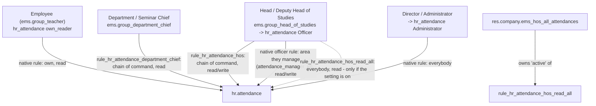

# Technical Reference: Employee Attendance (`hr.attendance`) - Access, List and Archiving

## Overview

The staff's own check-ins and check-outs are Odoo's native `hr.attendance`. EMS decides **who sees
and corrects whose**, how the list opens for each of them, and what happens to a past course's
records (issue #543). Correction requests have their own page:
[`ems.attendance_correction`](../attendance/attendance_correction.md).

## Access control

| Role | Whose attendance | Read | Write / create / delete | How |
|---|---|:---:|:---:|---|
| Employee | Their own | Yes | No | `hr_attendance.group_hr_attendance_own_reader` (native rule and ACL) |
| Department / Seminar Chief | Everybody below them in the chain of command | Yes | No | `rule_hr_attendance_department_chief`; no write ACL at all |
| Head / Deputy Head of Studies | Their own branch: the chain of command and the area they manage | Yes | Yes | `rule_hr_attendance_hos` + hr_attendance's own officer rule |
| Head / Deputy Head of Studies, setting on | Everybody | Yes | Only their own branch | `rule_hr_attendance_hos_read_all` |
| Director | Everybody | Yes | Yes | `ems.group_director` implies `hr_attendance.group_hr_attendance_manager` |
| Administrator | Everybody | Yes | Yes | `ems.group_academic_admin` implies the Director's group |

**"Their own branch" is the real hierarchy, not the role centre-wide** (see "Permission/approval
escalation" in `CLAUDE.md`), through the two ways somebody is a Head of Studies' own:

- **the chain of command**: `('employee_id.tutor_scope_user_ids', 'in', user.id)` - the employee
  themselves, every chief above them through `parent_id`, and the company's Director. The same
  non-stored, searchable field every tutor-scoped rule uses
  ([role hierarchy](role_hierarchy.md)); a Department Chief matches it for their department, a
  Head of Studies for every department below them;
- **the area they manage**: `hr.employee.attendance_manager_id` (kept equal to
  `leave_manager_id`, the manager of the employee's top-level department), which is what
  hr_attendance's own *Officer* rule already matches.

**Why the Head of Studies' group stopped implying hr_attendance's Administrator group.** That
group's own native rule is `[(1, '=', 1)]`, and group rules add up: no other rule can narrow it
back. So `ems.group_head_of_studies` now implies `hr_attendance.group_hr_attendance_officer`
(with a `(3, ...)` on the old one in `security/groups.xml`, since an implication already stored
survives its line being deleted) and `ems.group_director` implies the Administrator group
instead. Odoo never takes an implied group away from the users who already hold it, so
`res.users._ems_revoke_stale_attendance_admin()` does, from `migrations/18.0.0.36.0/post-migrate.py`:
only from users who hold the Head of Studies' group and no group that still implies it - a user it
was granted to by hand without being a Head of Studies is left alone.

## The "Heads of Studies see everybody's attendance" setting

`res.company.ems_hos_all_attendances` (Employee Attendances > Configuration > Settings, off by
default). Some centres need every Head of Studies to know at any time who is in. A record rule
cannot read a setting, so the setting owns the `active` flag of
`ems.rule_hr_attendance_hos_read_all` (`res.company._sync_hos_all_attendances_rule()`, called from
`write()`): a read-only `[(1, '=', 1)]` rule for the Head of Studies' group, declared
`noupdate="1"` and inactive so an upgrade never resets what the setting chose. It widens reading
only: writing, and deciding correction requests, stay within the branch.

## How the list opens

`hr_attendance.hr_attendance_action` used to open grouped by month and by employee for everybody.
A plain employee only ever sees their own attendance, so the grouping just hid the rows they came
for (picking one to request a correction). Now:

- from Department Chief up: grouped, as before;
- everybody else: a flat list, most recent first.

One action, no per-role context: a `search_default_*` for a filter the user's groups do not include
is simply ignored. `view_hr_attendance_filter_inherit_ems` therefore keeps each default group-by
twice - the native `groupby_name` / `employee` with `groups="!ems.group_department_chief"` (there
for a plain employee to use by hand) and `ems_manager_date` / `ems_manager_employee` with
`groups="ems.group_department_chief"` - and the action's context (overridden in
`views/attendance/menu.xml`) only switches the managers' ones on. Each user sees one "Date" and
one "Employee" in the Group By menu.

## Archiving a past course

`hr.attendance` gets an `active` field (it has none natively). `_ems_archive_before_course(course)`
archives every attendance whose `check_in` is before the course's first day (1 September, in the
company's timezone), in plain SQL: it is a flag on old rows, and `write()` would recompute overtime
and re-run the check-in/out validations for thousands of unchanged attendances.

- **Course transition**: `ems.course_transition_wizard._apply_transition_flip()` calls it for the
  incoming course, only when the centre actually flips (while a study is still pending, the
  outgoing course is still the current one).
- **Existing databases**: `migrations/18.0.0.36.0/post-migrate.py` archives everything before the
  current course. A clean install has nothing to archive, so there is no `post_init_hook`
  counterpart.
- Archived attendance is out of every list and report by default; the search view's **Archived**
  filter brings it back. Nothing is deleted.

## Tests

- `tests/test_employee_attendance_access.py`: every row of the access table, the setting, both
  flows of the correction requests, the list's filters per role, archiving and the group clean-up.
- `tests/test_course_transition.py`: archived on the flip, never before it.
- `tests/test_employee_role_group_sync.py`: the Head of Studies' role grants the Officer group,
  only the Director's the Administrator one.
- Tours (`employee_attendance_list_tour.js`): the flat list as a teacher, the grouped one as a
  Department Chief.
