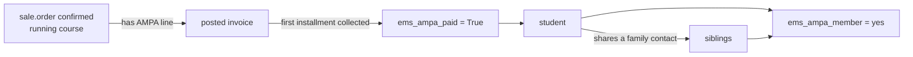

# AMPA membership (issue #820)

Tutors, the chiefs above them, the secretary's office and the administration see which students
are AMPA members, in the Students list (column and filters) and on the student form.

## Rule

A student is an AMPA member when:

- their **confirmed** enrollment (`sale.order`, `state = 'sale'`) of the **running course**
  (`res.partner._ems_running_course()`) carries the `ems.product_generic_ampa` line, and
- the **first installment** of that enrollment's posted invoice is collected. The AMPA fee is a
  non-fee item, billed in the first installment (`ems_first_installment`). "Collected" is the same
  test the portal's payment block uses: `account.move.line._ems_installment_paid()`.

A **sibling** of a member is a member too: the fee is paid once per family. Siblings are students
sharing a family contact (`res.partner.relation.all`, `other_partner_id.contact_type = 'family'`).

An enrollment without an invoice, with the invoice unpaid, or without the AMPA line is not a membership.

## Fields

| Model | Field | Kind | Notes |
|---|---|---|---|
| `sale.order` | `ems_ampa_paid` | Boolean, stored compute | Depends on `state`, the order lines' products and the invoice lines' `reconciled`/`amount_residual`/move `state`, so a payment, an unreconciliation or a cancelled invoice recomputes it. Stored so the filters are a plain domain. |
| `res.partner` | `ems_ampa_member` | Selection `yes`/`no`, non-stored, `depends_context('uid')`, with a search method | `groups="ems.group_tutor,ems.group_secretary"` (every chief and the administration imply `group_tutor`). Empty (`False`) for a student outside the reader's scope, so "not yours" never reads as "not a member". |

`res.partner._ems_ampa_member_ids()` returns the member ids centre-wide (payers of the running
course plus their siblings): three queries, shared by the compute and the search.

## Access

`res.partner._ems_ampa_scope_domain()`:

| Reader | Students they see the value for |
|---|---|
| Secretary, academic admin, system admin | All |
| Tutor, Department/Seminar Chief, Head of Studies/Deputy, Director | Their tutor scope: `tutor_id.tutor_scope_user_ids = uid` (see "Tutor scope" in `docs/en/developers/employees/role_hierarchy.md`) |
| Plain teacher and other roles | Field not available (`groups=`) |

The search method applies the same scope, so the filters never list students outside it.

## Views

- Students list (`ems.view_student_list`): optional `AMPA` column.
- Students search (`ems.view_student_search`): `AMPA member` / `Not an AMPA member` filters, in a
  group of their own so they narrow "My students".
- Student form (`ems.view_contact_form`): `AMPA` Yes/No badge next to Benefits, hidden when empty.

## Performance

Measured on the dev database (1,158 active students, 558 confirmed enrollments of the running course):
reading the field for every student takes ~80 ms cold and 3 ms warm; each filter ~25-33 ms cold and
12-13 ms warm. The stored `ems_ampa_paid` was computed for every existing enrollment on upgrade; no
migration is needed.

## Tests

`tests/test_ampa_membership.py` (rule, siblings, course, unreconciliation, scope by role, filters) and
`tests/test_ampa_membership_tour.py` (tutor: kanban, list column and filter, form badge).
