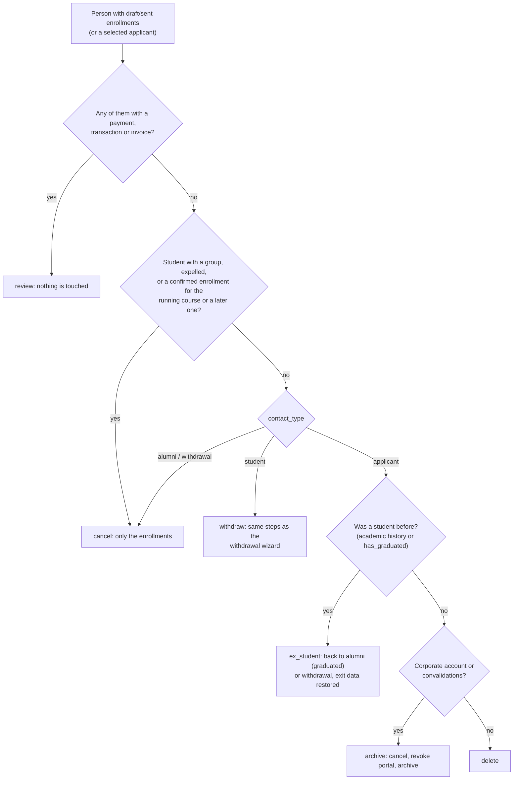

# Technical Reference: closing unconfirmed enrollments

`ems.enrollment_close_wizard` (`models/enrollment/enrollment_close_wizard.py`, issue #643).

Once the enrollment period is over, every enrollment still in draft or sent belongs to someone who
never formalised it. What has to happen to that person depends on who they are, so the wizard
resolves one **action per person** (not per enrollment), shows it in a preview and only applies it
when confirmed.

## Entry points

| Where | Launched on | People considered |
|-------|-------------|-------------------|
| Matrícules list, **Action → Close unconfirmed enrollments** (`action_server_enrollment_close`, bound to `sale.order`, `list` and `form`: the enrollment form has no Actions dropdown) | the selected enrollments | the customers of the selected draft/sent ones |
| Pre-inscripció list, header button (next to "Enrollment proposal") | the selected applicants | each of them, with or without an enrollment |

The Pre-inscripció list also gets a **Without enrollment** filter (no draft, sent or confirmed
enrollment), which is how the applicants imported from GEDAC who never got an offer are found.
The Matrícules list has no loose header button: "Send Enrollment" is in the same Action menu
(`action_server_enrollment_send`, `list` only: the form has Odoo's own "Send by email").

Every draft/sent enrollment of a person is handled, not only the selected ones: a person is either
leaving or not. A person holds at most one live enrollment per course (the
`sale_order_unique_enrollment_per_course` index), so a confirmed enrollment is never one of the
pending ones: one for the running course or a later one means they are staying, even while still
waiting for a group (`transition_status = 'unplaced'`), and only the pending ones are cancelled.

The **Without enrollment** filter reads `res.partner.ems_has_enrollment`, a non-stored, searchable
boolean: any draft, sent or confirmed enrollment, whatever the course.

## Decision per person

| Action | Enrollments | Contact |
|--------|-------------|---------|
| `review` | untouched | untouched |
| `cancel` | cancelled | untouched |
| `withdraw` | cancelled | `res.partner._ems_register_exit()`, the withdrawal wizard's own steps: exit data, academic history frozen, operational records cleared, alumni/withdrawal, Google grace period, portal revoked, archived |
| `ex_student` | cancelled | exit data restored from the newest academic history record that has one (`exit_type`, its course, `exit_date`); then `_ems_leave_centre()`: alumni if `has_graduated`, withdrawal otherwise, Google grace period, portal revoked, archived |
| `archive` | cancelled | portal revoked (family kept if another child is enrolled), archived |
| `delete` | deleted | portal revoked for the family as above; portal users deleted; the contact deleted with what cascades from it (authorizations, documents, bank accounts) |

An applicant who was a student before got there through `sale.order._ems_offer_to_ex_student()`,
which clears the exit data when the offer is sent; `ex_student` is its reverse.

A deletion runs in a savepoint: if anything still references the contact (a restricted foreign
key nobody foresaw), it falls back to `archive` and the summary lists it as an issue. The same
happens to an archive the portal revoke could not clear (see `_ems_leave_centre()`).

Cancellation uses `sale.order._action_cancel()`, Odoo's own, which sends no email. The only emails
sent are the Google Workspace grace-period warnings of `withdraw` and `ex_student`.

## Access

Same as the withdrawal wizard (`res.partner._ems_user_can_register_exits()`): secretary, Head of
Studies, administrator. Anybody else gets a `UserError` on open and on apply.
