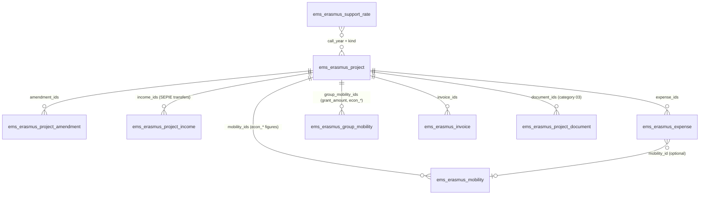
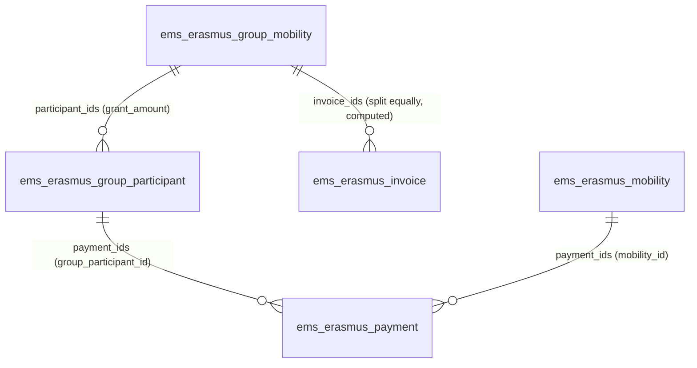

# Erasmus+ economic management (issue #762)

The economy of each Erasmus+ project: its grant (awarded, amendments, final) and the transfers
SEPIE makes, what its mobilities and expenses **commit**, what has been **paid**, what is
**available**, the **organisational support** generated, warnings and an Excel export. Code:
`models/erasmus/economy.py`, views `views/erasmus/economy/views.xml`, export route in
`controllers/erasmus_export.py`, tests `tests/test_erasmus_economy.py`.

**One source for every amount.** Nothing is typed twice: a mobility's commitment is its existing
`grant_amount` (phase 6), what has been paid comes from the existing grant payments
(`ems.erasmus.payment`) and invoices (`ems.erasmus.invoice` and their provisions). The new models
only hold what EMS had nowhere: the grant's amendments, SEPIE's transfers, the project's own
expenses and the organisational support rates.

## Models

| Model | Purpose |
|---|---|
| `ems.erasmus.economy` (abstract) | The economic figures of a mobility, shared by the individual (`ems.erasmus.mobility`) and the group ones (`ems.erasmus.group.mobility`): `econ_state`, `econ_forecast`, `econ_committed`, `econ_paid`, `econ_pending` (stored computes) and `recovered_amount` (what the participant gave back). Each model gives its inputs in `_ems_economic_inputs()`; the arithmetic is the module function `economic_figures()`. |
| `ems.erasmus.project` (extended) | `call_year` (from the agreement number, `2026-1-ES01-...`, editable), `final_grant`, the stored totals below, `support_adjustment` + reason, the aggregated figures from before EMS (`legacy_*`), `economy_warnings`, and its documents of category *03 Finances* (the grant agreement and annexes, kept in the Documentation tab like every other document). |
| `ems.erasmus.project.amendment` | An amendment of the grant: date, amount (negative for a reduction), description, files. |
| `ems.erasmus.project.income` | A transfer SEPIE made: date, kind (prefinancing, further prefinancing, balance, other), amount (> 0), files. A *balance* sets the project's `final_payment_date` if empty (the documents' keeping period counts from it). |
| `ems.erasmus.expense` | An expense of the project outside the participants' grants (working meals, merchandising, dissemination, language preparation...): reference `DESP-<year>-<id>`, project, concept, category (*Organisational support* or *Other project expenses*), date, amount (> 0), supplier, optional mobility (of the same project, linked by the Erasmus team only), invoice or receipt files, notes; `state` to pay / paid / cancelled. Also `transferred_amount` (what was transferred, set when paid), `counted_amount` (stored: what it consumes of the budget, `_ems_value()`) and `corrected_from_id` (see *Expenses*). |
| `ems.erasmus.expense.correct.wizard` | *Correct*: the only way to change a paid (or cancelled) expense's figures, with a required reason posted in its chatter; sets `corrected`. |
| `ems.erasmus.support.rate` | Organisational support per participant: call year, action (KA121-VET / KA131-HED), kind of mobility (`SUPPORT_TYPES`), band of participants (`band_from`-`band_to`, empty = no limit) counted as `band_scope` says, set from the action and hidden in the list (issue #788; `same`: among the same kind of mobility, KA121-VET; `project`: among every participant of the project, KA131-HED), `min_days` (empty = any length), amount, conditions. Bands of the same year, action and kind never overlap (the error names the other rate and its band). Seeded from `data/custom/erasmus/ems.erasmus.support.rate.csv` (KA121-VET 2025 and 2026, KA131-HED 2026), frozen afterwards like every `data/custom/` record: a new year's rates are added in the app. |

## Economic state of a mobility

The economic state never replaces the mobility's own state; it is derived from it:

| Mobility state | Phase | Group mobility state |
|---|---|---|
| *Defining the mobility* (`choosing`) | forecast | draft, enrolment, selection, waiting for validation |
| *Preparing*, *Closed* | committed | preparation, during the stay, on return, closed |
| *Cancelled* | cancelled | cancelled |

`economic_figures(planned, spent, paid, phase, recovered)`:

- **planned**: the grant (`grant_amount`; for a group, the sum of its active participants' own
  grants, `ems.erasmus.group.participant.grant_amount`, students and accompanying teachers alike,
  entered on the group's *Collective expenses* tab; each is counted **once**, in the group, never as
  a mobility of its own). Before the selection is approved a group has no participants, so no
  forecast.
- **spent**: what has been requested or invoiced out of it: the grant payments plus the provisions
  of services (individual), the collective invoices (group).
- **paid**: payments with state *paid* plus provisions whose invoice is paid (individual), paid
  collective invoices (group); minus `recovered_amount`.
- forecast: `econ_forecast` = grant, committed = only what has already gone out.
- committed: `econ_committed` = max(grant, spent): **paying never adds** a second expense, it only
  moves an amount from pending to paid; an invoice above the grant is still counted.
- cancelled: committed = what was paid and not given back (`adjusted` while above zero, then
  `cancelled`), so the rest of the grant is released.
- `econ_state`: forecast, committed, partial (something paid), paid (paid ≥ committed), cancelled,
  adjusted (cancelled with payments).

A change of grant, of payments, of the project (`project_id`) or of the state just recomputes:
nothing is duplicated, a mobility moved to another project takes its figures with it.

## Project totals (stored)

| Field | Formula |
|---|---|
| `grant_current` | `budget` (grant awarded) + amendments |
| `received_amount` / `to_receive_amount` | SEPIE transfers / current grant - received |
| `forecast_amount` | Σ mobilities' `econ_forecast` |
| `other_expense_amount` | the expenses' counted amount (`_ems_value()`) + the project's invoices of no mobility (`_ems_loose_invoices()`: an invoice of a mobility is a provision, already in its grant) |
| `committed_amount` | Σ mobilities' `econ_committed` + other expenses + `legacy_committed` |
| `paid_amount` | Σ mobilities' `econ_paid` + what was transferred of the expenses and paid loose invoices + `legacy_paid` |
| `pending_amount` | committed - paid |
| `available_amount` | current grant - committed (not the money received) |
| `support_forecast` / `support_generated` | see below (`support_generated` includes `support_adjustment` and `legacy_support_generated`) |
| `support_expense_amount` / `support_balance` | counted amount of the expenses of category organisational support / generated - spent |

They are stored so the panel can sum and group them. The organisational support depends on rates,
which no field links: `ems.erasmus.support.rate`'s create/write/unlink call
`projects.modified(['call_year'])` on the projects of the affected years, which recomputes them.

## Organisational support

`_ems_support_lines()` lists every eligible participant of the project, ordered by start date:

- individual mobilities not cancelled, with their `support_type` (stored compute, editable): a
  staff mobility is *courses and training* when its activity is a structured course, *job shadowing
  or teaching* otherwise; a student's is *long-term (ErasmusPro)* from 90 days on, *short-term*
  below. *Third country not associated* and *skills competitions, invited experts or hosted
  teachers* are only set by hand, and a later change of dates keeps them;
- group mobilities not cancelled: before the selection is approved, one line per **student place**
  (forecast only); afterwards, its active **student** participants. Leaders and accompanying
  teachers are never lines.

Each line takes the rate of the project's `call_year` and `kind` (never the current year's) for its
kind and its **position** (the band; the position kept for the Excel is the one the rate counted: among the same kind of mobility, or among the whole project when the rate's *Count the participants of* is *Whole project*; e.g. KA121-VET: 350 € up to the 100th short-term student, 200 €
from the 101st; KA131-HED: 400 € for the first 100 participants, students and staff together, 230 €
beyond), separately for the forecast (every line) and
for what is generated (only completed ones: individual *Closed*, group *on return* or *closed*). A
stay shorter than `min_days` generates nothing. A line with no rate, or with no dates when a rate
needs a minimum, has a `missing` reason, shown in the warnings and the Excel. The organisational
support is part of the grant awarded: it is never added to `grant_current`, and `support_balance` is
an internal indicator, not a certification of SEPIE.

## Expenses

- Registered by the team or the Secretary (`create`); each one is a to-do for the Secretary
  (`_ask_transfer()`, the same daily digest as payments and invoices).
- Paid with the same **transfer wizard** as grant payments and invoices (`TRANSFER_FIELDS` in
  `grant.py` maps each payable model to the wizard's field; `expense_ids` is added in
  `economy.py`), and undone with the same undo wizard, with its reason. Paying changes no total
  except *paid*: an expense counts in *committed* from the moment it is registered.
- While *to pay*, editable. Once paid or cancelled, `project_id`, `amount`, `category`, `concept`,
  `date` and `mobility_id` only change through *Correct* (team), which keeps the reason and marks it
  `corrected`; files, supplier and notes stay editable (the Secretary adds receipts).
- **Correcting a paid expense** never loses what was transferred (`transferred_amount`, set when it
  is paid and never changed by a correction). Above it: the expense keeps the transferred amount
  (still paid), EMS creates a new expense for the difference, *to pay*, with `corrected_from_id`
  pointing to the original and a to-do for the Secretary, and the original's history says so.
  Below it: the expense takes the new amount, `transferred_amount` stays, and the project counts
  what was really transferred (`counted_amount` = 0 if cancelled, max(amount, transferred)
  otherwise; committed and paid of the project use `_ems_value()`) and warns "<ref> was paid X above
  its corrected amount: ask for it back, then undo the transfer and register the right one."
- The expense lists total the `counted_amount` column (*Counted*); *Amount* has no total.
- *Cancel the expense* (team, only unpaid) and *Restore*. A paid expense cannot be deleted.

## Warnings (`_ems_economy_warnings()`)

Shown on the Economy tab and counted on the panel; they block nothing: committed above the current
grant; expenses without an invoice or receipt; payments, invoices and expenses still to transfer;
expenses changed after payment; expenses paid above their corrected amount; a mobility paid above its grant (grant lowered after paying); a
cancelled mobility or group with money paid (to recover, or an eligible cost); participants with not
enough information for the organisational support.

## Screens

- *Erasmus+ > Financial management > Economic panel* (`action_erasmus_economy_panel`): one row per
  project (awarded, committed, paid, available, support generated, warnings), filters by action,
  final payment and *above the grant*, grouping by call year and action, and a pivot view to compare
  calls; a row opens the project's form, whose first tab is **Economy**.
- The project's **Economy** tab: warnings, grant, budget, amendments, SEPIE transfers, the economic
  documents, the expenses, the organisational support and the figures from before EMS; the Actions
  dropdown's **Download the economy (Excel)**.
- *Financial management > Expenses* (`action_erasmus_expense`; its list has the *Register transfer* header button for the Secretary, who can select several), *Configuration > Organisational
  support rates* (`action_erasmus_support_rate`).
- The mobility's *Grant* tab shows its economic figures and its *Organisational support as*; the
  group mobility's *Collective expenses* tab, its figures and each participant's grant (editable by
  the team), also on the participant's form. The participants' grants list has no total: the
  group's grant above it is the total (a withdrawn participant never counts). The SEPIE transfer's
  column is *Type*.

## Excel export

`project._ems_economy_xlsx()`, served at `/ems/erasmus/project/<id>/economy` (built on the fly,
never stored). Sheets: *Summary* (the same stored totals as the panel), *Grants* (each mobility:
forecast, committed, paid, pending, given back), *Payments* (grant payments and invoices with their
receipts), *Expenses*, *Organisational support* (one row per line, with what is missing) and *Grant
and income*. No accounting entries or invoices are generated.

## Access

| Model / field | Erasmus team | Secretary | Director | Head of Studies |
|---|---|---|---|---|
| Project economic fields (`groups=`) | rw | r | r | - |
| `ems.erasmus.project.amendment`, `.income`, `.support.rate` | rwcu | r | r | - |
| `ems.erasmus.expense` | rwcu (correct, cancel) | rwc (+ register and undo the transfer) | r | - |
| `ems.erasmus.payment`, `.invoice`, `.provision` | rwcu | r | r (never `bank_account`/`bank_holder`) | - |
| `ems.erasmus.expense.correct.wizard` | rwcu | - | - | - |
| Excel export | yes | yes | yes | - |

The Secretary reads each participant's name and grant in the project's warnings and in the Excel
export (she pays them) but does not open the mobilities themselves, and cannot read them: the
expense's `mobility_id` is read-only for her. Files uploaded in an expense, an amendment, a SEPIE
transfer, a project document or a diffusion action are tied to their record once saved
(`ems.attachment_link_mixin`, `models/shared/attachment.py`: it links files with no `res_id` to the
record and never deletes a removed one; `ems.attachment_mixin` builds on it and also deletes).

The administrator (`ems.group_academic_admin`) can do everything the team does. Changes to the
economic lines are checked in Python too (`_check_manager()`), and every amendment and SEPIE transfer
added, changed or deleted is posted in the project's chatter. The mobilities' and group mobilities'
`econ_*` fields and `grant_amount` (group) carry `groups=` so a teacher or a leader never reads
them; a group participant's own `grant_amount` and pocket money figures are also readable by the
group's leader and accompanying teachers (`ems.group_erasmus_group_teacher`, issue #764), its
`bank_account`/`bank_holder` only by the team, the Secretary and the administrator.

## Pocket money of group participants (issue #764)

Every active participant of a group mobility (students and accompanying teachers) receives what is
left of their own grant once the collective invoices are paid: their **pocket money**, transferred
by the Secretary as an ordinary grant payment (`ems.erasmus.payment`), with the same transfer and
undo wizards as the individual mobilities.

**Example.** 8 students (1,200 € each) and 2 teachers (1,500 € each): 12,600 €. The centre pays a
2,000 € flight and a 5,000 € hotel (collective invoices): 700 € per person. A student's pocket money
is 1,200 - 700 = 500 €, a teacher's 800 €: 5,600 € in all. The group's figures: committed 12,600 €
(the grants), spent 7,000 + 5,600 = 12,600 €, nothing counted twice.

### What is shared with the individual mobilities

`ems.erasmus.payee` (abstract, `models/erasmus/payee.py`, loaded before the mobilities) holds the grant-payment logic both kinds of payee use:
`can_request_prefinancing` / `can_request_final`, the first payment (`prefinancing` or, at 100 %,
`single`) as the prefinancing percentage of the amount to transfer, the final one as what is left,
`_ems_left_to_pay()` and the portal's rows (`_ems_portal_grant()`). Each payee says what it transfers
(`_ems_payee_amount()`: an individual's `grant_net`, a participant's `pocket_amount`), its
percentage, when a payment may be requested and how a payment points at it (`mobility_id` or
`group_participant_id`; exactly one, checked).

### Fields

| Model | Field | Meaning |
|---|---|---|
| `ems.erasmus.group.mobility` | `prefinancing_percent` | Part of the pocket money paid before leaving (default **100**: one single payment); the rest on return. |
| | `no_direct_costs` | Edited through `travel_paid_by` (*Who pays the travel and accommodation*: the centre / each participant, non-stored with an inverse, issue #784), the same choice asked in positive. Each participant: no collective invoice can be added (blocked, with a warning on the form), each participant's pocket money is their whole grant. Cannot be set while the group has invoices. |
| `ems.erasmus.group.participant` | `invoice_share` | Their equal share of the group's collective invoices: each invoice's amount divided among the **active** participants, the cents left over on the first one (same rule as an individual invoice's shares). Computed, never typed. |
| | `pocket_amount` | `grant_amount - invoice_share` (below zero: a warning). |
| | `pocket_requested` / `pocket_paid` / `pocket_state` | What has been requested and paid, and *not requested*, *to pay*, *paid*. Read with sudo, so the leader sees them without reading the payments. |
| | `bank_account` / `bank_holder` | The IBAN (mod-97 checked) and holder the participant gives for the pocket money: a student on the portal, a teacher from *My bank account* on the group form, or the team. Empty: the contact's first bank account (a student's from the enrolment). |
| `ems.erasmus.payment` | `group_participant_id`, `group_mobility_id` | The participant paid; `partner_id`, `project_id`, `call_id` are stored computes from whichever payee it has. One first and one final payment per participant (unique index). |

### Requesting and paying

- *Request pocket money* (group form, Actions; team): one first payment per active participant
  with something to receive and none yet, from **Preparation** to **Closed**; *Request the final
  pocket money* only **on return** or **closed**, when the percentage is below 100. A participant
  with no IBAN (their own or the contact's) blocks the request, naming them.
- **One task per group for the Secretary** (not one per payment): an activity of type *Pay
  Erasmus+ pocket money* (`ems.mail_activity_erasmus_transfer`) on the group's first payment still
  to pay (the Secretary cannot open the group mobility), "pay the pocket money of <group> (N
  payments, total)", kept up to date as payments are requested, paid or undone (moved to the next
  payment to pay when its own is paid) and marked done once none is left
  (`group._ems_sync_transfer_task()`, called from `_ask_transfer()` and `_mark_paid()`).
- The Secretary pays them from *Financial management > Grant payments* (filter and group by group
  mobility), several at once with one receipt, or from a payment's *Register the transfer of the
  whole group*.
- A teacher gives their account with *My bank account* (`ems.erasmus.bank.wizard`, only for their
  own participant record); a student on the group's portal page (`/my/erasmus/group/<id>/bank`).
  The portal's grant table is one template for both kinds of payee
  (`ems.portal_erasmus_grant_table`).
- **Closing** the group waits until every active participant's pocket money is requested and paid
  and no collective invoice is left to pay.

### Figures

The group's `_ems_economic_inputs()`: spent = collective invoices + pocket payments; paid = paid
invoices + paid pocket payments. A withdrawn participant who was paid is warned in the project
("record what they gave back"); the group's `recovered_amount` takes it.

### Who sees what

| | Erasmus team | Secretary | Director | Leader / accompanying teacher | Participant (portal) |
|---|---|---|---|---|---|
| Collective invoices of the group | rwcu | r | r | r (own group) | - |
| Grant, share, pocket money, state | rw (grant) | r (payments list, Excel) | r | r (own group) | own, on the portal |
| IBAN and holder | rw | r | - | - | own (writes it) |
| Payments | request | pay, undo | r | - (states only) | own rows |

`ems.erasmus.invoice` gets read access for `ems.group_erasmus_group_teacher` with a rule limited to
the groups they lead or accompany (plus an *all* rule for the team, the Secretary, the Director and
the administrator, so holding both never narrows them).

## Why not Odoo's accounting (`account.move`, `account.payment`)

EMS depends on `account` for enrolments (customer invoices to families), but the Erasmus+ economy
is its own models. Reasons:

- **What it records is not accounting.** Most of it is the SEPIE grant: the budget lines of the
  grant agreement, the prefinancing and final transfers, what each mobility commits, the
  organisational support generated per participant, what is given back. None of this has a place
  in `account.move`; it would have to be kept beside it anyway.
- **A participant's grant is not a vendor bill.** It is part of the subvention transferred to a
  student or teacher, with no invoice behind it. Recording it as a bill or a payment would need a
  journal, accounts and every participant set up as a vendor, for no use of the centre.
- **Collective invoices are split.** A group's flight or hotel invoice is divided among its
  active participants and lowers each one's pocket money (`invoice_share`, `pocket_amount`); an
  individual invoice becomes provisions of one or more mobilities. A vendor bill knows nothing of
  this.
- **Access.** The Erasmus team are teachers. Creating and paying vendor bills needs accounting
  rights (`account.group_account_invoice`), which also let them edit and pay every invoice of the
  centre, the families' enrolment invoices included. With own models their rights stop at the
  Erasmus+ economy.

Open question (to check with the Secretary): if the centre's official accounting is kept outside
EMS, entries generated here would be a second, unofficial copy of it. The supplier invoices
(`ems.erasmus.invoice`: hotels, flights) are the part closest to a native vendor bill, and could
become one if the centre ever keeps its accounting in Odoo.

## Install and upgrade

New models and stored fields only (issue #764: `ems.erasmus.payment.mobility_id` stops being required; the payment's `partner_id`/`project_id`/`call_id` become stored computes that keep their values): on an upgrade, Odoo creates the columns and computes every
stored figure for the existing projects and mobilities (`call_year` from each agreement number). No
migration. The rates of the calls known so far are seeded once from `data/custom/` (clean install and
upgrade alike); the coordination adds the next years' in the app.
