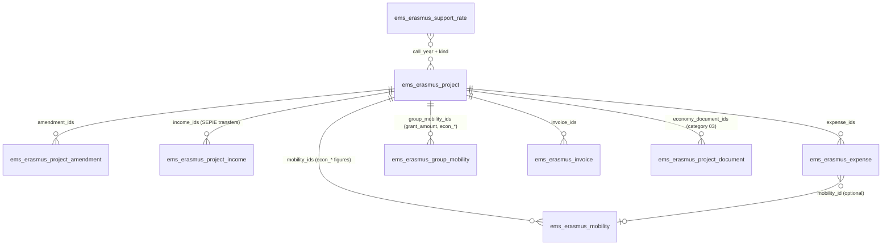

# Erasmus+ economic management (issue #762)

The economy of each Erasmus+ project: its grant (awarded, amendments, final) and the transfers
SEPIE makes, what its mobilities and expenses **commit**, what has been **paid**, what is
**available**, the **organisational support** generated, warnings and an Excel export. Code:
`models/erasmus/economy.py`, views `views/erasmus/economy/views.xml`, export route in
`controllers/erasmus_export.py`, tests `tests/test_erasmus_economy.py`.

**One source for every amount.** Nothing is typed twice: a mobility's commitment is its existing
`grant_amount` (phase 6), what has been paid comes from the existing grant payments
(`ems.erasmus.payment`) and invoices (`ems.erasmus.invoice` and their provisions). The new models
only hold what EMS had nowhere: the grant's amendments, SEPIE's transfers, the project's own
expenses and the organisational support rates.

## Models

| Model | Purpose |
|---|---|
| `ems.erasmus.economy` (abstract) | The economic figures of a mobility, shared by the individual (`ems.erasmus.mobility`) and the group ones (`ems.erasmus.group.mobility`): `econ_state`, `econ_forecast`, `econ_committed`, `econ_paid`, `econ_pending` (stored computes) and `recovered_amount` (what the participant gave back). Each model gives its inputs in `_ems_economic_inputs()`; the arithmetic is the module function `economic_figures()`. |
| `ems.erasmus.project` (extended) | `call_year` (from the agreement number, `2026-1-ES01-...`, editable), `final_grant`, the stored totals below, `support_adjustment` + reason, the aggregated figures from before EMS (`legacy_*`), `economy_warnings`, and `economy_document_ids` (its documents of category *03 Finances*: the grant agreement and annexes, in the same records and ZIP as every other document). |
| `ems.erasmus.project.amendment` | An amendment of the grant: date, amount (negative for a reduction), description, files. |
| `ems.erasmus.project.income` | A transfer SEPIE made: date, kind (prefinancing, further prefinancing, balance, other), amount (> 0), files. A *balance* sets the project's `final_payment_date` if empty (the documents' keeping period counts from it). |
| `ems.erasmus.expense` | An expense of the project outside the participants' grants (working meals, merchandising, dissemination, language preparation...): reference `DESP-<year>-<id>`, project, concept, category (*Organisational support* or *Other project expenses*), date, amount (> 0), supplier, optional mobility (of the same project), invoice or receipt files, notes; `state` to pay / paid / cancelled. |
| `ems.erasmus.expense.correct.wizard` | *Correct*: the only way to change a paid (or cancelled) expense's figures, with a required reason posted in its chatter; sets `corrected`. |
| `ems.erasmus.support.rate` | Organisational support per participant: call year, action (KA121-VET / KA131-HED), kind of mobility (`SUPPORT_TYPES`), band of participants (`band_from`-`band_to`, 0 = no limit) counted as `band_scope` says (`same`: among the same kind of mobility, KA121-VET; `project`: among every participant of the project, KA131-HED), `min_days`, amount, conditions. Bands of the same year, action and kind never overlap. Seeded from `data/custom/erasmus/ems.erasmus.support.rate.csv` (KA121-VET 2025 and 2026, KA131-HED 2026), frozen afterwards like every `data/custom/` record: a new year's rates are added in the app. |

## Economic state of a mobility

The economic state never replaces the mobility's own state; it is derived from it:

| Mobility state | Phase | Group mobility state |
|---|---|---|
| *Defining the mobility* (`choosing`) | forecast | draft, enrolment, selection, waiting for validation |
| *Preparing*, *Closed* | committed | preparation, during the stay, on return, closed |
| *Cancelled* | cancelled | cancelled |

`economic_figures(planned, spent, paid, phase, recovered)`:

- **planned**: the grant (`grant_amount`; for a group, the sum of its active participants' own
  grants, `ems.erasmus.group.participant.grant_amount`, students and accompanying teachers alike,
  entered on the group's *Collective expenses* tab; each is counted **once**, in the group, never as
  a mobility of its own). Before the selection is approved a group has no participants, so no
  forecast.
- **spent**: what has been requested or invoiced out of it: the grant payments plus the provisions
  of services (individual), the collective invoices (group).
- **paid**: payments with state *paid* plus provisions whose invoice is paid (individual), paid
  collective invoices (group); minus `recovered_amount`.
- forecast: `econ_forecast` = grant, committed = only what has already gone out.
- committed: `econ_committed` = max(grant, spent): **paying never adds** a second expense, it only
  moves an amount from pending to paid; an invoice above the grant is still counted.
- cancelled: committed = what was paid and not given back (`adjusted` while above zero, then
  `cancelled`), so the rest of the grant is released.
- `econ_state`: forecast, committed, partial (something paid), paid (paid ≥ committed), cancelled,
  adjusted (cancelled with payments).

A change of grant, of payments, of the project (`project_id`) or of the state just recomputes:
nothing is duplicated, a mobility moved to another project takes its figures with it.

## Project totals (stored)

| Field | Formula |
|---|---|
| `grant_current` | `budget` (grant awarded) + amendments |
| `received_amount` / `to_receive_amount` | SEPIE transfers / current grant - received |
| `forecast_amount` | Σ mobilities' `econ_forecast` |
| `other_expense_amount` | not-cancelled expenses + the project's invoices of no mobility (`_ems_loose_invoices()`: an invoice of a mobility is a provision, already in its grant) |
| `committed_amount` | Σ mobilities' `econ_committed` + other expenses + `legacy_committed` |
| `paid_amount` | Σ mobilities' `econ_paid` + paid expenses and loose invoices + `legacy_paid` |
| `pending_amount` | committed - paid |
| `available_amount` | current grant - committed (not the money received) |
| `support_forecast` / `support_generated` | see below (`support_generated` includes `support_adjustment` and `legacy_support_generated`) |
| `support_expense_amount` / `support_balance` | not-cancelled expenses of category organisational support / generated - spent |

They are stored so the panel can sum and group them. The organisational support depends on rates,
which no field links: `ems.erasmus.support.rate`'s create/write/unlink call
`projects.modified(['call_year'])` on the projects of the affected years, which recomputes them.

## Organisational support

`_ems_support_lines()` lists every eligible participant of the project, ordered by start date:

- individual mobilities not cancelled, with their `support_type` (stored compute, editable): a
  staff mobility is *courses and training* when its activity is a structured course, *job shadowing
  or teaching* otherwise; a student's is *long-term (ErasmusPro)* from 90 days on, *short-term*
  below. *Third country not associated* and *skills competitions, invited experts or hosted
  teachers* are only set by hand, and a later change of dates keeps them;
- group mobilities not cancelled: before the selection is approved, one line per **student place**
  (forecast only); afterwards, its active **student** participants. Leaders and accompanying
  teachers are never lines.

Each line takes the rate of the project's `call_year` and `kind` (never the current year's) for its
kind and its **position** (the band; e.g. KA121-VET: 350 € up to the 100th short-term student, 200 €
from the 101st; KA131-HED: 400 € for the first 100 participants, students and staff together, 230 €
beyond), separately for the forecast (every line) and
for what is generated (only completed ones: individual *Closed*, group *on return* or *closed*). A
stay shorter than `min_days` generates nothing. A line with no rate, or with no dates when a rate
needs a minimum, has a `missing` reason, shown in the warnings and the Excel. The organisational
support is part of the grant awarded: it is never added to `grant_current`, and `support_balance` is
an internal indicator, not a certification of SEPIE.

## Expenses

- Registered by the team or the Secretary (`create`); each one is a to-do for the Secretary
  (`_ask_transfer()`, the same daily digest as payments and invoices).
- Paid with the same **transfer wizard** as grant payments and invoices (`TRANSFER_FIELDS` in
  `grant.py` maps each payable model to the wizard's field; `expense_ids` is added in
  `economy.py`), and undone with the same undo wizard, with its reason. Paying changes no total
  except *paid*: an expense counts in *committed* from the moment it is registered.
- While *to pay*, editable. Once paid or cancelled, `project_id`, `amount`, `category`, `concept`,
  `date` and `mobility_id` only change through *Correct* (team), which keeps the reason and marks it
  `corrected`; files, supplier and notes stay editable (the Secretary adds receipts).
- *Cancel the expense* (team, only unpaid) and *Restore*. A paid expense cannot be deleted.

## Warnings (`_ems_economy_warnings()`)

Shown on the Economy tab and counted on the panel; they block nothing: committed above the current
grant; expenses without an invoice or receipt; payments, invoices and expenses still to transfer;
expenses changed after payment; a mobility paid above its grant (grant lowered after paying); a
cancelled mobility or group with money paid (to recover, or an eligible cost); participants with not
enough information for the organisational support.

## Screens

- *Erasmus+ > Financial management > Economic panel* (`action_erasmus_economy_panel`): one row per
  project (awarded, committed, paid, available, support generated, warnings), filters by action,
  final payment and *above the grant*, grouping by call year and action, and a pivot view to compare
  calls; a row opens the project's form, whose first tab is **Economy**.
- The project's **Economy** tab: warnings, grant, budget, amendments, SEPIE transfers, the economic
  documents, the expenses, the organisational support and the figures from before EMS; the Actions
  dropdown's **Export Excel**.
- *Financial management > Expenses* (`action_erasmus_expense`), *Configuration > Organisational
  support rates* (`action_erasmus_support_rate`).
- The mobility's *Grant* tab shows its economic figures and its *Organisational support as*; the
  group mobility's *Collective expenses* tab, its figures and each participant's grant (editable by
  the team), also on the participant's form.

## Excel export

`project._ems_economy_xlsx()`, served at `/ems/erasmus/project/<id>/economy` (built on the fly,
never stored). Sheets: *Summary* (the same stored totals as the panel), *Grants* (each mobility:
forecast, committed, paid, pending, given back), *Payments* (grant payments and invoices with their
receipts), *Expenses*, *Organisational support* (one row per line, with what is missing) and *Grant
and income*. No accounting entries or invoices are generated.

## Access

| Model / field | Erasmus team | Secretary | Director | Head of Studies |
|---|---|---|---|---|
| Project economic fields (`groups=`) | rw | r | r | - |
| `ems.erasmus.project.amendment`, `.income`, `.support.rate` | rwcu | r | r | - |
| `ems.erasmus.expense` | rwcu (correct, cancel) | rwc (+ register and undo the transfer) | r | - |
| `ems.erasmus.payment`, `.invoice`, `.provision` | rwcu | r | r (never `bank_account`/`bank_holder`) | - |
| `ems.erasmus.expense.correct.wizard` | rwcu | - | - | - |
| Excel export | yes | yes | yes | - |

The administrator (`ems.group_academic_admin`) can do everything the team does. Changes to the
economic lines are checked in Python too (`_check_manager()`), and every amendment and SEPIE transfer
added, changed or deleted is posted in the project's chatter. The mobilities' and group mobilities'
`econ_*` fields and `grant_amount` (group) carry `groups=` so a teacher or a leader never reads
them.

## Install and upgrade

New models and stored fields only: on an upgrade, Odoo creates the columns and computes every
stored figure for the existing projects and mobilities (`call_year` from each agreement number). No
migration. The rates of the calls known so far are seeded once from `data/custom/` (clean install and
upgrade alike); the coordination adds the next years' in the app.
