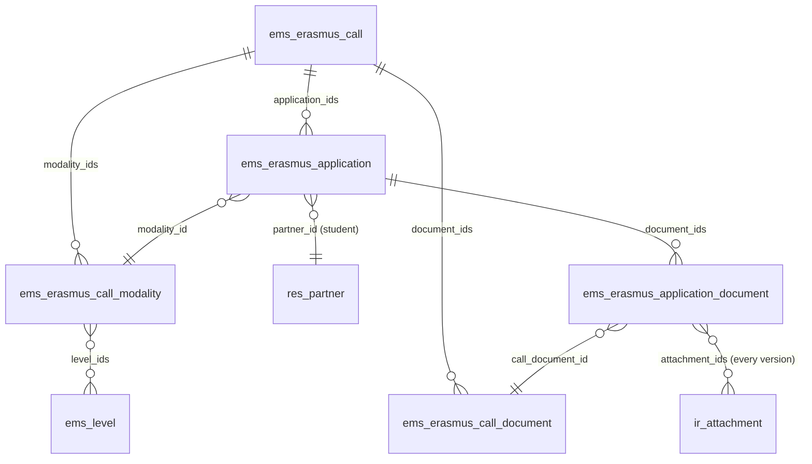
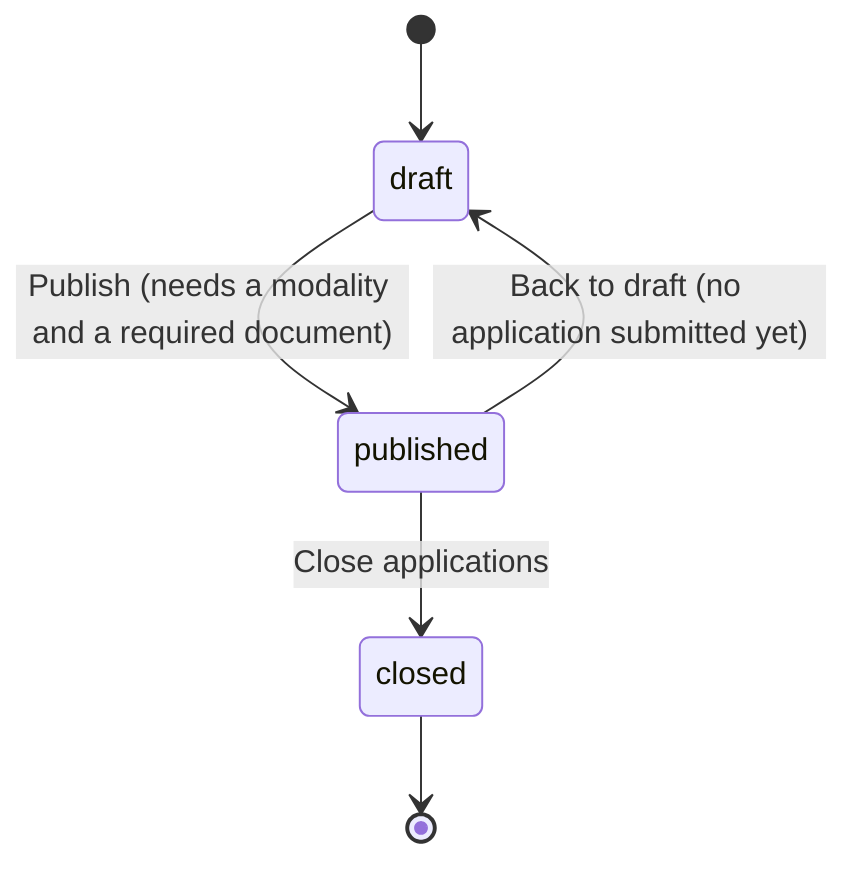
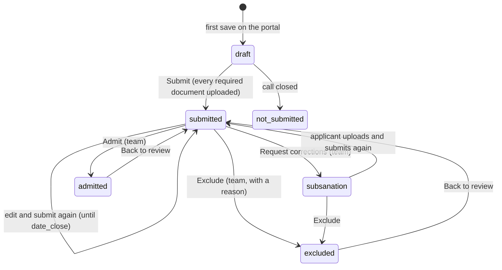

# Erasmus+ calls and applications

Issues #682 (umbrella) and #683 (phase 1). Design of the whole project: `plans/erasmus_portal.md`.
This page describes what is implemented.

The centre publishes a yearly Erasmus+ call for its vocational training students (CFGM/CFGS, any
year). Students apply from the portal (`/my/erasmus`), upload the documents the call asks for and
follow their application; the Erasmus team checks the requirements and the documents, asks for
corrections (subsanation) and admits or excludes each application. Scoring, interviews,
resolutions and the staff call come in later phases.

## Models

| Model | Purpose |
|---|---|
| `ems.erasmus.call` | One call: course, dates (`date_open`, `date_close`, optional `subsanation_deadline`), the published call PDF, the text shown on the portal, state. |
| `ems.erasmus.call.modality` | A selection list with its own places (GM, GS): project (KA121-VET / KA131-HED), places, period, destinations, and the **levels** whose students compete in it. |
| `ems.erasmus.call.document` | A document the call asks for: required, optional or required for minors; confidential (only the Erasmus team sees it). |
| `ems.erasmus.application` | One student's application to one call (unique per call and student). |
| `ems.erasmus.application.document` | The files uploaded for one document of the call, with the team's review. |

The modalities and documents are copied when a call is duplicated, so next year's call starts
from this year's.

**Who can apply is decided by the modalities, not by code:** a student can apply when the level of
their main group is in one of the call's modalities, and that modality is the application's. Any
year of the cycle.

## Call states

A published call is shown on the portal to every student who can apply to it. Applications are
accepted only while it is published **and** the company's local time is between `date_open` and
`date_close` (`is_accepting`, computed with `ems.datetime_utils`, never the browser's clock).
Closing turns every application still in draft into *Not submitted*.

## Application states

- The state only changes through these actions (`write()` refuses a direct change).
- **Submit** checks that every required document has a file (documents required for minors only
  when the applicant is a minor) and emails a receipt listing the files
  (`email_template_erasmus_application_submitted`). Each new submission sends a new receipt.
- **Request corrections** needs at least one document marked *Needs changes* or a required
  document missing; it emails the list and the call's `subsanation_deadline`
  (`email_template_erasmus_application_subsanation`). Those lines get `correction_requested`;
  until the deadline the applicant can upload to them only (not change the answers, nor other
  documents) and submit again, which clears the flags.
- **Admit** needs both admission checks met and every required document *Valid*. **Exclude**
  needs the exclusion reason.
- Emails go only to the applicant's own address; a recipient without one is noted in the chatter.

## Documents

Every upload adds an attachment to the document line; earlier files are never removed, so every
version stays. A new upload puts the line back to *Pending review*. The team marks each line
*Valid* or *Needs changes* (with a comment the applicant sees on the portal).

## Admission checks

Separate from the documents, each stores result (*Pending*, *Met*, *Not met*), author and date,
stamped by `write()`:

| Check | Who records it |
|---|---|
| Requirements (enrolled in a modality's level, no previous Erasmus+ internship in this cycle, family authorization if minor) | Erasmus team |
| No serious sanction this course | **Head of Studies or Director only** (`ems.group_head_of_studies`, which the Director implies) |

A Head of Studies who is not in the Erasmus team can open the applications and write only the
sanction check and its note; any other field is refused.

## Portal (`controllers/portal_erasmus.py`)

| Route | What |
|---|---|
| `GET /my/erasmus` | Published calls the student can apply to and their own applications. |
| `GET /my/erasmus/call/<id>` | The application form for that call. |
| `POST /my/erasmus/call/<id>/save` | Save answers and uploads; with `submit`, submit too. |
| `GET /my/erasmus/call/<id>/rules` | Download the call PDF. |

The applicant is always `request.env.user.partner_id`: no partner or application id travels in a
form. The controller works with `sudo()` (portal users have no ACL on these models) and checks
eligibility and state itself. The portal home card appears only to students who have an
application or can apply to a published call (`res.partner._ems_erasmus_portal_visible`); families
do not see it.

## Access control

New group `ems.group_erasmus` ("Erasmus+ / Manager"), assigned through the roles *Erasmus
coordinator* (`ems.role_erasmus`) and *Erasmus mobility technician* (`ems.role_erasmus_technician`).
The administrator is a member.

| Model | Erasmus team | Head of Studies / Director | Portal |
|---|---|---|---|
| `ems.erasmus.call`, `.modality`, `.document` | rwcu | r | via controller (sudo) |
| `ems.erasmus.application` | rwcu | rw (sanction check only, enforced in `write()`) | via controller |
| `ems.erasmus.application.document` | rwcu | r, **not confidential ones** (`ir.rule`) | via controller |

Menu *Erasmus+*: *Applications* (team, Head of Studies, Director) and *Calls* (team).
