# Erasmus+ calls and applications

Issues #682 (umbrella), #683 (phase 1: calls and applications), #684 (phase 2: scoring and
interviews), #685 (phase 3: resolutions, claims and place offers), #686 (phase 4: the staff
call) and #687 (phase 5: mobility preparation). Design of the whole project: `plans/erasmus_portal.md`.
This page describes what is implemented. Group mobilities (KA121-VET, issues #701-#704) are in
[group_mobility.md](group_mobility.md).

The centre publishes a yearly Erasmus+ call for its vocational training students (CFGM/CFGS, any
year). Students apply from the portal (`/my/erasmus`), upload the documents the call asks for and
follow their application; the Erasmus team checks the requirements and the documents, asks for
corrections (subsanation) and admits or excludes each application, then scores the admitted ones (record average, interview,
languages, fewer opportunities, first mobility, conduct warnings) and ranks them per modality.
The resolutions, approved by the Erasmus coordinator, are published on the portal, claims are recorded, and the places are
offered to the selected and, when one is renounced, to the next reserve. The centre's vocational
training staff apply to their own call through the same portal page; a panel rates their mobility
plans (see "Staff call"). Once a place is accepted, the mobility is prepared in EMS: destination,
host entity, documents and checklist (see "Mobility preparation" at the end).

## Models

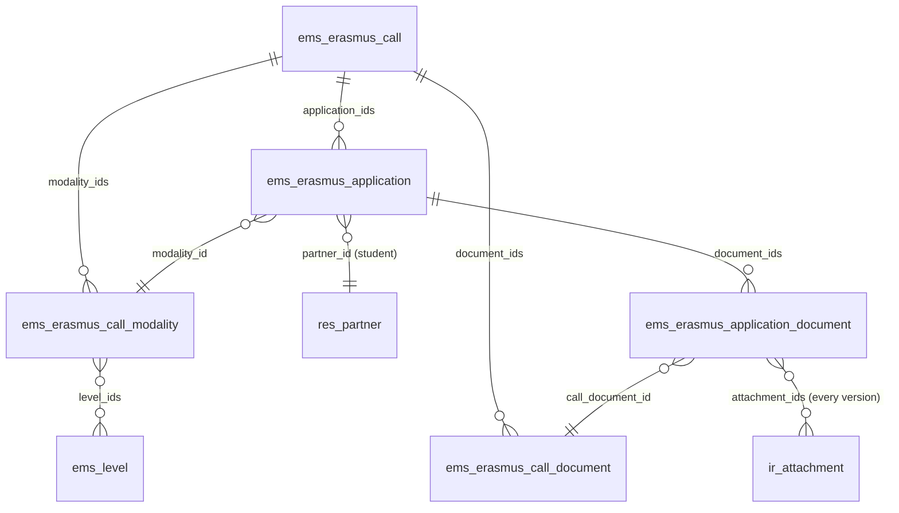

| Model | Purpose |
|---|---|
| `ems.erasmus.call` | One call: who applies (`audience`: students or staff), course, dates (`date_open`, `date_close`, optional `subsanation_deadline`), the published call PDF, the text shown on the portal, state. |
| `ems.erasmus.call.modality` | A selection list with its own places (GM, GS): project (KA121-VET / KA131-HED), places, period, destinations, and the **levels** whose students compete in it. |
| `ems.erasmus.call.document` | A document the call asks for: required, optional or required for minors; confidential (only the Erasmus team sees it). |
| `ems.erasmus.application` | One student's application to one call (unique per call and student). |
| `ems.erasmus.application.document` | The files uploaded for one document of the call, with the team's review. |

The modalities and documents are copied when a call is duplicated, so next year's call starts
from this year's.

**Who can apply is decided by the modalities, not by code:** a student can apply when the level of
their main group is in one of the call's modalities, and that modality is the application's. Any
year of the cycle.

## Call states

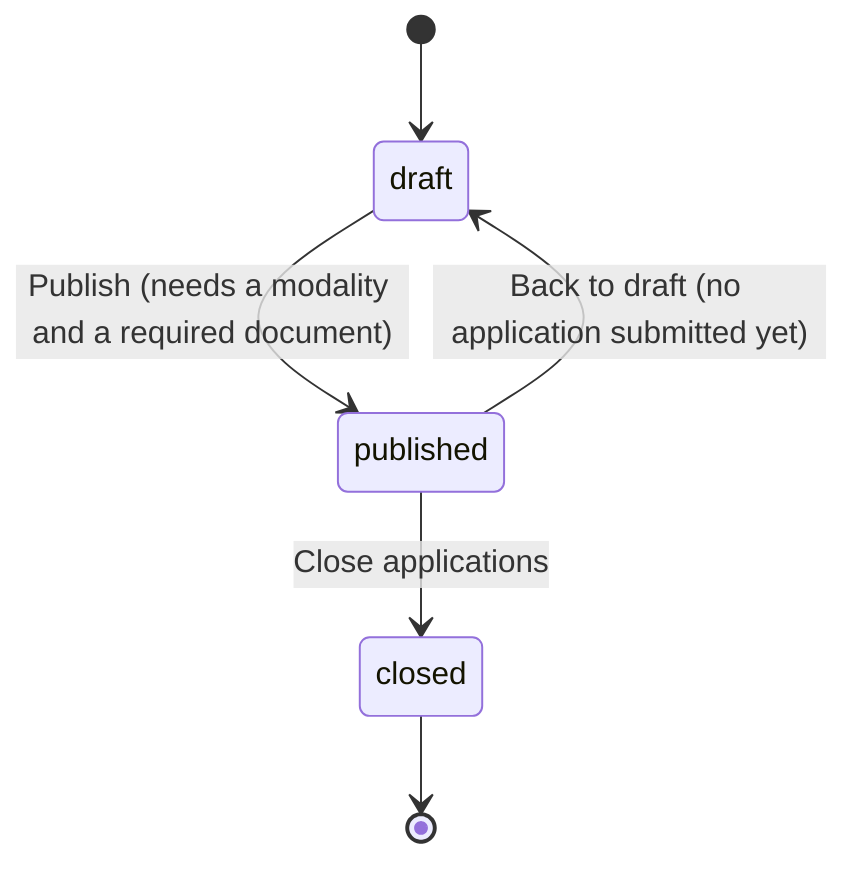

A published call is shown on the portal to every student who can apply to it. Applications are
accepted only while it is published **and** the company's local time is between `date_open` and
`date_close` (`is_accepting`, computed with `ems.datetime_utils`, never the browser's clock).
Closing turns every application still in draft into *Not submitted*.

## Application states

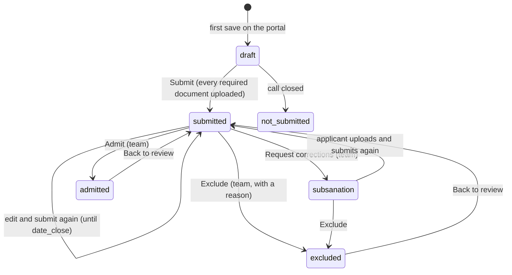

- The state only changes through these actions (`write()` refuses a direct change).
- **Submit** checks that every required document has a file (documents required for minors only
  when the applicant is a minor) and emails a receipt listing the files
  (`email_template_erasmus_application_submitted`). Each new submission sends a new receipt.
- **Request corrections** needs at least one document marked *Needs changes* or a required
  document missing; it emails the list and the call's `subsanation_deadline`
  (`email_template_erasmus_application_subsanation`). Those lines get `correction_requested`;
  until the deadline the applicant can upload to them only (not change the answers, nor other
  documents) and submit again, which clears the flags. Submitting a correction schedules a to-do
  for every member of the Erasmus team (`_ems_ask_review`, `call._ems_erasmus_team()`: the
  `ems.group_erasmus` internal users), so it shows in their daily pending-tasks digest; admitting,
  excluding or asking for corrections again marks it done.
- **Admit** needs the requirements met, every required document *Valid* and, in a students' call,
  no conduct block (below). **Exclude** needs the exclusion reason.
- Emails go only to the applicant's own address; a recipient without one is noted in the chatter.
  Their reply-to is whoever on the team caused the email (`_ems_reply_to()`), else the centre's
  Erasmus+ mailbox, `res.company.erasmus_contact_email` (Settings > Center Data > Erasmus+, the same
  for every call; it defaults to the centre's address, like `google_ws_domain`, so an upgrading
  installation gets it too), for the receipts and reminders sent with nobody of the team behind them.

## Documents

Every upload adds an attachment to the document line; earlier files are never removed, so every
version stays. A new upload puts the line back to *Pending review*. The team marks each line
*Valid* or *Needs changes* (with a comment the applicant sees on the portal).

## Admission checks

**Requirements** (enrolled in a modality's level, no previous Erasmus+ internship in this cycle,
family authorization if minor): recorded by the Erasmus team, with result (*Pending*, *Met*,
*Not met*), author and date stamped by `write()`.

**Conduct** (students' call, art. 6), never recorded by hand: EMS has no register of
disciplinary sanctions, only the conduct warnings (`ems.strike`), and the coexistence team reviews
a case each time a student reaches `res.company.strike_escalation_threshold` warnings (3 by
default). The same number rules a student out: `call._ems_course_strike_count(partner)` counts
their warnings since 1 September of the call's course (`ems.course.date_range()`, centre's
timezone), and `call._ems_conduct_blocked(partner)` is true at the threshold or above (a threshold
of 0 disables it; staff calls never). Shown on the application as `course_strike_count` and
`conduct_blocked` (non-stored). A blocked student sees the call on the portal with a notice
instead of *Apply*; `_ems_portal_get_or_create()` and `action_submit()` refuse them, and
`action_admit()` refuses an application whose warnings came after submitting (the form warns the
team to exclude it). Criterion F, the scoring's penalty per warning, is unrelated and unchanged.

The Head of Studies and the Director read the applications; they write nothing on them.

## Portal (`controllers/portal_erasmus.py`)

| Route | What |
|---|---|
| `GET /my/erasmus` | Published calls the student can apply to and their own applications. |
| `GET /my/erasmus/call/<id>` | The application form for that call. |
| `POST /my/erasmus/call/<id>/save` | Save answers and uploads; with `submit`, submit too. |
| `GET /my/erasmus/call/<id>/rules` | Download the call PDF. |

The applicant is always `request.env.user.partner_id`: no partner or application id travels in a
form. The controller works with `sudo()` (portal users have no ACL on these models) and checks
eligibility and state itself. The portal home card appears only to students who have an
application or can apply to a published call (`res.partner._ems_erasmus_portal_visible`); families
do not see it.

## Access control

New group `ems.group_erasmus` ("Erasmus+ / Manager"), assigned through the roles *Erasmus
coordinator* (`ems.role_erasmus`) and *Erasmus mobility technician* (`ems.role_erasmus_technician`).
The coordinator's role gives `ems.group_erasmus_coordinator` ("Erasmus+ / Coordinator", implies
Manager), the only one besides `ems.group_academic_admin` that can publish a resolution (#686: the
coordinator alone approves them). The administrator is a member of both.

| Model | Erasmus team | Head of Studies / Director | Portal |
|---|---|---|---|
| `ems.erasmus.call`, `.modality`, `.document` | rwcu | r | via controller (sudo) |
| `ems.erasmus.application` | rwcu | r | via controller |
| `ems.erasmus.application.document` | rwcu | r, **not confidential ones** (`ir.rule`) | via controller |

Menu *Erasmus+*: *Applications* (team, Head of Studies, Director) and *Calls* (team).

### Workflow fields and evidence (audit 2026-10-25)

`models/erasmus/workflow.py` holds what every Erasmus+ model applies on top of the table above:

- **Workflow fields only change through the actions.** A field declared `readonly=True` (stored, not
  computed nor related) plus `state` is written only by EMS's own actions, which check who may act
  and then write it as superuser: `check_workflow_write()` in `write()` and `check_workflow_create()`
  in `create()` (a new record may only carry the field's default, which a form sends for its status
  bar) refuse any other write with `AccessError`. Applied to the call, application, resolution,
  claim, interview and plan rating, mobility (its state, destination, decision on a proposal and the
  commitment letter's signatures), group mobility and participant; the payment and the invoice keep
  `_check_transfer_fields()`. `readonly=True` alone only hid the field in the views: an RPC `write`
  accepted it from anyone with write access on the model.
- **No context key opens the workflow.** The guards used to trust `ems_erasmus_state`,
  `ems_erasmus_payment_state` and `ems_erasmus_publish` in the context, which a client sends with any
  `call_kw` (`odoo/service/model.py` passes the context through as is). Only `env.su` passes now, so
  every internal write that needs it goes through `sudo()` after its own check (e.g.
  `EmsErasmusCall._ems_check_manager()`, `EmsErasmusClaim._ems_check_manager()`).
- **Evidence is never deleted** (`check_kept()`, also as superuser, except while uninstalling): a
  document line with a file or valid; an application, mobility, participant or group mobility that
  holds one, a signature, an earlier version of the letter, a self-assessment, a payment, an
  enrolment, a draw or a follow-up entry; a submitted interview or plan rating. A database cascade
  from a parent would skip the children's guards, so the parent checks them. A record without any
  of it can still be deleted (one created by mistake).
- **The file itself is kept too** (`models/erasmus/attachment.py`): an `ir.attachment` of a valid
  line, of a closed record or a paid transfer's receipt cannot be deleted, nor its content, type or
  owner (`res_model`/`res_id`/`res_field`) changed. Its name and description can.
- **The Head of Studies sees the total, not the criteria** (audit D-14, D-4): on the student
  application and on the resolution lines, criteria A, B, C, E and F are `groups=` the Erasmus team
  and the administrator, as D (fewer opportunities) already was, so D cannot be worked out from the
  total; the total, the rank and the published lists are unchanged. What the applicant declares
  about fewer opportunities (`fewer_opportunities`) is the team's too; the conduct warnings and the
  exclusion reason stay visible. Accepted as it is (decided 2026-10-29): the inputs of the criteria
  shown in the Scoring tab (record average, interview marks, language level checked, first
  mobility, conduct warnings) are still visible, so D could still be worked out by hand from them.
  The Director inherits the Head of Studies' rights and sees the same.
- **The Head of Studies only reads.** Their record rules are read only (`perm_write`, `perm_create`,
  `perm_unlink` False): rules add up across a user's groups, so a write-all rule plus the group
  teacher's write access let a Head of Studies who teaches in a group mobility change any
  individual record's documents.

## Scoring (phase 2, #684)

Art. 12 of the call: up to 100 points, 50 to be eligible (`ems.erasmus.call.min_score`).

| | Criterion | Field(s) on the application | Who / how |
|---|---|---|---|
| A | Record average x 4 (max 40) | `grade_average`, `grade_line_ids` | **Computed by EMS at closing** (below). Never typed by hand. |
| B | Interview: general (max 20) + English (max 15) | `interview_general`, `interview_english` | Mean of the submitted interviews (below). |
| C | Language certificate (B1 2.5, B2 5, C1 7.5, C2 10) | `language_level` | Erasmus team. |
| D | Fewer opportunities (10 or 0) | `fewer_opportunities_check` | Erasmus team only (confidential). |
| E | First mobility (5 or 0) | `first_mobility` | Erasmus team. |
| F | -3 per conduct warning, max -9 | `strike_ids`, `strike_count` | **Frozen at closing** (below). |

`score_total` = A + B + C + D + E + F, with no floor at zero. Every manual criterion starts empty
(*pending*) and stores who set it and when (`<field>_user_id`, `<field>_date`, stamped by
`write()`). **A pending criterion is never zero:** `score_complete` stays false and the
application is left out of the ranking.

### Frozen at closing

*Close applications* (`ems.erasmus.call.action_close`) freezes, for every application that was
submitted (states *submitted*, *corrections requested*, *admitted*, *excluded*), the data the
score is based on (`_ems_freeze_scoring_data`, sets `scoring_frozen_date`). Later changes in
grades or warnings never change it.

**Record average (A)** - `_ems_grade_lines()`, every module of the applicant's current cycle
(the study of their main group), every year of it:

- Past years: the student's year records of that study (`ems.student.year_record`, not
  provisional; previous-centre records included). The final grade when there is one; otherwise
  the internal grade if some outcome was evaluated (or it was overridden).
- Current course: the live grade lines (`ems.grade_subject_line`, last round per module) of the
  study's modules: the computed grade when every weighted part is in, otherwise the provisional
  internal grade from the outcomes evaluated so far (`_internal_from_outcomes`: RA-weighted, whole
  number, 4 at most with a failed RA). A module with nothing evaluated is left out.
- Convalidated and recognised modules are left out; failed ones count with their grade.
- A module taken more than once counts once, with its most recent grade (the current course
  before any year record, then the latest course).
- Mean weighted by module hours (`ems.subject.total_hours`), two decimals. The modules used are
  copied to `grade_line_ids` (`ems.erasmus.application.grade`: module, course, grade, hours).

There is no manual average (decided 2026-10-22: no certificate of previous studies): a student
new to the centre is scored with this course's provisional grades. With no evaluated module at all,
A stays pending (`score_a_pending`) and the application has no complete score.

**Conduct warnings (F)** - the applicant's `ems.strike` records up to `date_close` whose group
belongs to the same study (`group_id.study_id`), copied to `strike_ids`/`strike_count`. EMS only
holds warnings since the course it started recording them.

### Ranking

Per modality, among *admitted* applications (`rank`, stored, recomputed when any application of
the call changes). The ranking of a modality is only computed when **every** admitted
application in it has a complete score; until then every rank in it is 0. Order: total, then the
tie-breaks of art. 12 - fewer opportunities, first mobility, English part of the interview,
record average - and finally the draw (`draw_order`, lower first). Applications still
tied after all of it share the rank and get `needs_draw` (the call's `needs_draw` says some has it).
A tied set keeps needing a draw until each of its applications has its own drawn position: when a
correction (a claim upheld) ties someone with a set already drawn, the newcomer's `draw_order` 0
would otherwise put them first with no draw, so the whole set is flagged again.
`is_eligible`: complete and total at least `min_score`.

**Draw** (audit D-13): `draw_order` is read only; the Erasmus coordinator (or the administrator)
runs *Actions > Draw the ties* on the call (`action_draw_ties`): before the provisional resolution,
which needs every tie drawn, and again whenever a correction ties someone (also after the definitive
resolution, before a rectification; otherwise a tie created by a correction could never be
published). EMS orders each tied set (per modality; a staff call's, of the whole list; every member, those drawn before included) at random with
`secrets.SystemRandom`, writes `draw_order` and keeps the draw as an immutable
`ems.erasmus.group.draw` (the same model as the group mobilities', with `call_id` instead of
`group_mobility_id` and `score_total` as what they were tied on; its lines point at the
`application_id`), listed in the call's Resolutions tab and summed up in its chatter
(`EmsErasmusGroupDraw._ems_run`, shared with the group mobilities). The teachers of a group
mobility only read the group draws (`rule_erasmus_draw_group_teacher`).

## Interviews (phase 2, #684)

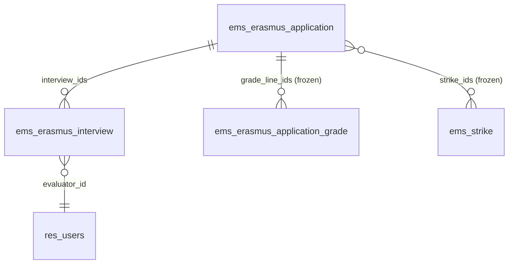

`ems.erasmus.interview` and the staff's `ems.erasmus.plan_rating` (phase 4) share the evaluator's
workflow through the abstract model `ems.erasmus.evaluation` (`models/erasmus/evaluation.py`):
evaluator, state, submit, reopen, lock at the review deadline or the provisional resolution, the
evaluator's activity, `ems.group_erasmus_evaluator` membership and the write guard (an evaluator
writes only the rubric `_ems_criteria` and their notes). Each model only adds its rubric.

The Erasmus team sets the interview's date and place on the application (`interview_date`,
`interview_place`) and assigns two evaluators (`ems.erasmus.interview`, one per evaluator, any
internal user). *Send interview call* emails the applicant the date and place
(`email_template_erasmus_interview_call`), at least 24 hours ahead (art. 11).

Each evaluator scores annex 4's rubric, 0-5 per criterion, all required to submit:

| Part | Criteria | Field |
|---|---|---|
| General (max 20) | motivation, maturity and autonomy, handling difficulties, adaptation and communication | `general_score` |
| English (max 15) | comprehension, fluency and interaction, accuracy, vocabulary and pronunciation | `english_score` |

```mermaid
stateDiagram-v2
    [*] --> draft: assigned (activity for the evaluator)
    draft --> submitted: Submit (every criterion scored)
    submitted --> draft: Reopen (evaluator until the call's interview_deadline; team any time)
```

- **Evaluators see only their own interviews** (record rule `evaluator_id = user`), never the
  other evaluator's, nor anything else of the application. Being assigned adds them to
  `ems.group_erasmus_evaluator` (*Erasmus+ > My evaluations*); losing every interview removes it.
- After the call's `interview_deadline` (label *Score correction deadline*, shared with the plan ratings) the evaluator can no longer change or reopen; the team
  can still reopen, writing a rectification note (`rectification_note`), posted in the chatter.
- The application's interview score is the mean of the submitted interviews, complete when every
  assigned interview is submitted and there are two of them, or one with a recorded reason
  (`single_interview_reason`, annex 4).
- A no-show (art. 11) is an exclusion: *Exclude* also works on admitted applications.

### Access (phase 2)

| | Erasmus team | Head of Studies / Director | Evaluator |
|---|---|---|---|
| Criteria C, E, draw | W | R | - |
| Criterion D | W | - | - |
| `ems.erasmus.interview` | rwcu | - | rw own (rubric, notes), no create/unlink |
| `ems.erasmus.application.grade` | r | r | - |

## Resolutions, claims and place offers (phase 3, #685)

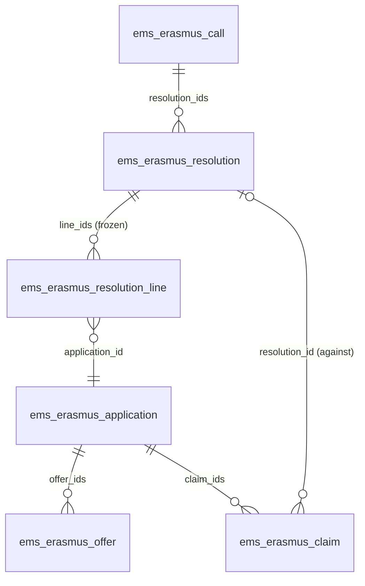

| Model | Purpose |
|---|---|
| `ems.erasmus.resolution` | A list the Erasmus team prepares and the Erasmus coordinator approves by publishing it: `admission`, `provisional`, `definitive` or `rectification`. |
| `ems.erasmus.resolution.line` | One applicant in it, frozen when the resolution was prepared: modality, rank, every criterion, total, result, masked identity document. Described as "Erasmus+ result" and named "<applicant> - <resolution>", which is what the email layout's header shows. |
| `ems.erasmus.offer` | A place offered to an applicant and their answer. |
| `ems.erasmus.offer.wizard` | Offer a free place to the next reserve (transient). |
| `ems.erasmus.claim` | A claim (after the provisional) or an appeal before the Director, recorded by the team. |

New fields on the call: `claims_deadline` (shown to applicants with the provisional result) and
`acceptance_deadline` (the deadline of the offers made when the definitive resolution is
published). New application states: `selected`, `reserve`, `not_selected`, `accepted`,
`renounced`; the ranking (`_compute_rank`) counts every one of them as admitted
(`RANKED_STATES`), so publishing results never changes a rank.

### Resolutions

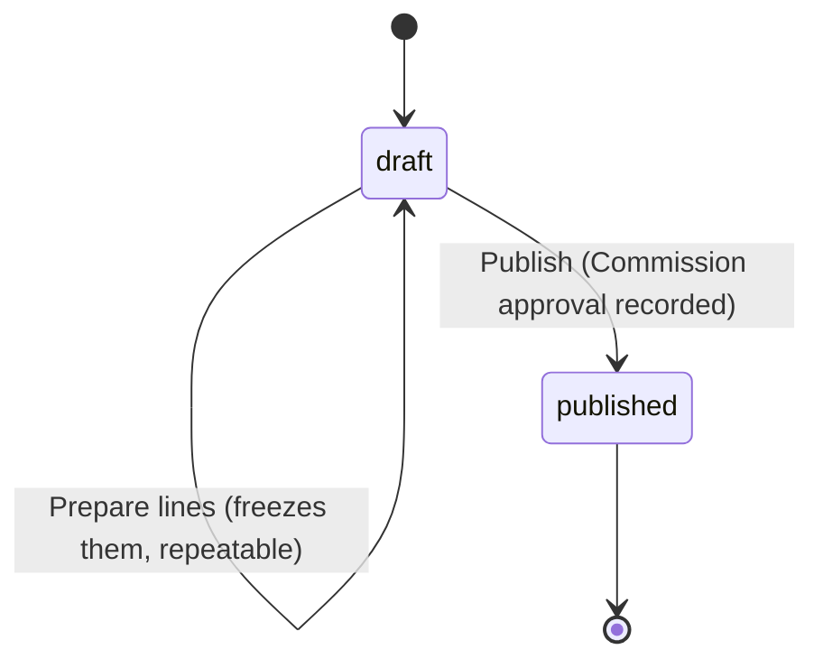

Order, each one needing the previous one published (`PREVIOUS_KIND`): admission, provisional,
definitive, then any number of rectifications. Admission, provisional and definitive are published
once per call (`SINGLE_KINDS`).

**Preparing** (`action_prepare`, checked again on publishing) needs the call closed, every
application admitted or excluded, and - except for the admission list - every admitted one with a
complete score and no pending draw (*A missing value blocks*, never zero). It also needs every
applicant's identity document (`document_id`, or `passport_id`). The lines copy, for the admission
list, the admitted and the excluded; for the others, also every result (`RANKED_STATES`), with the
rank, the criteria and the result. The definitive resolution also waits for the claims (art. 14):
it is refused while the call's `claims_deadline` has not passed or any claim of the call is still
open.

| Result | Rule (`_ems_ranking_result`) |
|---|---|
| `excluded` | The application is excluded; the reason goes on the line, only for the applicant. |
| `not_selected` | Not eligible: below the call's minimum score. |
| `selected` | Eligible and rank within the modality's `places`. |
| `reserve` | Eligible, after the places. |

**Publishing** is the coordinator's approval (`ems.group_erasmus_coordinator` or
`ems.group_academic_admin`, checked in `action_publish()`; who and when are `published_by_id` and
`publish_date`, shown on the list as the approval date). It needs the lines, notes for a
rectification and, for a definitive resolution or a rectification, a future `acceptance_deadline`.
Then:

- The resolution can never be changed or deleted (`write()`/`unlink()` refuse it; the lines have
  no write access at all). A correction is a new rectification.
- Every applicant on it gets their result by email (`email_template_erasmus_resolution_published`,
  rendered per line): the reason if excluded, the rank and total otherwise, the claims deadline
  with the provisional, the acceptance deadline if selected. Replies go to whoever published it,
  which is how claims arrive.
- The provisional resolution locks every interview of the call (`ems.erasmus.interview.is_locked`),
  as the review deadline does: after it, only a team rectification reopens one.
- A definitive resolution or a rectification sets each application's state to its result - except
  those that already answered an offer (`accepted`, `renounced`), which a rectification never
  undoes - and creates an offer for every selected one without an offer waiting or accepted, with
  the call's `acceptance_deadline`. No separate offer email: the result email already asks them to
  answer. A rectification withdraws (`cancelled`, noted in the chatter) the offers still waiting of
  whom it no longer selects: the offer they got as selected, or any offer once below the minimum
  score; a reserve keeps an offer made for a free place. Whoever already accepted or renounced gets
  the list with "you keep the place you accepted" / "you renounced earlier" instead of the result
  line, since their state does not change.
- Since an accepted place is never withdrawn, a rectification can leave more people with a place
  than places (who accepted, plus whom it now selects). `_ems_places_overflow()` counts them per
  modality (a staff call: the whole pool) on the draft; `places_warning` shows it on the form and
  `_ems_check_can_publish` refuses to publish until the team decides (e.g. adds a place to the
  modality).

**Published lists never show names.** The portal list (`/my/erasmus/call/<id>/resolution/<id>`)
and the PDF for the centre's website (`ems.action_report_erasmus_resolution`, same template
`ems.erasmus_resolution_list`) show, per modality, the rank, the masked identity document
(`public_id`), the total and the result. `mask_document_id()` follows the Spanish data protection
agency's guidance for additional provision 7 of Organic Law 3/2018: DNI `***4567**`, NIE
`****4567*`, any other document its 4th to 7th characters.

### Place offers

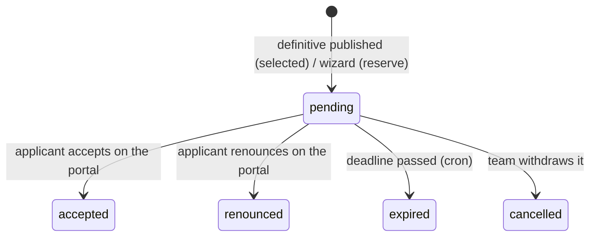

- The applicant answers on the portal (`POST /my/erasmus/call/<id>/offer`, `answer=accept|renounce`,
  optional `reason`), before the deadline, which `_ems_answer` checks with the centre's clock. The
  application moves to `accepted` or `renounced`.
- No answer = renounced: the hourly cron `ems.ir_cron_erasmus_expire_offers`
  (`_cron_expire_offers`) marks the offer `expired` and the application `renounced`.
- **A free place is never offered on its own.** The modality computes `free_places` (places minus
  the offers waiting or accepted) and `next_reserve_id` (the best-ranked `reserve` application
  without one). The team clicks **Actions > Offer a free place** on the call; the wizard shows that
  proposal and asks for a new deadline; confirming creates the offer (`from_reserve`) and emails it
  (`email_template_erasmus_offer`).
- **The team is told when a place is free.** A renunciation, an offer without an answer (cron) or
  a published definitive/rectification call `ems.erasmus.call._ems_sync_free_place_tasks()`: while
  a modality (a staff call: the pool) has a free place and a reserve to offer it to, each member
  of the Erasmus team has a to-do on the call (`ems.mail_activity_erasmus_free_place`, one each,
  never duplicated). It is marked done once no such place is left, e.g. when the wizard offers it.
  No reserve left means no task.
- The team can withdraw an offer still waiting (*Withdraw offer*, e.g. made by mistake; state `cancelled`): the place becomes free again.

### Claims

A log, recorded by the team from the email that brought it (art. 14): application, the published
resolution it is against, kind (claim, appeal before the Director), received date, text, files,
response. **Resolve** needs the response and stamps the date. Upholding a claim means correcting the
application's data and publishing the next resolution (the definitive, or a rectification).

### Export to spreadsheet

**Actions > Export to spreadsheet** (the applications list, and the Actions dropdown of an
accepted application and of the call once its definitive resolution is published) downloads an
`.xlsx` with one row per applicant who **accepted** a place. An external tool imports it as is, so
the sheet (*Participantes*) and the headers are fixed Spanish strings, in this order, never
translated (`PARTICIPANT_HEADERS`):

| Column | Source |
|---|---|
| Nombre, Apellidos | `firstname`, `lastname` |
| DNI | `document_id`, else `passport_id` |
| Email, Teléfono, Dirección | personal `email`, `phone` (else `mobile`), the postal address on one line |
| Fecha de nacimiento | `birth_date`, as a real date cell (dd/mm/yyyy) |
| Nacionalidad | `citizenship_id` |
| Género | always empty: EMS keeps no gender for students |
| Ciclo formativo, Curso | the main group's study acronym and year (1 or 2) |
| Titular de la cuenta, Banco, BIC, IBAN | the first `res.partner.bank` (holder, else the student's name), IBAN without spaces |
| Tutor legal, Email del tutor legal, Teléfono del tutor legal | only for minors: **every** family contact (`_ems_family_contacts()`), joined with ", " in the same order in the three columns |

It carries personal and bank data: the file is built on the fly by `/ems/erasmus/participants`
(`controllers/erasmus_export.py`) and never stored, and only `ems.group_erasmus` can get it
(`_ems_participants()` refuses anyone else; the server action has that group only). Each download
is logged (audit D-10, `ems.erasmus.export._ems_log_spreadsheet`): an export line with
`scope = participants`, the call (or group mobility), who, when and how many people, and a message
in the call's (or group mobility's) chatter. Who can download it does not change.

### Portal (phase 3)

| Route | What |
|---|---|
| `GET /my/erasmus/call/<id>` | Adds the place offer (accept / renounce) and a *Results* card: one entry per published resolution, with the applicant's own result, rank, total and every criterion. |
| `GET /my/erasmus/call/<id>/resolution/<id>` | The published list, without names. Only for applicants of that call, only published resolutions. |
| `GET /my/erasmus/call/<id>/resolution/<id>/pdf` | The same list as a PDF. |
| `POST /my/erasmus/call/<id>/offer` | Answer the logged-in user's own pending offer of that call. |

### Access (phase 3)

| Model | Erasmus team | Head of Studies / Director | Portal |
|---|---|---|---|
| `ems.erasmus.resolution` | rwcu (published: read only); publishing: coordinator only | r | via controller (sudo), published only |
| `ems.erasmus.resolution.line` | r (written by *Prepare lines* only); criterion D hidden from others | r | own lines and the list |
| `ems.erasmus.offer` | r + *Withdraw offer*; created by publishing and the wizard | r | answers their own |
| `ems.erasmus.claim` | rwcu | r | - |

Menus *Erasmus+ > Resolutions*, *Place offers* and *Claims*: team, Head of Studies, Director.

## Staff call (phase 4, #686)

A call's `audience` (*Applicants*) is `student` or `staff`; it cannot change once the call has
applications. The engine is the same (call, application, documents, resolutions, offers, claims);
what differs:

| | Students | Staff |
|---|---|---|
| Who sees the call on the portal | A student whose main group's level is in a modality | An internal user with an employee file (`res.partner._ems_erasmus_employee`) |
| Modality | Computed from the level when applying; required to publish | Not needed to publish (the places may change): required before preparing the provisional resolution; the team assigns each selected person's project and period |
| Documents | Configured per call | The three of art. 8 added on their own (`_ems_staff_documents`, on create and on the `audience` onchange); the mobility plan is written in the form, not uploaded (`PLAN_TEXT_FIELDS`, issue #697) |
| Admission checks | Requirements + conduct warnings this course (automatic) | Requirements only |
| Scoring | Art. 12 (A-F), A and F frozen at closing | Art. 11 of the staff call (1-6): the panel, what the applicant declares (last mobility, seniority, language) and the merits the team records |
| Ranking | Per modality | One list for the whole call |
| Places | Per modality | The sum of every modality, offered as one pool |
| Modalities | Levels, places, period, destinations | One per project, added on their own (`_ems_staff_modalities`: FP KA121-VET and higher education KA131-HED), places only, no period; never shown to staff. The team assigns each selected person one, so their mobility goes on that project of the year |
| Dissemination | - | Not part of the plan nor of the rubric (criterion 2 rates the application to the job only): the same obligation for everyone, a news item on the website and sharing it at a meeting if needed (two return steps of the checklist) |
| Identity document of the lists | `res.partner.document_id` / `passport_id` | `hr.employee.identification_id` / `passport_id` (`_ems_identity_document`) |
| Minimum score | 50 | 0 (set by `create()` and the onchange of `audience`; hidden in the form) |
| Score correction deadline (`interview_deadline`) | Set by hand | `date_close` + 14 days (`STAFF_RATING_DAYS`), set by `create()`/onchange and moved with `date_close` while it still holds that default |

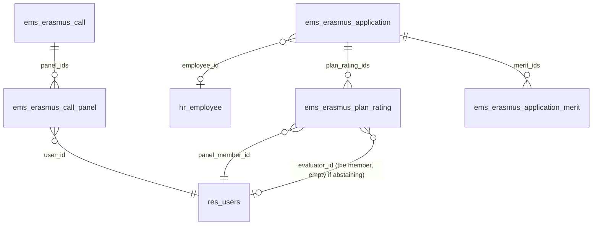

| Model | Purpose |
|---|---|
| `ems.erasmus.call.panel` | A panel member of a staff call (user, post), copied when the call is duplicated. |
| `ems.erasmus.plan_rating` | One panel member's rating of one application's mobility plan (annex 2: `relevance`, `transfer`; their selection labels are the annex's descriptions, their keys the points, 1 / 0.5 / 0). Unique per (application, panel member). Inherits `ems.erasmus.evaluation`. |
| `ems.erasmus.application.merit` | A merit of criteria 3 (centre project: collaboration 0.5, coordination 1) or 6 (internationalisation activity 0.5), with its justification. |

### Application form

The portal shows the staff form when `audience == 'staff'` (`ANSWER_FIELDS['staff']`): activity
(`staff_activity`), host entity or course, destination, preferred dates, last staff mobility and date
at the centre (below), centre projects, the mobility and transfer plan of annex 1 (`plan_reason`,
`plan_objectives`, `plan_application`; `PLAN_FIELDS`, with the activity, host, destination and dates,
all required to submit: always a concrete host, decided with the coordinator 2026-10-23; the rating
shows them through related fields, so the panel reads the plan on screen and nothing else of the
application), support needs
(confidential: `groups` Erasmus team and administrator), the declared language certificate
(`declared_language_level`), image consent, notes. The controller saves only the answers of the call's audience;
`_ems_portal_save` refuses an activity outside the selection. `employee_id` is set when the
application is created. `is_minor` is always false for staff.

**Who sees a staff call** (art. 6, `ems.erasmus.call._ems_staff_can_apply`, used by
`res.partner._ems_erasmus_calls`, so by the portal card and by `_ems_portal_get_or_create`): an
internal user whose employee is a teacher with an active `ems.teaching` in a group of one of the
call's `staff_level_ids` (*Teachers of*; a new staff call gets every FP level of the catalog,
`STAFF_LEVELS`: CFGB, CFGM, CFGS, EFPS, PFI; required to publish), and the call's
`validator_ids` (*Validates the activities*, required to publish). Never the administration staff
(`asp`) nor a teacher of ESO/BTX only. A new staff call fills `validator_ids` with
`_ems_staff_validators()`: the Director (`res.company.director_id`) and the Head of Studies that
`find_head_of_studies()` returns for most of the teachers of those levels (decided with the
coordinator 2026-10-23: FP's validates every applicant, also the language teachers who hang below
ESO/BTX's in the chart). The staff portal never shows the modality (places and periods are the
team's planning): not in the application header, the offer nor the offer email.

### Panel and plan ratings

**Actions > Send plans to the panel** (`action_send_to_panel`, closed staff call only) creates one
rating per admitted application and panel member still without one, so it can be repeated after
admitting more. It needs the call's `interview_deadline`: each evaluator's to-do is due that day
in the company's timezone (`_ems_activity_date`), and changing the deadline moves the open to-dos
of the interviews and plan ratings (`_ems_move_evaluation_activities`). The daily task digest
reminds the members of them. A panel member who applied to the call (`_ems_candidate_partners`: any application
past draft) gets an abstention instead: no `evaluator_id`, reason *Candidate in this call* (art. 10).
For any other conflict of interest the team writes the `abstention_reason`, which clears the
evaluator (`write`); clearing the reason gives the rating back to the member. There are no
substitutes (decided with the coordinator 2026-10-22): `_check_evaluator` only accepts the panel
member, or nobody, and never a candidate of the call.

`plan_score` is the mean of the submitted ratings that are not abstentions; `plan_complete` needs
every non-abstaining rating submitted and a rating for every panel member (`call.panel_ids`). A
pending rating leaves the score incomplete.

**What a panel member sees:** only their ratings (record rule `evaluator_id = user`), and, so they
can open the plan, the application document lines whose call document is `panel_visible` and not
confidential, of the applications they rate (record rule on `ems.erasmus.application.document`,
read only); the rating shows those files (`plan_attachment_ids`). Nothing else of the application.

### Criteria (art. 11 of the staff call)

| | Criterion | Field(s) | Points |
|---|---|---|---|
| 1 | Mobility plan | `plan_score` → `score_plan` | max 2 |
| 2 | Last staff mobility | `last_staff_mobility` (team correction) else `declared_last_staff_mobility` → `score_last_mobility` | never / older 1.5, two courses ago 0.5, recent 0 |
| 3 | Centre projects | `merit_ids` (project kinds) → `score_projects` | sum, max 1.5 |
| 4 | Languages | `language_level` (checked by the team) else `declared_language_level` (the applicant's) → `score_staff_language` | B2 1, C1 1.5, C2 2 (B1 0) |
| 5 | Seniority | `seniority` (team correction) else `declared_seniority` → `score_seniority` | < 1 year 0, 1-2 1, 2-5 1.5, ≥ 5 2 |
| 6 | Internationalisation | `merit_ids` (internationalisation) → `score_internationalisation` | sum, max 1 |

**Declared values** (`_compute_declared_staff_bands`): the applicant gives the month of their last
Erasmus+ staff mobility from the centre (`declared_last_mobility_date`, or
`declared_never_staff_mobility`) and the month they joined the centre (`declared_centre_start_date`);
both are required to submit. The mobility belongs to the course starting the 1 September before it
and is compared with the call's course; seniority counts whole months up to the call's closing date
(company time). The portal sends them as `<input type="month">` values (`YYYY-MM`, stored as the 1st).

`score_complete` needs the plan complete, criteria 2 and 5 (declared or corrected) and
`merits_checked` (stamped like every manual criterion, so "no merits" is an explicit answer).
Criterion 4 never blocks: no declared certificate counts as none (`_ems_staff_language_level`).

**Ranking** (`_compute_rank`, `_ems_rank_key`): one list per call, once every admitted application
is complete. Tie-breaks (art. 11 of the staff call): plan score, then more seniority at the centre by
the month and year declared in the form (`declared_centre_start_date`, earlier first; within the same
criterion-5 band too), then the draw the coordinator runs (`action_draw_ties`). Result
(`_ems_ranking_result`): selected within the sum of every modality's places, reserve after them.

### Resolutions, offers and export

- The resolution lines also freeze the staff criteria (`STAFF_SCORE_FIELDS`). The published list
  (`_ems_list_groups`) is a single table for a staff call, still without names.
- Offers of a staff call have no modality until the team assigns one; `free_places` and
  `next_reserve_id` live on the call (`_ems_free_places`, `_ems_next_reserve`), and the offer
  wizard asks for no modality.
- **Export to spreadsheet** (`_ems_staff_participant_row`) reads the employee file: name from the
  user's contact, identity document, private email (else work), private phone (else mobile),
  private address, birthday, nationality (`country_id`) and `bank_account_id`. Género, Ciclo
  formativo, Curso and the legal guardian columns stay empty.
- One place per person: the unique (call, applicant) constraint gives it.

### Access (phase 4)

| Model | Erasmus team | Head of Studies / Director | Panel member (`ems.group_erasmus_evaluator`) |
|---|---|---|---|
| `ems.erasmus.call.panel` | rwcu | r | - |
| `ems.erasmus.plan_rating` | rwcu | - (unless in the panel) | rw own (rubric, notes) |
| `ems.erasmus.application.merit` | rwcu | r | - |
| `ems.erasmus.application.document` | rwcu | r, not confidential | r, `panel_visible` lines of the plans they rate |

Menus *Erasmus+ > Plan ratings* (team) and *My plan ratings* (evaluators).

## Mobility preparation (phase 5, #687)

Accepting a place offer (`ems.erasmus.offer.action_accept`) creates the participant's **mobility**.
The application keeps the selection; the mobility holds everything after it.

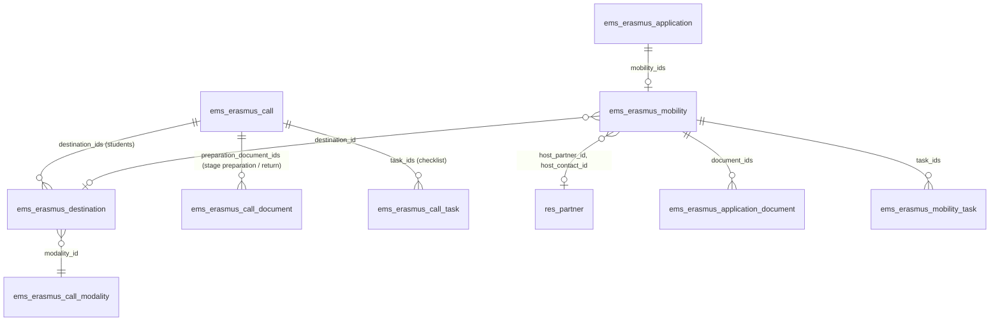

| Model | Purpose |
|---|---|
| `ems.erasmus.destination` | A destination of a students' call, in one modality: country, city, places, the levels it suits (empty: all), dates, host entities, notes. `free_places` = places minus its mobilities not cancelled. Not copied with the call (destinations change every year). |
| `ems.erasmus.mobility` | One per accepted application (`unique(application_id)`): destination, the proposal and its decision, country, city, host entity (a company contact) and its contact person, dates, documents and checklist. |
| `ems.erasmus.call.task` | A checklist step of the call (not a document): when (`stage`: before leaving / on return), only for some modalities. |
| `ems.erasmus.mobility.task` | That step for one mobility, ticked by the team (who and when stamped). |

**Documents.** `ems.erasmus.call.document` has a `stage`: `application` (phases 1-4), `preparation`
or `return`. The call's `document_ids` shows only the application ones (One2many domain), so the
application's lines and every earlier rule are unchanged; `preparation_document_ids` holds the
other two. Each one (and each checklist step, `ems.erasmus.call.task`) can be limited to some
modalities (`modality_ids`) and to one project (`project`: KA121-VET or KA131-HED, matched against
the mobility's modality, so a default can say "VET only" before the call has modalities), and says
who signs it outside EMS (`sign_participant`, `sign_guardian` for minors, `sign_director`,
`sign_coordinator`, `sign_tutor`: the centre's tutor in sBID, `sign_host`; shown as `signers`). The mobility's lines are `ems.erasmus.application.document` records with `mobility_id`
set: same review, every version kept, a new upload goes back to review. A new call gets default
documents and steps per audience (`_ems_preparation_documents`, `_ems_preparation_tasks`: art. 17
of the students' call, art. 15 of the staff call), editable. `_ems_sync_requirements()` adds what
the mobility's modality needs and is missing, never removing a line: on creation, when a staff
member's modality is assigned (`application.write`), and from *Update documents and checklist*.

New call fields: `choice_turn_hours` (default 72) and `choice_open`.

**Deadlines, per document:** `due_basis` (`destination`: after the destination is set,
`before_start`: before leaving, `after_end`: after returning) and `due_days`; each line computes its
`deadline` from the mobility's `destination_date` (stamped when it moves to *preparing*,
`_ems_set_state`), `date_start` or `date_end`. **Handled by** (`handled_by`): `participant` (they
upload it), `team_to_sign` (the team attaches the filled-in document to the line's
`prepared_attachment_ids`; the participant downloads it, signs it and uploads it signed, and is not
asked for it until then) or `team` (the team provides it, e.g. the insurance policy: the participant
only downloads it, can't upload to it, is never reminded of it, and the line counts as complete once
`prepared_attachment_ids` has a file). Defaults (art. 17 and annex 1): students, the European Health
Insurance Card and, for minors, the family's and the Mossos d'Esquadra's authorisations (30 days
after the destination), the OLS certificate with the English level (30 days after the destination),
the inclusion documentation (optional, confidential), the grant agreement and the learning agreement
(`team_to_sign`, 30 days before leaving at the latest, ideally 90), the insurance policy (`team`, 30
days before leaving), the sBID agreement (REF5) and activity plan (REF6) (`team`, requirement
`curricular`) and, on return, the certificate of stay (`team_to_sign`, signed by the tutor at the host
company, 30 days after returning), the Europass mobility document (`team`, KA121-VET, issued after the
mobility with the learning outcomes and actual dates) and the recognition of ECTS credits (`team`,
KA131-HED, requirement `curricular`). Staff: health card, grant agreement, insurance policy, learning
agreement (KA121-VET) or mobility agreement (KA131-HED), on return the Europass mobility document
(KA121-VET, plus an optional certificate of stay or attendance for when the dates or the activity need
proving) or the certificate of stay or attendance (KA131-HED), and the report with evidence.

**Conditional requirements.** A call document's `requirement` is `required`, `optional`, `minor`
(the application's `is_minor`), `curricular`: required only when the mobility's `placement_type`
is `curricular` (a work placement managed in sBID, the default for a student, computed once and then
editable by the team; `extracurricular` and `graduate` leave it optional), or `short_blended`:
required only when the mobility `is_short_blended`, and hidden on the portal otherwise (the student's
virtual component, a PDF with their preparation, KA131-HED, in the record's category 02).

**Opening date.** A call document's `open_days` (mobility documents before leaving) keeps it closed
until that many days before leaving: the line's `open_date` is `date_start - open_days`, and
`_ems_is_open()` is false before that day or while the dates are unknown. A closed line shows on the
portal with the day it opens and no upload input; `_ems_portal_upload` ignores it and
`_ems_documents_to_correct` (the weekly reminder) leaves it out. It still counts for
`preparation_complete`. The virtual component opens 30 days before leaving and is due the day before
(`due_basis='before_start'`, `due_days=1`). A checklist step
(`ems.erasmus.call.task`) has its own `requirement`: `required` or `short_blended`, which only counts
when the mobility `is_short_blended` (KA131-HED modality and a stay of `SHORT_BLENDED_MAX_DAYS`, 30,
days or fewer). The mobility line computes `is_required`; `_compute_complete` and the portal's steps
only take the required ones, and a document that is not required can still be attached. Signers by default: the Director signs the
grant agreement and the sBID agreement; the Erasmus coordinator, the learning agreement and the
Europass mobility document; the family of a minor, the grant agreement and the learning agreement
too; the centre's tutor, the sBID activity plan. Not asked for, EMS
already has them: identity document, bank account, personal details, emergency contact.

**Commitment letter** (annex 3): the call's `commitment_text` (HTML, filled in with
`_ems_commitment_text()` on a new students' call, translatable). The participant accepts and signs it
on the portal (`action_sign_commitment`, portal step `commitment`): EMS keeps a copy of the text
(`commitment_signed_text`), who (`commitment_signed_by_id`), when and the IP address.
`commitment_pending` (text on the call, not signed yet) blocks `preparation_complete` and is part of
the weekly reminder. A minor student's family signs it too (`commitment_guardian_*` fields,
`action_sign_commitment(guardian=True)`), in either order and over the same text: the first signature
stamps `commitment_signed_text` and the second signs that copy (`_ems_commitment_text()`).
`commitment_guardian_pending` (students' call, partner not adult, not signed by the family) also
blocks `preparation_complete`. The family signs on `/my/erasmus` (route
`/my/erasmus/commitment/<mobility_id>`), which lists `res.partner._ems_erasmus_guardian_mobilities()`:
the mobilities in preparation of the minors it acts for (`_ems_portal_can_act_for`); that also makes
the portal's Erasmus+ card visible to it. `_ems_remind_guardians()` emails every family contact with
an address (template `email_template_erasmus_commitment_guardian`) when the mobility moves to
*preparing* and in the weekly reminder cron.

**Weekly self-assessment during the stay.** The call's `self_assessment_question_ids`
(`ems.erasmus.call.question`: `name`, `kind` text or rating 1-5; four on a new students' call,
`_ems_self_assessment_questions()`, editable; none on a staff call, so staff get no self-assessment
unless the team adds questions). The stay is split into weeks from `date_start`
(`_ems_self_assessment_weeks()`: (week, first day, last day), the last one cut at `date_end`). While
the mobility is *preparing* (it stays so until the team closes it after the return), the portal
offers a form for every week already begun and not answered (`_ems_self_assessments_open()`, portal
step `self_assessment`, `_ems_portal_self_assessment(week, answers)`: every question answered,
ratings 1-5, each week once, `unique(mobility_id, week)`). Each answer
(`ems.erasmus.self_assessment.answer`) keeps the question's text as asked. The weekly reminder adds
the weeks already over and not answered (`_ems_self_assessments_missing()`). The team reads them on
the mobility (*Self-assessment* tab, `self_assessment_progress` "answered / weeks"), prints them
(report `ems.action_report_erasmus_self_assessment`, bound to the mobility) and the exports add that
PDF to the participant's record, category `03_Durant_la_mobilitat` (see [records.md](records.md)). Access: Erasmus team and administrator
read/write (the team can delete a week for the participant to answer it again), Head of Studies read.

**Projects** (`ems.erasmus.project`, menu *Erasmus+ > Projects*): the centre's active projects
(agreement number, `kind` KA121-VET / KA131-HED, dates, `active`). Each mobility's `project_id` must
be of its modality's `project` kind (`_check_project`; the field's domain offers only those).

### Mobility states

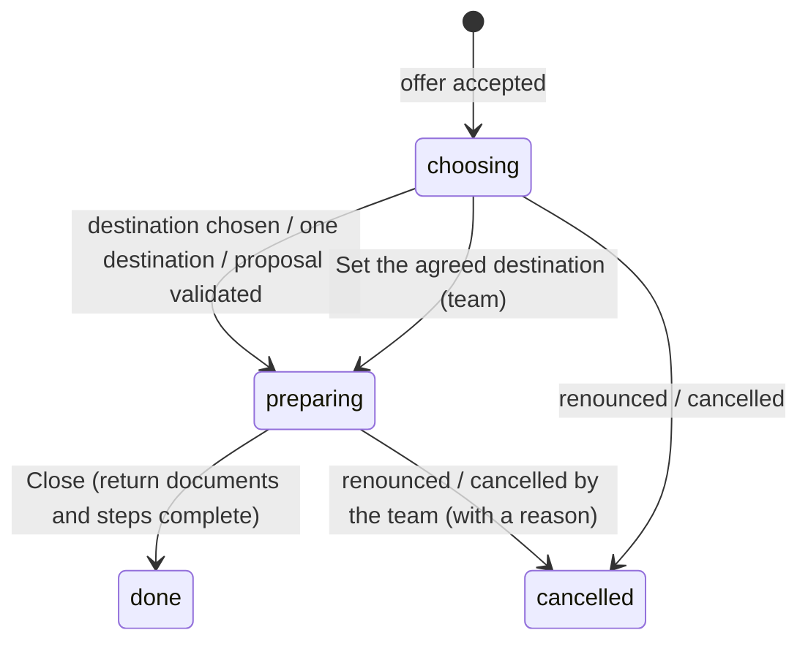

The state changes only through the actions. Cancelling frees the place (`_ems_cancel`): the
accepted offer and the application become `renounced`; the place is then offered with the existing
wizard, never on its own.

### Destination choice (students, art. 15)

`call.action_open_destination_choice()` (after the definitive resolution, with destinations) sets
`choice_open` and runs `_ems_advance_choice()`, which runs again after every choice, proposal,
rejection and cancellation. Per modality:

- **One destination:** every mobility still choosing that it suits is assigned directly.
- **Several:** if no turn is open, the best-ranked mobility still choosing (`_ems_choosing`: not
  waiting for an own proposal) gets `turn_deadline` = now + `choice_turn_hours` and the email
  `email_template_erasmus_choice_turn`. One turn at a time.
- On the portal they choose among `_ems_choices()` (free and suitable for their `level_id`, the
  level when the place was accepted). If none suits them, they talk to the Erasmus team (art. 15),
  which agrees an alternative (their own find, or a destination through an intermediary
  organisation), writes it on the mobility and clicks *Set the agreed destination*
  (`action_agree_destination`, needs the country).
- No answer: the hourly cron `ems.ir_cron_erasmus_expire_turns` (`_cron_expire_turns`) clears the
  turn and sets `turn_missed`; the place is kept and the next one gets the turn. Once nobody in the
  modality is left to choose in order, every mobility that missed its turn gets `free_choice` (and
  the turn email, without a deadline) and can choose any destination still free.

Assigning copies country, city and dates from the destination - and its host entity, with the
entity's tutor when it has a single contact, when the destination has only one - and emails
`email_template_erasmus_mobility_assigned`.

### Proposals and their decision

The same fields serve a student's **own destination** and a staff member's **activity**:
`proposal_*`, `proposal_state` (`pending` / `validated` / `rejected`), `decision_note`,
`decided_by_id`, `decision_date`.

| | Student | Staff |
|---|---|---|
| Sent | From the portal while choosing, with the host's written commitment (required) | Filled from the application when the mobility is created (`proposal_state` empty); the staff member completes it with the exact dates (`proposal_date_start`/`_end`) and the responsible declaration for the absence (`leave_declaration`), both required, and sends it from the portal, again after a rejection |
| Validated by (`_ems_can_validate`) | Erasmus team | **Direction** (`_ems_validators`): the call's `validator_ids` (the Director and the Head of Studies of FP), never the applicant; without anyone, the administrators. The Erasmus team cannot |
| Validated | Preparing, country, city and dates from the proposal | Same |
| Rejected (needs `decision_note`) | Back to choosing the centre's destinations | Proposes another activity on the portal |

A pending proposal schedules a to-do (`mail.activity`) for every validator, marked done on the
decision; a validation emails `email_template_erasmus_mobility_assigned` (students) or
`email_template_erasmus_proposal_validated` (staff), a rejection `email_template_erasmus_proposal_rejected`.
The administrator can always validate, but gets no to-do. `decision_note` (*Comment on the
decision*) is required to reject and optional to validate; the validated email and the portal show
it.

**A change after validation (staff, issue #697):** while `_ems_can_change_proposal()` (a staff
mobility in `preparing`, not pending, `date_start` still in the future, company's today), the
participant sends a new proposal from the portal (*Change the activity or the dates*), or the team
edits the Proposal tab and clicks `action_request_revalidation`. Either sets `proposal_state =
'pending'` and asks the validators again, keeping the mobility's validated dates and its
`destination_date` (`_ems_set_state` only sets it when empty). Validating copies the new
proposal onto the mobility (the training absence follows, `_ems_sync_training_leave`); rejecting
keeps the validated activity and the email says so.

### Preparation, return and closing

- *Notify pending documents* emails `email_template_erasmus_mobility_documents` with the lines
  missing or needing changes (`_ems_documents_to_correct`: before leaving, and on return once the
  end date has passed; one filled in by the team only once it is uploaded to sign). The weekly cron `ems.ir_cron_erasmus_remind_documents`
  (`_cron_remind_documents`) sends the same email to every mobility in preparation with any.
- `preparation_complete` / `return_complete`: every required line of the stage valid and every
  step done. **Close** (`action_close`, audit D-5) needs both, the mobility assigned to a project,
  the EU Survey validated and nothing left to pay (`_ems_left_to_pay()`: no payment nor invoice of
  the mobility `to_pay`, and no part of `grant_net` not requested yet, the final payment included).
  Closing frees a graduate's portal, so it waits for the last payment. A group mobility's closing is
  unchanged.
- **EU Survey** (audit D-8, mixin `ems.erasmus.eu.survey`, shared with the group mobilities):
  `eu_survey_state` pending → answered (`done`) → validated, read only (workflow field), and
  `eu_survey_deadline`, by default 30 days after `date_end` (`EU_SURVEY_DAYS`, editable). Once the
  stay is over (`_ems_eu_survey_open()`), the portal asks the participant to answer it and they say
  so (step `eu_survey`, `_ems_portal_eu_survey`); the team can also record it (*EU Survey
  answered*). Answering posts in the chatter and gives the Erasmus team a to-do to validate it
  (*Validate the EU Survey*). It replaced the checklist step "Final report (EU Survey)", no longer in
  a new call's default steps; a call that already has the step keeps it until the team removes it.
- **Cancel** (team) needs `cancel_reason`; the participant can renounce from the portal.
- **Staff absence for training** (`_ems_sync_training_leave`, run when the dates or the state
  change): once the Direction has validated the proposal, dates included, EMS files an `hr.leave` of
  `ems.leave_type_training` for those whole days (`leave_id`), submitted with the declaration the
  staff member gave with the proposal, so it follows the usual approval of that employee's absences.
  A request not decided yet follows the mobility's dates and is withdrawn (unlink) if the mobility is
  cancelled; once decided, a change or a cancellation only leaves a note on the mobility for the
  team.

### Graduates

The course transition (`_apply_graduates`) does not retire a graduate with an open mobility
(`res.partner._ems_erasmus_open_mobility`): it is reported and keeps the portal. When the mobility
is closed or cancelled, `_ems_erasmus_release_graduate()` retires an active alumnus with no open
mobility left, as the transition would have (`res.partner._ems_retire_graduate`, shared with it).

### Portal (phase 5)

`POST /my/erasmus/call/<id>/mobility/<step>` acts on the logged-in user's own mobility of that
call: `choose` (`destination_id`), `propose` (the `proposal_*` fields and
`proposal_files`), `upload` (`document_<call document id>`) and `renounce` (`reason`). The call page
shows the *Your mobility* card (`ems.portal_erasmus_mobility`).
`GET /my/erasmus/call/<id>/mobility/file/<attachment id>` downloads a file to sign of their own
mobility (`prepared_attachment_ids`).

### Access (phase 5)

| Model | Erasmus team | Head of Studies | Director | Portal |
|---|---|---|---|---|
| `ems.erasmus.destination`, `.call.task`, `.mobility.task` | rwcu | r | r | via controller |
| `ems.erasmus.mobility` | rwcu | r + `decision_note` and validating staff proposals (`write()` guard) | same as Head of Studies | via controller |

Menu *Erasmus+ > Mobilities* (team, Head of Studies, Director), with a *Proposal to validate*
filter.

## Grants, provision of services and host entities (phase 6, #697)

The coordinator calculates each participant's grant in the Beneficiary Module and enters it on the
mobility. The centre may pay part of it directly (flights, accommodation, course fees): those
**provisions of services** are deducted, and the Secretary transfers the rest to the participant
(art. 5 of both calls).

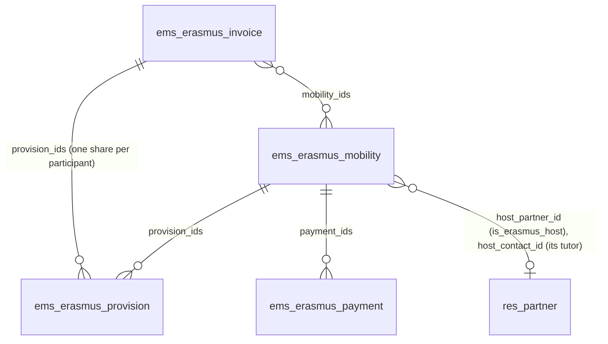

| Model | Purpose |
|---|---|
| `ems.erasmus.provision` | Part of a grant the centre pays directly: concept (travel, accommodation, course fees, other), description, amount, the invoice it comes from (optional). Added by hand on the mobility's *Grant* tab, or created by an invoice. |
| `ems.erasmus.invoice` | A supplier's invoice the centre paid for some participants: number, supplier, date, concept, project, amount, file, `mobility_ids`. Creating it, or changing its amount or participants, splits it again into equal shares (`_ems_split()`: rounded down to the cent, the remainder on the first share); a share can then be edited by hand, and `unassigned_amount` shows what is left. Changing only the concept or description updates the shares in place. |
| `ems.erasmus.payment` | An amount the Secretary transfers: `kind` prefinancing, final or single; amount; `state` to pay / paid, who and when, `receipt_ids` (the transfer receipts); the participant's IBAN and holder (`bank_account`, `bank_holder`: their first `res.partner.bank`, read with sudo). |
| `ems.erasmus.transfer.wizard` | *Register transfer*: the Secretary picks the grant payments or the invoices one bank transfer pays (several at once, e.g. a batch of grants or a travel agency's invoice), its date and its receipt; one `ir.attachment` is created and linked to every one of them, which become paid. |
| `ems.erasmus.project.document` | A file of a project that no other EMS record holds (the grant agreement, budget follow-up, exceptional costs, dissemination, the final report...), in one of the project's five categories (`category`), optionally about some participants, whose records then show it (see [records.md](records.md)). |

**On the mobility:** `grant_amount`, `prefinancing_percent` (default 80, above 0 and up to 100),
`provision_amount` and `grant_net` (= grant - provisions, what the participant receives).
*Request the first payment* (`action_request_prefinancing`) creates the prefinancing, `grant_net` x
percentage, or a **single** payment at 100 %. *Request the final payment*
(`action_request_final_payment`) creates the rest, `grant_net` minus every payment already
requested, so a change of the grant or the provisions after the prefinancing lands in it. Each
can be requested once (`can_request_prefinancing`, `can_request_final`), from the *preparing*
state, and never for nothing (zero or less raises). An unpaid payment can be deleted by the team
and requested again.

**Paying:** only the Secretary (or the administrator) registers a transfer
(`action_register_transfer` on payments and invoices opens the wizard) or undoes one
(`action_mark_unpaid` opens `ems.erasmus.undo.transfer.wizard`, with a required reason, audit
D-18); both write with sudo after checking the group (`_check_payer`). A direct
write of `state`/`paid_date`/`paid_by_id`/`receipt_ids` raises, a paid payment cannot be changed or
deleted and a paid invoice cannot be deleted. Invoices have the same `state`, `paid_date`,
`paid_by_id` and `receipt_ids` as payments.

**The Secretary's tasks:** every payment requested and every invoice created schedules a to-do for
whoever holds the Secretary role (`ems.role_secretary`; without anyone, the administrators),
`_ask_transfer()`; registering the transfer marks it done and undoing it schedules it again. Both
models inherit `ems.base` for it, so the Secretary sees what is left to pay every working day in
the daily pending-tasks digest (`docs/en/developers/shared/task_digest.md`), with no mechanism of
its own.

**Portal:** once the mobility is in preparation and has a grant, the participant sees it
(`_ems_portal_grant()`): the grant, each provision of services, what they receive and each payment
with its state. The call's page also links the published call.

**Host entities:** `res.partner.is_erasmus_host` marks a company, school or course provider that
hosts participants; its contacts are the tutors at destination, with their email. Menu *Erasmus+ >
Host entities* (`action_erasmus_host_entity`, the native contact views). The mobility's and the
destination's host fields only offer host entities, the mobility shows the tutor's email
(`host_contact_email`) and picks the tutor automatically when the entity has only one contact. The
Learning Agreement already says it is signed by the host entity (`sign_host`); sending it to the
tutor to sign waits for the integrated e-signature.

**Projects:** the team assigns each mobility to a project (`project_id`, phase 5) before entering it
in the Beneficiary Module. Payments and invoices carry the project for the Secretary. The centre's
active projects are seeded once from `data/custom/erasmus/ems.erasmus.project.csv` (agreement
number, kind, dates; maintained in the app afterwards, like every `data/custom/` record). A project
also has its `budget` (grant awarded), `final_payment_date` and `keep_until`: SEPIE asks to keep the
documents 3 years after the final payment of the grant, 5 when it is above 60,000 €.

**Documents and exports:** the project's documents in five categories, each participant's record in
four, and the ZIP exports (a record or a whole project, with index, manifest and SHA-256 hashes,
logged) are described in [records.md](records.md). The host entity also has its Erasmus+
`erasmus_oid`.

### Access (phase 6)

| Model | Erasmus team | Secretary | Head of Studies / Director |
|---|---|---|---|
| `ems.erasmus.provision`, `.invoice` | rwcu | r (+ register the invoice's transfer) | - |
| `ems.erasmus.project.document` | rwcu | rwc | r |
| `ems.erasmus.transfer.wizard`, `.undo.transfer.wizard` | - | rwcu | - |
| `ems.erasmus.payment` | rwcu (unpaid only; `write()` guard) | r + register the transfer (wizard) | - |

Undoing a transfer (`action_mark_unpaid`, Secretary, through its wizard) posts in the payment's or
invoice's chatter who undid it and why, when it had been paid and by whom, with its receipts attached; its state is tracked. A paid
invoice cannot change, as a paid payment cannot. The first payment (prefinancing or single) and the
final one exist once per mobility: a unique index (`ems_erasmus_payment_once_per_mobility`, created in
`init()`, so on install and on upgrade) refuses a second one requested at the same moment, which the
check in `action_request_*` cannot see from its own transaction. A payment is only requested for a
mobility in preparation or closed.
| `ems.erasmus.call`, `.project` | rwcu | r | r |
| `res.partner` | r every contact; wc only host entities and their contacts (`rule_contact_erasmus_*`) | (unchanged) | (unchanged) |

The mobility's *Grant* tab and its grant columns are only for the team (`groups=`), so the Head of
Studies and the Director, who read mobilities, never load the grant models. Menus *Erasmus+ > Host
entities* (team), *Projects*, *Invoices* and *Grant payments* (team and Secretary; the Secretary
sees only these three under *Erasmus+*). The project form's tabs follow the same split (mobilities:
team and Head of Studies; invoices and payments: team and Secretary).
