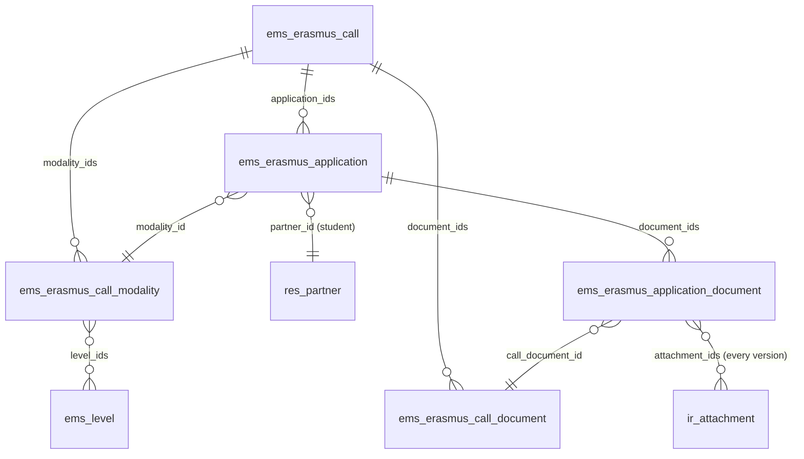
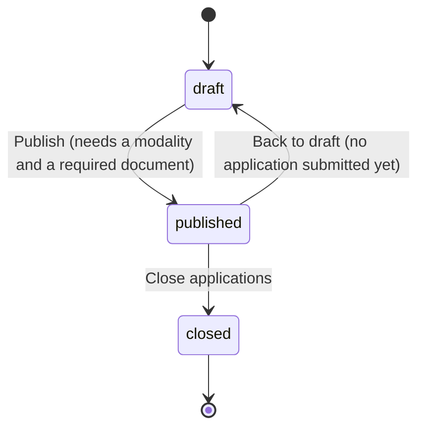
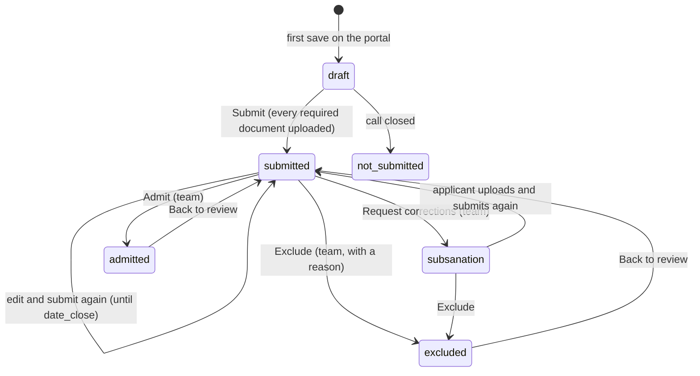
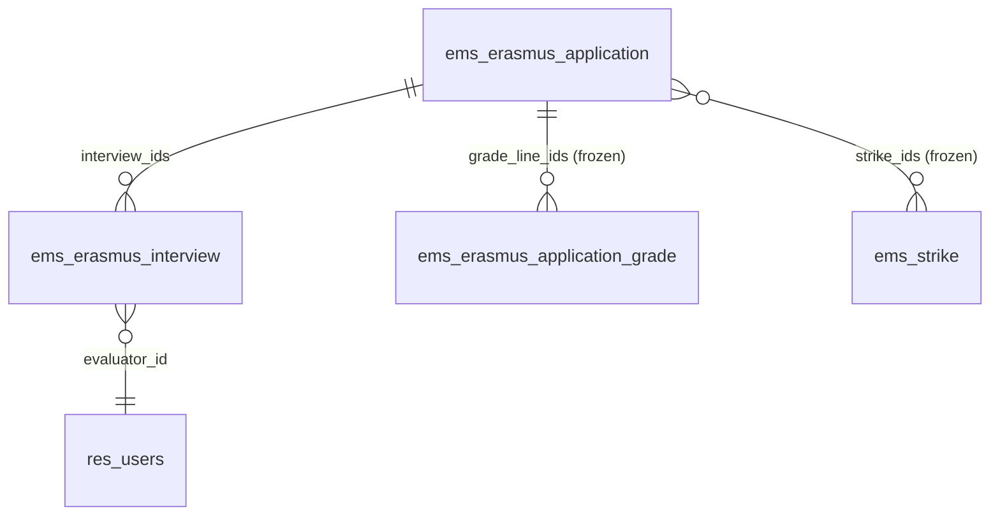
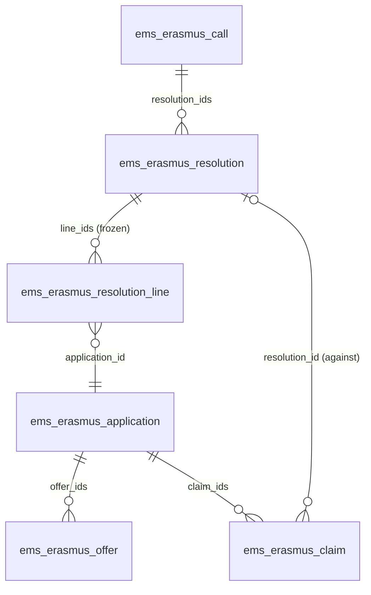
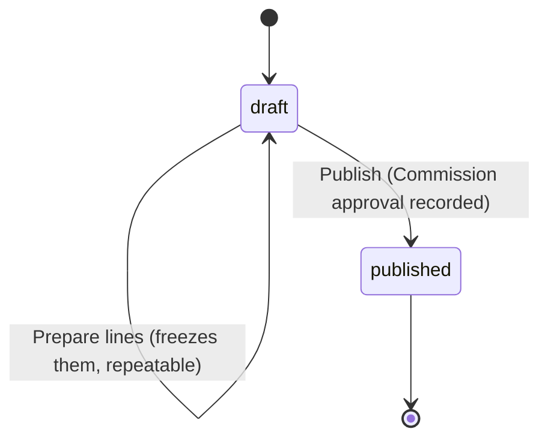
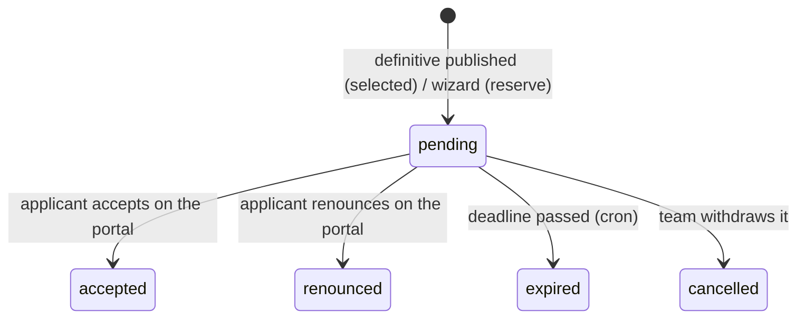

# Erasmus+ calls and applications

Issues #682 (umbrella), #683 (phase 1: calls and applications), #684 (phase 2: scoring and
interviews) and #685 (phase 3: resolutions, claims and place offers). Design of the whole project: `plans/erasmus_portal.md`.
This page describes what is implemented.

The centre publishes a yearly Erasmus+ call for its vocational training students (CFGM/CFGS, any
year). Students apply from the portal (`/my/erasmus`), upload the documents the call asks for and
follow their application; the Erasmus team checks the requirements and the documents, asks for
corrections (subsanation) and admits or excludes each application, then scores the admitted ones (record average, interview,
languages, fewer opportunities, first mobility, conduct warnings) and ranks them per modality.
The Commission's resolutions are published on the portal, claims are recorded, and the places are
offered to the selected and, when one is renounced, to the next reserve. The staff call comes in a
later phase.

## Models

| Model | Purpose |
|---|---|
| `ems.erasmus.call` | One call: course, dates (`date_open`, `date_close`, optional `subsanation_deadline`), the published call PDF, the text shown on the portal, state. |
| `ems.erasmus.call.modality` | A selection list with its own places (GM, GS): project (KA121-VET / KA131-HED), places, period, destinations, and the **levels** whose students compete in it. |
| `ems.erasmus.call.document` | A document the call asks for: required, optional or required for minors; confidential (only the Erasmus team sees it). |
| `ems.erasmus.application` | One student's application to one call (unique per call and student). |
| `ems.erasmus.application.document` | The files uploaded for one document of the call, with the team's review. |

The modalities and documents are copied when a call is duplicated, so next year's call starts
from this year's.

**Who can apply is decided by the modalities, not by code:** a student can apply when the level of
their main group is in one of the call's modalities, and that modality is the application's. Any
year of the cycle.

## Call states

A published call is shown on the portal to every student who can apply to it. Applications are
accepted only while it is published **and** the company's local time is between `date_open` and
`date_close` (`is_accepting`, computed with `ems.datetime_utils`, never the browser's clock).
Closing turns every application still in draft into *Not submitted*.

## Application states

- The state only changes through these actions (`write()` refuses a direct change).
- **Submit** checks that every required document has a file (documents required for minors only
  when the applicant is a minor) and emails a receipt listing the files
  (`email_template_erasmus_application_submitted`). Each new submission sends a new receipt.
- **Request corrections** needs at least one document marked *Needs changes* or a required
  document missing; it emails the list and the call's `subsanation_deadline`
  (`email_template_erasmus_application_subsanation`). Those lines get `correction_requested`;
  until the deadline the applicant can upload to them only (not change the answers, nor other
  documents) and submit again, which clears the flags.
- **Admit** needs both admission checks met and every required document *Valid*. **Exclude**
  needs the exclusion reason.
- Emails go only to the applicant's own address; a recipient without one is noted in the chatter.

## Documents

Every upload adds an attachment to the document line; earlier files are never removed, so every
version stays. A new upload puts the line back to *Pending review*. The team marks each line
*Valid* or *Needs changes* (with a comment the applicant sees on the portal).

## Admission checks

Separate from the documents, each stores result (*Pending*, *Met*, *Not met*), author and date,
stamped by `write()`:

| Check | Who records it |
|---|---|
| Requirements (enrolled in a modality's level, no previous Erasmus+ internship in this cycle, family authorization if minor) | Erasmus team |
| No serious sanction this course | **Head of Studies or Director only** (`ems.group_head_of_studies`, which the Director implies) |

A Head of Studies who is not in the Erasmus team can open the applications and write only the
sanction check and its note; any other field is refused.

## Portal (`controllers/portal_erasmus.py`)

| Route | What |
|---|---|
| `GET /my/erasmus` | Published calls the student can apply to and their own applications. |
| `GET /my/erasmus/call/<id>` | The application form for that call. |
| `POST /my/erasmus/call/<id>/save` | Save answers and uploads; with `submit`, submit too. |
| `GET /my/erasmus/call/<id>/rules` | Download the call PDF. |

The applicant is always `request.env.user.partner_id`: no partner or application id travels in a
form. The controller works with `sudo()` (portal users have no ACL on these models) and checks
eligibility and state itself. The portal home card appears only to students who have an
application or can apply to a published call (`res.partner._ems_erasmus_portal_visible`); families
do not see it.

## Access control

New group `ems.group_erasmus` ("Erasmus+ / Manager"), assigned through the roles *Erasmus
coordinator* (`ems.role_erasmus`) and *Erasmus mobility technician* (`ems.role_erasmus_technician`).
The administrator is a member.

| Model | Erasmus team | Head of Studies / Director | Portal |
|---|---|---|---|
| `ems.erasmus.call`, `.modality`, `.document` | rwcu | r | via controller (sudo) |
| `ems.erasmus.application` | rwcu | rw (sanction check only, enforced in `write()`) | via controller |
| `ems.erasmus.application.document` | rwcu | r, **not confidential ones** (`ir.rule`) | via controller |

Menu *Erasmus+*: *Applications* (team, Head of Studies, Director) and *Calls* (team).

## Scoring (phase 2, #684)

Art. 12 of the call: up to 100 points, 50 to be eligible (`ems.erasmus.call.min_score`).

| | Criterion | Field(s) on the application | Who / how |
|---|---|---|---|
| A | Record average x 4 (max 40) | `grade_average`, `grade_line_ids` | **Computed by EMS at closing** (below). Never typed by hand. |
| B | Interview: general (max 20) + English (max 15) | `interview_general`, `interview_english` | Mean of the submitted interviews (below). |
| C | Language certificate (B1 2.5, B2 5, C1 7.5, C2 10) | `language_level` | Erasmus team. |
| D | Fewer opportunities (10 or 0) | `fewer_opportunities_check` | Erasmus team only (confidential). |
| E | First mobility (5 or 0) | `first_mobility` | Erasmus team. |
| F | -3 per conduct warning, max -9 | `strike_ids`, `strike_count` | **Frozen at closing** (below). |

`score_total` = A + B + C + D + E + F, with no floor at zero. Every manual criterion starts empty
(*pending*) and stores who set it and when (`<field>_user_id`, `<field>_date`, stamped by
`write()`). **A pending criterion is never zero:** `score_complete` stays false and the
application is left out of the ranking.

### Frozen at closing

*Close applications* (`ems.erasmus.call.action_close`) freezes, for every application that was
submitted (states *submitted*, *corrections requested*, *admitted*, *excluded*), the data the
score is based on (`_ems_freeze_scoring_data`, sets `scoring_frozen_date`). Later changes in
grades or warnings never change it.

**Record average (A)** - `_ems_grade_lines()`, every module of the applicant's current cycle
(the study of their main group), every year of it:

- Past years: the student's year records of that study (`ems.student.year_record`, not
  provisional; previous-centre records included). The final grade when there is one; otherwise
  the internal grade if some outcome was evaluated (or it was overridden).
- Current course: the live grade lines (`ems.grade_subject_line`, last round per module) of the
  study's modules: the computed grade when every weighted part is in, otherwise the provisional
  internal grade from the outcomes evaluated so far (`_internal_from_outcomes`: RA-weighted, whole
  number, 4 at most with a failed RA). A module with nothing evaluated is left out.
- Convalidated and recognised modules are left out; failed ones count with their grade.
- A module taken more than once counts once, with its most recent grade (the current course
  before any year record, then the latest course).
- Mean weighted by module hours (`ems.subject.total_hours`), two decimals. The modules used are
  copied to `grade_line_ids` (`ems.erasmus.application.grade`: module, course, grade, hours).

There is no manual average (decided 2026-10-22: no certificate of previous studies): a student
new to the centre is scored with this course's provisional grades. With no evaluated module at all,
A stays pending (`score_a_pending`) and the application has no complete score.

**Conduct warnings (F)** - the applicant's `ems.strike` records up to `date_close` whose group
belongs to the same study (`group_id.study_id`), copied to `strike_ids`/`strike_count`. EMS only
holds warnings since the course it started recording them.

### Ranking

Per modality, among *admitted* applications (`rank`, stored, recomputed when any application of
the call changes). The ranking of a modality is only computed when **every** admitted
application in it has a complete score; until then every rank in it is 0. Order: total, then the
tie-breaks of art. 12 - fewer opportunities, first mobility, English part of the interview,
record average - and finally the recorded draw (`draw_order`, lower first). Applications still
tied after all of it share the rank and get `needs_draw`. `is_eligible`: complete and total at
least `min_score`.

## Interviews (phase 2, #684)

The Erasmus team sets the interview's date and place on the application (`interview_date`,
`interview_place`) and assigns two evaluators (`ems.erasmus.interview`, one per evaluator, any
internal user). *Send interview call* emails the applicant the date and place
(`email_template_erasmus_interview_call`), at least 24 hours ahead (art. 11).

Each evaluator scores annex 4's rubric, 0-5 per criterion, all required to submit:

| Part | Criteria | Field |
|---|---|---|
| General (max 20) | motivation, maturity and autonomy, handling difficulties, adaptation and communication | `general_score` |
| English (max 15) | comprehension, fluency and interaction, accuracy, vocabulary and pronunciation | `english_score` |

```mermaid
stateDiagram-v2
    [*] --> draft: assigned (activity for the evaluator)
    draft --> submitted: Submit (every criterion scored)
    submitted --> draft: Reopen (evaluator until the call's interview_deadline; team any time)
```

- **Evaluators see only their own interviews** (record rule `evaluator_id = user`), never the
  other evaluator's, nor anything else of the application. Being assigned adds them to
  `ems.group_erasmus_evaluator` (*Erasmus+ > My evaluations*); losing every interview removes it.
- After the call's `interview_deadline` the evaluator can no longer change or reopen; the team
  can still reopen, writing a rectification note (`rectification_note`), posted in the chatter.
- The application's interview score is the mean of the submitted interviews, complete when every
  assigned interview is submitted and there are two of them, or one with a recorded reason
  (`single_interview_reason`, annex 4).
- A no-show (art. 11) is an exclusion: *Exclude* also works on admitted applications.

### Access (phase 2)

| | Erasmus team | Head of Studies / Director | Evaluator |
|---|---|---|---|
| Criteria C, E, draw | W | R | - |
| Criterion D | W | - | - |
| `ems.erasmus.interview` | rwcu | - | rw own (rubric, notes), no create/unlink |
| `ems.erasmus.application.grade` | r | r | - |

## Resolutions, claims and place offers (phase 3, #685)

| Model | Purpose |
|---|---|
| `ems.erasmus.resolution` | A list the Erasmus+ Commission approves: `admission`, `provisional`, `definitive` or `rectification`. |
| `ems.erasmus.resolution.line` | One applicant in it, frozen when the resolution was prepared: modality, rank, every criterion, total, result, masked identity document. |
| `ems.erasmus.offer` | A place offered to an applicant and their answer. |
| `ems.erasmus.offer.wizard` | Offer a free place to the next reserve (transient). |
| `ems.erasmus.claim` | A claim (after the provisional) or an appeal before the Director, recorded by the team. |

New fields on the call: `claims_deadline` (shown to applicants with the provisional result) and
`acceptance_deadline` (the deadline of the offers made when the definitive resolution is
published). New application states: `selected`, `reserve`, `not_selected`, `accepted`,
`renounced`; the ranking (`_compute_rank`) counts every one of them as admitted
(`RANKED_STATES`), so publishing results never changes a rank.

### Resolutions

Order, each one needing the previous one published (`PREVIOUS_KIND`): admission, provisional,
definitive, then any number of rectifications. Admission, provisional and definitive are published
once per call (`SINGLE_KINDS`).

**Preparing** (`action_prepare`, checked again on publishing) needs the call closed, every
application admitted or excluded, and - except for the admission list - every admitted one with a
complete score and no pending draw (*A missing value blocks*, never zero). It also needs every
applicant's identity document (`document_id`, or `passport_id`). The lines copy, for the admission
list, the admitted and the excluded; for the others, also every result (`RANKED_STATES`), with the
rank, the criteria and the result:

| Result | Rule (`_ems_ranking_result`) |
|---|---|
| `excluded` | The application is excluded; the reason goes on the line, only for the applicant. |
| `not_selected` | Not eligible: below the call's minimum score. |
| `selected` | Eligible and rank within the modality's `places`. |
| `reserve` | Eligible, after the places. |

**Publishing** needs the lines, the Commission's approval date and minutes reference, notes for a
rectification and, for a definitive resolution or a rectification, a future `acceptance_deadline`.
Then:

- The resolution can never be changed or deleted (`write()`/`unlink()` refuse it; the lines have
  no write access at all). A correction is a new rectification.
- Every applicant on it gets their result by email (`email_template_erasmus_resolution_published`,
  rendered per line): the reason if excluded, the rank and total otherwise, the claims deadline
  with the provisional, the acceptance deadline if selected. Replies go to whoever published it,
  which is how claims arrive.
- The provisional resolution locks every interview of the call (`ems.erasmus.interview.is_locked`),
  as the review deadline does: after it, only a team rectification reopens one.
- A definitive resolution or a rectification sets each application's state to its result - except
  those that already answered an offer (`accepted`, `renounced`), which a rectification never
  undoes - and creates an offer for every selected one without an offer waiting or accepted, with
  the call's `acceptance_deadline`. No separate offer email: the result email already asks them to
  answer.

**Published lists never show names.** The portal list (`/my/erasmus/call/<id>/resolution/<id>`)
and the PDF for the centre's website (`ems.action_report_erasmus_resolution`, same template
`ems.erasmus_resolution_list`) show, per modality, the rank, the masked identity document
(`public_id`), the total and the result. `mask_document_id()` follows the Spanish data protection
agency's guidance for additional provision 7 of Organic Law 3/2018: DNI `***4567**`, NIE
`****4567*`, any other document its 4th to 7th characters.

### Place offers

- The applicant answers on the portal (`POST /my/erasmus/call/<id>/offer`, `answer=accept|renounce`,
  optional `reason`), before the deadline, which `_ems_answer` checks with the centre's clock. The
  application moves to `accepted` or `renounced`.
- No answer = renounced: the hourly cron `ems.ir_cron_erasmus_expire_offers`
  (`_cron_expire_offers`) marks the offer `expired` and the application `renounced`.
- **A free place is never offered on its own.** The modality computes `free_places` (places minus
  the offers waiting or accepted) and `next_reserve_id` (the best-ranked `reserve` application
  without one). The team clicks **Actions > Offer a free place** on the call; the wizard shows that
  proposal and asks for a new deadline; confirming creates the offer (`from_reserve`) and emails it
  (`email_template_erasmus_offer`).
- The team can withdraw an offer still waiting (*Withdraw offer*, e.g. made by mistake; state `cancelled`): the place becomes free again.

### Claims

A log, recorded by the team from the email that brought it (art. 14): application, the published
resolution it is against, kind (claim, appeal before the Director), received date, text, files,
response. **Resolve** needs the response and stamps the date. Upholding a claim means correcting the
application's data and publishing the next resolution (the definitive, or a rectification).

### Export to spreadsheet

**Actions > Export to spreadsheet** (the applications list, and the Actions dropdown of an
accepted application and of the call once its definitive resolution is published) downloads an
`.xlsx` with one row per applicant who **accepted** a place. An external tool imports it as is, so
the sheet (*Participantes*) and the headers are fixed Spanish strings, in this order, never
translated (`PARTICIPANT_HEADERS`):

| Column | Source |
|---|---|
| Nombre, Apellidos | `firstname`, `lastname` |
| DNI | `document_id`, else `passport_id` |
| Email, Teléfono, Dirección | personal `email`, `phone` (else `mobile`), the postal address on one line |
| Fecha de nacimiento | `birth_date`, as a real date cell (dd/mm/yyyy) |
| Nacionalidad | `citizenship_id` |
| Género | always empty: EMS keeps no gender for students |
| Ciclo formativo, Curso | the main group's study acronym and year (1 or 2) |
| Titular de la cuenta, Banco, BIC, IBAN | the first `res.partner.bank` (holder, else the student's name), IBAN without spaces |
| Tutor legal, Email del tutor legal, Teléfono del tutor legal | only for minors: **every** family contact (`_ems_family_contacts()`), joined with ", " in the same order in the three columns |

It carries personal and bank data: the file is built on the fly by `/ems/erasmus/participants`
(`controllers/erasmus_export.py`) and never stored, and only `ems.group_erasmus` can get it
(`_ems_participants()` refuses anyone else; the server action has that group only).

### Portal (phase 3)

| Route | What |
|---|---|
| `GET /my/erasmus/call/<id>` | Adds the place offer (accept / renounce) and a *Results* card: one entry per published resolution, with the applicant's own result, rank, total and every criterion. |
| `GET /my/erasmus/call/<id>/resolution/<id>` | The published list, without names. Only for applicants of that call, only published resolutions. |
| `GET /my/erasmus/call/<id>/resolution/<id>/pdf` | The same list as a PDF. |
| `POST /my/erasmus/call/<id>/offer` | Answer the logged-in user's own pending offer of that call. |

### Access (phase 3)

| Model | Erasmus team | Head of Studies / Director | Portal |
|---|---|---|---|
| `ems.erasmus.resolution` | rwcu (published: read only) | r | via controller (sudo), published only |
| `ems.erasmus.resolution.line` | r (written by *Prepare lines* only); criterion D hidden from others | r | own lines and the list |
| `ems.erasmus.offer` | r + *Withdraw offer*; created by publishing and the wizard | r | answers their own |
| `ems.erasmus.claim` | rwcu | r | - |

Menus *Erasmus+ > Resolutions*, *Place offers* and *Claims*: team, Head of Studies, Director.
