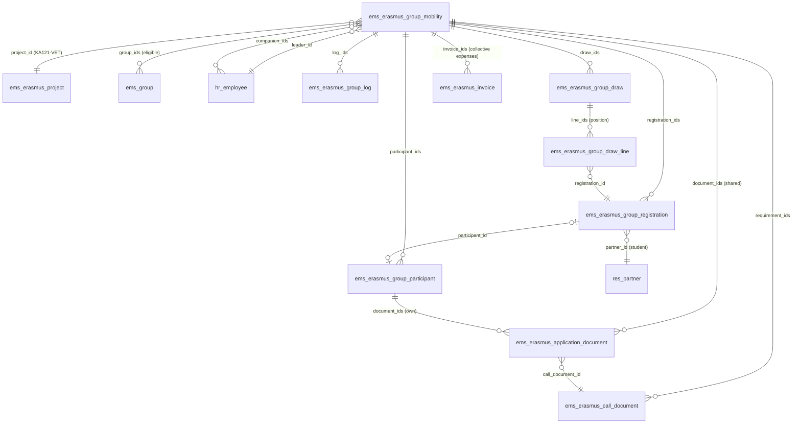

# Erasmus+ group mobilities (KA121-VET)

Issues #701 (model and portal enrolment), #702 (ranking and selection), #703 (participants'
files and documents) and #704 (leader panel, follow-up, coordinator overview), all on branch
`ems-movgrupo`. The individual modalities (internships, staff) are in [erasmus.md](erasmus.md).

A group mobility is a group of students of one or more real EMS groups (e.g. the two morning
groups of SMX2) that goes abroad together with its accompanying teachers, one of them the
**leader teacher**. It is a third Erasmus+ modality next to the internship and staff calls, with
a much simpler procedure: the students enrol from the portal with one click (no CV, letter,
video nor interview), EMS ranks them when the enrolment closes, the leader teacher prepares the
proposal and the Erasmus coordinator approves it. Then every participant gets a file on the same
document engine as the other modalities. The four mobilities the centre starts with (SMX2 and
2GA, morning and afternoon, 8 students and 2 teachers each) are plain configuration: nothing in
the code knows about them.

## Models

| Model | Purpose |
|---|---|
| `ems.erasmus.group.mobility` | The group mobility: project, eligible groups (`group_ids`, real `ems.group` records; `shift` only filters the choice), places for students and teachers, leader and other accompanying teachers, enrolment period and published selection criteria (`tie_break`), destination and host entity, planned and final dates, travel dates, programme, state, the selection's evidence (ranking, proposal and approval dates and users), EU Survey and closure. |
| `ems.erasmus.group.registration` | A student's enrolment (unique per mobility and student, kept when withdrawn), the data frozen when the enrolment closes, the ranking, the result and the substitutions. **Selection evidence, not the travel file.** |
| `ems.erasmus.group.participant` | A participant's file: each selected student, the leader and the accompanying teachers (`role`). Teachers join without any staff call. A student's commitment letter (below) lives here. |
| `ems.erasmus.group.draw` / `.draw.line` | One record per tie the coordinator drew: who (`user_id`), when (`date`), what the students were tied on (`grade_average`, `fewer_opportunities`), the exact set tied and the order drawn (`line_ids`: enrolment, student, position). Created by EMS only; `write` and `unlink` refuse (except on module uninstall). |
| `ems.erasmus.commitment` (abstract) | The commitment letter mechanism shared with the internship mobilities (`ems.erasmus.mobility`): signature fields of the student and of the family, `action_sign_commitment`, `_ems_remind_guardians`. |
| `ems.erasmus.group.log` | The follow-up written by the group's teachers: attendance (who was absent), incidents (apart from the academic conduct warnings, `ems.strike`), changes, evidence, communications, with files. |

States of the mobility: `draft` → `enrolment` → `selection` → `validation` → `preparation` →
`stay` → `return` → `done` (or `cancelled`). The participants' files exist from `preparation`.

## Enrolment (issue #701)

- The coordinator creates the mobility (*Erasmus+ > Group mobilities*), fills in the groups, the
  enrolment period and the selection criteria (a default text with the agreed rule), and opens the
  enrolment (`action_open_enrolment`, which refuses without groups, period or criteria). Dates
  and destination may stay empty until they are confirmed.
- `/my/erasmus` shows a card per group mobility the student can see
  (`res.partner._ems_erasmus_group_mobilities`: enrolling for one of their groups, or one they
  enrolled in or take part in). One button enrols (`POST /my/erasmus/group/<id>/enrol`), another
  withdraws while the period is open. An optional tick declares a situation of fewer
  opportunities: only the Erasmus team sees it and accredits it (`fewer_opportunities_check`).
  No file is uploaded at this point: a confidential file on the enrolment would be readable by
  the leader through its attachment, so the evidence goes, if needed, to the confidential
  "Group inclusion documentation" or is checked by the team outside EMS.
- Server checks (`ems.erasmus.group.registration._ems_portal_enrol`): student of an eligible group,
  enrolment open (`is_enrolling`: state and period), no duplicate, and the internship call's
  conduct rule (`ems.erasmus.call._ems_conduct_blocked_count`: as many conduct warnings this
  course as the coexistence escalation threshold, or more). The routes never take a partner or an
  enrolment id from the form: the student is always the logged-in user's partner.

## Ranking and selection (issue #702)

- When the enrolment closes (the hourly cron `_cron_close_enrolments`, or the coordinator's
  button), `_ems_freeze` copies onto each enrolment the main group at that moment, the record
  average and this course's conduct warnings, and decides eligibility (`exclusion`: not in an
  eligible group, or too many conduct warnings). These values are never recomputed.
- The **record average is the internship call's**: `ems.erasmus.application._ems_partner_grade_values`
  and `_ems_grade_average` (extracted from the application without changing them).
- **A student with no evaluated module has no average, never a 0** (`grade_found` false). If they
  are eligible, the enrolment is a **grade incident** (`grade_incident`, stored): not ranked
  (`rank` 0, no proposed result), counted on the mobility (`grade_incidents`, a red banner) and it
  **blocks both the proposal and the approval** (`_ems_check_selection_ready`). It is resolved
  either by the Erasmus team entering the average by hand (`grade_manual`,
  `grade_average_manual` 0-10, `grade_manual_reason` required, all tracked; the ranking then uses
  it through `_ems_average`) or by the coordinator excluding the student (`result_override` =
  excluded, with its reason).
- `_ems_rank` orders the eligible enrolments by average (descending), then the fewer
  opportunities accredited by the team, then a **draw** (decided by the coordinator, 2026-10-24).
  A remaining tie is flagged (`needs_draw`) and **blocks the proposal** until the Erasmus
  coordinator runs the draw (`action_draw_ties`): EMS orders each tied set at random with a
  cryptographically secure generator (`secrets.SystemRandom`), stores the position in
  `draw_order` (read-only) and keeps an `ems.erasmus.group.draw` per tied set (who, when, the
  values tied on, the exact students and the order drawn; the mobility's Selection tab lists them),
  also summed up in the chatter. It only touches tied enrolments. A tie is the same
  `_ems_tie_key` (average, accreditation); it counts as resolved while everyone in it has a
  different `draw_order`, so a student who joins an already drawn tie later (an average entered
  by hand, an accreditation) reopens it for a new draw, which is recorded as another draw. A declared situation of fewer
  opportunities still pending verification blocks the proposal too. The first ones, as many as
  places, are proposed as selected, the rest as reserves in order; the non-eligible, as excluded
  ("excluded" and "no place" are different results).
- The leader teacher reviews the ranking (rank, average and whether the requirements are met;
  never the conduct warnings, the reason for exclusion nor the fewer opportunities: those fields
  have `groups=` Erasmus team/admin) and sends the proposal (`action_submit_proposal`). The
  leader cannot change grades, ranks or results; they can write an exception request with its
  reason, which becomes a task for the coordinator.
- Only the Erasmus coordinator (`ems.group_erasmus_coordinator`) or the administrator approves
  (`action_approve_selection`), sends the proposal back with a reason, or sets an exception
  (`result_override`, a reason required, tracked). Approving freezes `result`, opens the files,
  and emails each student **their own** result (`email_template_erasmus_group_result`).
- Withdrawal and substitution: a selected student renounces (portal, or the leader or the team on
  their behalf, with the reason); their file is withdrawn but every document is kept. With a
  place free, `next_reserve` shows the first reserve; the leader proposes them
  (`action_propose_substitution`), the coordinator approves or rejects. The frozen ranking is
  never rewritten; the history is in the enrolments (`substitute_for_id`, who proposed and
  approved, when) and the chatter.

## Files and documents (issue #703): the integration contract

Group mobilities use **the Erasmus+ document engine as it is**, without an application and
without a second engine. Two shared models are extended with `_inherit` in
`models/erasmus/group_mobility.py` (not edited in their own files, to keep the branch that
reorganises the documents free of conflicts):

| Question | How it is answered |
|---|---|
| Which project does a document belong to? | `line.group_mobility_id.project_id` (individual lines: `line.mobility_id.project_id` / the application's mobility). |
| Which mobility? | `ems.erasmus.application.document.group_mobility_id` (set on every group line). |
| Which participant (individual document)? | `group_participant_id` → `ems.erasmus.group.participant` (`partner_id`, `employee_id`, `role`). |
| Is it a shared document of the mobility? | `group_mobility_id` set and `group_participant_id` empty: **one line per mobility** (e.g. the group learning agreement). Individual files reference it through the mobility; no copy is ever made. |
| Document type and requirement | `call_document_id` → `ems.erasmus.call.document`, which for a group belongs to the mobility (`group_mobility_id`, no `call_id`) and says who it is for (`group_audience`: `collective`, `student`, `teacher`, `participant`), `requirement` (required, optional, minors), `stage`, signers (`sign_*`), `handled_by`, `confidential`, `file_category` (the record's category), deadline rule. |
| Validation and signature | The same fields and rules as every line ([records.md](records.md)): `review_state`, `review_comment`, files (every version kept, never removed from a valid line or a closed group mobility) and the team's prepared files; the record status `file_state` (a document someone signs is complete only once the team marks it valid) and `file_category`. There is no electronic signature workflow (see records.md, "Signatures"). |
| Read and write permissions | Record rules on `ems.erasmus.application.document` and `ems.erasmus.call.document` for `ems.group_erasmus_group_teacher` (below); the review (`review_state`) only by the team or the leader (`write` override). Attachments follow the line's access. |

Constraints: a line has an application **or** a group mobility (SQL `CHECK`), and a participant's
line belongs to the participant's own mobility; a call document has a call **or** a group
mobility (SQL `CHECK`). The default documents of a new group mobility
(`_ems_default_requirements`, editable on each mobility) follow KA121-VET group mobilities: the
**group learning agreement once** for the whole group (no individual learning agreement), the final
list of participants and teachers, agreements with the host, group travel documents, the
confidential group inclusion documentation and common evidence; each student's grant agreement,
health card, the official authorisation for minors to travel abroad (minors only, processed with
the Mossos d'Esquadra and handed in as its own document), insurance and Europass mobility document; each
teacher's grant agreement and certificate of stay (no learning agreement nor Europass). Lines are
created when the selection is approved (`_ems_sync_documents`, `_ems_sync_collective_documents`)
and never duplicated or removed by updating them.

### Commitment letter (students)

The same mechanism as the internship mobilities (`ems.erasmus.commitment`, portal acceptance with
the logged-in user, date and IP, no other signature system). Each selected student accepts it on
their portal file (`/my/erasmus/group/<id>/commitment`) and, for a minor, the family on its own
portal page (`/my/erasmus/group/commitment/<participant id>`, only for a child it acts for,
`res.partner._ems_erasmus_guardian_group_participants`), in any order, while the mobility is in
preparation. The family is emailed when the file opens
(`email_template_erasmus_group_commitment_guardian`). The letter is one common template built in
`ems.erasmus.group.participant._ems_commitment_letter` (whole translatable sentences, in the
reader's language): authorisation to take part in this mobility with destination, host and dates
once confirmed (otherwise "to be confirmed"), taking part in the programme, the centre's
coexistence rules and the teachers' instructions, the measures for a serious breach under the
centre's rules and protocols, communication and collaboration with the centre, plus the mobility's
**additional conditions** (`commitment_extra`). The text is stored exactly as at the first
acceptance (`commitment_signed_text`) and that is what the second one accepts. When the
destination, the host, the dates, the travel dates, the teachers or the additional conditions
change afterwards, the acceptance is kept unchanged as an earlier version and both have to accept
the new letter (see "Commitment letter versions" in [records.md](records.md)); an acceptance while
the destination or the start date is still to be confirmed is provisional. Until both are done, and
not provisionally, the participant is not ready to leave (`preparation_complete`), and the mobility
counts the pending ones (`commitments_pending`). The
letter says it does not replace the official authorisation to travel abroad, which stays a
document of the file. Teachers sign no letter.

### Participants' spreadsheet

*Actions > Export participants (Excel)* (Erasmus team only) downloads, from
`/ems/erasmus/group/participants`, the **same workbook as the calls**
(`ems.erasmus.application._ems_participants_workbook`, sheet and `PARTICIPANT_HEADERS`
unchanged) with the active participants: the selected students first, then the accompanying
teachers. Students' rows come from their contact (`_ems_student_row`) and teachers' from their
employee file (`_ems_staff_row`), the same as in the calls. Teachers are told apart without a new
column: their cycle, year and legal guardian columns are empty. The bank columns stay empty for
everyone (a group mobility pays collectively, nothing is transferred to a participant). Built on
the fly, never stored.

Deadlines count from the group mobility: `destination` = the day the selection was approved
(`destination_date`), `before_start` / `after_end` = its final dates.

### On the document records

Group mobilities are part of the Erasmus+ document records ([records.md](records.md)):

- Their documents use the same four categories of a participant's record (`file_category` on each
  requirement: health card, inclusion and minors' authorisation in 01, the group's travel documents
  and common evidence in 03, the rest by stage), the same `file_state` and the same history rules.
  The health card is confidential, as in the calls: only the Erasmus team sees it.
- The project dossier ZIP includes every group mobility that is neither draft nor cancelled
  (`GRUP<id>_<name>/`: the common documents once, the selection's evidence, the follow-up, the EU
  Survey and each active participant's record), and a group mobility can be exported on its own.
- Selection evidence (criteria, enrolments, eligibility, frozen ranking, proposal, approval,
  results, withdrawals and substitutions) lives on `ems.erasmus.group.registration` and the
  mobility's chatter, never in a participant's travel file; in the ZIP it is the group's
  `Selection.csv` and `Draws.csv`, with the conduct and fewer-opportunities data only in an audit
  export.

## Follow-up, EU Survey and closure (issue #704)

- The leader (or the team) starts the stay and marks the return (`action_start_stay`,
  `action_end_stay`). On return EMS schedules the EU Survey task for its responsible person
  (`eu_survey_user_id`, by default the leader) with a deadline (30 days if empty). That person or
  the leader says it is answered, with evidence if any; the team validates it. EMS does not
  connect to the EU Survey platform. In group mobilities only the leader answers the EU Survey
  (decided by the coordinator, 2026-10-24): students and the other teacher have no survey task.
- During the stay the leader and the accompanying teachers write the follow-up
  (`ems.erasmus.group.log`). Tasks and reminders are Odoo activities on the mobility, which reach
  the daily task digest.
- The leader proposes the closure; the team closes it once every required document is valid and
  the EU Survey validated.
- Collective expenses are ordinary `ems.erasmus.invoice` records linked to the group mobility
  (`group_mobility_id`), charged to its project and **never split** among the participants.

## Coordinator overview

*Erasmus+ > Group mobilities*: kanban by state and list, with the groups, leader, destination,
enrolled and selected students, documents missing and to review, a tie to resolve, the EU Survey
state and the late tasks (Odoo activities). Each card opens the mobility's panel.

## Roles and access

The leader and accompanying teachers get the hidden group `ems.group_erasmus_group_teacher`,
managed by EMS when the mobility's teachers change (`res.users._ems_sync_erasmus_group_teacher_group`),
which shows *Erasmus+ > My group mobilities*. Record rules restrict them to their own mobilities;
what each role may change is checked again in the models (`EmsErasmusGroupMobility._ems_role`,
`write` overrides), never only by hiding buttons.

| | Erasmus coordinator | Mobility technician (Erasmus team) | Leader teacher | Accompanying teacher | Head of Studies | Student (portal) |
|---|---|---|---|---|---|---|
| Group mobilities | all, create and change | all, create and change | own: read; programme, notes, shared documents, follow-up, EU Survey evidence | own: read; follow-up | all, read | the ones they can enrol in or take part in |
| Enrolments and ranking | all | all | own mobility: rank, average, eligible (no conduct data) | no | all, read (no conduct data) | own enrolment and result |
| Open / close enrolment | yes | yes | no | no | no | - |
| Send the proposal | yes | yes | yes | no | no | - |
| Approve, send back, exceptions, substitutions | yes | no | request only | no | no | - |
| Participants' files | all | all | own mobility, not confidential | own mobility (read), own documents | all, not confidential | own file |
| Review documents | yes | yes | own mobility | no | no | - |
| Follow-up | all | all | own mobility | own mobility | read | no |
| EU Survey | validate | validate | answer | no | no | - |
| Close / cancel | yes | yes | propose closure | no | no | - |

## Pending and open questions

- **Signatures:** see "Signatures: what EMS does and what is missing" in [records.md](records.md),
  common to every modality.
- **Families of minors:** the commitment letter is accepted on the portal (above); the other
  documents the family signs (grant agreement) are uploaded signed.
