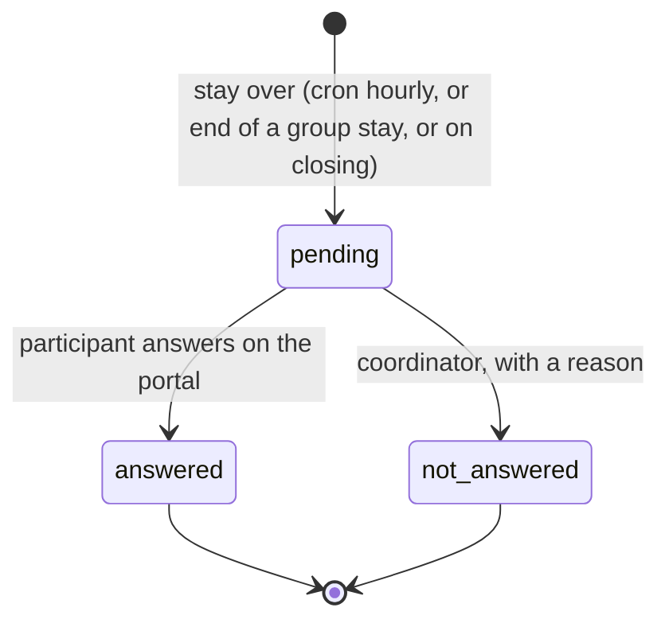

# Technical Reference: Erasmus+ quality (`ems.erasmus.satisfaction`, `ems.erasmus.quality.panel`)

The Erasmus+ part of the centre's quality system (ISO 9001) and of the Mobilitat FP network's
annual report: two indicators, a satisfaction survey every participant answers when the stay is
over, and a panel with the figures. Code: `models/erasmus/satisfaction.py`,
`models/erasmus/quality.py` (earlier courses, diffusion, PDF, Mobilitat FP evidence),
`views/erasmus/quality/views.xml`, `reports/erasmus/report_erasmus_quality.xml`, the portal routes in
`controllers/portal_erasmus.py` (`/my/erasmus/satisfaction/<id>`), `mails/erasmus/satisfaction.xml`.

## Indicators

| Indicator | Calculation | Target |
|-----------|-------------|--------|
| Student interest | Applicants / target students x 100, students' calls | > 5 % |
| Staff interest | Applicant teachers / target teachers x 100, staff calls | none set |
| Satisfaction | Average of the scores (1-10) answered | > 8.5 |
| Response rate | Answered surveys / surveys opened (stays over) | none |

- **Applicant**: a submitted application (any state but `draft`/`not_submitted`), counted once per
  person.
- **Target population**: exactly who could apply, `ems.erasmus.call._ems_eligible_partners()`.
  Students' call: every student of the call's levels (CFGM, CFGS, EFPS). Staff call: the teachers of
  its FP levels (CFGB, CFGM, CFGS, EFPS, PFI by default) plus the Direction that validates (Director
  and Head of Studies of FP).
- Both counts are **frozen on the call** (`interest_applicant_count`, `interest_target_count`,
  `interest_date`) when its definitive resolution is published (`ems.erasmus.resolution._ems_after_publish`),
  so later enrolments or leavers never change the history. Before that, `_ems_interest()` counts live.
- Satisfaction counts every participant: individual students and staff, and every active participant
  of a group mobility (students, leader, companions).
- The **course** of a survey is the call's (or the group mobility's), never the year the stay ends.

## Survey lifecycle

- **Opening**: `_cron_satisfaction` (hourly, nothing before 9:00 in the centre) calls
  `_ems_open_ended()`: an individual mobility `preparing` whose `date_end` has passed, and every
  active participant of a group mobility in `return` (or in `stay` past its `date_end`).
  `action_end_stay` of a group mobility opens them at once, and closing a mobility opens a missing
  one before checking it.
- **Telling the participant**: students get `email_template_erasmus_satisfaction` (on opening, and
  as a reminder 3 and 7 days later, `reminder_count`). Staff (an internal user) get one to-do on
  their contact instead, like their mobility documents, due the day the survey opens (it shows as
  today or late, and their daily summary repeats it while it is pending); it is removed when the
  survey is answered or closed. On the portal, a pending survey shows as a banner on `/my` and on
  the Erasmus+ page, saying it is the centre's satisfaction survey, not the EU Survey; the link of
  a survey already answered shows the thanks message.
- **Answer** (`_ems_portal_answer`): a score from 1 to 10 (SQL check too); 6 or lower needs
  `what_failed`. The portal first shows a confirmation step for a low score ("You have given a X out
  of 10. Is that right?") with the mandatory "What did not work?". The comment is optional.
- **Closing a mobility** (`ems.erasmus.mobility.action_close`, after every other check, and
  `ems.erasmus.group.mobility.action_close`) needs every survey answered or `not_answered`
  (`_ems_check_satisfaction`). `action_mark_not_answered` is for the coordinator (and the
  administrator) only: the reason (`not_answered_reason`, in the *Without an answer* section) is
  written first, then the button is pressed, with no confirmation dialog; without a reason EMS asks
  for it.

## Improvement actions

`action_create_improvement` turns a low score into an `ems.quality.action` of type `improvement`
in the Quality app (no scope, the survey's course), with the participant type, host entity, score,
what did not work and the comment, and **never the participant's name**. It is created as the team
member who presses the button (they then manage it like any action they create) or, for one who
may not create actions, with sudo, left to the quality committee; one who may not even read it (not a
teacher) gets a notification instead of the form, which would end in an access error. One action per
survey. On the survey, `can_open_improvement` (`has_access('read')` on the action) decides whether
the action's field is a link; otherwise its name and state show without one.

## Panel

`ems.erasmus.quality.panel` is a transient model whose form is the panel, opened from the *Indicators* menu by `action_open_panel()` (a server action that creates it, so the title is "Quality indicators" and not "New"): filters (course, call,
project, participant type, cycle, host entity) and four non-stored computed HTML tables, recomputed
on every filter change (onchange):

- Indicators: value, target, met, n and, for satisfaction, the median; the response rate. Figures are rounded half up to one decimal (81.25 % shows 81.3 %).
- Satisfaction by participant type and by host entity (average, median, n).
- Each call's funnel: applications, admitted, with a place, mobilities done, renounced or cancelled,
  in total and by cycle (the study of the applicant's group).
- Evolution by course of the two indicators.

There is no minimum group size: every breakdown shows whatever there is (adriamt, 2026-11-04). The
interest only follows the course, call and participant type filters (it is a per-call figure); filtered by project, it is that of the calls of the project's mobilities, shared with any other project of the same calls.
`_ems_data()` returns every figure as plain values, shared by the panel and the PDF. Measured on this dev DB
(3 calls, no surveys): 0.06 s cold.

## Earlier courses (manual load)

`ems.erasmus.quality.history`: one row per course before EMS kept the figures (`course_name` as EMS
names courses, `2022-2023`, since those courses may not exist as `ems.course`), with applicants and
target (students, staff), the average satisfaction (0-10, other scales converted), n and the
`source`. The coordinator edits them (Erasmus+ › Quality › Earlier courses); the team reads them.
The evolution table (`_ems_evolution`) adds each one marked "(manual load)" unless EMS has its own
figures for that course. The centre's four courses 2022-2023 to 2025-2026 are seeded from
`data/custom/erasmus/ems.erasmus.quality.history.csv` (frozen once created, like every
`data/custom/` record). Their interest numerator was the students *admitted* to Erasmus+ over the
CCFF enrolment, the coordination's criterion at the time; EMS counts applicants from 2026-2027 on.

## Diffusion actions

`ems.erasmus.diffusion` (objective 4 of the Mobilitat FP network, at least 10 a year): date, action,
channel, generic audience (never names), people reached, course, call, evidence files. EMS records
one by itself (`is_automatic`) for every email it sends to whoever can apply to a call, the notice
and the closing reminder (`ems.erasmus.call._ems_announce`), in the centre's language; the team adds
the rest by hand. Erasmus team: full access.

## Quality report (PDF)

`ems.action_report_erasmus_quality`, on the panel (file name "Erasmus+ quality report - <course or call>"; each heading stays with its table): the panel's tables for its filters, the
improvement actions of the surveys selected (code, content, state, deadline), the filters, the
generation date and how each figure is calculated. Printed from the panel's Actions menu, and added
by itself to the project ZIP (`05_Informe_final_i_auditoria/`, the panel filtered by the project,
whose calls are those with mobilities on it).

## Mobilitat FP evidence

From the panel with a course chosen, Actions › Mobilitat FP evidence (ZIP): an `ems.erasmus.export`
of scope `network` (logged and downloaded like the other exports, `controllers/erasmus_export.py`),
laid out like the network's Drive:

| Folder | Content |
|--------|---------|
| `1-gestio` | The Erasmus+ team's meetings of the course: minutes of the workgroup set in Settings (`res.company.erasmus_workgroup_id`) - date, code, title. Without that setting the folder holds a "Read me" text saying so |
| `2-documentacio` | The calls published with their calendar (CSV) and their rules PDF; every published list with its totals by result (no names); the % of participants with every required document |
| `3-mobilitats` | The quality report of the course (PDF) |
| `4-difusio` | Every diffusion action of the course (CSV, dates as dd/mm/yyyy) and its evidence files |

No personal data: only totals, generic audiences and documents that are public anyway (the rules).

## Access control

| Who | Panel | Surveys | Participant's name | Close without answer | Improvement action |
|-----|-------|---------|--------------------|----------------------|--------------------|
| Erasmus team (`group_erasmus`: coordinator and mobility technician) | yes | read | yes | no | yes |
| Erasmus coordinator | yes | read, write the reason | yes | yes | yes |
| Administrator (`group_academic_admin`) | yes | read, write | yes | yes | yes |
| Participant | no | own pending survey, on the portal | - | - | - |

Earlier courses: the team reads, the coordinator and the administrator edit. Diffusion actions: the
whole team. The Mobilitat FP evidence: the Erasmus team and the administrator.

The name is shown only to the Erasmus team and the administrator, with field `groups`
(`NAMES_GROUPS`) on `partner_id`, `mobility_id` and `group_participant_id` (and on the mobility's
`satisfaction_ids`); `display_name` never contains it, and neither the PDF report nor the
Mobilitat FP ZIP carry any name. The mobility form
shows `satisfaction_state` (computed with sudo) to the whole team; the group mobility form, the
answered/total count.
