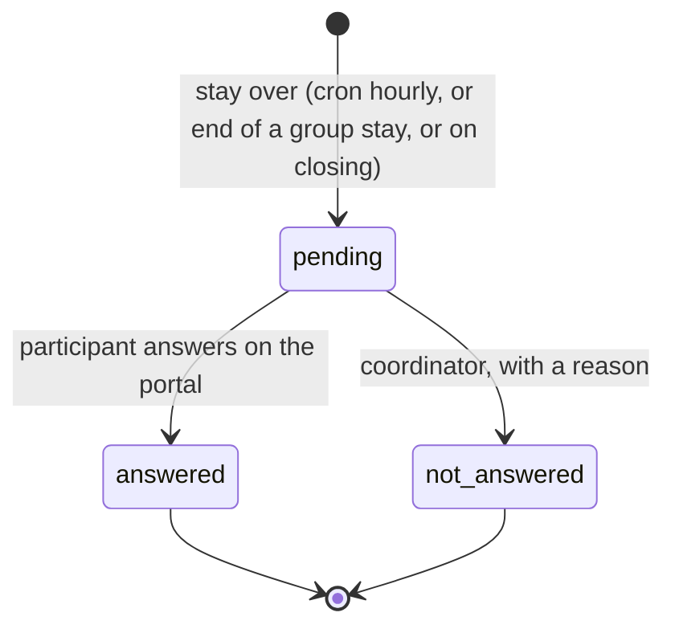

# Technical Reference: Erasmus+ quality (`ems.erasmus.satisfaction`, `ems.erasmus.quality.panel`)

The Erasmus+ part of the centre's quality system (ISO 9001) and of the Mobilitat FP network's
annual report: two indicators, a satisfaction survey every participant answers when the stay is
over, and a panel with the figures. Code: `models/erasmus/satisfaction.py`,
`views/erasmus/quality/views.xml`, the portal routes in `controllers/portal_erasmus.py`
(`/my/erasmus/satisfaction/<id>`), `mails/erasmus/satisfaction.xml`.

## Indicators

| Indicator | Calculation | Target |
|-----------|-------------|--------|
| Student interest | Applicants / target students x 100, students' calls | > 5 % |
| Staff interest | Applicant teachers / target teachers x 100, staff calls | none set |
| Satisfaction | Average of the scores (1-10) answered | > 8.5 |
| Response rate | Answered surveys / surveys opened (stays over) | none |

- **Applicant**: a submitted application (any state but `draft`/`not_submitted`), counted once per
  person.
- **Target population**: exactly who could apply, `ems.erasmus.call._ems_eligible_partners()`.
  Students' call: every student of the call's levels (CFGM, CFGS, EFPS). Staff call: the teachers of
  its FP levels (CFGB, CFGM, CFGS, EFPS, PFI by default) plus the Direction that validates (Director
  and Head of Studies of FP).
- Both counts are **frozen on the call** (`interest_applicant_count`, `interest_target_count`,
  `interest_date`) when its definitive resolution is published (`ems.erasmus.resolution._ems_after_publish`),
  so later enrolments or leavers never change the history. Before that, `_ems_interest()` counts live.
- Satisfaction counts every participant: individual students and staff, and every active participant
  of a group mobility (students, leader, companions).
- The **course** of a survey is the call's (or the group mobility's), never the year the stay ends.

## Survey lifecycle

- **Opening**: `_cron_satisfaction` (hourly, nothing before 9:00 in the centre) calls
  `_ems_open_ended()`: an individual mobility `preparing` whose `date_end` has passed, and every
  active participant of a group mobility in `return` (or in `stay` past its `date_end`).
  `action_end_stay` of a group mobility opens them at once, and closing a mobility opens a missing
  one before checking it.
- **Telling the participant**: students get `email_template_erasmus_satisfaction` (on opening, and
  as a reminder 3 and 7 days later, `reminder_count`). Staff (an internal user) get one to-do on
  their contact instead, like their mobility documents, which their daily summary repeats while it
  is pending; it is removed when the survey is answered or closed.
- **Answer** (`_ems_portal_answer`): a score from 1 to 10 (SQL check too); 6 or lower needs
  `what_failed`. The portal first shows a confirmation step for a low score ("You have given a X out
  of 10. Is that right?") with the mandatory "What did not work?". The comment is optional.
- **Closing a mobility** (`ems.erasmus.mobility.action_close`, after every other check, and
  `ems.erasmus.group.mobility.action_close`) needs every survey answered or `not_answered`
  (`_ems_check_satisfaction`). `action_mark_not_answered` is for the coordinator (and the
  administrator) only, with `not_answered_reason`.

## Improvement actions

`action_create_improvement` turns a low score into an `ems.quality.action` of type `improvement`
in the Quality app (no scope, the survey's course), with the participant type, host entity, score,
what did not work and the comment, and **never the participant's name**. It is created as the team
member who presses the button (they then manage it like any action they create) or, for one who
may not create actions, with sudo, left to the quality committee. One action per survey.

## Panel

`ems.erasmus.quality.panel` is a transient model whose form is the panel: filters (course, call,
project, participant type, cycle, host entity) and four non-stored computed HTML tables, recomputed
on every filter change (onchange):

- Indicators: value, target, met, n and, for satisfaction, the median; the response rate.
- Satisfaction by participant type and by host entity (average, median, n).
- Each call's funnel: applications, admitted, with a place, mobilities done, renounced or cancelled,
  in total and by cycle (the study of the applicant's group).
- Evolution by course of the two indicators.

There is no minimum group size: every breakdown shows whatever there is (adriamt, 2026-11-04). The
interest only follows the course, call and participant type filters (it is a per-call figure).
`_ems_data()` returns every figure as plain values, for a later export. Measured on this dev DB
(3 calls, no surveys): 0.06 s cold.

## Access control

| Who | Panel | Surveys | Participant's name | Close without answer | Improvement action |
|-----|-------|---------|--------------------|----------------------|--------------------|
| Erasmus team (`group_erasmus`) | yes | read | no | no | yes |
| Erasmus coordinator | yes | read, write the reason | yes | yes | yes |
| Administrator (`group_academic_admin`) | yes | read, write | yes | yes | yes |
| Participant | no | own pending survey, on the portal | - | - | - |

The name is hidden with field `groups` on `partner_id`, `mobility_id` and `group_participant_id`
(and on the mobility's `satisfaction_ids`); `display_name` never contains it. The mobility form
shows `satisfaction_state` (computed with sudo) to the whole team; the group mobility form, the
answered/total count.
