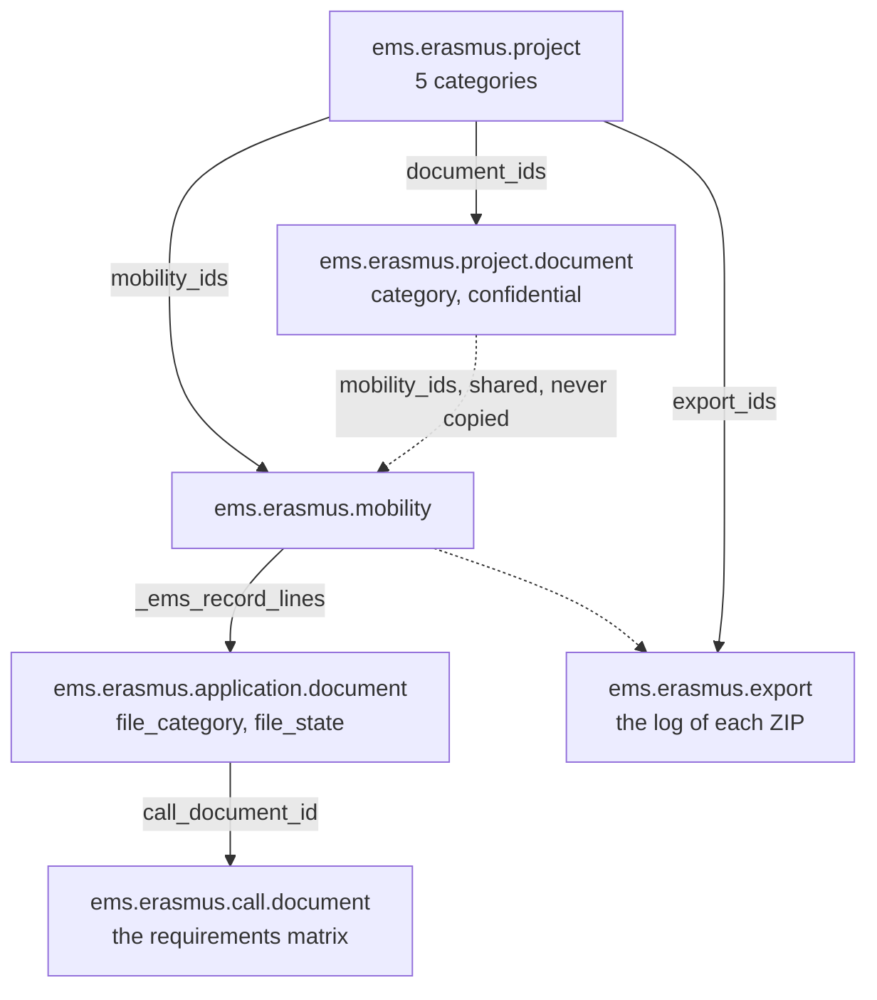
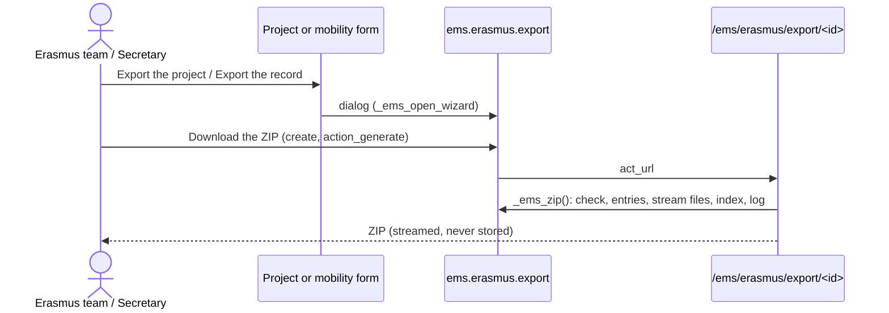

# Erasmus+ document records

EMS is where the Erasmus team manages every document of a project day to day; the centre's Google
Drive is where closed records are archived. There is no separate document manager: the records are
a view, organised in categories, of the documents EMS already holds (the call's documents uploaded
by each participant, the project's own documents, invoices and transfer receipts), and an export
that builds a verifiable ZIP from them.

Code: `models/erasmus/records.py` (categories and file checks), `models/erasmus/export.py`
(`ems.erasmus.export`), the record fields on `ems.erasmus.application.document`,
`ems.erasmus.mobility` and `ems.erasmus.project`, and the route `/ems/erasmus/export/<id>`
(`controllers/erasmus_export.py`).

## Three levels

| Level | Categories (code = folder in the ZIP) |
|---|---|
| Project | `01_Projecte`, `02_Mobilitats`, `03_Economia`, `04_Impacte_i_difusio`, `05_Informe_final_i_auditoria` (`PROJECT_CATEGORIES`) |
| Mobility | Inside `02_Mobilitats`: `00_Documentacio_comuna` (project documents in category 02, shared by several participants) and one folder per participant's record |
| Participant | `01_Dades_i_autoritzacions`, `02_Abans_de_la_mobilitat`, `03_Durant_la_mobilitat`, `04_Despres_de_la_mobilitat` (`PARTICIPANT_CATEGORIES`) |

The categories replaced the 13 SEPIE folders the project dossier used before (decided by the
Erasmus coordinator, 2026-10-24).

## The call's documents stay the only list of requirements

What a participant must hand in is still decided only by the call's documents
(`ems.erasmus.call.document`: `requirement`, `project`, `modality_ids`, signers, `handled_by`) and
the mobility's conditions (`is_minor`, `placement_type`, `is_short_blended`). The records add no
checklist of their own:

- `ems.erasmus.call.document.file_category`: the category of the document in the record. Empty:
  by stage (`STAGE_CATEGORIES`: with the application → 01, before leaving → 02, on return → 04).
  New calls preset it (health card, inclusion and travel authorisations → 01, tickets → 03).
- `ems.erasmus.application.document.file_category`: stored, computed from the call document; the
  lines are ordered by it, so the mobility's *Record* tab and the portal show them by category.
- `file_state`: `complete` (valid after the team's review, or uploaded when the team provides it),
  `to_review`, `needs_change`, `missing` (required), `optional` or `not_applicable` (a conditional
  requirement that does not apply). A document to sign is never complete only because a file was
  uploaded: `review_state` must be `valid`. `preparation_complete` / `return_complete` use it.

A participant's record for a mobility (`_ems_record_lines()`) is the application's own documents
(stage *application*) plus the mobility's: never another mobility's, even of the same person.
`record_missing` counts the required lines not complete, `record_progress` shows "complete /
required"; the project sums them (`record_count`, `record_complete_count`, `record_missing_count`).

**Project documents** (`ems.erasmus.project.document`) hold what no call document does: the grant
agreement with SEPIE, budget follow-up, dissemination, the final report... in a project `category`.
Linked to some mobilities (`mobility_ids`, constrained to the same project) they appear in those
records too, in `participant_category`, as one file shared by all of them: this is how a document
common to several participants (a group programme) or a one-off document about one participant (an
incident) enters a record. `confidential` marks health, inclusion or bank data.

## History kept

- Every upload is a new attachment: earlier versions are never replaced.
- A file can never be removed from a valid line, nor from any line of a closed or cancelled mobility
  (`write()` guard, also for the superuser): a new version is uploaded instead.
- Every change of `review_state` on a mobility line is posted in the mobility's chatter, with its
  author. The attachment keeps who uploaded it and when (`create_uid`, `create_date`).
- Closing the mobility (`state = done`) closes the record: no more portal uploads, files kept.
- Uploaded names keep only the file's own name and refuse programs, scripts and HTML/SVG
  (`check_upload`, `FORBIDDEN_EXTENSIONS`).

## Keeping period

`ems.erasmus.project.keep_until` = `final_payment_date` (when SEPIE paid the balance) + 3 years, or 5
when `budget` > 60,000 €; empty until both are known. `retention_hold` + `retention_note` mark an
audit or request still open. Nothing is ever deleted automatically.

## Export

- `scope = record`: one mobility's record (the four categories). `scope = project`: the five
  categories, the calls and published resolutions (`01_Projecte/Calls/<call>/`), every non-cancelled
  mobility's record under `02_Mobilitats/<ALU|PROF><mobility id>_<name>/`, invoices
  (`03_Economia/Invoices/<number>/`) and transfer receipts (`03_Economia/Transfers/<record>/`).
- Per record: every file of each line, numbered `v1_`, `v2_`... (`team_v1_` for the team's file);
  the commitment letter signed in EMS as an HTML page with who signed, when and from which IP; the
  weekly self-assessments as a PDF (in 03); the project documents linked to it. In a project export
  a shared document is written once (in its project category) and each record's index row points to
  it.
- `index.csv` (UTF-8 with BOM): one row per document, also the missing and not applicable ones, with
  category, required, status, signers, version, path, upload date and author, size and SHA-256.
  `manifest.json`: the export (id, scope, who, when, audit, reason) and every file. `SHA256SUMS`: the
  files' hashes in `sha256sum -c` format, to verify the copy archived in Drive. Only folders with
  files appear.
- Files are copied from the file store in 1 MB chunks into a temporary, uncompressed ZIP (PDFs,
  photos and videos hardly shrink) and streamed: a large project never sits in memory.
- Names go through `safe_name()`: no separators, control or reserved characters, no `..`, so no path
  can climb out of the ZIP's root.

### Who exports

| | Erasmus team | Erasmus coordinator | Secretary | Administrator | Others |
|---|---|---|---|---|---|
| Export a project or a record | yes | yes | yes | yes | no (`AccessError`) |
| Audit export (with confidential documents, a reason required) | no | yes | no | yes | no |
| See the exports log | all | all | own | all | no |

Each export is a log line (`ems.erasmus.export`: requester, date, scope, audit flag, reason, files,
documents missing, SHA-256 of the ZIP), created only as oneself (create and read rights, no write or
unlink). The ZIP is downloaded once, by its requester; a record export is also posted in the
mobility's chatter. Without an audit export, confidential documents (call documents with
`confidential`, e.g. the health card and the inclusion documentation; confidential project
documents) never leave EMS: a required one appears in the index without its file.

### Prepared for later

- **Group mobilities** (branch `ems-movgrupo`): the group's common documents fit
  `02_Mobilitats/00_Documentacio_comuna` via shared project documents; a *mobility* scope (common
  documents + students + companions) will reuse `_ems_record_entries()`.
- **Automated archive to a shared Drive**: `_ems_zip()` returns a file object and its log line holds
  the ZIP's hash, so a job could upload it to the institutional shared drive without changing the
  builder.
