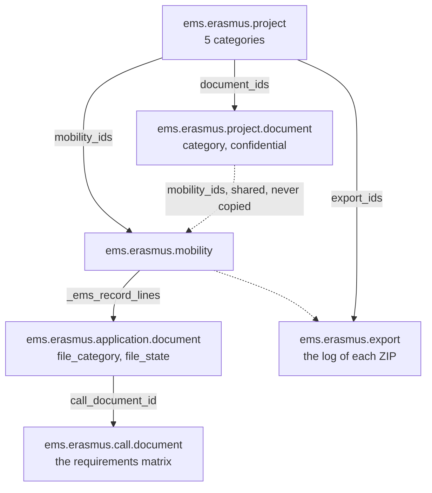
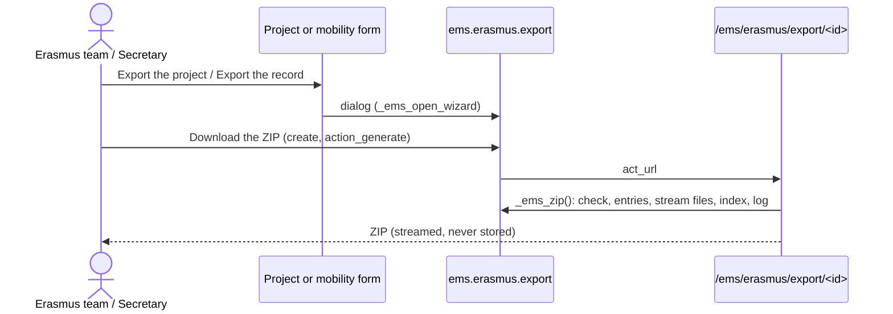

# Erasmus+ document records

EMS is where the Erasmus team manages every document of a project day to day; the centre's Google
Drive is where closed records are archived. There is no separate document manager: the records are
a view, organised in categories, of the documents EMS already holds (the call's documents uploaded
by each participant, the group mobilities' documents, the project's own documents, invoices and
transfer receipts), and an export that builds a verifiable ZIP from them.

Code: `models/erasmus/records.py` (categories and file checks), `models/erasmus/export.py`
(`ems.erasmus.export`), the record fields on `ems.erasmus.application.document`,
`ems.erasmus.mobility` and `ems.erasmus.project`, and the route `/ems/erasmus/export/<id>`
(`controllers/erasmus_export.py`).

## Three levels



| Level | Categories (code = folder in the ZIP) |
|---|---|
| Project | `01_Projecte`, `02_Mobilitats`, `03_Economia`, `04_Impacte_i_difusio`, `05_Informe_final_i_auditoria` (`PROJECT_CATEGORIES`) |
| Mobility | Inside `02_Mobilitats`: `00_Documentacio_comuna` (project documents in category 02, shared by several participants), one folder per individual participant's record, and one folder per group mobility (`GRUP<id>_<name>`, below) |
| Participant | `01_Dades_i_autoritzacions`, `02_Abans_de_la_mobilitat`, `03_Durant_la_mobilitat`, `04_Despres_de_la_mobilitat` (`PARTICIPANT_CATEGORIES`) |

The categories replaced the 13 SEPIE folders the project dossier used before (decided by the
Erasmus coordinator, 2026-10-24). A database that still has the old `sepie_folder` column (only
development copies: it was never released) gets the category from it on upgrade,
`EmsErasmusCallDocument._auto_init` running `records.LEGACY_FOLDER_SQL` before Odoo drops the
column: health card, inclusion and minors' authorisations to 01 (the health card confidential),
travel to 03, the rest empty (their stage decides). The lines' stored `file_category` and
`confidential` are recomputed (record rules and exports read them there); files are not touched.

## The call's documents stay the only list of requirements

What a participant must hand in is still decided only by the call's documents
(`ems.erasmus.call.document`: `requirement`, `project`, `modality_ids`, signers, `handled_by`) and
the mobility's conditions (`is_minor`, `placement_type`, `is_short_blended`). The records add no
checklist of their own:

- `ems.erasmus.call.document.file_category`: the category of the document in the record. Empty:
  by stage (`STAGE_CATEGORIES`: with the application → 01, before leaving → 02, on return → 04).
  New calls preset it (health card, inclusion and travel authorisations → 01, tickets → 03).
- `ems.erasmus.application.document.file_category`: stored, computed from the call document; the
  lines are ordered by it, so the mobility's *Record* tab and the portal show them by category.
- `file_state`: `complete`, `to_review`, `needs_change`, `missing` (required), `optional` or
  `not_applicable` (a conditional requirement that does not apply). A document is complete once the
  team marks it valid (`review_state`). The only exception is a document the team provides that
  nobody signs (e.g. the insurance policy): complete once uploaded (in `prepared_attachment_ids`,
  or in `attachment_ids` for a group's shared document). **A document someone signs (any `sign_*`)
  is never complete only because a file was uploaded, whoever uploaded it**: the team's own
  documents to sign (Europass, sBID, the group learning agreement) are `to_review` until the team
  checks the signatures and marks them valid. `preparation_complete` / `return_complete` (individual)
  and the group participant's `preparation_complete` / `record_missing` use it.

A participant's record for a mobility (`_ems_record_lines()`) is the application's own documents
(stage *application*) plus the mobility's: never another mobility's, even of the same person.
`record_missing` counts the required lines not complete, `record_progress` shows "complete /
required"; the project sums them (`record_count`, `record_complete_count`, `record_missing_count`).

**Project documents** (`ems.erasmus.project.document`) hold what no call document does: the grant
agreement with SEPIE, budget follow-up, dissemination, the final report... in a project `category`.
Linked to some mobilities (`mobility_ids`, constrained to the same project) they appear in those
records too, in `participant_category`, as one file shared by all of them: this is how a document
common to several participants (a group programme) or a one-off document about one participant (an
incident) enters a record. `confidential` marks health, inclusion or bank data.

## History kept

- Every upload is a new attachment: earlier versions are never replaced.
- A file can never be removed from a valid line, nor from any line of a closed or cancelled mobility
  or group mobility (`write()` guard, also for the superuser; `_ems_record_closed()`): a new version
  is uploaded instead.
- From a line not valid yet, a file uploaded by mistake is only removed through **Remove a file**
  (`action_remove_file`, the wizard `ems.erasmus.file.removal.wizard`, whoever reviews the line:
  `_ems_check_reviewer()`), with a required reason (audit D-2). The file is not deleted: it is
  unlinked from the line and attached to a message in the chatter of the line's record
  (`_ems_record_owner()`, or the application) with the reason, who removed it and when. Any other
  removal by a user (the file widget, an RPC `write`) raises; the wizard writes as superuser after
  its checks.
- A project document (`ems.erasmus.project.document`) with files is never deleted (`check_kept`,
  audit D-2); one without files can be.
- Every change of `review_state` is posted in the chatter of the line's mobility or group mobility
  (`_ems_record_owner()`), with its author and, for a group, the participant. The attachment keeps who uploaded it and when (`create_uid`, `create_date`).
- Closing the mobility (`state = done`) closes the record: no more portal uploads, files kept.
- Uploaded names keep only the file's own name and refuse programs, scripts and HTML/SVG
  (`check_upload`, `FORBIDDEN_EXTENSIONS`), the host's commitment of an own destination proposal
  included.
- The attachment itself is kept as well: the file of a valid line or of a closed record cannot be
  deleted, overwritten or moved to another record (`ir.attachment` guard), and a line, mobility,
  participant or group mobility holding files is never deleted (see "Workflow fields and evidence" in
  [erasmus.md](erasmus.md)).

## Keeping period

`ems.erasmus.project.keep_until` = `final_payment_date` (when SEPIE paid the balance) + 3 years, or 5
when `budget` > 60,000 €; empty until both are known. `retention_hold` + `retention_note` mark an
audit or request still open. Nothing is ever deleted automatically.

`keep_until` is stored, so the daily cron `ems.ir_cron_erasmus_retention_notice`
(`_cron_retention_notice`, audit D-12) filters in its domain: every project past its date, without
`retention_hold` and not told yet gets a to-do for the Erasmus coordinators
(`_ems_coordinators()`; the project inherits `ems.base` for its chatter and activities) and its
`retention_notice_date`. Once per project: changing `final_payment_date` or `budget` clears the date,
so a new keeping date is told again when it comes. The coordination decides what to keep or delete;
there is no automatic archive to Drive.

## Export



- `scope = record`: one mobility's record (the four categories). `scope = group`: one group
  mobility (below). `scope = project`: the five categories, the calls and published resolutions
  (`01_Projecte/Calls/<call>/`), every non-cancelled mobility's record under
  `02_Mobilitats/<ALU|PROF><mobility id>_<name>/`, every group mobility that is neither draft nor
  cancelled under `02_Mobilitats/GRUP<id>_<name>/`, invoices (`03_Economia/Invoices/<number>/`, the
  group's collective invoices included, once) and transfer receipts (`03_Economia/Transfers/<record>/`).
- Per record: every file of each line, numbered `v1_`, `v2_`... (`team_v1_` for the team's file);
  the commitment letter signed in EMS as an HTML page with who signed, when and from which IP (and
  every earlier version, see below); the
  weekly self-assessments as a PDF (in 03); the project documents linked to it. In a project export
  a shared document is written once (in its project category) and each record's index row points to
  it.
- `index.csv` (UTF-8 with BOM): one row per document, also the missing and not applicable ones, with
  category, required, status, signers, version, path, upload date and author, size and SHA-256.
  `manifest.json`: the export (id, scope, who, when, audit, reason), every file and `excluded`. `SHA256SUMS`: the
  files' hashes in `sha256sum -c` format, to verify the copy archived in Drive. Only folders with
  files appear.
- Archived records (mobilities, group mobilities, participants) are exported and counted like the
  others, each of their index rows noted "Archived".
- **Cancelled and withdrawn records with evidence** (audit D-17) go in complete, apart, under
  `02_Mobilitats/99_Cancellades_i_retirades/` (a cancelled mobility or group mobility) or
  `GRUP<id>_<name>/99_Cancellades_i_retirades/` (a withdrawn group participant), each index row
  noted with its state and never counted as missing. Evidence here means a **payment made**
  (`state = paid`) or something **signed or validated** on the record's own documents: a line
  `valid`, a signature ticked (`ems.erasmus.document.signature`) or the commitment letter accepted in
  EMS (`_ems_signed_domain()`; the application's documents do not count, every admitted application
  has them valid). They are found with one search per project, filtered in the domain
  (`_ems_project_cancelled`, `_ems_project_cancelled_groups`).
- The rest of what is left out on purpose (a cancelled mobility or a withdrawn participant without
  evidence, a group mobility in draft) gets one index row ("Not exported: <state>") and an entry in
  the manifest's `excluded` list: nothing is left out silently. Its documents stay in EMS and in its
  own record's export.
- Files are copied from the file store in 1 MB chunks into a temporary, uncompressed ZIP (PDFs,
  photos and videos hardly shrink) and streamed: a large project never sits in memory.
- Names go through `safe_name()`: no separators, control or reserved characters, no `..`, so no path
  can climb out of the ZIP's root.

### Who exports

| | Erasmus team | Erasmus coordinator | Secretary | Administrator | Others |
|---|---|---|---|---|---|
| Export a project or a record | yes | yes | yes | yes | no (`AccessError`) |
| Audit export (with confidential documents, a reason required) | no | yes | no | yes | no |
| See the exports log | all | all | own | all | no |

Each export is a log line (`ems.erasmus.export`: requester, date, scope, audit flag, reason, files,
documents missing, SHA-256 of the ZIP), created only as oneself (create and read rights, no write or
unlink). The ZIP is downloaded once, by its requester; a record export is also posted in the
mobility's chatter. Without an audit export, confidential documents (call documents with
`confidential`, e.g. the health card and the inclusion documentation; confidential project
documents) never leave EMS: a required one appears in the index without its file.

### Group mobilities in the export

`_ems_group_entries()` builds the same layout for `scope = group` (at the ZIP's root) and inside a
project export:

```
GRUP<id>_<name>/
├── 00_Documentacio_comuna/            the group's own documents, written once
│   ├── 01_Dades_i_autoritzacions/     shared lines (e.g. group inclusion documentation), Selection.csv, Draws.csv
│   ├── 02_Abans_de_la_mobilitat/      group learning agreement, final list, agreements with the host
│   ├── 03_Durant_la_mobilitat/        group travel documents, common evidence, Follow-up/ (files) and Follow-up.csv
│   └── 04_Despres_de_la_mobilitat/    EU Survey/ (its evidence)
├── ALU<participant id>_<name>/        each selected student: their own lines and the commitment letter
└── PROF<participant id>_<name>/       the leader and the accompanying teachers: their own lines
```

- Active participants, and withdrawn ones with evidence in `99_Cancellades_i_retirades/` (see
  above); the others are only listed.
- A shared document is never copied into the records: each participant's index rows point to its
  path ("Shared document: ...").
- `Selection.csv`: the frozen ranking (rank, group at closing, average and whether it was entered by
  hand with its source, eligible, draw position, proposed result, exception and reason, result,
  renouncement, substitution). `Draws.csv`: every draw (who, when, tied average, positions). The
  fewer opportunities, the conduct warnings and the reason for an exclusion are added only in an audit
  export: they are confidential and never go in an export meant for anyone else.
- Exported from the group mobility form (*Actions > Export the documents*, Erasmus team and admin) or
  inside the project export; logged and posted in the group mobility's chatter. `missing_count`
  includes the group's required documents not complete (`_ems_group_missing`), and so do the project's
  record counters (each active group participant is one more record).

### Commitment letter versions

The letter (`ems.erasmus.commitment`, shared by internships and group mobilities) keeps every accepted
version. A group mobility's `write()` compares what the letter states (`COMMITMENT_TERMS`: city,
country, host, dates, travel dates, teachers, additional conditions) before and after; when it changed
and a participant had accepted, `_ems_commitment_supersede()` stores the acceptance as an
`ems.erasmus.commitment.version` (the exact text, who, when, IP for the participant and the family,
whether it was provisional, when and why it was replaced; create-only, `write`/`unlink` refuse) and
clears the signatures, so the new letter is accepted again (the family is emailed again). An
acceptance while the destination or the start date is still to be confirmed
(`_ems_commitment_is_final()` false) is `commitment_provisional`: shown as such and the participant is
not ready to leave. Internships never call it (their letter is the call's annex, fixed once
published), so they behave as before. Versions are read by the Erasmus team and the administrator only.

### Signatures: what EMS does and what is missing

What EMS has today (no electronic signature system):

| Document | Who signs | How it reaches EMS |
|---|---|---|
| Commitment letter (internships and group students) | participant; family of a minor | Accepted on the portal: logged-in user, date, IP, exact text, versions |
| Grant agreement | participant, Director; family of a minor | Team uploads it filled in, participant uploads it signed (`team_to_sign`) |
| Learning / mobility agreement (individual) | participant, coordinator, host; family of a minor | Same, `team_to_sign` or participant |
| Group learning agreement | coordinator, host | Team uploads it signed |
| sBID agreement and activity plan (REF5, REF6) | Director or centre's tutor, participant, host | Team uploads them from sBID |
| Europass mobility document | coordinator | Team uploads it |
| Certificate of stay | host | Participant (or team) uploads it |
| Report with evidence | participant | Participant uploads it |
| Family authorisation to travel (individual) | family of a minor | Participant uploads it |
| Authorisation for minors to travel abroad | Mossos d'Esquadra procedure | Participant uploads it; never replaced by the commitment letter |

- The signers of each document are configured per call document (`sign_participant`, `sign_guardian`
  (minors only), `sign_director`, `sign_coordinator`, `sign_tutor`, `sign_host`) and shown on every
  line, the portal and the index.
- **One signature per signer** (audit D-1, `models/erasmus/document_review.py`): every line of a
  document someone signs has an `ems.erasmus.document.signature` per signer the call document asks
  for (created with the line, and kept in step when the call document's signers change; a database
  whose lines predate them gets them in `init()`). Whoever reviews the line (the team; for a group
  mobility, also its leader) ticks each one from **Signatures** when it is on the uploaded copy: EMS
  keeps who ticked it and when, and writes it in the record's chatter. It is not an electronic
  signature, it is the team's check of the scan. `is_required`: the legal guardian's only for a
  minor; a signer no longer asked for is kept if ticked, not required. A ticked signature is
  unticked only while the line is not valid, nothing changes in a closed record, and a ticked one is
  never deleted. The portal shows each signer's state, read only.
- The states of a signed document are the review: uploaded → `to_review` → `complete` (the team
  checked the signatures and marked it valid) or `needs_change` (with a comment for the participant).
  **Valid needs every required signature ticked** (`signatures_missing` empty; `write()` refuses
  otherwise, decided by the coordination 2026-10-29). Nothing to sign is ever complete on upload, and
  a mobility cannot be closed, nor a participant be ready to leave, with a required document not
  complete.
- Not there: a verifiable electronic signature (the Catalan idCAT/VALid or an external provider such
  as DocuSeal or OpenSign) and how the host entity would sign (it has no EMS account). The
  commitment letter keeps its click acceptance. A provider would fill the same signature lines
  (send, webhook, signed PDF stored as a new version) instead of the team's tick.

### Prepared for later

- **Automated archive to a shared Drive** (not wanted for now, audit D-12): `_ems_zip()` returns a
  file object and its log line holds the ZIP's hash, so a job could upload it to the institutional
  shared drive without changing the builder.
