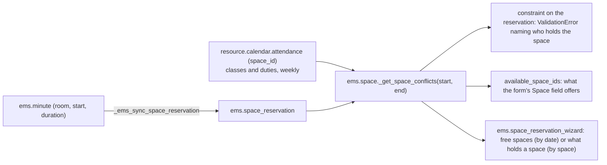

# Technical Reference: Space Reservation (`ems.space_reservation`)

## Overview

A teacher reserves a free space for a time span. A space is busy when a weekly schedule block, a
reservation or a meeting holds it. **A meeting's room is a reservation too**: `ems.minute` makes
and keeps one automatically, so a meeting and a teacher asking for the same room go through the
same check.

## Why a model of its own (Odoo way)

- Odoo Community 18 has no room booking; the *Meeting Rooms* (`room`) app is Enterprise-only.
- OCA `resource_booking` books combinations of `resource.resource` against a `resource.calendar`
  and creates a `calendar.event` with invitation emails per booking. Here a space is not a
  resource and what occupies it lives in the teachers' schedule blocks
  (`resource.calendar.attendance.space_id`), so it would need a mirrored calendar per space, the
  meetings would have to create its bookings, and it brings portal and external-customer flows
  that EMS does not use.

## Data model

| Field | Notes |
|-------|-------|
| `space_id` | Required, indexed; the space must be `reservable` unless a meeting made the reservation. |
| `start_datetime` | Required, indexed, defaults to now. |
| `duration` | Hours, greater than zero. |
| `end_datetime` | Computed and stored, so the overlap search runs in SQL. |
| `reason` | Free text. |
| `user_id` | Who reserved it (defaults to the current user). |
| `minute_id` | Set when a meeting made it (`ondelete='cascade'`); the reservation follows the minute. |
| `available_space_ids` | Computed, not stored: the spaces free for the span typed so far. The form's `space_id` has `domain="[('id', 'in', available_space_ids)]"`. |

## The reservation wizard (`ems.space_reservation_wizard`)

The list's **New** button (`display="always"` header button, the list has `create="false"`) opens the
wizard instead of the form. Day, start and duration are always asked; then either:

- **By date** (no space chosen): *Search free spaces* (`action_search`) writes one
  `ems.space_reservation_wizard.line` per reservable space that is free (optionally of one type) and
  reopens the wizard. The lines are real records, not a computed list: a row's *Reserve* button
  needs a record to call (a computed one2many holds virtual rows and the button did nothing).
  Changing day, start, duration, type or space drops the lines (`write`).
- **By space**: the chosen space's `space_is_free` and `occupation_html` (everything that holds it
  that day, from `_get_space_busy`, classes included) are computed live.

`Reserve` creates the reservation (never in the past) and opens it. A space with `reservable` off
(services...) is never offered and is refused by the reservation, except when a meeting holds it.
Calendar view: not offered. A calendar of 7 simultaneous reservations is unreadable, and the
questions asked are answered by the two modes above.

## What holds a space (`ems.space._get_space_busy` / `_get_space_conflicts`)

`spaces._get_space_busy(start, end, exclude_reservations=None)` returns one dict per holder (space,
local start and end, who, whether it is a reservation); `_get_space_conflicts` is the same as
`{space id: [texts]}` for the busy ones only (a missing key means free). It runs under `sudo()`: whether a room is taken
is a fact about the whole centre, not about what the acting user may read.

1. **Reservations** overlapping `[start, end)` (adjacent spans do not clash).
2. **Weekly blocks**: `resource.calendar.attendance` rows of an active calendar with that
   `space_id`, the local weekday, an overlapping hour range and `date_from`/`date_to` covering
   the day. Breaks (`non_teaching_is_break`) never hold a space. Hours are read in the company's
   timezone (see `docs/en/developers/shared/timezones.md`); a span crossing midnight is checked
   day by day.

Cost: two searches for any number of spaces, plus one block search per calendar day the span
touches (almost always one). Measured on this box's data (85 spaces, 1,679 blocks with a space,
`odoo shell`): cold 18 ms / 12 queries for a one-hour span, 21 ms / 6 queries for a whole day;
warm 3-8 ms / 2 queries. `available_space_ids` cold: 12 ms.

Weekly blocks are the single schedule source on purpose: they are what the space's own
*Schedule* tab shows. `ems.attendance_schedule` is derived from them (bottom-up sync) and is not
read here, or a class would be counted twice.

## Meetings

`ems.minute._ems_sync_space_reservation()` (called from `create` and from `write` when
`space_id`, `start_datetime`, `duration` or `modality` change) keeps exactly one reservation while
the meeting has a room, a start, a duration and is in person or hybrid, and none otherwise (no
room, online, by email). The reservation is written under `sudo()` for the minute's creator, since
whoever edits the minute later did not ask for the room. A room that is taken makes the minute's
save fail with the reservation's message. Deleting the minute deletes the reservation.

## Existing installations

`migrations/18.0.0.53.0/post-migrate.py` gives a reservation to every meeting already scheduled in a
room (in person or hybrid, starting from now), oldest first, so when two of them hold the same room
at once the earlier one keeps it. A meeting whose room is taken is left without a reservation and
logged as a warning; the migration never fails on existing data. Past meetings need none. A clean
install has no meetings, so it needs nothing in `post_init_hook`.

## Access

| Role | Read | Create | Write / delete |
|------|------|--------|----------------|
| Teacher (and every role implying it) | all | own | own, never one made by a meeting |
| Secretary | all | yes | any |
| Administrator (`group_academic_admin`) | all | yes | any |

`security/ir.model.access.csv` gives the CRUD rows; `security/rules/facilities.xml` narrows the
teacher's write rights to `user_id = user.id` and `minute_id = False`.

## Out of scope

Weekly repetition, capacity and equipment filters, prior approval, and treating holidays or
absences as occupation.

## Tests

`tests/test_space_reservation.py` (overlaps, schedule blocks, timezone, archived calendars,
breaks, meetings, rules) and `tests/test_space_reservation_tour.py` (a teacher reserves a free
space through calendar, list and form).
