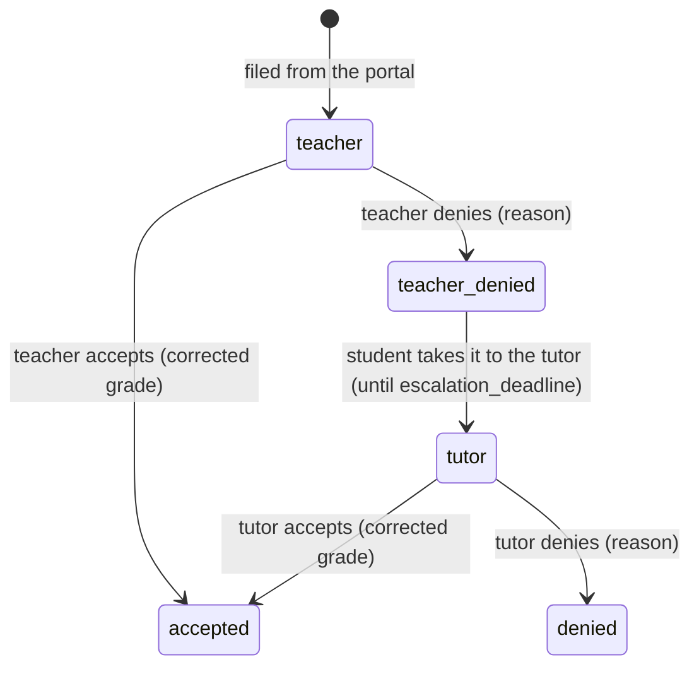

# Grade claims (`ems.grade_claim`)

Issue #879. A circuit **before** the official claim: a student (or their family) claims a published
grade from the portal; the session's teacher answers first, and, if they deny it, the student can take
it to their tutor. A claim is about a grade that **does not match the calculation the teacher shared**
(a mark left out, something not taken into account), not a request for a higher grade: the portal says
so above the form, and the denial reasons answer in that sense.

The Head of Studies of the student's tutor's chain and an administrator answer either instance.

## Model

| Field | Meaning |
|---|---|
| `session_id`, `student_id` | The published session and the student. `group_id`, `subject_id`, `round` are stored related fields for the list and its filters. |
| `kind` | `outcome` (a learning outcome's grade, `outcome_line_id`) or `final` (the subject's final grade, `subject_line_id`). |
| `claim_key` | `<session>-<student>-<outcome id or "final">`, unique: one claim per grade and round (each one can still go to the tutor once). |
| `claimed_score` | The grade when it was filed. |
| `reason` | What does not match the shared calculation (the student's text). |
| `state` | `teacher`, `teacher_denied`, `tutor`, `accepted`, `denied`. |
| `teacher_*`, `tutor_*` | Each instance's answer: who, when, the denial reason (`ems.grade_claim.denial_reason`) and details. |
| `escalation_reason`, `escalation_date` | The student's text when taking it to the tutor. |
| `escalation_deadline` | The end of the claims period, or two school days after the teacher's denial when that is later (`resource.calendar.leaves._ems_nth_school_days`, one holiday search for every claim read). |
| `new_score` | The corrected grade of an accepted claim. |
| `can_answer` | Non-stored, per user: drives the form's Accept/Deny entries. |

`ems.grade_claim.denial_reason` inherits `ems.reason.catalog` (sequence, active) and adds
`requires_details` ("Others" asks for a text), as the student walkout's rejection reasons. Seeded in
`data/main/ems.grade_claim.denial_reason.xml` with `noupdate`: the Head of Studies edits and reorders
them in **Grades > Evaluation management > Claim denial reasons**.

## Filing (portal)

`ems.grade_claim._ems_claimable_items(student, partner)` lists what can be claimed now: published
sessions inside their claims period (company-timezone today), the outcomes graded in that round (not
one carried over passed from an earlier round, `is_locked`), the final grade once every outcome is
evaluated (`has_final`), convalidated subjects aside and nothing already claimed. Three searches in
all (subject lines, existing claims, outcome lines indexed by session). Who may file follows the
convalidations' rule, `res.partner._ems_can_file_requests_for`: a minor never files it himself, only
his family; an adult files it himself, and his family when he authorized sharing.

`ems_file_from_portal()` and `ems_escalate_from_portal()` re-check everything server-side;
`controllers/portal_grades.py` only forwards the form and redirects with a code (`?claimed=1`,
`?error=claim`), never a message.

## Answering (backend)

**Grades > Grade claims** (pending by default). The form's Actions dropdown offers **Accept** and
**Deny** (`action_accept`/`action_deny`), which open `ems.grade_claim.answer_wizard`; the methods
`ems_accept()`/`ems_deny()` check `_ems_check_can_answer()` (the session is still published, the
claim pending, and the user answers it):

| Who | Answers |
|---|---|
| The session's teacher (`teacher_id.acting_user_ids`) | First instance. |
| The student's tutor (`user_acts_as_tutor(student.tutor_id)`, so their chiefs too) | Second instance. |
| Head of Studies in the tutor's chain (`group_head_of_studies` + `user_acts_as_tutor`), administrator | Either. |

Accepting writes the grade in sudo with the context flag `ems_grade_claim_apply`, which the outcome and
subject lines' `write()` only honour **in sudo** (a flag any RPC can send is not enough): an outcome's
grade (no longer provisional), or for a final-grade claim the internal grade overridden (the centre's
part). Nothing else of the session opens.

A session cannot be finalised while it has unanswered claims (`ems.grade_session._ems_check_state_change`).

## Notifications

- The teacher, then the tutor, get a quiet task (`ems.mail_activity_grade_claim_answer`, via
  `_ems_sync_user_tasks`), due at the end of the claims period: their daily summary tells them. It is
  marked done when the instance is answered.
- The student, and whoever is kept informed about them (`_ems_informed_recipients`: the family while a
  minor), get an email when each instance is answered: `ems.email_template_grade_claim_answered`, card
  layout `ems.mail_layout_grades`, with the reason and, after a teacher's denial, until when it can go to
  the tutor.

## Access

| Role | Model access | Records |
|---|---|---|
| Teacher (and every role implying it) | read | Claims of their sessions, and of the students of their tutorship chain (`tutor_scope_user_ids`). |
| Academic administrator | full | All. |
| Portal | none | Through the controller, in sudo, scoped to `get_portal_student()`. |

Denial reasons: teachers read them, the Head of Studies creates and edits them (archiving, not
deleting), the administrator has full access.

## Cost

Measured on the dev database (odoo shell): the claimable list of a student with 5 published subjects
takes 14 ms cold (3 ms warm); reading 10 claims with their deadlines, 2 ms.
