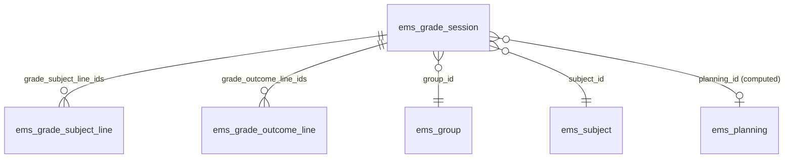
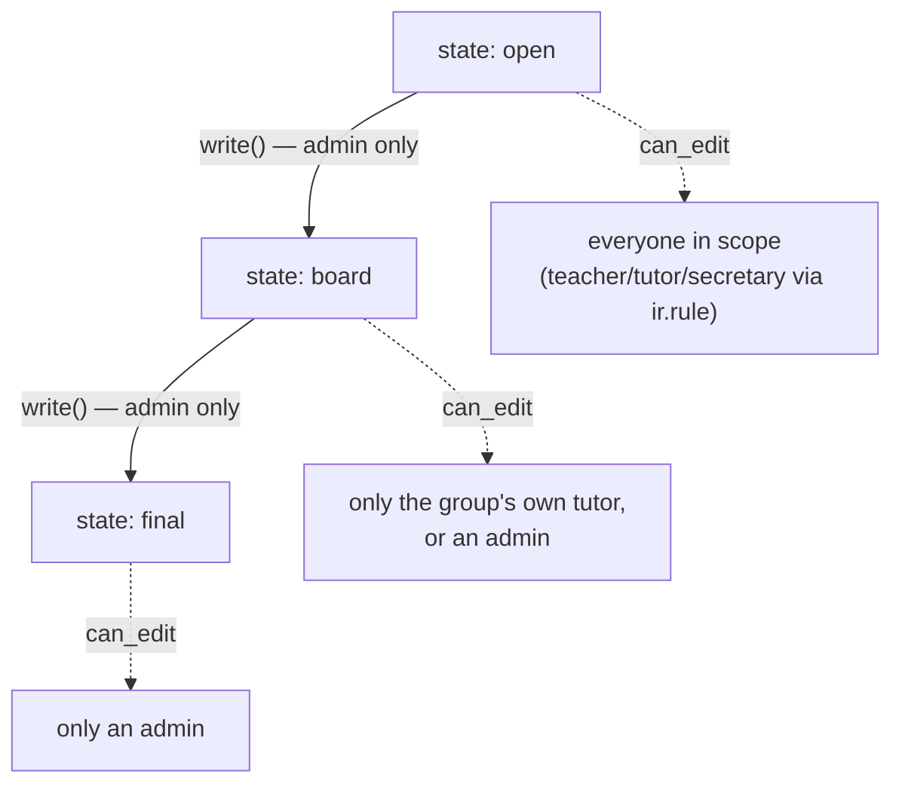
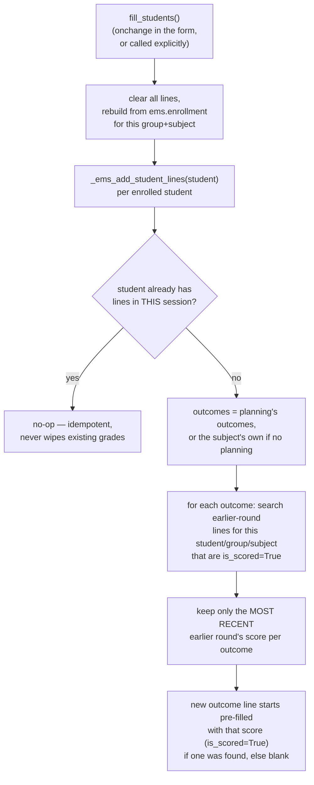
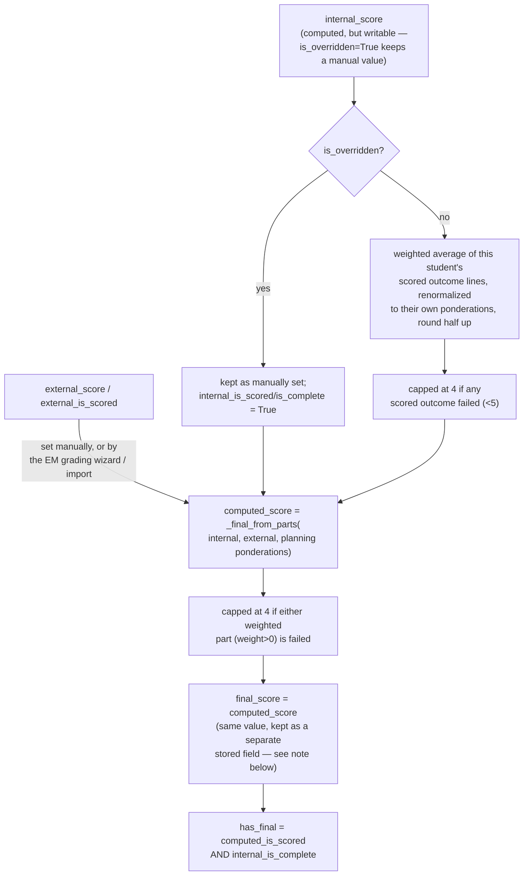
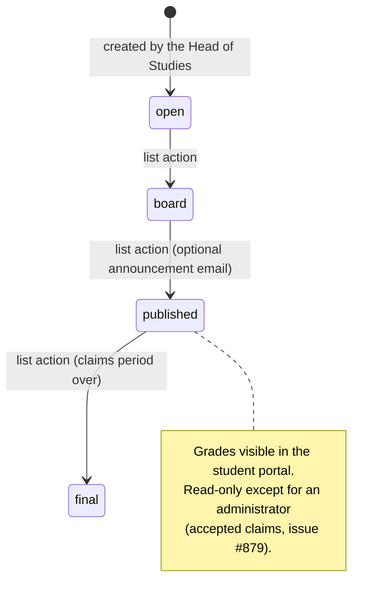

# Technical Reference: `ems.grade_session` / `ems.grade_subject_line` / `ems.grade_outcome_line`

## Overview

The core grading triad — one **`ems.grade_session`** per (group, subject, round), holding
one **`ems.grade_subject_line`** per enrolled student (the subject grade) and one
**`ems.grade_outcome_line`** per (student, learning outcome) (the outcome-level score the
subject grade is computed from).

**Module files:** `models/grades/grade_session.py` (`EmsGradeSession`),
`models/grades/grade_subject_line.py` (`EmsGradeSubjectLine`),
`models/grades/grade_outcome_line.py` (`EmsGradeOutcomeLine`).

**See also:** [`em_grading_wizard.md`](em_grading_wizard.md) (the work-placement grade entry
point, which writes into `grade_subject_line` after the normal rounds are closed) and
[`year_record.md`](year_record.md) (the archived history these sessions eventually feed) and
[`convalidation.md`](convalidation.md) (`grade_subject_line.is_convalidated` +
`convalidation_grade`: a convalidated subject is complete with the grade its convalidation was
resolved with, whatever its outcomes hold).

---

## `ems.grade_session`: identity and access-control state machine

`_sql_constraints`: `UNIQUE(group_id, subject_id, round)` — the real guard against duplicate
sessions; `create()` catches the resulting `IntegrityError` and re-raises as a friendly
`ValidationError`.

`can_edit` (`store=False`, `@api.depends_context('uid')`) is the single source of truth both
`grade_subject_line`'s and `grade_outcome_line`'s own `write()` overrides check — the state
machine is enforced once here, not duplicated on each line model.
`planning_id`/`has_planning` are derived from `(group_id.study_id, subject_id, course_id)` —
the `course_id` term (issue #503) is always `self.env.company.current_course_id`, since a live
grade session only ever exists for the course currently in progress; without it, once the same
study+subject has a planning for more than one course, the search could pick up a different
year's ponderations instead of the current one. A session with no matching
[`ems.planning`](../planning/planning.md) still works (falls back to the subject's own
`outcome_ids` and a 100%-internal/0%-external split), just without ponderations tailored per
outcome.

### `fill_students` / `_ems_add_student_lines`: cross-round carry-over

A carried-over score that was **passed** (≥5) becomes `is_locked` (see below) — the student
doesn't re-sit an outcome they already cleared. A carried-over **failed** score is not
locked — editable, but starts from the previous attempt's score rather than blank.

`_ems_has_scored_grades(student, group, subject)` is the read-only check
[`ems.enrollment`](../contacts/enrollment.md) uses to block deleting the underlying
placement once evaluation has actually started (scored outcome, or an external grade) — see
that model's own doc for the calling side.

`apply_grade_changes(outcome_vals, subject_vals)` batches the tutor grading screen's buffered
edits into one RPC (outcome lines first, so subject lines recompute from the fresh scores) —
the per-line `write()` overrides still enforce locking/state, this is purely a network-
efficiency wrapper.

---

## `ems.grade_subject_line`: internal / external / computed / final

`_final_from_parts()` is an `@api.model` **pure function** (no `self` state read) —
deliberately shared verbatim with `ems.student.year_record`'s archived-history equivalent
(`year_record.py`'s `subject.apply_external_grade`, see [`year_record.md`](year_record.md)),
so a live session and an already-archived record compute a final grade with the *exact* same
formula. Any future change to the weighting/capping rules must be made in both places, or
they will silently diverge.

`final_score` duplicates `computed_score`'s value rather than being a plain `related` alias —
the code's own comment explains why: a stored compute that only reads *another* stored
compute of the same model can flush stale when both are pending recomputation in the same
transaction (the dependency-triggered re-mark is suppressed while the field is protected), so
`final_score` is assigned directly inside `_compute_computed_score` instead.

`write()` enforces the session's `can_edit` state machine, with one documented exception: a
context flag (`ems_em_grading`) set only by [`ems.em_grading_wizard`](em_grading_wizard.md),
scoped to *only* `external_score`/`external_is_scored` — a work-placement grade legitimately
arrives after the rounds are closed, but every other field on the line stays protected
regardless of context.
The same kind of exception covers `is_convalidated`/`convalidation_grade`, through the
`ems_convalidation_sync` context set by [`ems.convalidation.line`](convalidation.md): a
convalidation is completed whenever its resolution arrives, which can be after the session is
finalised.

---

## `ems.grade_outcome_line`: the cross-round lock

`is_locked` (`store=False`, recomputed on read — it depends on *other* grade sessions, not
just this record) is `True` when this exact (student, outcome) already scored ≥5 in an
**earlier round** of the same group+subject. A locked outcome's `write()` unconditionally
rejects any `score`/`is_scored` change — not even an admin can override it through the normal
UI — **except** when `ems_grade_import_bypass_lock` is set in context, which only
[`ems.grade_import_wizard`](grade_import_wizard.md) sets (the official exported grade is the
source of truth and may need to overwrite a locked line; see `is_lock_released`, which marks
that specific line so the padlock stops showing without touching the earlier round that
originally locked it).

---

## Views

| View | File | Notes |
|------|------|-------|
| List/Form/Kanban | `views/planning_grading/grading/grade_session/` | Admin/secretary-facing session management. |
| Tutor grading screen | Custom OWL component (`static/src/js/backend/...`), backed by `apply_grade_changes` | The actual day-to-day roll-call-style grading UI; covered by `static/tests/tours/grade_session_tour.js`. |
| Bulk creation/state wizards | `views/planning_grading/grading/grade_session_wizard/` | See below. |

### `ems.grade_session_wizard` / `ems.grade_session_state_wizard`

Two small `TransientModel`s (`models/grades/grade_session_wizard.py`) automating what would
otherwise be many individual session creates/state writes:

- **`EmsGradeSessionWizard.action_create_sessions()`**: for every group in the selected
  level(s)/study(ies), creates one session per subject with actual enrolled students
  (excluding tutorship subjects — never graded), skipping any that already exist for the
  chosen round, deriving the teacher via `EmsGradeSession._derive_teacher()` (the active
  `ems.teaching` entry, falling back to the group's tutor).
- **`EmsGradeSessionStateWizard.action_apply_state()`**: bulk `state` transition
  (open→board→final) across every session in the selected scope+round in one write.

Both share a `_target_studies()` helper (level-mode resolves to that level's studies) and
raise `UserError` if the scope/round selection matches nothing.

## Fixed in this pass (2026-07-28)

Classes renamed `ems_grade_session`/`ems_grade_subject_line`/`ems_grade_outcome_line`/
`ems_grade_session_wizard`/`ems_grade_session_state_wizard` → their PascalCase equivalents.
Whole files were tab-indented — normalized to spaces.

**Self-caught regression, fixed before landing:** normalizing `grade_subject_line.py`'s loop
variable (originally `rec`) to `line` collided with an *existing, unrelated* lambda parameter
also named `line` in three computes (`_compute_internal_score`, `_compute_internal_is_scored`,
`_compute_internal_is_complete`) — the lambda's own `line` shadowed the outer loop variable,
silently turning `lambda line: line.student_id == line.student_id` into a tautology (always
`True`, since both sides refer to the shadowed inner parameter) instead of the intended
"does this candidate outcome-line belong to the current subject-line's student" filter. Caught
immediately by the existing test suite (`test_apply_grade_changes_batches_writes`,
`test_internal_complete_when_all_scored`, `test_no_final_while_incomplete` all failed) before
being committed to memory/roadmap as done — fixed by renaming the *outer* loop variable to
`subject_line` throughout the file instead, leaving the inner lambda's `line` (correctly
referring to outcome-line candidates) alone. No other file in this pass had the same
collision. **Lesson: a blind find-and-replace rename of a loop variable is not safe when the
method also has a nested lambda/comprehension using a plausible-sounding parameter name of its
own — always re-read the method after a mechanical rename, not just run the test suite
after the whole file (which is what actually caught this one) and grep for the old name.**

Test coverage was already extensive before this pass (`tests/test_grade_session.py`, 39
tests spanning all three models plus both bulk wizards, `tests/test_grade_session_tour.py`)
— no new tests were needed; this was a normalization-only pass (plus the regression fix
above). No dev doc existed for this triad before now.

---

## Evaluation lifecycle: publication, provisional outcomes and the student portal (issue #878)

> **Spec, in progress (issue #878).** Requirements for this cycle; reconciled with the
> implementation at Close.

| Requirement | Design |
|---|---|
| New state | `published` between `board` and `final` (`grade_state_selection`). `can_edit` is `False` except for an administrator; #879 adds the accepted-claim exception. |
| State changes | One step at a time, forwards or backwards (`_ems_check_state_change`, enforced in `write()` except for the superuser). Publishing needs the claims period. The state wizard only offers the states every target session can reach (`allowed_states`, read by the `ems_selection_allowed` widget), the next one by default. |
| Publish warning | `ems.grade_session_state_wizard.publish_warning`: sessions with no outcome graded at all (a whole subject forgotten), convalidated students aside, from `_ems_empty_grades_summary()` (two queries). Not sessions with only some outcomes empty, the usual state of a term. A warning, not a block. |
| Claims period | `claim_date_from` / `claim_date_to` (Date) on the session, required by the creation wizard (form and `action_create_sessions()`, not NOT NULL: old wizard rows), editable on the form and in bulk from the list (`multi_edit`); `from <= to` constraint. |
| Who manages sessions | `ems.group_head_of_studies` (and the administrator), `MANAGED_FIELDS` in `write()`, `can_manage` for the views: create sessions (the wizard writes with `sudo()` after checking it), change states, set the claims period and the provisional switch. A rule gives the Head of Studies write access to every session; the grades stay with the line rules. |
| State changes from the list (#354) | The state wizard, bound to the list (`action_grade_session_state_wizard_selection`); the form's Actions dropdown runs it on its record (`action_open_state_wizard`). From the menu it keeps acting on a level or study and round. |
| Rounds (#354) | Not asked: the creation wizard computes the round after the highest existing one in its scope. Round `4` is the extraordinary evaluation (2a convocatòria), the last one, so it carries over the outcomes passed in the ordinary ones. |
| Provisional outcomes (#314) | `allow_provisional` on the session (default on); `is_provisional` on `ems.grade_outcome_line`, refused when the session doesn't allow it, cleared with the grade. In the grids, typed as `6*` or `6p` (`static/src/js/backend/grade_input.js`, shared by both grids), or by ticking an outcome's column in the session's grid: the tick is kept on the session (`provisional_outcome_ids`, set by whoever may grade it) and every grade entered later in that outcome is provisional too, whatever was typed (enforced in the line's `write()`, so the tutors' view follows it; an official import does not). |
| Who edits a line | `can_edit` mirrors the line rules: open, the session's teacher and the group's tutor scope; board, the group's tutor scope. The tutor who follows the student (`student_id.tutor_id`) may edit that student's lines in open and board too (`_ems_check_can_edit(student)`), whatever group the session is; the line rules let them read and write those lines. |
| Tutors' view | Students by their tutor (`student_id.tutor_id`), grouped by their tutorship group, with every subject they take in open/board sessions of any group. Filters on the stored `session_state` of the subject line: a search through `grade_session_id.state` would apply the session's rules and drop the other groups' sessions. |
| Grade matrix and the pager | The matrix keeps edits in a buffer of its own, reloaded when the form shows another session (`onWillUpdateProps`). The session form (`ems_grade_session_form`, `static/src/js/backend/grade_session_form.js`) asks the matrix before the pager moves on, so unapplied changes get the same warning as leaving the screen. |
| Performance | Lines are created per session in one write, and the subject line computes index the outcome lines by student once per batch: 52 sessions of a study went from 27.9 s to 5.8 s. `is_locked` is computed with one query per batch: a tutor's view went from 12.3 s to 0.2 s cold. |
| Portal (#271) | `/my/calificaciones` (`controllers/portal_grades.py`): the student's published and final sessions, newest round first, from `res.partner._ems_portal_grade_rounds()` (`models/grades/grade_portal.py`, two searches through `sudo()` scoped to the student `get_portal_student()` resolves, so no student id travels in the URL). Per subject: the final grade, or, while an outcome is still pending, the internal grade marked provisional (as the grids show it), or pending; per outcome: its score, provisional mark, or "passed in an earlier round". One table per round laid out as the tutors' view: one column per outcome (natural order), as many as the subject with the most, greyed where a subject has fewer, and the teacher's comment (`notes`) last. Families see their child's, view-only included. Open and board sessions never show. |
| PDF (#271) | `/my/calificaciones/pdf`: `ems.report_student_grades`, rendered on request and never stored, titled as non-official. Portal page and PDF share the tables (`ems.student_grades_tables`). |
| Announcement | "Announce the publication" (`announce`) in the state wizard when the target is Published: `ems.grade_session._ems_announce_publication()` queues one email per student and round, whatever the number of their sessions, to `_ems_informed_recipients()` (the student, and the family while a minor), in each recipient's language. Template `ems.email_template_grades_published` on the student, card layout `ems.mail_layout_grades` with a button to the portal; it carries the round and the claims period, never the grades. |
