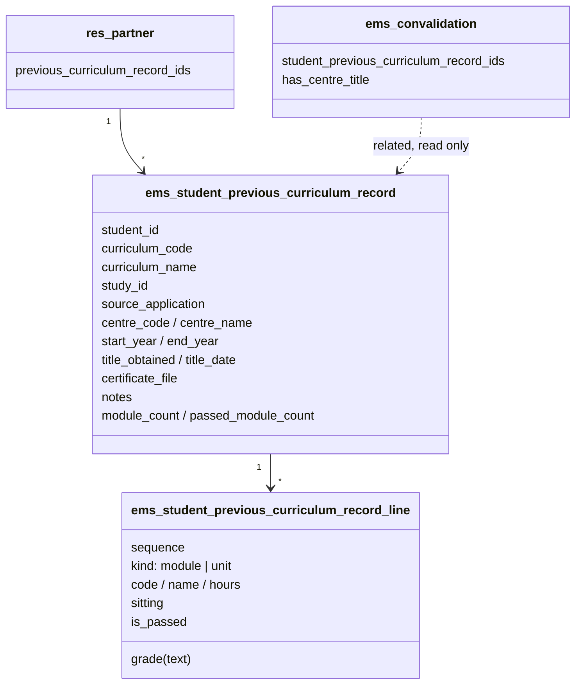
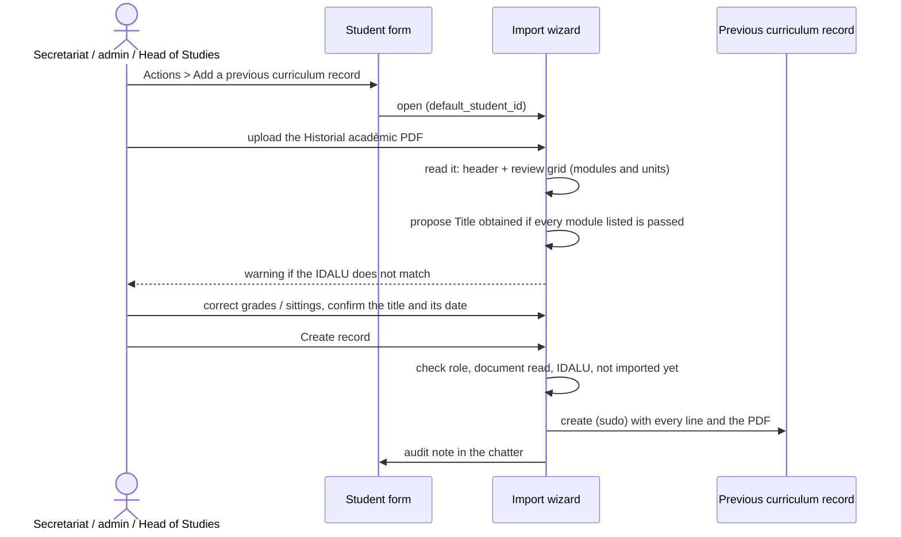

# Technical Reference: `ems.student.previous_curriculum_record`

## Overview

The academic history of a student under a **previous curriculum** (issue #672): a VET cycle of an
earlier law (LOE, organised in units, *unitats formatives* or UF, instead of learning outcomes) that
the Departament d'Educació managed in SAGA before Esfera. Its modules do not map onto the current
curriculum (different numbering, hours and modules, units instead of RAs, no course per module), so
it is **not** an `ems.student.year_record`: it is kept apart, as printed on its *Historial acadèmic*
document, and only looked up, typically to decide a convalidation request.

Students still studying a previous curriculum are not managed in EMS: only their documents are
imported, for consultation.

**See also:** [`year_record.md`](year_record.md) (the per-course history, and the previous record
of the current curriculum from an Esfera certificate), [`convalidation.md`](convalidation.md).

## Hierarchy and relations

- **One record per student and curriculum** (`unique (student_id, curriculum_code)`).
- **Curriculum as text** (`curriculum_code` "CFPS ICB0", `curriculum_name` "CFPS Desenvolupament
  d'aplicacions multiplataforma (LOE)"): the curriculum is what identifies the studies, and it is not
  in EMS. `study_id` is only informative: the current study whose code ends with the curriculum's
  token (`CFPS ICB0` → `CFGS_ICB0`).
- **One flat line table**, modules and their units interleaved in the printed order (`sequence`,
  `kind`), so the record reads like the document in a single list.
- **Grades as text** (`grade`): a number, `NP`, `Ap`, `CV`... A module is only graded once all its
  units are. `is_passed` (stored) comes from `grade_passes()`: a number from 5, or `Ap`/`A`/`Apte`,
  `CV`/`Convalidat`, `EX`/`Exempt`.
- **`source_application`** defaults to `SAGA`, the application that issued the document.

## Reading the document (`models/grades/previous_curriculum_pdf.py`)

The *Historial acadèmic* PDF is read with `pdftotext -layout` (same reason as the Esfera reader,
[`year_record.md`](year_record.md#previous-records-issue-585)), reusing its `pdf_to_text()` and
`_value_below()`.

- **Header:** IDALU and name (`Cognoms i nom` row), centre (`Municipi` row), curriculum
  (`Nom del cicle formatiu` row), years (`Anys acadèmics`, "De 2020 a 2022"), and the
  `Observacions` box as notes.
- **Grades table:** module and units side by side, both names wrapped. The table starts at the
  `Mòdul ... Unitat Formativa` header of each page and stops at the signatures or the closing
  sections. Each line is split where its unit code (five digits) starts, searched from near the
  header's `Unitat Formativa` column, since the module's sitting (`Ext.`) reaches under that title
  and a page may shift its rows; a line without a unit code is split just right of it. Each half is
  read on its own: a code opens a row, anything else continues the name above (a word cut at its
  hyphen is joined without a space).
- A file that is not this document raises `AcademicRecordPdfError`, shown as a message in the
  wizard.

## Import wizard (`ems.previous_curriculum_wizard`)

- Same roles as the previous record of the current curriculum (`ems.base.get_user_can_edit_history()`:
  secretariat, academic administration, Head of Studies, Deputy, Director). The record is created
  with `sudo()` after that check, as the Head of Studies has no create right on it.
- The IDALU check is `ems.base.get_certificate_student_problem()`, shared with the Esfera reader:
  identifier not read, student without IDALU, or a different one, all block creation.
- **Title:** the document never states it. `all_modules_passed` proposes it when the PDF is read;
  the user confirms or corrects it and may give its date.
- The button shows for students, alumni and withdrawals.

## Where it is shown

- **Student form**, *Studies* tab, under the academic history (`previous_curriculum_record_ids`,
  only when there is one).
- **Convalidation request**, *Academic history* tab (`student_previous_curriculum_record_ids`,
  related, same groups as the per-course history).
- **Planning and Grading → Grades → Previous curricula**: every record.
- **`has_centre_title`** on a convalidation request also counts a previous curriculum record with
  the title obtained whose `centre_code` is this centre's (`res.company.center_code`).

## CRUD flow

| Operation | How |
|---|---|
| Create | Only the import wizard (form views have `create="0"`). |
| Read | Student form, convalidation request, Previous curricula list. |
| Write | Secretariat and administration correct a grade, the title or the notes on the form. |
| Delete | Academic administration only. |

## Access control

| Role | Record and lines | Import wizard |
|---|---|---|
| Teacher (every teacher) | read | - |
| Head of Studies / Deputy / Director | read | yes (writes through `sudo()`) |
| Secretariat | read, write, create | yes |
| Academic administration | read, write, create, delete | yes |
| Student data reader | read | - |

Access is ACL-only (no `ir.rule`), the same reach as the academic history: the whole teaching staff
reads it.
