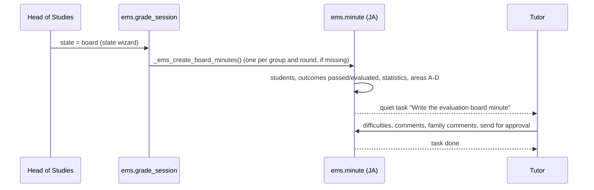

# Evaluation board minutes (issue #880)

The minute of an evaluation board (*junta d'avaluació*) replaces the evaluation tabs of the tutor's
spreadsheet. It is an ordinary `ems.minute` of the type **Acta de junta d'avaluació** (`JA`,
`__import__.minute_type_board`, `data/custom/quality/`), scoped to a group's teaching team, plus three
section kinds of its own and the round it is about (`grade_round`). Attendance of the teaching team,
the follow-up of earlier agreements, the agreements and the signatures are the minutes' own.

## Section kinds

| Kind | Data | Notes |
|---|---|---|
| `board_difficulties` | `ems.minute.board.difficulty`: `area` (A prior knowledge and basic competences, B expectations and interests, C study techniques and habits, D behaviour), `tests`, `diagnosis`, `objectives`, `priority` | The four rows are created with the minute. |
| `board_statistics` | On the minute: `board_withdrawals`, `board_absence_count`, `board_unjustified_count`, `board_working_count` (computed from the students' `works`), `board_period_from/to` | Computed **once**, when the minute is created; the tutor corrects them by hand (developer, issue #880). |
| `board_students` | `ems.minute.board.student`: `passed_count`, `evaluated_count`, `works`, `comments` (the teaching team's, stay in the minute), `family_comment` (the tutor's, for the student and the family) | One row per student of the group's tutorship (`tutorship_group_id`). |

`board_kinds` (non-stored) says which of the three the minute's type has: the form shows each block,
and `grade_round`, only then. The PDF (`reports/minute_report.xml`) prints the difficulties, the
statistics and the teaching team's comments; never the family comments.

## Creation

`ems.grade_session.write()` (`models/quality/minute_board.py`): when sessions move to `board`,
`ems.minute._ems_create_board_minutes(sessions)` creates, in sudo, one minute per group and round that
has none yet, written by the group's tutor (`redactor_employee_id`), and gives the tutor a quiet task
(`ems.mail_activity_board_minute_write`, via `_ems_sync_user_tasks`), marked done once the minute is
sent for approval. Going back to open and to the board again does not create a second one.

- **Outcomes passed and evaluated**: from the round's outcome lines of each student, in every session
  (also another group's); one search for the whole minute. "Update the outcomes from the grades"
  (`action_board_refresh_grades`) reads them again while the minute is open, since grades can change
  during the board.
- **Term**: from the group's previous board minute's date, or 1 September of the current course,
  until the creation day.
- **Withdrawals**: the group's enrolled students (archived enrollments included) who withdrew or were
  expelled in the term, with the registered reason (`exit_type`, `exit_date`, `exit_reason`).
- **Absences**: from the roll-calls (`ems.attendance_session_line`), weighting each session by its
  length (`end_time - start_time` of the header): a student counts when absences exceed 25% of their
  hours, or unjustified ones (any absence but `ems.attendance_status_justified`) exceed 5%. One grouped
  raw SQL query for the whole group, because the length lives on the header, which `_read_group` cannot
  sum through the line.

## The family comment in the portal

`res.partner._ems_portal_board_comments()` gives each round's `family_comment`;
`_ems_portal_grade_rounds()` adds it to the rounds the portal and the grades' PDF show, which are only
the published and final ones: the comment appears with the grades, never before.

## Access

The two line models have the minutes' lines' access (teachers, secretary, quality administrator and
academic administrator), narrowed by record rules that repeat, through `minute_id`, the minute's own
read and write rules (`security/rules/quality.xml`). Repeated on purpose: a record rule's domain is
evaluated without the related model's rules, so `('minute_id.id', '!=', False)` would let any teacher
read every student comment.

## Cost

Measured on the dev database (odoo shell, a group of 14 students): creating the minute takes 0.34 s,
of which the absences query 16 ms; refreshing the outcomes, 8 ms.
