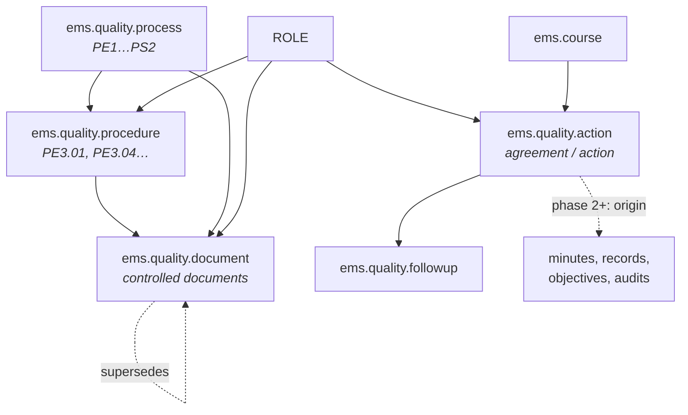
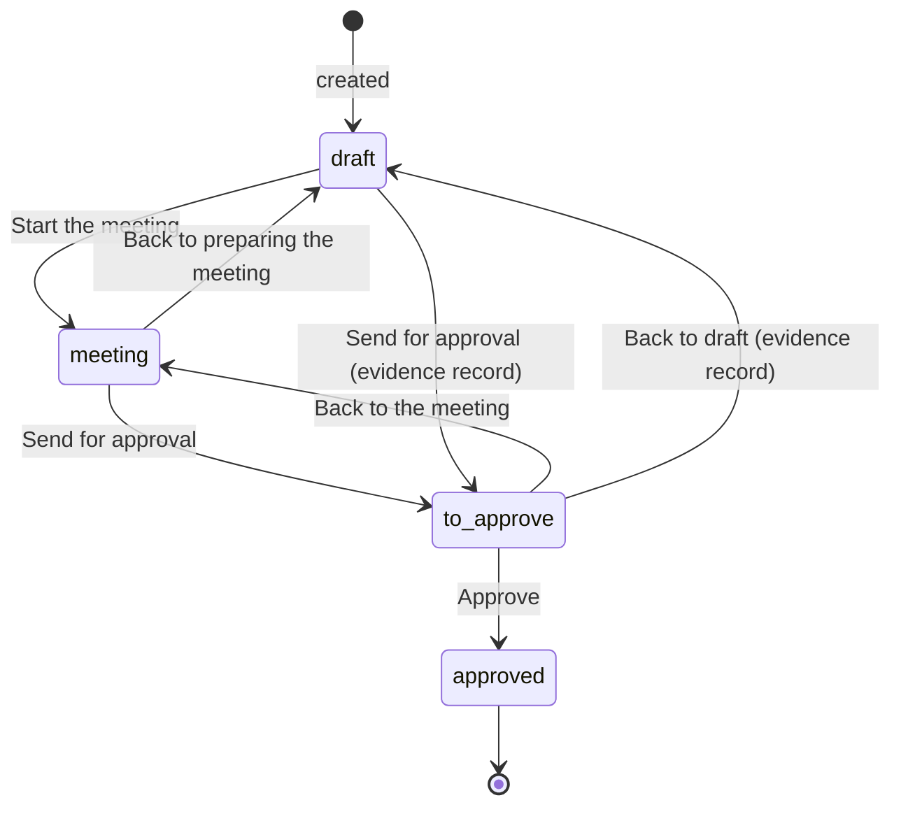

# Technical Reference: quality management (`ems.quality.*`)

## Overview

The `ems.quality.*` models bring the centre's ISO 9001 quality management system inside EMS. **This
document is the area overview**; each model gets its own reference as it lands. The design of record for
the whole feature, including the phases still to come, is `plans/quality_iso.md`.

**Phase 1 (this one) delivers the foundation:** the embedded process map, the documentary structure
(processes, procedures and documents, each with its Drive link), and the unified action/agreement model. It is visible only to quality coordination and management; the
staff-facing application arrives in phase 2 with the minutes.

**Module files:** `models/quality/` · **Views:** `views/quality/` · **Security:**
`security/groups.xml`, `security/ir.model.access.csv`, `security/rules/quality.xml`

---

## Model map



Three ideas carry the whole area and are worth stating before the field tables:

1. **One owner per piece of information.** A controlled document lives in the centre's Drive, and its
   version, state, dates and owner are written there and only there. EMS keeps where each document sits
   in the structure and its link, nothing else, so nobody updates the same thing twice.
2. **Responsibility is a post, not a person.** Every owner field of an action points at `ems.role`
   (Director, Head of studies, Secretary, Quality coordinator…) and resolves to the employee holding it. The centre's own
   records work this way, and it survives someone changing job in September.
3. **An agreement and an improvement action are the same thing.** One model, `ems.quality.action`, with a
   `type`. That is what makes a single "what do I owe and by when" screen possible instead of one per
   origin.
4. **State is computed, never typed.** It derives from the latest follow-up entry, so changing state
   requires recording why.

---

## Documentary structure

Three models, under `Quality > Documentation` (with the process map first, so it is what clicking
*Quality* opens), that hold **only the structure and the links**:

| Model | Fields |
|-------|--------|
| `ems.quality.process` | `code` (unique, `PE1`…`PS2`), `name`, `kind` (`strategic` / `key` / `support`), `sequence`, `active`, `procedure_ids`, `document_ids`, `url`, `embed_url` |
| `ems.quality.procedure` | `code` (unique, `PE3.01`), `name`, `process_id` (required), `document_ids`, `active`, `url`, `embed_url` |
| `ems.quality.document` | `code` (unique when set, nullable: some documents have no code yet), `name`, `procedure_id`, `process_id` (computed from the procedure, editable when there is none), `url`, `embed_url`, `is_process_map`, `active` |

A process and a procedure each have their own sheet in Drive (the one the process map links to), so
all three carry a link, through the shared abstract model `ems.quality.link` (`models/quality/link.py`).
The process and procedure forms show it in a first **Document** tab.

There is deliberately **no version, state, date, owner or distribution field**: the document itself, in
Drive, is the only place those are kept. A document no longer in force is archived (`active = False`).

### One link per record, previewed inside EMS

`url` (from `ems.quality.link`) is the ordinary address people copy from the browser; **Open document**
(`action_open_document`) opens it in a new tab, where Google Docs edits it. `embed_url` is derived from it
(`_EMBEDDABLE_LINKS` in `models/quality/link.py`, which also accepts the `/u/<n>/` form some links carry): Google's own `/preview` address for Docs, Sheets,
Slides, Drawings and Drive files, which the forms show in an `<iframe>` across the full width of the window (the three forms carry
`class="o_quality_wide_form"`, `static/src/css/backend/quality_document.css`) (field widget
`ems_quality_document_preview`, `static/src/js/backend/quality_document_fields.js`). No second link, no
"Publish to the web" copy and no extra module: the frame is served by Google and follows the file's own
sharing, so the viewer's browser must be signed in to a Google account that can open the file. Any other
address gets no preview, only the button.

### Process map

`Quality > Process map`, the first entry of the app, is a server action
(`ems.action_quality_process_map_open` → `ems.quality.document.action_open_process_map()`) that opens the
form of the document with `is_process_map` set, so the map is an ordinary document of the structure: its
link is changed from its own form. A constraint keeps a single one marked. Seeded as
`__import__.quality_doc_process_map` ("Mapa de processos", the Drive title), without its link.

### Read-only until "Edit"

The three models inherit `ems.quality.edit.mode` (`models/quality/edit_mode.py`): a non-stored
`edit_mode` that always loads False (True for a record being created) and, through
`ems.quality.can.edit`, `can_edit` (`has_access('write')`, non-stored, `@api.depends_context('uid')`). Every field of their forms is `readonly="not edit_mode"`, and the header shows
an **Edit** button (field widget `ems_quality_edit_mode`) only when `can_edit`. Pressing it sets
`edit_mode` on the client; saving or discarding reloads the record, so it comes back read-only. Record
access is unchanged: this is only about not presenting every field as editable by default.

### Minutes: read-only for whoever may only read them

`ems.minute` inherits `ems.quality.can.edit` too, without the "Edit" step: a minute is written live,
so whoever may write it gets it editable straight away. Whoever may only read it (an attendee, a
department colleague: see `rule_minute_teacher` vs `rule_minute_teacher_write` in
`security/rules/quality.xml`) gets it read-only. The form's `js_class="ems_minute_form"`
(`static/src/js/backend/minute_form.js`) adds an `onRootLoaded` hook that switches the record to
`readonly` mode when `can_edit` is False, and back to `edit` when it is True, on every load (the pager
moves between minutes the user may and may not write); its autosave skips a read-only record. Every
header action and the attendance kiosk buttons are also `invisible="not can_edit or ..."`, since each
of them writes the minute. The record rules stay the only real guarantee.

The three forms use `js_class="ems_quality_form"` (`QualityFormRenderer` in
`static/src/js/backend/quality_document_fields.js`), which always opens them on their first tab, the
record's own document: Odoo otherwise restores the last tab opened on the same form, even for another
record. Their embedded procedure and document lists use the field widget `ems_quality_linked_rows`
(`QualityLinkedRowsField`, same file): while the form is read-only, clicking a row opens that record in
its own form, with the parent kept in the breadcrumbs; while editing, a click edits the row in place.

There is no configuration menu: everyone with the *Quality* menu consults the structure under
*Documentation*, and whoever may write changes it with *Edit* on the record itself. The document list is
not editable in place, so every change goes through the form. Its *Load links* button (quality
coordination and management) opens `ems.quality.document.link.import`, which fills `url` from a
`code,url` file in one go, matching each code against documents, procedures and processes, and a line
that is no code against the exact name of a document without one (the strategic documents and the process
map; a name shared by several matches none and is reported).

### Why the links are not in the data files

The links point into the centre's Drive, and several of those documents are shared by link: publishing
them in this public repository would expose them. So `url` is not a `data/custom/` CSV column; it is
filled in from the interface, or loaded with the wizard from a file kept outside the repository.

The three models are **seeded once and then frozen**, like every `data/custom/` record
(`res.company._ems_freeze_living_custom_data()`, see `../shared/data_loading.md`): the quality
coordination keeps the structure from the interface, and no upgrade reverts those edits.

### Why the seeded names are in Catalan

The process map, the procedures, the document registry, the minute types and the minute sections are
seeded from `data/custom/quality/*.csv` with their **Catalan** names, taken verbatim from the centre's
own controlled documents. Those records are owned by `__import__`, and `.po` translation never reaches
them: the exporter (`TranslationModuleReader._export_translatable_records`) only looks at
`ir_model_data` rows whose `module` is a module being exported, and `__import__` is not a module. The
value written by the CSV — stored under the `en_US` key of the jsonb field — is therefore what every
reader sees, whatever their language, so it has to be the wording the centre actually uses.

Module strings (field labels, menus, buttons, report headings, selection values) are unaffected: they
stay English in the source and are translated through `i18n/ca_ES.po` and `i18n/es_ES.po` as usual.

## `ems.minute` — lifecycle

**Language.** The title (`name`) and the scope (`scope_name`) are stored computes, so they are built in
the centre's language (`_ems_centre_lang()`, `common.SCOPE_CODE_LANG` = `ca_ES`, falling back to the
user's when Catalan is not installed) rather than in the language of whoever creates the minute; the PDF
and the call use the same language. Making it a setting of the installation is future work (issue #620).

A meeting minute goes through four states; an evidence record (a minute type of kind `record`) skips the
meeting and goes straight from draft to approval.



| Change | Method | Who | What else happens |
|---|---|---|---|
| (before sending for approval) Send the call | `action_send_call` | whoever can write it | emails the convened; no change of state |
| (in draft) Delete | `action_delete` (`unlink`) | whoever can write it (`rule_minute_teacher_unlink`, draft only) | its agenda, lines and agreements go with it, and its NFC session while still a draft; `_unlink_only_draft` refuses any other state, for every role |
| Start the meeting | `action_start_meeting` | whoever can write it | the minute opens for writing; with the NFC tag, its kiosk can be opened |
| Back to preparing / to the meeting / to draft | `action_back_to_draft`, `action_back_to_meeting` | whoever can write it | back to preparing is refused once its NFC session has been opened |
| Send for approval | `action_submit` | whoever can write it | NFC attendance copied into the lists; the development composed from the items |
| Approve | `action_approve` | **whoever gives the approval** (`can_approve`) | approval date set, PDF rendered and attached; irreversible |

"Whoever can write it" is the write rule (`rule_minute_teacher_write`): the writer and their chain of
command (`redactor_scope_user_ids`: a Seminar Chief above the teacher who writes it edits it even when a
Department Chief above both approves it), the person named to approve it and their chain of command, and
the holders of its approver post, while it is not approved, plus quality coordination and the
administrator. The rules that depend on "whoever can write the minute" (its agreements, their follow-up, its
NFC attendance session) use the same two chains. Approving is narrower (`_ems_user_may_approve`): the
person named in **Approved by** or anybody above them in the chain of command, who stands in when they are
away (`approver_scope_user_ids`, non-stored and searchable: that employee's `tutor_scope_user_ids`, so
their Department or Seminar Chief, Head or Deputy Head of Studies and the Director, never a chief of
another branch); while nobody is named, a holder of the post in **Approved by (post)**; plus the
administrator (`group_academic_admin`, top of the pyramid) and the superuser. Never the writer just for
having written it. The check runs in `action_approve` before anything is written, since approving then records the
approving employee as **Approved by** (which differs from the person named only when the administrator
approves on their behalf). Every change of state asks for confirmation (`confirm=` on its button).

Sending for approval records who did it and when (`submitted_by_id`, `submission_date`), cleared again
when the minute goes back to the meeting or to draft. In the PDF, each signature cell carries, under the
name, the stamp of its side once it has happened: "Sent for approval in EMS" (who sent it, when, the
minute's code) under the writer, "Approved in EMS" (who approved it, `approval_date`, the code) under the
approver; until then the same room is left blank. The stamp is the shared QWeb template
`ems.report_validation_stamp` (`reports/shared/report_validation_stamp.xml`), the same one the
convalidation resolution prints; like there, it is EMS's record of who did it, not a qualified electronic
signature (issue #530).

**People from outside EMS** (`ems.minute.guest`, the minute's `guest_ids`): a student's family, a teacher
from another school, a speaker. No employee record and no account: first name, surname, an optional email
(validated with `email_normalize`), an optional organisation or relationship, and *Present* (ticked by
default; unticked for somebody invited who did not come). They are written by hand whatever the attendance
mode (they have no tag), count in `attendee_count` when present, and the PDF lists them with the attendees
or the absentees by name and organisation. Their email is never printed. The call (`action_send_call`) goes
to the staff as a single message with every recipient in view, so a guest is only sent it when *Send them
the call* (`send_call`, which needs an email) is ticked, and then in a message of their own
(`_ems_call_mail`), without the backend link to the previous minute, which they could not open; they count
in `call_recipient_count`. Access is the same as the minute's other line models (ACL, no rule of their own). The form keeps the table hidden behind a switch (`show_guests`, non-stored, computed from
`guest_ids` and editable) until somebody is added, so the attendance block stays short.

### Who can start each kind of minute

`ems.minute.type` declares it with two fields, set per type in **Meetings → Configuration → Minute
types**: `starter_role_ids` (the posts whose holders can start it for any scope) and `starter_scope`
(also the people of its own scope, only for that scope). With neither set, anybody can.

| Scope | Its people (`_ems_scope_records()`) |
|---|---|
| department | the department's Department and Seminar Chiefs and those above them (`manager_id`/`seminar_chief_id.tutor_scope_user_ids`) |
| teaching_team | the group's tutor and those above them (`tutor_id.tutor_scope_user_ids`), and whoever teaches the group (`ems.teaching`) |
| workgroup | its members |

Academic and quality administrators can always start any kind (`_ems_starts_anywhere()`).

- The type dropdown only offers `can_start` types (non-stored, `depends_context('uid')`, searchable).
- When the user can only start the chosen type for their own scope, `start_scope_restricted` and
  `start_department_ids`/`start_group_ids`/`start_workgroup_ids` narrow the scope dropdown.
- `_check_can_start` (constraint on type and scope) refuses the rest, as the user making the change;
  minutes created by the system (`sudo`) are not checked.

Seeded values (`data/custom/quality/ems.minute.type.csv`): generic open to all; department and
teaching team by their scope; claustre by Director, Head of Studies, Deputy Head of Studies and
Secretary; improvement team constitution and closing by the quality coordinator, its meetings also
by the team's members.

## `ems.quality.action` — agreements and improvement actions

| Field | Type | Notes |
|-------|------|-------|
| `code` | `Char`, readonly | Issued by sequence — see *Numbering* |
| `name` | `Char`, required | "Action to take" / "Agreement" |
| `description` | `Html` | |
| `type` | `Selection`, required | `agreement`, `immediate`, `repair`, `corrective`, `preventive`, `improvement`, `change` |
| `responsible_role_id` | `Many2one → ems.role` | |
| `responsible_employee_ids` | `Many2many → hr.employee` | The centre's real data holds values like "\<name\> + volunteers", so several people must be expressible alongside the post |
| `deadline_date` | `Date` | |
| `deadline_text` | `Char` | Real deadlines are often prose ("by the final meeting of the year"); both are kept |
| `resources` | `Char` | |
| `completion_criteria` / `efficacy_criteria` | `Text` | "When will it be finished" / "How will efficacy be measured" |
| `department_id` / `workgroup_id` / `group_id` / `is_centre` | | The scope: drives the sequence, the filters and the record rules |
| `course_id` | `Many2one → ems.course`, required | |
| `followup_ids` | `One2many` | |
| `state` | `Selection`, computed, stored | See *State* |
| `is_late` | `Boolean`, computed, stored | Past its deadline and not closed |

Phase 2 onwards adds the origin (`minute_id`, `issue_id`, `objective_id`, `audit_id`, `review_id`), of
which exactly one is set.

## `ems.quality.followup`

| Field | Type | Notes |
|-------|------|-------|
| `date` | `Date`, required | |
| `state` | `Selection`, required | The five stages below |
| `description` | `Text`, required | What happened |
| `author_employee_id` | `Many2one → hr.employee` | Defaults to the current user's employee |
| `action_id` | `Many2one` | Phase 3 adds `issue_id`, with exactly one of the two set |

---

## State

```
no owner and no deadline yet     → New (pending)
planned but no follow-up yet     → Analysed (planning)
otherwise                        → the state of the latest follow-up entry
```

The five stages, matching the centre's own vocabulary: `new` New (pending), `analysed` Analysed
(planning), `in_progress` In progress (implementation), `review` Review (measuring efficacy), `closed`
Closed. **Open means anything not closed** — there is no separate open flag, and no editable state field:
moving forward requires a follow-up entry, which is what keeps the reason on record.

## Numbering

`ir.sequence`, one per (scope, element type, course), resolved or created on demand by
`ems.quality.action._ems_sequence_for_scope()`. A hand-rolled `max + 1` is not used: it loses to
concurrent writes when two people approve records at the same time.

| Element | Code | Counter |
|---|---|---|
| Agreement or action | `ACORD-INF-2026-27-012` | per scope and course |
| Records (phase 3) | `NC-2026-27-007` | per centre and course |

The academic year segment comes from `ems.course.short_code`, a stored computed field (`2026-27`) that is
the single source of that string. Note `ir.sequence.number_next_actual` is live application state and must
never appear in a data file.

---

## Access control

Quality coordination is `ems.group_quality_admin` and the quality committee is `ems.group_quality`
("Committee member", implied by coordination; see below for how it is kept in step with the committee
workgroup).

| Model | Teacher | Dept. head | Head of studies | Secretariat | Quality coord. | Committee | Management |
|---|---|---|---|---|---|---|---|
| `ems.quality.process` | — | R | R | R | R+W | R | R+W |
| `ems.quality.procedure` | — | R | R | R | R+W | R | R+W |
| `ems.quality.document` | R | R+W | R | R | R+W | R | R+W |
| `ems.quality.action` | R own scopes, W content of their actions out of a minute | R own scopes, W content in their line | R+W content in their line | R own scopes | R+W all | R+W all | R+W content in their line |
| `ems.quality.followup` | R as its action, W when responsible | R as its action, W when responsible or in their line | R as its action, W in their line | R as its action | R+W all | R+W all | R as its action, W in their line |
| `ems.minute` | R own scopes, W own | R+W own, R their departments | R their line | R own scopes, W own | R all, W | R all | R their line |

`ems.minute` (`security/rules/quality.xml`): "own scopes" are the minutes of the user's departments,
workgroups and staff meetings, the ones they write, approve or attended, and, along the chain of command,
those of every department whose Department or Seminar Chief they are above (the department's chief's
`tutor_scope_user_ids`: the chief, every chief above them through `parent_id`, which is how the Deputy Head
of Studies for VET reaches the VET departments and the Head of Studies the ESO/BTX ones, and the Director)
and of every group whose tutor they are above. The secretariat goes by the same rule (a user in no rule
group of the model would see every record). Only the committee, quality coordination and the
administrator see every minute. Writing stays with whoever writes or approves the minute, while it is not
approved.

`ems.quality.action` and `ems.quality.followup` (same file; the follow-up uses its action's domains through
`action_id`) go by the same chain of command, with three ways of being in an agreement:

- **Content managers** write the action itself (what was agreed, scope, responsible and involved people,
  deadline): the chain of the department's Department or Seminar Chief and of the group's tutor; while its
  minute is not approved, whoever writes or approves the minute and whoever added the agreement to it; the
  creator of an action from no minute.
- **Responsible people** (`responsible_employee_ids`), the holders of `responsible_role_id` and everybody
  above those people (`responsible_scope_user_ids`, non-stored and searchable, built on
  `tutor_scope_user_ids` like the minute's `approver_scope_user_ids`) create follow-up entries, which drive
  the state, and write the `description` (how to carry it out), nothing else: their own write rule
  (`rule_quality_action_progress_write`) lets them write the record and `write()` refuses any field outside
  `PROGRESS_FIELDS` to whoever `_ems_content_managed()` leaves out (it evaluates the content rule
  `rule_quality_action_teacher_write` itself rather than repeating it in Python). The form locks every other
  field with `can_manage_content`, and *Actions → Add follow-up* (`action_add_followup`, a dialog on
  `view_quality_followup_form`) is gated by `can_follow_up`. In the agreement's form the description
  itself is editable only for `is_responsible` (the responsible people, the post's holders, their chain and the
  administrator); the minute's writers edit it from the minute's agreement cards instead, and the minute's PDF
  prints it under each agreement.
- **People involved** (`involved_employee_ids`) only read it and its follow-up.

Reading also reaches whoever reads a minute of the same scope (its department, workgroup or group, a staff
meeting; the minute's attendees, writer and approver). The committee, quality coordination and the
administrator see and write them all. Responsible and involved people are subscribed as followers
(`_ems_subscribe_people`, sudo) and every follow-up entry is posted to the agreement as a comment
(`ems.quality.followup._ems_notify_followers`), which is how they hear of its progress. The scope is one at a
time: `is_centre` empties department, group and workgroup in the form, and the other way round. The form uses
`ems_can_edit_form` (`static/src/js/backend/can_edit_form.js`, also the base of the minute's form controller)
to open read-only for whoever may not write it.

Escalation follows the **real hierarchy**, not flat group membership: a department head sees their own
department's scope, and above them their own head of studies and management — not every holder of those
posts. Reuse the `tutor_scope_user_ids` / `find_head_of_studies()` patterns rather than an `ir.rule` with
`domain_force=[]`.

The *Quality* root menu is restricted to the quality committee (`ems.group_quality`, "Committee member"),
quality coordination (`ems.group_quality_admin`, which implies it) and management (`ems.group_director`);
the head of studies and the secretariat reach minutes and agreements from the *Meetings* menu. The same
committee group opens the Surveys section (LimeSurvey), where each member reads every survey but
only edits the ones they created (`security/rules/communications.xml`). Only quality coordination maintains the structure
and loads its links.

A committee member is given the group either by hand (the *Quality* selector of the user form) or by
being a member of the committee workgroup, the catalogue's `ems.quality` ("Quality Comission",
`data/cat/ems.workgroup.csv`; no flag on the workgroup model). `ems.workgroup._ems_sync_quality_committee()`
adds the group to whoever joins it and takes it from whoever leaves it, on every change of its
`employee_ids` and on its unlink, following the role sync's rule (`hr.employee._sync_security_groups`):
someone given the group by hand without being a member is never touched, and quality coordination keeps
it on leaving. `data/main/sync_quality_committee.xml` runs it (add-only) on every install and upgrade, for
an installation whose committee already had members. Only `group_academic_admin` may write workgroups. A
change to an employee's user is not followed until the workgroup changes again.
