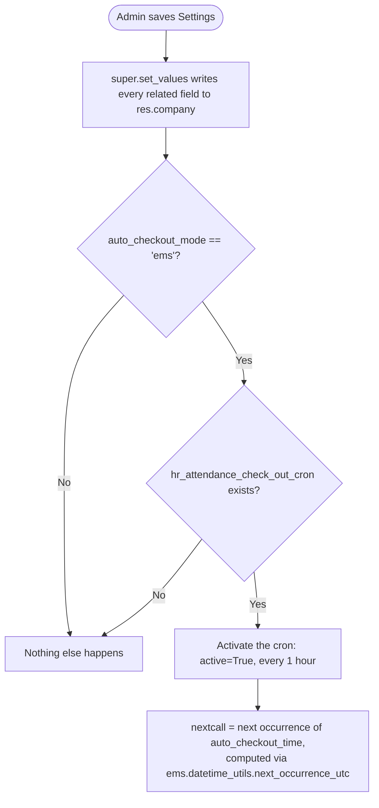
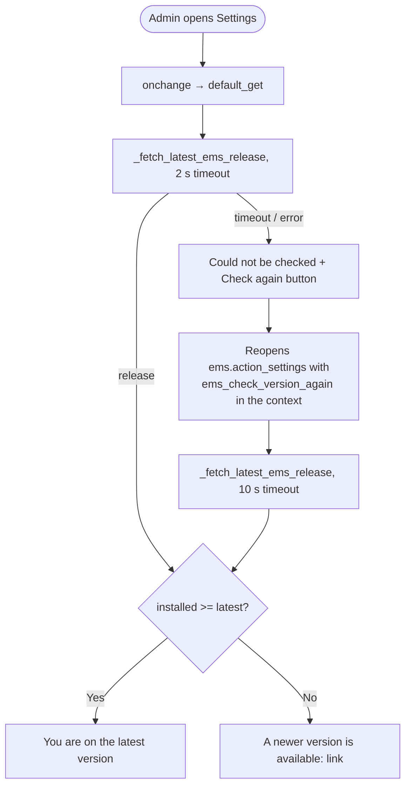

# Technical Reference: `res.config.settings` (EMS extension)

## Overview

`models/settings/settings.py` extends Odoo's `res.config.settings` transient wizard with a `related=..., readonly=False` field for every EMS-added `res.company` field (see [res.company](company.md) for what each one does) — this is what makes them editable from the Settings screen at all. It is a thin proxy: reading/writing any of these fields just reads/writes the underlying `res.company` field through the relation.

**Module file:** `models/settings/settings.py`

The only behaviour that isn't a plain passthrough is `set_values()`, plus the About block's installed/latest version check.

---

## `set_values()` — EMS auto-checkout cron activation

Switching `auto_checkout_mode` back to `native` does **not** deactivate the cron — `set_values()` only acts when the mode is `'ems'`; the native mode relies on Odoo/`hr_attendance`'s own built-in auto-checkout instead, which this cron has nothing to do with. Toggling away from `'ems'` currently leaves a previously-activated cron running; if that turns out to matter operationally, it's a one-line follow-up (deactivate the cron in the `else` branch) — not addressed in this DTON pass since it wasn't flagged as broken.

---

## About block: installed and latest EMS version

Shown at the bottom of the EMS Management tab.

| Field | What it holds |
|---|---|
| `ems_version` | `ir.module.module.latest_version` for `ems` (with `sudo()`): the version the database was last installed/upgraded to, i.e. the one actually running, not the manifest on disk (code pulled but not yet upgraded would show the new number too early). |
| `ems_latest_version`, `ems_latest_version_url` | Newest published release on GitHub (tag without the leading `v`, and its release page). Empty when GitHub could not be read. |
| `ems_version_status`, `ems_version_message` | Non-stored computes: `latest` (installed >= latest, which also covers a development branch already carrying the next version), `outdated` (message links the release) or `unknown`. |

Notes:

- Every value is a `default`, filled once in `default_get()` (one GitHub request for both release fields), never a compute: the settings form takes its initial values from `onchange()`, which only asks `default_get()` for fields present in the view (hence the invisible `ems_latest_version`/`ems_latest_version_url` fields) and never computes a field with no dependencies.
- "Check again" is a `type="action"` button reopening the settings, not a method writing the record: after a button, the settings form starts a new record instead of re-reading the saved one, so anything written to it would be lost.
- The source is `GET https://api.github.com/repos/ElPuig/EMS/releases`, taking the first non-draft entry. Not `/releases/latest`: every EMS release is published as a pre-release (0.y.z), which that endpoint ignores (404). Unauthenticated, so GitHub's 60 requests/hour per IP limit applies; a refused request just shows "could not be checked".
- Under `--test-enable` `_fetch_latest_ems_release()` returns `None` without any network call: tests patch it to simulate GitHub (`tests/test_settings.py`, `tests/test_settings_tour.py`).

---

## Access Control

Same as any `res.config.settings`: reaching the screen at all requires Settings access (standard Odoo `base.group_system`-gated navigation), not an EMS-specific rule.

---

## Views

| View | File | Notes |
|------|------|-------|
| Settings form | `views/settings/form.xml` | See [res.company](company.md)'s Views section — same page, already covered by the `ems_course_settings` tour; the `ems_settings_edit` tour also checks the About block's version |
