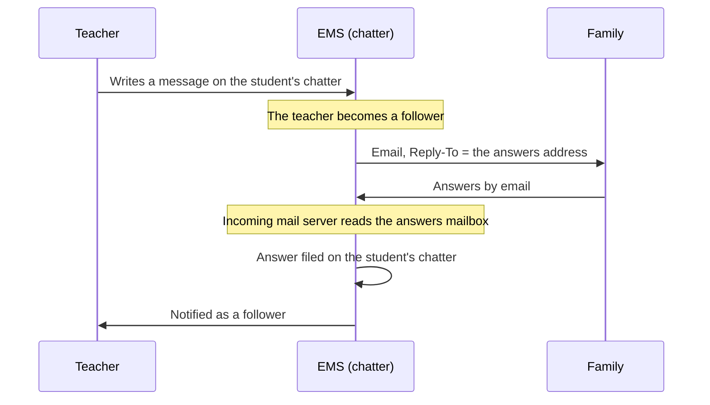

# Conversations on a contact's chatter and their answers by email

A message written on a student's or a family's chatter is a conversation between whoever writes
it and the contact (issue #586). Two things decide who else gets it: the record's followers, and
where an answer sent by email ends up.

## Followers

- **Creating a contact makes nobody follow it.** `res.partner.create()` runs with
  `mail_create_nosubscribe`, taken off the returned records again so it does not also stop the
  next point. Odoo's default subscribes the creator, so whoever registered students and families
  received every message later exchanged with them.
- **Writing a message makes you follow it** (Odoo's own behaviour for a comment), which is what
  delivers the answer to you.
- `res.partner._ems_unfollow_contact_creators()`, run by `migrations/18.0.0.36.0/post-migrate.py`,
  removes the follows left from before: whoever follows a contact they created without ever
  having written on it, and the administrator account from every contact (its mailbox is the EMS
  one). Someone who wrote on the contact, or who follows one they did not create, stays. A clean
  install has none.

## Answers by email

Odoo files an answer on the record it belongs to when an incoming mail server reads the mailbox
the answer arrives at. That needs configuration in production, not code:

1. **An address for answers that is not the bounce address.** In the alias domain (Settings >
   Technical > Email > Alias Domains) the catchall alias is the `Reply-To` of every chatter
   message and the bounce alias receives the delivery failures. Odoo discards as a bounce
   whatever arrives at the bounce address, before looking at what it answers: with both set to
   the same name no answer is ever filed. Use a mailbox of its own for the catchall.
2. **An incoming mail server** (Settings > Technical > Email > Incoming Mail Servers) reading that
   mailbox, with no "create a new record" action: only answers are wanted.
3. The scheduled action "Mail: Fetchmail Service" active.

What to expect from it:

- Only unread emails in the inbox are fetched, and they are marked as read. An email somebody
  opens first in the mailbox is never filed.
- An email written directly to the answers address (not an answer to anything) gets an automatic
  reply from Odoo saying the address does not accept it. This is why the mailbox must be used for
  nothing else.
- The answer is filed as written by the contact whose email address it comes from, and every
  follower of the record is notified as their own preference says.

Direct notices (`message_notify()`) and templates with their own `reply_to` do not go through
this: their answers go straight to a person.

## Development machines

A database restored from production carries production's incoming mail server. An email is
fetched once, so reading that mailbox from a development machine would take the answers away from
production. `fetchmail.server.fetch_mail()` does nothing when `ems_server_role = dev`
(`models/settings/mail_guard.py`), and `devel.sh` switches the incoming servers off.

## Tests

`tests/test_student_chatter_replies.py`: followers on creation and on writing, the administrator
clean-up, an emailed answer routed through `message_process()` to the contact's chatter and to
whoever wrote, and the development-machine guard.
