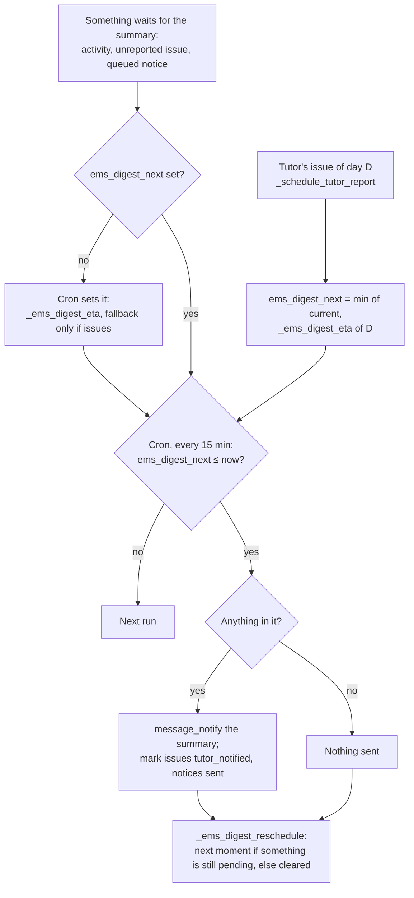

# Technical Reference: Daily Summary

## Overview

Every member of staff gets **one EMS message a day at most, at the moment they chose in their
profile**, with everything EMS has for them that isn't urgent:

1. **Pending tasks**: every activity (`mail.activity`) still assigned to them. Most EMS tasks
   (convalidation requests, supporting documents to validate, attendance corrections, absence
   approvals...) are scheduled with `mail_activity_quick_update`, which suppresses Odoo's "X has
   assigned you an activity" email on purpose (see [Task assignment](task_assignment.md)), so this
   is how someone who hasn't opened EMS learns that work is waiting.
2. **Your students' attendance issues** (tutors only): every notifiable roll-call status of their
   students not reported yet (see [attendance_issue.md](../attendance/attendance_issue.md)).
3. **For your information**: the informative notices queued for them (`ems.info_notice`), grouped
   by the record (usually a student) they are about.

It replaced two separate emails (issue #644): the morning pending-tasks digest and the tutor's
attendance issues report, each with its own schedule. **Rule for new code** (also in `CLAUDE.md`):
a notice to staff that asks for no action and isn't urgent is never sent on the spot; it is
queued with `ems.info_notice._ems_queue()` and travels in this summary. Something the person must
act on is an activity. Only a genuinely urgent case (e.g. a guard duty for today) is sent
immediately, with a comment in the code saying why. Families and students are not affected: their
emails are a different channel.

**Module files:** `models/shared/daily_summary.py` (`res.users`), `models/shared/info_notice.py`
(`ems.info_notice`), `models/employees/workday.py` (`hr.employee`/`res.company` working days),
`mails/shared/daily_summary.xml` (QWeb body), `data/main/ir.cron-daily_summary.csv`,
`views/community/employee/user_profile_form.xml`.

---

## Data Model

### `res.users` (inherited)

| Field | Type | Description |
|-------|------|-------------|
| `ems_digest_moment` | `Selection`, required, default `teacher_start` | When the summary is sent: `teacher_start` (start of their working day), `teacher_end` (end of it), `students_end` (end of their students' last class, group tutors only; anyone else gets `teacher_end`), `fixed_time`. Self-readable and self-writable, in **My Profile > Preferences > Daily summary**. |
| `ems_digest_time` | `Float` | The `fixed_time` hour (local). Default: the company's `attendance_issue_tutor_default`. Must be a time of day (constraint). |
| `ems_digest_next` | `Datetime`, readonly | When the next summary is due (naive UTC). Set as soon as something is waiting, moved on after each summary, cleared when nothing is left. Never shown to the user. |
| `ems_digest_last_sent` | `Datetime`, readonly | When the last summary went out. |
| `ems_is_tutor` | `Boolean`, computed | Whether the user tutors a group (`ems.group.tutor_id`); not the `ems.group_tutor` role, which Department/Seminar Chiefs, JE/JEA and the Director also hold. |

The native **`notification_type`** ("Handle by Emails" / "Handle in Odoo") is moved into the same
"Daily summary" block of the profile (it lives in the native preferences block, which EMS hides
from ordinary users): it decides whether the summary arrives by email or in their EMS inbox.

### `ems.info_notice`

A notice waiting for its recipient's summary. Only the system reads or writes it (`sudo()`); the
administrator (`base.group_system`) may read it.

| Field | Type | Description |
|-------|------|-------------|
| `user_id` | `Many2one res.users`, required, cascade | Recipient. |
| `res_model` / `res_id` | `Char` / `Many2oneReference` | The record the notice is about, linked from the summary. |
| `body` | `Html` | The notice, already written in the recipient's language when queued. |
| `sent_date` | `Datetime` | When it went out in a summary; notices sent more than 30 days ago are deleted by the cron. |

`_ems_queue(users, record, compose)` creates one notice per user, `compose(user)` writing it in
that user's language; archived users, portal users and OdooBot are skipped.

---

## When the summary is due

All in the company's timezone. `res.users._ems_digest_moment_on(day)` gives the moment on one day,
or None when there is none:

| Moment | On a given day |
|--------|----------------|
| `teacher_start` (default) | Start of the person's working day: their employee's schedule with approved absences and public holidays subtracted (`hr.employee._ems_workday_intervals`), or the company's default schedule framework without an employee or schedule. None on a day they don't work. |
| `teacher_end` | End of that same working day. |
| `students_end` | End of the last class that day of any student they tutor, from each student's **own** schedule (`hr.employee._ems_students_day_end`, built from their enrollments: a 2nd-year student taking a 1st-year subject counts with that group's class). |
| `fixed_time` | `ems_digest_time`, on every school day of the centre (a day the default framework has periods, public holidays subtracted). |

`_ems_digest_eta(issue_date, fallback)` gives the next due moment, **always after now**:

- **End-of-day moments** (`teacher_end`, `students_end`): that moment on `issue_date` (the day the
  reported data belongs to) if it hasn't passed yet.
- Otherwise the first moment strictly after now, looking up to 14 days ahead.
- **Fallback** (only for a tutor's attendance issues, which must not wait for the tutor): when no
  moment is found, the end of the centre's day (default framework), and as a last resort the
  company setting `attendance_issue_tutor_default`. Pending tasks and notices never use it: nobody
  gets a summary on a day off or during an absence just for those.
- Never due now: a roll-call saves each student's status in its own request, so a summary due now
  would go out before the next click could join it (issue #588: one email per click).

- Something that arrives after today's moment waits for the next one: a task assigned at noon to
  someone who chose the start of their day reaches them the next working morning.
- **Changing the preference** (`res.users.write`) moves a summary already due to the new moment.
- Each user is processed inside its own savepoint: a failure for one person is logged and never
  prevents the others' summaries.
- "Today" and "now" both come from `fields.Datetime.now()`, so a test can freeze them together.

---

## The message

`res.users._ems_daily_summary_content()` builds the subject and body in the recipient's language
(also used by the user manual's screenshot); `_ems_send_daily_summary()` sends it with
`message_notify()` on the user's own partner, authored by OdooBot, with the light layout
(`mail.mail_notification_light`). Being a notification, **it honours the user's
`notification_type`**: an email, or a message in their EMS inbox. It belongs to no record's
chatter and does not make anybody a follower.

- **Subject:** "EMS: daily summary (pending tasks: N, attendance issues, notices: N)", with only
  the parts it has.
- **Body:** the QWeb template `ems.daily_summary_body` (translated through the `.po` files, like
  any view), with only the sections that have something:
  - Pending tasks, grouped by activity type (ordered as the types are), each with the record's name
    linked through `/mail/view` (Odoo's own access-checked redirect), its summary and due date, an
    overdue mark, at most 20 per type then "and N more".
  - The tutor's issues by day and student, each status with its class, time range and notes;
    rectified ones struck through.
  - The informative notices, grouped by the record they are about, linked through `/mail/view`.
  - A link to EMS and where to change the moment and the channel.
- After sending: the issues it reported get `tutor_notified = True` and their day's
  `ems.attendance_issue_tutor.summary_message_id` points at the message (the "Daily issues"
  screen shows Pending/Sent/Failed from it); the notices get `sent_date`.

---

## Upgrade (18.0.0.44.0)

`migrations/18.0.0.44.0/pre-migrate.py`:

- Creates `ems_digest_moment`/`ems_digest_time` from the tutor report's old preference
  (`ems_attendance_report_moment`/`_time`). The old default, `teacher_end`, can't be told apart from
  a deliberate choice, so it becomes the new default (`teacher_start`); any other value is kept.
- Cancels the tutor report queue jobs still pending; their issues stay unreported and go in the
  next summary.

The old `ems_task_digest` switch is gone: the summary always arrives when it has something, and
the user decides the channel with `notification_type`.

---

## Access Control

| Who | What |
|-----|------|
| Every internal user | Receives their own summary; reads and changes their own `ems_digest_moment`, `ems_digest_time` and `notification_type` from My Profile. |
| Administrators (`base.group_system`) | Change anyone's from the user form; read `ems.info_notice`. |
| Portal users, OdooBot, archived users | Never get a summary; no notice is queued for them. |

The summary reads tasks, issues and notices with `sudo()`, but every link goes through
`/mail/view` (or the student's form), which applies the recipient's own access rights when opened.
