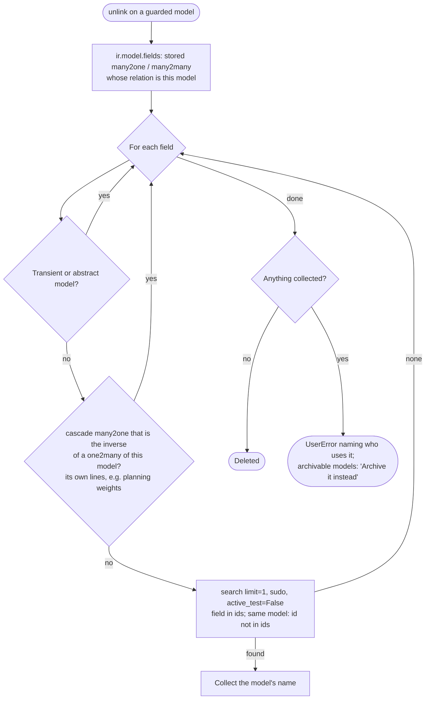

# Archive instead of delete: the in-use guard

`ems.in_use_guard.mixin` (`models/shared/in_use_guard_mixin.py`) refuses to delete a record while any
other record still points at it. It is the shared mechanism behind issue #52 ("don't delete, archive"),
applied area by area in its sub-issues; the academic catalog (#868) is the first one.

## Which models use it

| Model | Archivable (`active`) | Why |
|---|---|---|
| `ems.level`, `ems.study`, `ems.subject` | yes | A new curriculum archives the old study and its subjects; their history stays |
| `ems.planning` | yes | A past course's plan is history (versions are tracked in issue #38) |
| `ems.space`, `ems.space_type` | yes | A room that stops existing keeps its past sessions and reservations |
| `ems.role`, `ems.workgroup` | yes | A coordination post or a team that disappears keeps its minutes and actions |
| `ems.outcome`, `ems.content`, `ems.criteria` | no | They only make sense inside their subject: a typo is fixed in place, a new curriculum archives the whole subject |
| `ems.course` | no | A school year is never retired; one created by mistake can still be deleted |

`ems.planning_outcome` (a planning's weight lines) does not use it: deleting a line is part of editing
the weights, which always sum 100, and every grade stores its own weight
(`ems.grade_outcome_line.ponderation`), so nothing is lost.

## What it checks

- **Archived referencing records count:** an archived group still points at its level.
- **The record's own lines don't:** a one2many declared on the model whose inverse many2one is
  `ondelete='cascade'` is part of the record (a planning's weight lines are deleted with it). A cascade
  from a model that is *not* such a line still blocks: `ems.enrollment.subject_id` and
  `ems.teaching.subject_id` are `cascade`, and deleting a subject would delete them.
- **Records deleted together don't:** a content deleted with its composite child, in the same
  `unlink()`, is not "used" by that child.
- **Superuser code is checked too:** most references are `set null` or `cascade`, so a delete that
  skipped the check would silently empty or delete other records. A process that must delete (e.g. a
  future clean-up in the course transition) can only do so once nothing points at the record.

Odoo has no "in use" check of its own: an `ondelete='restrict'` foreign key only covers the fields
declared that way. Reading `ir.model.fields` keeps the guard correct as new references are added, with
no list to maintain.

## Who sees "Delete"

The guard does not replace the access rights: on every guarded model only the administrators
(`ems.group_academic_admin`) hold `perm_unlink`, so every other role never sees **Delete**. The
administrator sees it and can delete a record nobody uses yet (created by mistake); anything in use is
refused with the guard's message.

## Who sees "Archive"

Odoo's web client offers **Archive**/**Unarchive** whenever the `active` field isn't readonly, without
checking the user's write access. The mixin's `fields_get()` marks `active` readonly for a user who
can't write the model (reusing `ems.base.fields_get_active_readonly_for_teachers()`, the same rule the
contact and employee forms use), so a role that only reads these screens (teachers on subjects, spaces
or plannings) never gets the entry. Heads of Studies, who edit plannings, can archive them. Cost: two
small queries per `fields_get()` (0.9 ms measured), i.e. per view opened.

## Archived records

An archived record leaves searches and selectors (Odoo's `active_test`), but every record pointing at it
keeps showing it. Every archivable catalog list has an **Archived** filter (`name="inactive"`) and every
form shows the **Archived** ribbon. Lookups that must find history include archived records explicitly
(`with_context(active_test=False)`): a past course's planning in external records
(`ems.external_record_wizard._planning`, `_compute_available_study_ids`), grade corrections
(`ems.grade_review_wizard`) and the academic record (`ems.student.year_record._convalidated_vals`), the
external record's subject lookup by code, and the course transition's check for an already-existing
target-course planning (the `unique_study_subject_course` constraint counts archived plannings).

## Cost

One query on `ir.model.fields` plus one indexed `search(limit=1)` per referencing field, only when a
delete is attempted: 13-74 ms cold on this box's data (measured with `odoo shell`, subject with 23
referencing fields the slowest).
