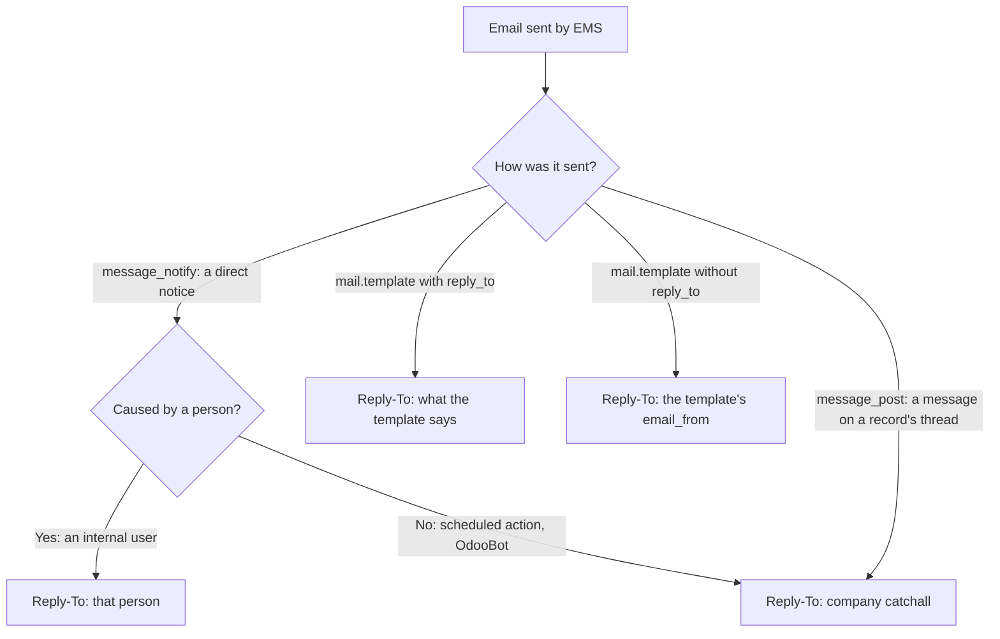

# Who receives the answer to an EMS email

Every email EMS sends leaves from the same technical address (`ems@elpuig.xeill.net`, the only one
the outgoing mail servers may relay as), whoever wrote or caused it. What decides where an answer
goes is the `Reply-To` header, and it depends on how the email was sent.

| Sent with | Reply-To | Where |
|---|---|---|
| `message_notify()` (a direct notice, e.g. "you have been sent to cover this class") | The acting user, as `"Name" <email>`; the company's catchall when nobody caused it | `models/shared/mail_thread.py` |
| A `mail.template` that sets `reply_to` (notices, strikes, attendance issues) | The person the template names (who sent the notice, the teacher, the tutor) | `mails/` |
| A `mail.template` without `reply_to` | Its `email_from`: the company's own email address for convalidations, authorizations, contact data requests and the task digest; the EMS address for the tutors' automatic daily attendance summary | Odoo (`ir.mail_server`: `reply_to or email_from`) |
| `message_post()` (a message written on a record's chatter) | The company's catchall address | Odoo (`_notify_get_reply_to()`) |

## Direct notices (`message_notify`)

`mail.thread.message_notify()` is overridden for every model: when the caller gives no `reply_to`,
it is set to the message's author as long as that author is an internal user other than OdooBot.
The author is resolved with Odoo's own `_message_compute_author()`, so `sudo()` does not change
it (it keeps the acting user) and an explicit `author_id`/`email_from` is honoured.

Odoo's default for these messages is the catchall address, which is meant for answers that get
filed on the record's thread. A notice is not shown on any thread, so an answer sent there
reached nobody: the guard who answered "I can't make it" to the person who assigned them wrote,
in fact, to the EMS mailbox (issue #607).

A notice with no person behind it (a scheduled action runs as OdooBot) keeps the catchall, so its
answers still reach the EMS mailbox.

This also applies to the notices of Odoo's own apps that use `message_notify()` (e.g. time off).

## Tests

`tests/test_mail_reply_to.py` (the rule itself) and
`TestAbsenceCoverage.test_the_department_chief_sends_a_guard_who_is_notified` (the guard notice).
