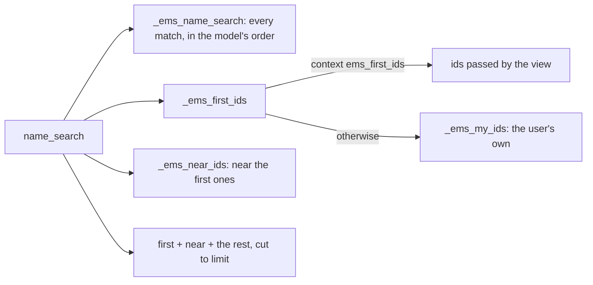

# `ems.mine_first_mixin`: the user's own records first in a dropdown

`models/shared/mine_first_mixin.py`. An abstract model that overrides `name_search`, the call behind
every many2one dropdown and its quick-search, so the records most likely to be picked come first, then the
ones near them, and everything else follows. Nothing is hidden: any record can still be typed or picked through
"Search more", whose list keeps the model's own order.

| Hook | Default | Override to |
|------|---------|-------------|
| `_ems_my_ids()` | `[]` | return the ids of the current user's own records (searched with `sudo()`: only ids, the result still goes through the user's access) |
| `_ems_near_ids(first_ids)` | `[]` | return the ids offered right after the first ones (e.g. the same area's) |
| `_ems_first_ids()` | the context's `ems_first_ids`, else `_ems_my_ids()` | rarely needed; a view that knows the likely choices passes `ems_first_ids` instead |
| `_ems_name_search(name, args, operator, limit)` | the plain `name_search` | sort the rest differently |

## Models using it

| Model | First | Near | Rest |
|-------|-------|------|------|
| `hr.department` | the user's own department and those they head (Department or Seminar Chief) | the rest of the same area: every department under the top department of the first ones (`parent_path`) | sorted by the department's path in the reader's language, accents ignored |
| `ems.workgroup` | the workgroups the user is a member of | - | by name |
| `ems.group` | the groups the user tutors or teaches (`ems.teaching`) | - | by name |
| `hr.employee.public` | only what a view passes as `ems_first_ids` (the minute's approver candidates) | - | by name |

## Department names in the reader's language

`hr.department.display_name` is built from each level's translated `name` (respecting the native
`hierarchical_naming` context key), not from the stored `complete_name`, which is not translatable
and keeps the language of whoever last changed the department. `_search_display_name` also matches
the translated `name` and returns the departments under a match (`child_of`), so typing "FP"
offers every VET department.

Each dropdown costs a few milliseconds on real data (four small queries).
