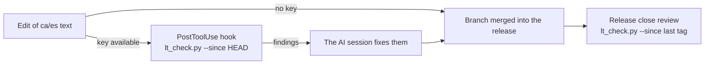

# Spelling and grammar check (LanguageTool)

EMS's Catalan and Spanish texts (user manuals and translations) are checked with
[LanguageTool](https://languagetool.org) so they reach staff and families without spelling,
grammar or style errors (issue #650).

## What is checked

| Text | How |
|------|-----|
| `docs/ca/**/*.md`, `docs/es/**/*.md` | Markdown-aware: headings, list and table markers, emphasis, link targets, inline code, HTML tags, front matter and fenced blocks (Mermaid included) are sent as markup, so only the prose is checked. |
| `i18n/ca_ES.po`, `i18n/es_ES.po` | Only `msgstr`. Placeholders (`%s`, `%(name)s`, `{name}`), HTML tags and entities are markup. Capital at the start and final stop are not required (a `msgstr` is often a fragment). |
| Loose text (newsletter, slides, video text) | `--text "..." --lang ca-ES` |

The language comes from the path: `docs/ca/` and `ca_ES.po` are `ca-ES` (central Catalan),
`docs/es/` and `es_ES.po` are `es-ES`.

## Usage

```bash
scripts/i18n/lt_check.py docs/ca/teachers/attendance-session.md   # whole files
scripts/i18n/lt_check.py --since HEAD                               # what changed and is not committed
scripts/i18n/lt_check.py --since v18.0.0.38.0                       # everything changed since a release
scripts/i18n/lt_check.py --text "Vaig a faltar" --lang ca-ES
```

`--since <ref>` takes every checked file changed since that git ref (plus new untracked ones)
and reports only the changed lines of a manual and the new or changed entries of a `.po`, so
errors that were already there don't hide the new ones. `--picky` adds LanguageTool's style
suggestions; `--json` prints the findings as JSON. Exit code: 0 no findings, 1 findings.

## Credentials

The script uses the LanguageTool Premium API (`api.languagetoolplus.com`) with a personal key
that never goes in the repo:

```bash
printf '{"username":"<account email>","apiKey":"<key>"}' > ~/.claude/languagetool.json
chmod 600 ~/.claude/languagetool.json
```

The key is on the LanguageTool account page. Without the file the script prints a notice and
exits 0: whoever has no key is not blocked, and their text is checked in the release close
review instead.

## When it runs



- **On every edit** by a Claude Code session on a machine with a key: a `PostToolUse` hook on
  `Edit`/`Write` runs the check on the file just edited and hands the findings back to the
  session, which fixes them right away. The hook is part of the developer's Claude Code setup,
  not of this repo; it does nothing on any other file, without a key, or on a branch without
  the script.
- **In the release close review**, over everything changed since the last release tag.

## Findings: review, don't apply blindly

LanguageTool is a strong aid, not an authority. Each finding is read in context:

- A real error is fixed.
- A correct word flagged every time (an acronym of the centre or of the Catalan school
  administration, a proper noun) goes in `scripts/i18n/lt_ignore.txt`, one per line. Never add a
  word there to silence a real error.
- Rules that only react to markup the conversion can't hide (`WHITESPACE_RULE`,
  `UNPAIRED_BRACKETS`, `CONFUSIONS_EMS`, which reads "EMS" as a misspelt "ems") are disabled in
  the script.

House style, agreed 2026-10-16: job titles in lowercase in running text, as the IEC norm says
("cap d'estudis", "director", "professors").

## Privacy

Only texts that are already public (the repo is public) or meant for staff are sent to
LanguageTool. Never send data read from the database (names, emails or anything else about
students, families or staff).
