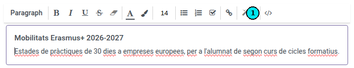

[Català](../../ca/erasmus/calls-and-applications.md) | [Castellano](../../es/erasmus/calls-and-applications.md) | [English](calls-and-applications.md)

---

# Erasmus+ calls and applications

Create and publish an Erasmus+ call, review the applications students send from the portal, ask for corrections and admit or exclude each application.

**Required role:** *Erasmus coordinator* or *Erasmus mobility technician* (Erasmus+ > Manager).

---

## 1. Create the call

Go to **Erasmus+ > Calls > Calls** and click **New**:

| Field | What to enter |
|---|---|
| Name | For example, *Erasmus+ internships 2026-27* |
| Course | The school year of the call |
| Published call | The PDF of the call, which students can download from the portal |
| Applications open / close | When students can apply. After the closing date nobody can change their application |
| Corrections deadline | Until when applicants can upload the corrections you ask for. You can fill it in later |

> Replies to the emails EMS sends without anyone of the team sending them (receipts and reminders) go to the Erasmus+ mailbox in **Settings > EMS Management > Center Data > Erasmus+** (erasmus@elpuig.xeill.net), the same for every call.

The call's tabs are in two blocks: **Selection** (modalities, documents, information for applicants, panel and resolutions) and **Mobility** (destinations, mobility documents, commitment letter, checklist and weekly self-assessment). The buttons at the top follow the call's phase, the latest first: before the definitive resolution, the ranking and the interviews (or plan ratings); then the mobilities and place offers; the claims, from the provisional resolution. A tie to draw is warned at the top of the call.

**Modalities** tab: one line per selection list with its own places, for example *GM* and *GS*. In **Levels** choose the levels whose students apply in that modality (for example *CFGM* for GM, and *CFGS* and the specialisation courses for GS, whose students go on the higher education project). Any student whose main group is of one of those levels can apply, whatever their year. Also fill in the project, places, period and destinations.

**Documents** tab: one line per document the call asks for, with its **Requirement**:

- *Required*: the application cannot be submitted without it.
- *Optional*.
- *Required for minors*: only asked to students under 18 (for example the family authorization).
- *Required if fewer opportunities are declared*: the portal shows it right below the fewer opportunities box, only once the student ticks it, and then it is required.

**Handed in as**: *Files* (any), *PDF only* (the CV: other files are refused) or *A link* (the presentation video: the student pastes the Google Drive link instead of uploading it). **Instructions** and **Instructions link** (e.g. the Europass editor) are shown to the student with the document. A new students' call already brings the CV (PDF), the video (link), the language certificates, and the evidence of fewer opportunities, with their instructions. No family authorisation is asked for to apply: the receipt of a minor's application goes to the family too, and the family accepts the commitment letter once the place is accepted, which authorises taking part.

Tick **Confidential** for documents only the Erasmus team may see, such as the evidence of fewer opportunities.

**One file** (ticked by default): only the newest file the student uploads counts; the earlier ones are kept and shown as *Earlier version*, and the receipt lists only the newest. Untick it for a document with several files, such as the language certificates (one per language). **Model to download**: a file the student (and the family of a minor) downloads from the portal, fills in and hands in, for example the family authorisation.

The default documents, the checklist and the questions are already on a new call before you save it; if you change **Applicants**, they change to those of the staff call (or the students' call).

**Information for applicants** tab: the text shown on the portal above the form. Click in the text and the editor's toolbar appears. To paste an information card prepared elsewhere (for example with the portal's colours and boxes), use the **`</>`** button (code view) at the end of the toolbar (1), paste its HTML code there and press the button again to go back to the editor: the card keeps its design. Pasting the card directly into the editor loses it.

> **Tip:** next year, open this call and use **Duplicate**: the modalities and documents are copied.

## 2. Publish it

In **Actions**, click **Publish**. The call appears on the portal of every student who can apply. While no application has been submitted you can still go **Back to draft**.

## Notify who can apply

Publishing sends no email. To tell everyone who can apply, click **Actions > Notify who can apply**: EMS shows how many people will get it (and how many have no email address, who will not) and sends it when you click **Send the notice**. It is the same rule as the portal: in a students' call, the students of the levels of its modalities, except those with too many conduct warnings; in a staff call, the teachers of its levels and the Direction that validates the activities. Each person receives their own email, with the call's dates and the link to apply. The family does not receive it. You can send it before the call opens; if you send it again (for example after adding a level), everybody receives it again: the assistant warns you.

**Reminder before closing:** in **Reminder (days before closing)** (3 by default), EMS emails, that many days before the closing date and from 9:00, whoever can apply and has not submitted an application yet (a draft does not count). It is sent once, and only if the notice was sent from EMS. Set it to 0 for no reminder. The call shows when each email was sent and to how many people.

## 3. Review the applications

Go to **Erasmus+ > Calls > Applications** (or the **Applications** button on the call, which groups them by modality). Filters: *To review*, *Corrections requested*, *Admitted*, *Excluded*. **Documents to review** counts the files waiting for your check (a draft not submitted yet does not count).

Open an application:

- **Documents** tab: each document with its **Status** (*Missing*, *Pending review*, *Needs changes*, *Complete*; in grey, the optional ones and those that do not apply, such as the family authorisation of an adult), its **Files** (the ones that count) and, for a link, the **Link** itself. Every file the student uploaded is kept: the optional column **Every version** shows the earlier ones too. Mark each one as **Valid** (✓) or **Needs changes** (✗), and write a **Comment for the applicant** when it needs changes. A document without any file cannot be marked valid.
- While the application is a draft, the student can remove from the portal a file uploaded by mistake. Once submitted, only you remove it, with **Remove a file** and the reason.
- **Admission** tab:
    - **Requirements**: enrolled in a level of the call and no previous Erasmus+ internship in this cycle (a minor needs no family authorisation to apply). EMS records who checked it and when.
    - **Conduct this course**: the **conduct warnings** the student has in EMS during the call's course. With as many as the number that sends the case to the coexistence team (3, the EMS setting) or more, **Conduct to review** is ticked and the form shows a notice at the top. It does not rule the student out: having heard the teaching team and the coexistence team, you may **exclude** the application with the reason (article 6 of the call). If it goes on, every warning takes points off (criterion F).
    - **Exclusion reason**, if the application is excluded.
- **Answers** tab: what the student answered in the form.

## 4. Ask for corrections

When a document needs changes or a required one is missing, mark it and click **Actions > Request corrections**. The call needs a **Corrections deadline** still to come: without it EMS does not let you ask. The student receives an email with the list and that deadline, and can upload only those documents. When they submit again, the application is back to *Submitted*, the new files are pending review and each member of the Erasmus team gets a task to review it (also in their daily summary of pending tasks). The task is closed on its own when you admit it, exclude it or ask for corrections again.

## 5. Admit or exclude

- **Admit**: the requirements must be *Met* and every required document *Valid*.
- **Exclude**: write the exclusion reason first. It also works on an admitted application, for example when the student does not attend the interview.
- **Back to review** undoes either decision.

## 6. Close the call

When the application period is over, click **Actions > Close applications**. Applications that were never submitted are marked as *Not submitted*, and EMS saves the record average and the conduct warnings of the others for the scoring: see [Scoring and interviews](scoring-and-interviews.md).

---

[← Back to Erasmus+ manuals](index.md)
