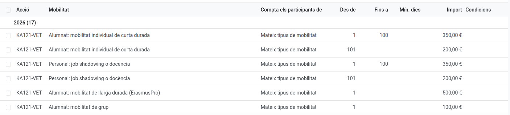

[Català](../../ca/erasmus/economy.md) | [Castellano](../../es/erasmus/economy.md) | [English](economy.md)

---

# Economic management of the projects

For each Erasmus+ project EMS shows how much grant it has, how much has been received from SEPIE, how much the mobilities and the expenses commit, how much has been paid and how much is still available. Everything is calculated from what is already in EMS: the grant of each mobility, the grant payments, the invoices and the expenses. You don't need to type any amount twice.

**Required role:** Erasmus+ team (the coordination). The Secretary registers and pays expenses; the Director only reads.

---

## The economic panel

**Erasmus+ > Financial management > Economic panel** shows one row per project: *Awarded*, *Committed*, *Paid*, *Available*, *Support generated* and how many warnings it has. You can filter by kind (KA121-VET, KA131-HED), by whether the final payment has been received, or the projects *Above the grant*, and group them by call year. The **pivot** view compares calls and kinds of project side by side: it opens with the grant, what is committed and what is available (the other figures, under **Measures**). To see older, archived projects, use the **Archived too** filter.

Click a project to open its **Economy** tab.

## The Economy tab of a project

1. **Grant awarded** is the amount of the agreement. Add each **grant amendment** (date, description, amount; negative if it reduces the grant): the *current grant* is the initial grant plus the amendments.
2. Add each **SEPIE transfer** (date, kind, amount). They tell you what has been *received* and what is still *to receive*. The *Balance* transfer also fills in *Final payment received on*, which sets how long the documents are kept.
3. Attach the **grant agreement and its annexes** in *Grant agreement, annexes and economic documents*. They are part of the project's documents (category 03 Finances) and go into the project's export.
4. **Call year** is taken from the agreement number (e.g. 2025-1-ES01-...). Correct it if needed: it decides which organisational support rates apply.

**What each figure means:**

- **Forecast:** the grants of the mobilities whose destination is still being defined, and of the group mobilities before the selection is approved. They don't use any budget yet.
- **Committed:** the grants of the confirmed mobilities (*Preparing* or *Closed*) plus the project's other expenses.
- **Paid:** what has been transferred to the participants, plus the paid invoices and expenses.
- **Available:** current grant minus committed. It is **not** the money in the bank: a project can have an awarded grant still to be transferred by SEPIE.

**Paying doesn't count twice.** A grant of 1,500 € counts as 1,500 € committed as soon as the mobility is confirmed. When the Secretary pays the advance and then the rest, the 1,500 € only move from *pending* to *paid*. The same goes for an invoice paid out of a participant's grant (flights, accommodation): it is part of their grant, not an extra expense.

## Each mobility

On the **Grant** tab of a mobility you see its *economic state* (forecast, committed, partially paid, paid, cancelled), what it commits, what has been paid and what is pending. If you change the grant, the commitment changes by the difference. If you move the mobility to another project, its figures move with it.

**A cancelled mobility** only keeps committed what has already been paid. If the participant gives money back, write it in **Given back by the participant**. Until then, the project shows a warning.

**Group mobilities:** each participant, student or accompanying teacher, has their own grant, as calculated in the Beneficiary Module. Enter them on the **Collective expenses** tab, in *Participants' grants* (once the selection is approved). The group's figures add them up, each one once: the group's grant above the list is the total (a withdrawn participant never counts). What has been spent of them is the group's collective invoices plus each participant's pocket money (their grant minus their equal share of the invoices), requested from the group and paid by the Secretary: nothing is counted twice. See *Grants and pocket money* in [Group mobilities](group-mobilities.md).

## Expenses

**Financial management > Expenses** (or the *Expenses of the project* list on the Economy tab) holds the project's expenses that are not part of a participant's grant: working meals, merchandising, dissemination services, language preparation...

1. Click **New** and fill in the project, the concept, the category (*Organisational support* or *Other project expenses*), the date and the amount. Optionally, the supplier, the mobility it is about (only the Erasmus team can choose it) and the invoice or receipt.
2. The expense counts as committed as soon as it is saved, and the Secretary gets a task to pay it. Paying it doesn't take it off the budget again.
3. While it is not paid you can change it. Once paid, its figures only change with **Actions > Correct**: write the new figures and the reason. The reason stays in its history and the project warns that it was changed after payment.
   - **If the new amount is higher than what was transferred**, the expense keeps the amount already paid and EMS creates a new expense for the difference, *to pay*, with a task for the Secretary. Example: a working meal of 75 € was paid, but the real ticket was 80 €. You correct it to 80 €: the original stays at 75 € (paid) and a new expense of 5 € is to pay. The original's history says so.
   - **If the new amount is lower than what was transferred**, the expense takes the new amount, but the project keeps counting what was really transferred and warns: "<reference> was paid X above its corrected amount: ask for it back, then undo the transfer and register the right one."
   The expense lists show one amount per row, **Amount**: the one that counts (a cancelled expense counts 0; a corrected one, what was really transferred). The amount typed in is on the expense, or in the *Amount entered* column of the column selector.
4. An expense that won't be paid: **Actions > Cancel the expense** (it stops counting). **Restore** brings it back.

## Organisational support

The organisational support is money to manage the mobilities, separate from the participants' grants. EMS calculates it per participant with the **rates of the project's call year**, not the current year's. The rates of KA121-VET 2025 and 2026 and KA131-HED 2026 are already in **Erasmus+ > Configuration > Organisational support rates**, grouped by year, the newest year first; when a new call comes, add its year's rates there.

**The 100-participant rule (the "From participant / Up to participant" columns):** some rates drop after the 100th participant. In KA121-VET it counts the participants of the same kind of activity: a short-term student or a job shadowing is 350 € up to the 100th and 200 € from the 101st. In KA131-HED it counts everyone in the project, students and staff together: 400 € for the first 100 and 230 € from the 101st. EMS counts them by start date; you don't need to do anything.

**Empty means no limit:** an empty *Up to participant* is a band with no end, and an empty *Minimum days* applies to any length of stay. If two bands overlap, EMS tells you which other rate and band they clash with. In the Excel, the *Position* is the one the rate counted: among the same kind of activity or, in KA131-HED, among the whole project.

**Which rate each mobility takes:** EMS works it out. A student's stay of 90 days or more is long-term (ErasmusPro), shorter is short-term; a staff member's structured course is *courses and training*, job shadowing or teaching the other one; each student of a group mobility, 100 €. If a mobility is in a third country not associated to the programme, or is a skills competition, an invited expert or a hosted teacher, choose it by hand in **Organisational support as** on its **Grant** tab.

On the Economy tab you see:

- **Organisational support forecast:** for the planned mobilities (for a group still selecting, its student places).
- **Organisational support generated:** for the completed mobilities, with the real participants. Accompanying teachers never count.
- **Organisational support expenses:** the expenses of that category, and the difference between generated and spent.

The difference is an internal indicator, not a certification of SEPIE. The support is part of the grant awarded: it is never added to it. For a particularity of the agreement, enter a **Correction** with its reason. For a project managed before EMS, you can fill in the aggregated **Figures from before EMS**.

## Warnings

At the top of the Economy tab, EMS warns about anything that may be a mistake, without blocking anything: commitments above the grant, expenses without an invoice or receipt, payments still to make, expenses changed after payment, expenses paid above their corrected amount, a mobility paid above its grant, a cancelled mobility with money paid, and participants without enough information to calculate the organisational support (for example, no rate for their call year, or no dates).

## Excel

**Actions > Download the economy (Excel)** downloads the project's economy: a summary with the same figures as the panel, each mobility's grant (forecast, committed and paid separately), the payments and invoices with their receipts, the expenses, the organisational support participant by participant, and the grant amendments and SEPIE transfers.

---

[← Back to the Erasmus+ team index](index.md)
