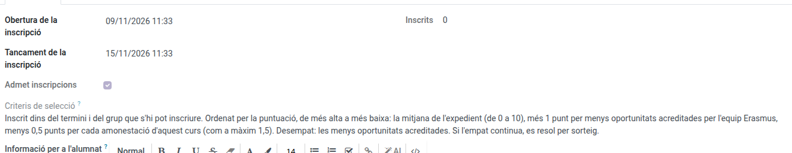
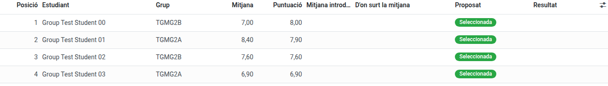

[Català](../../ca/erasmus/group-mobilities.md) | [Castellano](../../es/erasmus/group-mobilities.md) | [English](group-mobilities.md)

---

# Group mobilities

Group mobilities (KA121-VET) are stays of a group of students of one or more of the centre's groups, with two accompanying teachers, one of them the **leader teacher**. Students enrol from the portal with one click, EMS ranks them when the enrolment closes, the leader teacher prepares the proposal and the Erasmus coordination approves it.

**Required role:** *Erasmus coordinator* or *Erasmus mobility technician*. Only the coordination approves the selection, exceptions and substitutions.

---

## Creating a group mobility

1. Go to **Erasmus+ > Mobilities > Group mobilities** and click **New**.
2. Fill in the name (e.g. *SMX2 morning*), the KA121-VET **project**, the **shift** (it only helps to find the groups) and the **eligible groups** (the centre's real groups, e.g. SMX2A and SMX2B).
3. Set the student places (8 by default), the accompanying teachers (2), the **leader teacher** and the other accompanying teacher.
4. In the **Enrolment** tab, set the enrolment period, check the **selection criteria** (published on the portal, in each family's language: a new group mobility brings them, and its documents, in Catalan, Spanish and English) and, if needed, the information for students (to paste a card prepared elsewhere, use the **`</>`** button, as in the call's information for applicants).

   

5. The destination, host entity and dates can stay pending until they are confirmed.
6. In **Actions**, click **Open the enrolment**.

Teachers go through no staff call: once saved, they see the mobility in **Erasmus+ > My participation > My group mobilities**.

## Ranking and selection

The **Selection** tab starts with the students' table: rank, name, group, the **Average** used, the **Score** and the proposed and final result.

 The other columns (record average, conduct warnings, fewer opportunities, exception, average entered by hand, reserve position...) are added from the column selector, at the right end of the table's header. The dates of each step, the notes and the published lists are at the end of the tab.

- During the enrolment, the **Selection** tab already lists who has enrolled (only the Erasmus team sees it).
- When the enrolment period ends (or with **Close the enrolment now**), EMS freezes each enrolment's data: the group, the **record average** (the same formula as the internship call) and this course's conduct warnings. A student not in an eligible group is excluded. Conduct warnings exclude nobody on their own: with a serious conduct record, the coordinator may exclude the student with an **Exception**, giving the reason, after hearing the teaching team and the coexistence team.
- If a student has as many conduct warnings this course as the number that sends the case to the coexistence team, or more, the mobility shows a warning and the *Conduct to review* column marks them. It is a warning, not an exclusion: the coordinator decides.
- The order is by **score**, from highest to lowest: the record average (0 to 10, also an average entered by hand), plus 1 point for fewer opportunities accredited by the Erasmus team, minus 0.5 points per conduct warning this course (at most 1.5), as art. 16 of the call says. For example, an average of 7.5 with fewer opportunities accredited and one conduct warning scores 8.0. In a tie (the same score), the student with fewer opportunities accredited goes first. A mobility ranked before the score existed keeps its ranking by the average. If somebody declared fewer opportunities, check it in the **Selection** tab (*Fewer opportunities accredited* column). If a tie remains, it is resolved by a **draw**: EMS flags it and the proposal cannot be sent until the Erasmus coordinator clicks **Draw the ties** in **Actions**. EMS orders only the tied students at random. Each draw is kept in the **Selection** tab, under **Draws**: who ran it, when, what the students were tied on and the order drawn. Nobody can change or delete it. If another student joins a tie already drawn (for example, after entering their average), the tie has to be drawn again, and both draws are kept.
- **Students with no grades:** if an eligible student has no evaluated module, EMS does not give them a 0: they are left out of the ranking and the mobility shows a red warning. Neither the proposal nor the approval can go ahead until it is solved, in the **Selection** tab: tick *Average entered by hand* and write the average and *Where the average comes from* (for example, the academic record), or the coordinator excludes the student with an *Exception* and its reason.
- The leader teacher reviews the ranking and sends the proposal. If they ask for an exception, the coordinator gets a task that stays pending until they set the exception or approve the selection. You get a task: publish the lists or, in **Actions**, **Send the proposal back** with the reason.
- **Provisional list:** in the **Selection** tab, set the *Claims deadline*. Then, in **Actions**, **Publish the provisional list**: each student receives their provisional result by email and can claim from the portal until that deadline. Each claim arrives with its files, the whole Erasmus team gets a task to answer it, and it appears in the **Selection** tab (*Claims*) and in **Erasmus+ > Calls > Claims**: write the *Response* and click **Resolve**; the student receives it by email. The list shows each student only by four digits of their identity document, with their rank, score and result (selected, reserve or excluded); EMS refuses to publish it while a student has no identity document recorded.
- To make an exception to the ranking (for example, after accepting a claim), set the *Exception* and its *Reason for the exception* in the **Selection** tab (add both columns from the column selector) before approving. If a claim shows that an average was wrong, correct it with *Average entered by hand* and *Where the average comes from*, also for a student who has grades: the score uses the *Average used* column. A student excluded with an exception leaves the ranking and their place goes to the next one. If you select someone with an exception instead, move someone else to reserve: EMS does not approve more selected students than places, and the mobility warns you while there are more.
- **Definitive list:** in **Actions**, **Approve and publish the selection** publishes the definitive list, emails each student their own result and opens the files. It is not available until the provisional list is published, its claims deadline has passed and every claim is answered. Both lists stay in the **Selection** tab (*Published lists*), on the portal of the students who enrolled, as a PDF, and in the documents export.

## Withdrawals and substitutions

If a selected student renounces (from the portal, or telling the leader teacher or you, who record it with the **Renounce** button of their enrolment in the **Selection** tab, with the reason), the place becomes free and the mobility shows the next reserve. The leader teacher proposes them and you approve or reject it in the **Selection** tab; if you reject it, the leader teacher gets a task to propose a substitute again. If that reserve does not want the place, record it the same way, with **Renounce** on their enrolment: they leave the reserve list and the mobility shows the next one. The frozen ranking does not change and the documents already handed in are kept.

## Files and documents

Approving the selection opens the file of each selected student and of both teachers. The **Documents** tab has the group's **shared documents** (the group learning agreement, planned and executed; agreements, travel, the collective insurance policy, inclusion —confidential—, Green Travel and evidence) and the list of **documents asked for**, which you can adapt to each mobility: who each document is for (the group, each student, each teacher or everybody), whether it is required or only for minors, who signs it and its deadline. After changing the list, click **Update documents**.

A complete document offers **Reopen** instead of **Needs changes**: it does the same, sending it back to be corrected.

Each document has a **record category** (01 Data and authorisations, 02 Before the mobility, 03 During the mobility, 04 After the mobility), as in the individual mobilities, and a **status**: missing, pending review, needs changes, complete, optional or not applicable. A document someone has to sign (for example the group learning agreement, signed by the coordination and the host entity) **is not complete just because it was uploaded**, even by the team: check its signatures and mark it **Valid**. The documents the team provides that nobody signs (for example the insurance policy) are complete once uploaded.

Every Erasmus+ document is prepared outside EMS: EMS keeps the files, the signatures, the review and the record. A document with a **Signature template** can be sent to sign electronically from EMS, as in the individual mobilities (see [Preparing the mobilities](mobility-preparation.md)). By default a group mobility asks for:

- **Group learning agreement**, in two versions signed by both centres (the coordination and the host entity). The **planned** one, before leaving: objectives, learning outcomes, calendar, activities and participants. The **executed** one, after the stay: the real dates, the activities carried out, the methodologies and the final list of participants (students and accompanying teachers of every centre). If nothing changed, it ratifies the planned one with the real dates and participants. There is no individual learning agreement nor a separate list of participants.
- **Insurance policy** of each student and each accompanying teacher. If one **collective policy** covers all or part of the participants, upload it to the group's *Collective insurance policy* and tick *Covered by the collective policy* on each participant it covers (participant's form): their own policy is then no longer asked for.
- **Grant agreement** of each participant: the team prepares it outside EMS (with the services the centre pays, if any) and uploads it to be signed. To upload them all on one screen, use the **Pending documents** button of the mobility: every participant's documents on one list, grouped by document.
- **Green Travel: sworn statement and evidence**, optional: only when Green Travel is declared.
- **Group inclusion documentation**, optional and confidential: evidence of the fewer opportunities and, when there are real inclusion costs, why the support was needed. Their invoices go in the **Collective expenses** tab.
- **Europass mobility document** (students) and **Certificate of stay** (teachers): optional, they never stop the mobility from closing.
- The **image rights** are not asked for again: the *Image rights* column of the **Participants** tab (column selector) shows each student's authorisation of the course, the one EMS already uses. The **European Health Insurance Card** is confidential, as in the calls: only the Erasmus team sees it. The files of a valid document or of a closed mobility cannot be removed (upload a new version instead), and every review is written in the mobility's chatter.

The **Participants** tab shows each person's role, name, group, whether they are a minor, the **Docs. pending**, whether they are **Ready** to leave and their state; a withdrawn participant is greyed out, with nothing in red. Email, phone, image rights, the collective insurance and the commitment letters are in the column selector.

## Commitment letter

Each selected student accepts the mobility's **commitment letter** on the portal and, for a minor, the family too, from its own portal (EMS emails the family when the file opens). It is the same procedure as in the internships: the person ticks that they accept and EMS keeps who accepted it, when and from where, together with the exact text accepted. The letter is common to every group mobility and EMS fills it in with each one's data (destination, host entity and dates once confirmed; until then it says they are to be confirmed). It includes the authorisation to take part, taking part in the programme, the centre's coexistence rules and the teachers' instructions, the measures for serious breaches under the centre's rules and protocols, and communication with the centre.

To add conditions of your own, write them in *Additional conditions* (**Participants** tab). A letter already accepted keeps the text it was accepted with. If the destination, the host entity, the dates, the travel, the teachers or the additional conditions change afterwards, the earlier acceptance is kept as it was (in the participant's file, under *Earlier versions*) and the student and, for a minor, the family accept the new letter; the family gets an email. A letter accepted while the destination or the dates are still to be confirmed is **provisional** and does not let the student leave. The mobility shows how many letters are pending, and a participant is not ready to leave until theirs is accepted. The letter **does not replace** the official authorisation for minors to travel abroad: that one is still a document of each minor's file.

## Exporting the documents

In **Actions**, **Export the documents** downloads a ZIP with the group's common documents once (folder *00_Documentacio_comuna*: shared documents, the ranking and the draws, the follow-up and the EU Survey) and each participant's record in the four categories, with an index of what is missing and the SHA-256 fingerprint of each file. Each participant's record points to the shared documents instead of copying them. Confidential data (health card, inclusion, fewer opportunities and conduct warnings) only appear in an **audit export**, which only the Erasmus coordination can ask for, giving the reason. The project export includes every group mobility too.

## Participants' spreadsheet

In **Actions**, **Export participants (Excel)** downloads the selected students and the accompanying teachers in the same spreadsheet as the calls (same columns). Teachers have the cycle, year and legal guardian columns empty; the bank columns are empty for everyone: the account each participant gives for the pocket money is in the grant payments.

## Stay, EU Survey and closure

While the mobility is in preparation, a warning says what to check before clicking **The stay starts**: whether there is no host entity yet, or the planned start date has not come yet. It is a warning: the stay can be started anyway.

Before leaving, the mobility lists who is not ready yet (a required document or the commitment letter pending), and **The stay starts** asks for confirmation. The leader teacher says when the stay starts and when they are back. Then EMS creates the **EU Survey** task for the leader teacher (or the person set) with its deadline. When they say it is answered, you validate it. The group's expenses (flights, accommodation...) are recorded as invoices in the **Collective expenses** tab (see *Grants and pocket money* below). On return the leader teacher also gets the task of saying whether the **programme was carried out as planned** (**Return and closure** tab): yes, or no and what changed. The closure cannot be proposed nor done without that answer. When the leader teacher proposes the closure, every required document is valid (the executed group learning agreement among them) and every participant's pocket money and every collective invoice is paid, click **Close the mobility**.

## Grants and pocket money

If any participant has no grant amount, a warning at the top of the form names them. When the centre pays the travel and accommodation, **Request the pocket money** first asks whether every invoice of the group is already in, because the pocket money is the grant minus each one's share of the invoices; if it comes out negative for someone (their share is larger than their grant), a red warning names them.

In the **Collective expenses** tab you enter each participant's **grant** (students and accompanying teachers), as calculated in the Beneficiary Module. The centre usually pays the flights and the accommodation of the whole group: record them as **collective invoices**. EMS splits every collective invoice **equally among the participants taking part** and shows, for each one, their share and their **pocket money**: their grant minus their share. That is what the Secretary transfers to them. An invoice is either the group's or for some individual participants, never both, because it would count twice: EMS stops you if you fill in both.

*Example:* 8 students with a 1,200 € grant and 2 teachers with 1,500 €. The flights cost 2,000 € and the hotel 5,000 €: 700 € per person. Each student receives 500 € and each teacher 800 €.

- **Pocket money before leaving (%)**: 100 by default, a single payment. With a lower percentage, that part is paid before leaving and the rest on return.
- **Who pays the travel and accommodation**: *The centre* or *Each participant*. Choose *Each participant* when the centre pays no flight nor hotel; each participant then receives their whole grant. Such a group cannot have collective invoices (EMS stops you, and it cannot be chosen while the group has some). The dates show on one line: the planned ones until you set the final **Stay dates**, and the **Travel** only when it differs from the stay.
- Once the selection is approved, in **Actions**, **Request the pocket money** creates one payment for each participant with something to receive. The Secretary gets **one task for the whole group** and pays them from **Financial management > Grant payments**, all at once with one receipt. With a percentage below 100, on return use **Request the final pocket money** for the rest.
- Each participant needs a **bank account**: students give it on the portal (if they don't, the one of their enrolment is used), teachers with **My bank account** on the group mobility, and you can also write it in their file. If someone has none, EMS names them and requests nothing.
- If a participant withdraws after being paid, the project's economy shows a warning: record what they give back in the group's *Given back by the participant*. A warning also shows if the collective invoices are above someone's grant.

The leader teacher sees this tab too (the invoices, the grants, the pocket money and whether it is paid), never the bank accounts.

The kanban and list of **Group mobilities** show the state of all of them: enrolled, selected, documents missing or to review, ties and late tasks.
