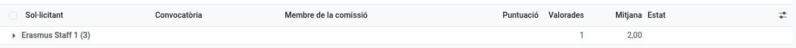
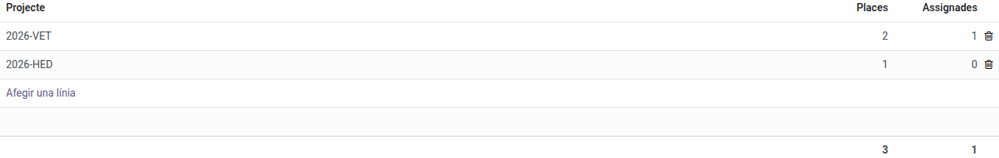

[Català](../../ca/erasmus/staff-call.md) | [Castellano](../../es/erasmus/staff-call.md) | [English](staff-call.md)

---

# The Erasmus+ staff call

Run the call for vocational training staff (job shadowing, structured courses and teaching assignments): the staff apply from EMS (**Erasmus+ > My participation**), the panel rates their mobility plans, and you review the rest, publish the resolutions and offer the places.

**Required role:** *Erasmus coordinator* or *Erasmus mobility technician* (Erasmus+ > Manager).

The staff call works like the students' one (see [Calls and applications](calls-and-applications.md) and [Resolutions, claims and place offers](resolutions-and-offers.md)). This manual explains only what is different.

---

## 1. Open the call

In **Erasmus+ > Calls > Calls**, create the call, set **Applicants** to *Staff*, fill in the dates, attach the published call and publish it. That's all:

- The **documents** of art. 8 are added on their own: only the optional language certificates (no CV; the identity document is asked of whoever goes, among the mobility's documents). The **mobility and transfer plan** is not a document: the applicants write it in the form (annex 1), and it is the only part of the application the panel sees. You can change them before publishing.
- There is no **Minimum score**: the staff call has none, so EMS sets it to 0 and hides it.
- The **Commission's rating deadline** is filled in from the closing date, as in the students' call (14 days later, at 14:00, on a school day): the panel's tasks are due that day, and after it the members can no longer change their ratings. It follows the closing date when you change it, unless you changed it by hand. The other deadlines are filled in the same way.
- To open the call you only need the settings and the calendar: **Teachers of** and **Validates the activities** come filled in. The **Documents** tab does not appear (the only document asked for is the form, and the language certificates are already there), the **Panel** tab appears once the call is closed and the **Mobility** block once the definitive resolution is published.
- **Teachers of:** the levels whose teachers can apply. A new staff call has every vocational training level (basic, intermediate and higher cycles, specialisation courses and PFI). EMS shows the call only to the teachers who teach a group of those levels and to the people in **Validates the activities**: not to the administration staff nor to the teachers of ESO or Batxillerat only.
- **Validates the activities:** the Direction that validates each selected person's activity and its later changes. It comes filled in with the Director and the Head of Studies of FP (the one above most of the FP teachers), and only they get the to-do, even for a teacher who hangs below another Head of Studies in the organisation chart.
- The **places** are not needed to open it: the published call gives the indicative ones, and they may change with the projects. You add them later (step 5); when you publish without them, EMS warns you, so that they are not forgotten.

Once published, every member of the staff with an employee file sees the call in EMS, under **Erasmus+ > My participation > Staff calls**. To tell all of them, use **Actions > Notify who can apply**: they get it in their daily summary, not as a separate email (see [Calls and applications](calls-and-applications.md)).

## 2. What the staff fill in

Besides their two proposals (A, the main one, and B, the backup) and what they want to learn and how they will apply it, written in their own words, each applicant declares:

- Whether they **never had an Erasmus+ staff mobility at the Puig**. Otherwise, you set when their last one was (**Correction**, criterion 2) from the centre's records. Accompanying students and other programmes don't count.
- The **month and year since when they work at the centre** without interruption.
- Their highest **language certificate** (B2 or higher), and they attach it.
- The **centre projects** they take part in, and optionally their **support needs** (confidential: only the Erasmus team sees them).

They can't submit without the date at the centre, both proposals and the plan.

## 3. Review, admit and send the plans to the panel

Review the documents and admit or exclude as in the students' call (conduct warnings do not count).

After **Close applications**, fill in the **Panel** tab of the call: the people who rate the mobility plans (the management and the heads and seminar chiefs of the departments). Then click **Actions > Send plans to the panel**. Every member gets a task to rate every plan from **Erasmus+ > My participation > My plan ratings**, due on the **Commission's rating deadline** (the button asks for it if it is empty; if you change it later, the open tasks follow it). You can click it again after admitting more applications: it only creates the ratings still missing. The button is only there until the provisional resolution is published, which freezes the scores.

**Erasmus+ > Calls > Mobility plan ratings** opens with one row per applicant: how many have rated and the plan's mean. Click a row to see each member's rating.

**Abstentions:** a panel member who is a candidate in the call does not rate (art. 10): their ratings are created as abstentions, with the reason *Candidate in this call*. For another conflict of interest, open the rating from the **Plan ratings** button of the call and write the **Abstention reason**. There are no substitutes: the plan score (criterion 1) is the mean of the members who rate it. **A pending rating blocks it** until it is submitted. In **Plan ratings**, an abstention is shown as *Abstention*, and the pivot view (applicants × status) shows at a glance which plans still have ratings to submit.

**The Direction sees no points while the panel rates:** the Head of Studies and the Director can open the staff applications, but until every plan of the call is rated they see the plan score, the criteria and the total at 0, also when they are in the panel. This way no member sees the others' mean before rating. Once the last rating is submitted, they see everything.

## 4. Review the other criteria

On the application's **Scoring** tab EMS shows what the applicant declared and the points it gives. You only correct it when it is wrong:

| Criterion | Comes from | Correct it in | Points |
|---|---|---|---|
| 1. Mobility plan | The panel's mean | - | Up to 2 |
| 2. Last staff mobility | **Declared last staff mobility** (the course of the month they gave) | **Correction** | Never or more than two courses ago 1.5; two courses ago 0.5; last course or this one 0 |
| 3. Centre projects | **Merits** you record: each collaboration 0.5, each coordination 1 | - | Up to 1.5 |
| 4. Languages | **Declared language certificate** | **Correction** | B2 1; C1 1.5; C2 2 |
| 5. Seniority | **Declared seniority** (at the closing date) | **Correction** | Less than 1 year 0; 1 to 2 years 1; 2 to 5 years 1.5; 5 years or more 2 |
| 6. Internationalisation | **Merits** you record: each activity 0.5 | - | Up to 1 |

Each **Correction** field reads *Correct, as declared* while it is empty: leave it like that when what the person declared is right, and choose a value only when it is wrong. Every criterion shows its points over its maximum (*1.5 / 2*). The table **Commission's ratings** shows what each member gave the plan.

Record each merit with its justification, from what the applicant wrote in centre projects. Tick **Merits reviewed** once every merit is recorded, also when there is none: until then the score is incomplete.

## 5. Places, ranking and resolutions

A staff call has no modalities: the staff compete in a single list and only ever see the call's total places. In the **Selection** tab, **Places per project** is your own planning: one line per active project that pays places, with its places (for example 6 on *2025-VET*, 2 on *2026-VET* and 2 on *2026-HED*). The call's places are their sum; the **Assigned** column counts the mobilities already put on each project. Fill it in before preparing the provisional resolution. Only the Erasmus team sees this table.

The staff are ranked **in one list** for the whole call (**Ranking** button of the call). The criteria columns carry a short name (*1. Plan*, *2. Last mob.*, *3. Projects*, *4. Languages*, *5. Seniority*, *6. Internat.*); hover over one to see its full name. The staff resolution lists have no modality column. Ties are broken by the mobility plan score, then by who has been at the centre longer (the month and year of joining declared in the form, not the points of criterion 5: someone who joined in 2000 goes before someone who joined six years ago, although both get 2 points) and, last, by the draw the Erasmus coordinator runs from the call (**Draw the ties**).

The resolutions are published as in the students' call: the lists show only four digits of the identity document, never names. For the staff it is taken from their **employee file** (DNI or NIE, otherwise the passport); if someone has none, ask the Secretariat to add it. EMS warns you already when you admit their application, and the lists cannot be prepared until it is there. If the score of someone is not complete when you prepare a resolution, EMS says what is missing for each person (for example *Merits reviewed* or *Seniority*).

The selected are those within the call's places (the sum of the places per project); each person gets one place at most. Once a person accepts, choose their **Project** in their mobility: EMS only offers the projects of the call's table, and next to it shows how many places of that project are left (for example *2026-VET: 1 of 2 places left*). Choosing a project with no place left is allowed, but the mobility shows a warning until you add a place to that project or choose another one. The project brings the documents of its kind (KA121-VET or KA131-HED). The staff never see which project pays their mobility. While an accepted place has no project, the call warns you (*N places accepted without a project*), and the call's **Applications** show each person's **Project**.

## 6. Offers and spreadsheet

The selected answer the offer from their application in EMS (**Actions > Accept the place** or **Renounce the place**). A free place is offered to the next reserve of the whole call (**Actions > Offer a free place**, with no modality to choose).

**Export to spreadsheet** takes the staff's data from their employee file. The columns of the cycle, the year and the legal guardian stay empty.

---

[← Back to the Erasmus+ team's manuals](index.md)
