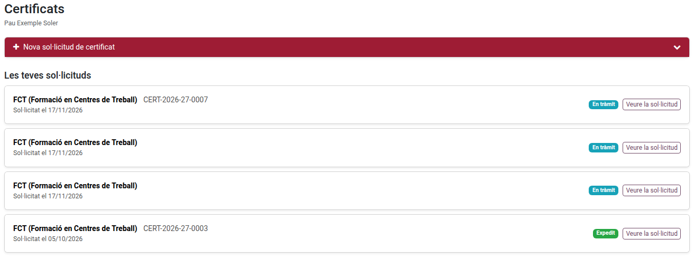
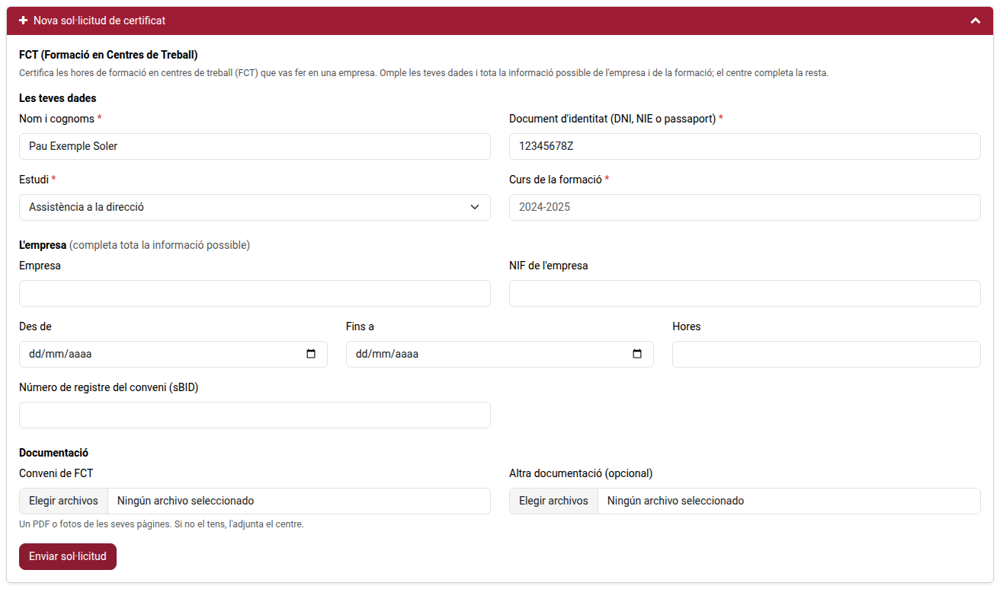
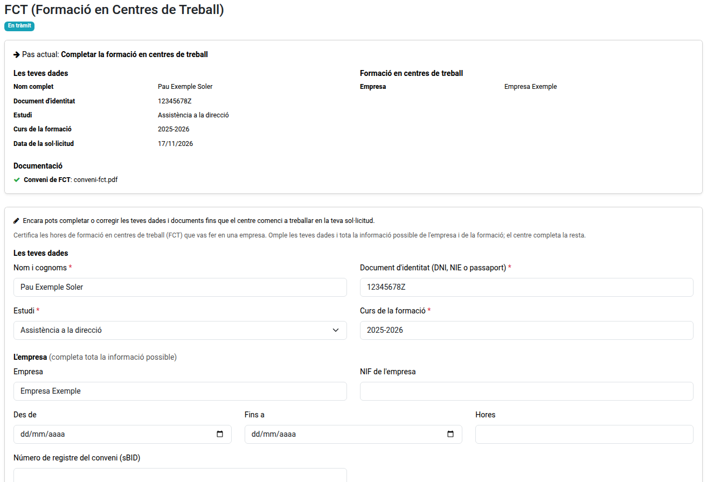

[Català](../../ca/families/manual-certificats.md) | [Castellano](../../es/families/manual-certificats.md) | [English](manual-certificats.md)

---

# Requesting a certificate

Ask the centre for a certificate (for example, the one for the hours of workplace training, FCT), follow it up and download it once it is issued.

On the portal, FCT certificates can be requested by vocational training students (CFGM and CFGS) or their family.

---

## Requesting a certificate from the portal

1. Log in to the portal and click the **Certificates** card.
2. Click **New certificate request** to unfold the form.
3. Check **Your details** and write the **School year of the training** (choose one from the list or write another).
4. Under **The company**, fill in as much information as you have: the name, the VAT number, the dates, the hours and the agreement registration number.
5. Under **Documentation**, attach the **FCT agreement** if you keep a copy (a PDF or photos of its pages). If you do not have it, the centre attaches it. You may also add **Other documentation**.
6. Click **Submit request**.

---

## Following the request

Under **Your requests**, click **Open my request** to see:

- its state and **Current step**;
- your details and the training's, including what the centre adds;
- the documentation attached.

Until the centre starts working on the request, you can still complete or correct your details and documents from the same page, with **Save changes**.

If the centre needs more information, you get an email: click **Answer the centre**, write your answer, attach what they ask for and send it.

Until it is issued, you can cancel the request with **Cancel request**.

---

## Getting the certificate

Once the certificate is issued, you get it by email as a PDF and can also download it with **Download the certificate** from the request.

---

## If you are no longer a student of the centre

Ask the secretariat for the certificate. You get an email with a link to the form: open it (no login needed), fill in your details, attach the agreement if you keep a copy and send it. The same link lets you follow the request, answer the centre and download the certificate.
