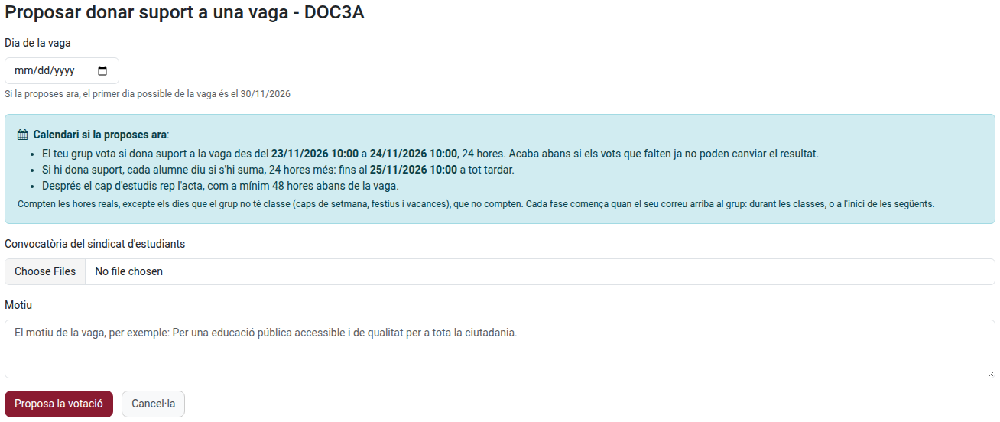
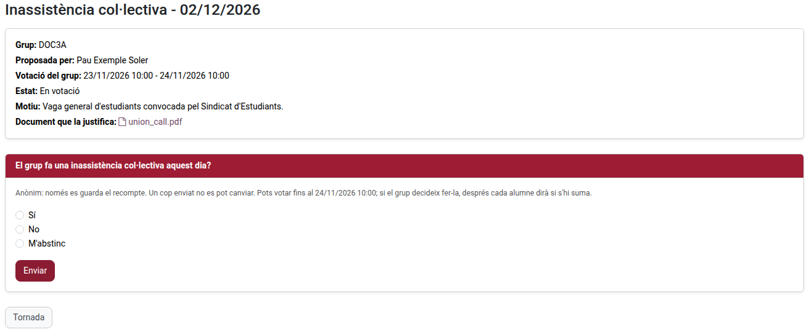
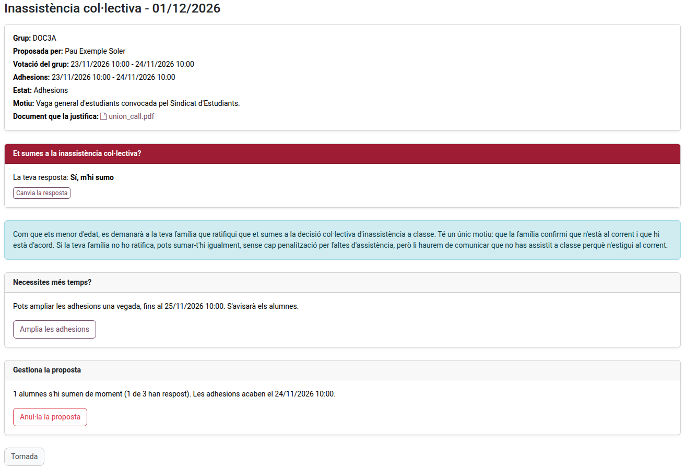
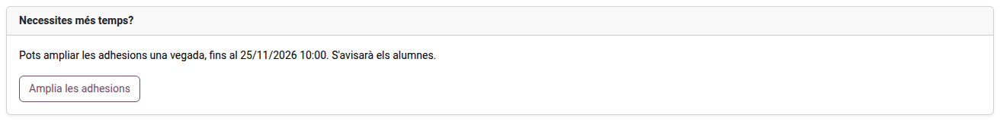
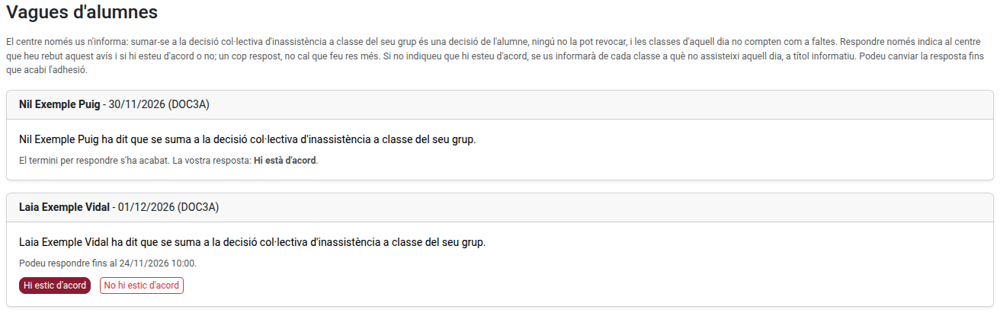

[Català](../../ca/families/manual-vagues.md) | [Castellano](../../es/families/manual-vagues.md) | [English](manual-vagues.md)

---

# Student walkouts

Your group can decide on the portal whether it walks out on a given day (for instance, after a students' union calls a walkout), and each student says whether they join it. The students who join it are off the roll-calls of that day: neither absent nor present.

It is a collective decision not to attend class, of students from the 3rd year of ESO onwards, told to the school's management beforehand. Nobody can revoke it, the family included: the school only informs. The family of a minor is asked on the portal to acknowledge receipt and to say whether it agrees.

---

## Who does what

| Who | What they do |
|-----|--------------|
| The group's delegate or sub-delegate | Proposes the vote, gives the reason and attaches the document that supports it |
| Every student of the group with portal access | Votes whether the group walks out and, if it does, says whether they join it |
| The family of a minor who joins | Acknowledges receipt on the portal and says "I agree" or "I do not agree": it does not change the student's decision |
| The group's tutor | Is told of everything and can stop the proposal if it has a formal defect |
| The Head of Studies | Gets the minute and validates the walkout or not |

Only the groups the centre allows can propose a walkout (from the 3rd year of ESO, baccalaureate and vocational training).

---

## The calendar

The proposal goes in two phases: first the group votes whether it walks out, then each student says whether they join it. Each phase lasts **24 hours** by default, and the Head of Studies must get the minute at least **48 hours** before the walkout. So, with the default settings, **a walkout has to be proposed about four school days ahead**.

How the hours count is decided by the centre, and the form explains it to you:

- Usually they are **real hours**, but the days your group has no class (weekends, public holidays and school breaks) count nothing: a phase starting on Friday at 9:00 ends on Monday at 9:00 (you can still answer during the weekend).
- The count starts **when you propose it**, and the emails leave at once, or **when the email reaches your group**: during its classes or, if it is sent outside them, at the start of the next ones.
- The centre can also count only your group's **class hours**: then the calendar is longer.
- The vote ends early once the votes still to come can no longer change the result.

The form shows you the exact calendar, what the hours count and the first day the walkout can be on before you send it.

**A walkout closer than that.** If both phases do not fit whole before the notice, but part of the joining does (at least 5 minutes), you can propose it anyway: the form tells you from which day, and **the joining phase will be shorter**. Once proposed, its page warns you: the individual joining phase will last at most so many hours instead of 24. If the group vote ends earlier because the majority has already decided, the joining phase is extended with the time gained, up to the usual 24 hours.

---

## Proposing the vote (delegate or sub-delegate)

1. On the portal, open **Student walkouts** (card on the home page, or in the top bar) and click **Propose a walkout**.
2. Choose the **Walkout day**. It must be a school day, and no earlier than the first day the form tells you.
3. Write the **Reason**: why the group does not want to attend class that day (for instance "For an accessible, quality public education for everyone"). It shows in the whole group's banners and emails.
4. Attach the **Supporting document** (one or more files): the call of a students' union, the minute of the group's assembly or any document that explains the decision.

Both are required: without a reason and a document you cannot propose the vote.
5. Click **Propose the vote**.

Your group gets an email at once to vote. Only one proposal per group and day is possible.

While the proposal is being voted or joined, its page shows you how many students have answered, and **Cancel the proposal** cancels it. A cancelled proposal disappears for the group.

---

## Voting (every student)

The home page of the portal warns you when your group is voting. Open the proposal and answer **Does the group walk out that day?**: **Yes**, **No** or **Abstain**, and click **Send**. A pop-up confirms that your vote is saved.

- The vote is **anonymous**: only the count is kept, never who voted what.
- You vote **once**: it cannot be changed afterwards.
- The group decides to walk out when there are more yes than no among the votes cast (a tie does not decide it).

If the group decides not to walk out, the proposal closes and everybody is expected in class that day.

A student who had no access to the portal when the walkout was proposed appears in the minute and does not vote, but if the group decides to walk out and they get access while joining is open, they can say whether they join: they are sent the email at that moment.

---

## Joining (every student)

If the group decides to walk out, you get an email and the proposal asks you **Do you join the walkout?** Answer **Yes, I join it** or **No** and click **Send**. A pop-up confirms your answer, and the form closes and shows it. You can change it with **Change my answer** until joining ends.

- Your name appears in the minute the Head of Studies gets.
- The classes of that day do not count as absences for you: you are off the roll-calls. If the walkout is not validated, they do count.
- **If you are a minor**, your family is asked on the portal, while joining lasts, to acknowledge receipt and say whether it agrees that you join. Nobody can revoke your decision. If it does not say that it agrees, it is told of each class you do not attend that day, for information. The page tells you what your family has answered.

---

## Extending the joining (delegate or sub-delegate)

If joining is about to end, or has ended, and students still need time, open the proposal's page and click **Extend the joining**. Joining lasts one phase more (the same time as each phase in the centre's settings), or less if the Head of Studies would then not get the minute in time: it is extended as far as possible. It is counted from the end of joining, or from now if it has already ended. Every student is told.

- **You can do it only once.** The group's tutor, and whoever is above them, can extend it more times.
- If joining had already ended, the proposal is open again and the minute goes to the Head of Studies when it closes again.
- It is not always possible: the Head of Studies must still get the minute with the notice before the walkout. The button only appears when it is.

---

## Acknowledging receipt (family of a minor)

When your child (under 18 on the walkout day) says that they join a walkout, you get an email at once. On the portal, the home page warns you; click **Answer**, or open **Student walkouts**.

For each walkout, click **I agree** or **I do not agree**. A pop-up confirms your answer, and the page shows it. You can change it with **Change my answer** until joining ends (the page tells you until when).

- Answering only tells the school that you have received the notice and whether you agree. It is a collective decision of the students that nobody can revoke, and the classes of that day do not count as absences. **Once answered, you do not need to do anything else**: the rest is automatic.
- If you do not say that you agree, or do not answer in time, you are told of each class your child does not attend that day, for information only. If you say that you do not agree, your child is told too.
- To answer you need access to the portal. If you don't have it, ask the school for it in time.
- Once the walkout is validated you get an email, for information. If the proposal is aborted or not validated instead, you are told too.

---

## After joining

The minute goes to the Head of Studies, who decides whether to validate the walkout:

- **Validated**: the students who join it stay off the roll-calls of that day. Every student is told, and so is the family of each minor who joins.
- **Not validated**: the classes of that day of the students who join it count as absences. Every student is told, with the reason.

Meanwhile, the group's tutor can **abort** the proposal while it is being voted or joined, only for a formal defect (for instance, the attached document does not support it). Every student is told, with the reason.

The minute (PDF) is on the proposal's page once it closes.

### What each state means

| State | Meaning |
|-------|---------|
| **Voting** | The group is voting whether it walks out |
| **Joining** | The group walks out: each student says whether they join it |
| **Closed** | The Head of Studies has the minute and decides |
| **Validated** | Those who join it are off the roll-calls of that day |
| **Aborted** | The tutor stopped the proposal, with a reason |
| **Not validated** | The Head of Studies did not validate it, with a reason |
| **Cancelled** | The delegate cancelled it |

---

[← Back to the families' manuals](index.md)
