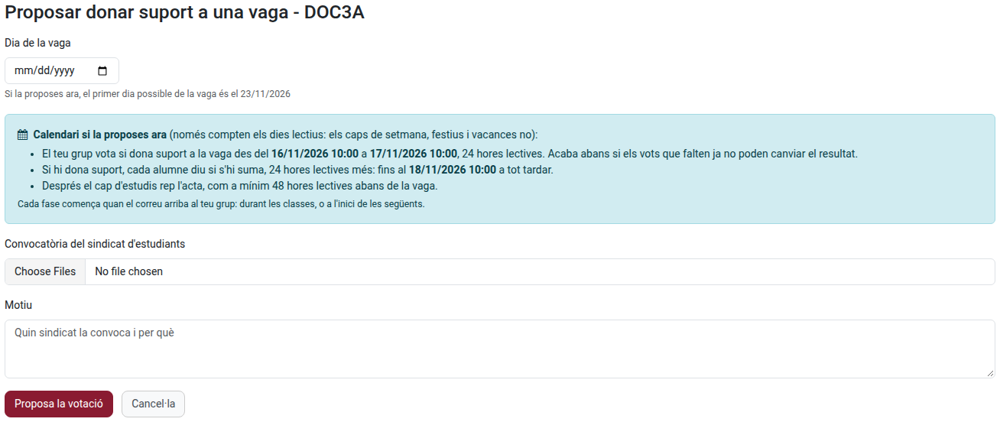
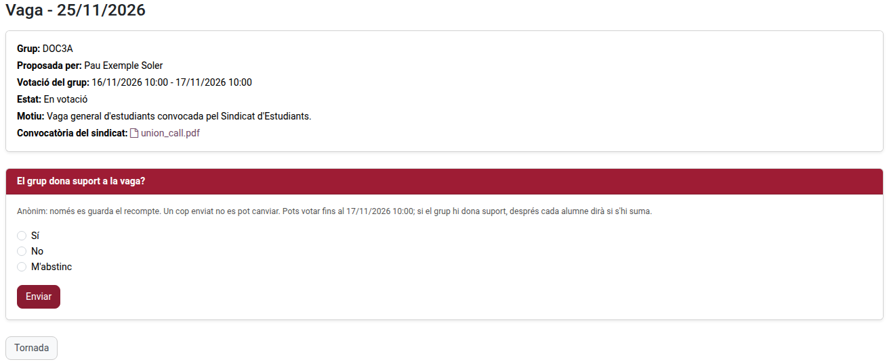
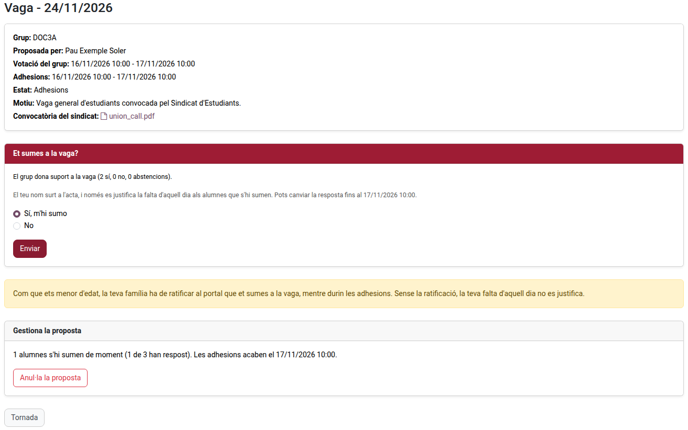
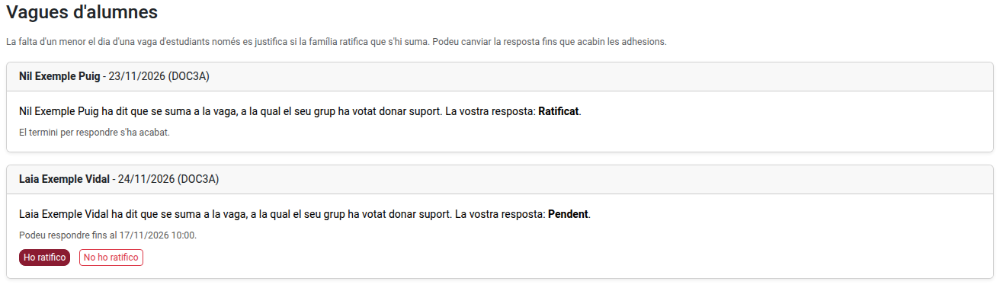

[Català](../../ca/families/manual-vagues.md) | [Castellano](../../es/families/manual-vagues.md) | [English](manual-vagues.md)

---

# Student walkouts

When a students' union calls a walkout, your group can decide on the portal whether it supports it, and each student says whether they join it. If the walkout is validated, the absence of the students who join it is justified that day.

Collectively deciding not to attend class is a right of students from the 3rd year of ESO onwards, when the school's management is told beforehand (LODE, article 8). In Catalonia, a minor also needs their family's authorization (Decret 102/2010, article 24.2): the family ratifies it on the portal.

---

## Who does what

| Who | What they do |
|-----|--------------|
| The group's delegate or sub-delegate | Proposes the vote, attaching the union's call |
| Every student of the group with portal access | Votes whether the group supports the walkout and, if it does, says whether they join it |
| The family of a minor who joins | Ratifies it, or not, on the portal |
| The group's tutor | Is told of everything and can stop the proposal if it has a formal defect |
| The Head of Studies | Gets the minute and validates the walkout (justifies the absences) or not |

Only the groups the centre allows can propose supporting a walkout (from the 3rd year of ESO, baccalaureate and vocational training).

---

## The calendar

The proposal goes in two phases: first the group votes whether it supports the walkout, then each student says whether they join it. Each phase lasts **24 school hours** by default, and the Head of Studies must get the minute at least **48 school hours** before the walkout. So **a walkout can only be proposed at least four school days ahead**.

- Only school days count: weekends, public holidays and school breaks do not. A phase starting on Friday at 13:00 ends on Monday at 13:00 (you can still answer during the weekend).
- Each phase starts when its email reaches your group: during its classes or, if it is sent outside them, at the start of the next ones.
- The vote ends early once the votes still to come can no longer change the result.

The form shows you the exact calendar and the first day the walkout can be on before you send it.

---

## Proposing the vote (delegate or sub-delegate)

1. On the portal, open **Student walkouts** (card on the home page, or in the top bar) and click **Propose supporting a student walkout**.
2. Choose the **Walkout day**. It must be a school day, and no earlier than the first day the form tells you.
3. Attach the **Call of the students' union** (one or more files).
4. Write the **Reason** (which union calls it and why). It is required: without it you cannot propose the vote.
5. Click **Propose the vote**.

Your group gets an email at once to vote. Only one proposal per group and day is possible.

While the proposal is being voted or joined, its page shows you how many students have answered, and **Cancel the proposal** cancels it. A cancelled proposal disappears for the group.

---

## Voting (every student)

The home page of the portal warns you when your group is voting. Open the proposal and answer **Does the group support the walkout?**: **Yes**, **No** or **Abstain**, and click **Send**.

- The vote is **anonymous**: only the count is kept, never who voted what.
- You vote **once**: it cannot be changed afterwards.
- The group supports the walkout when there are more yes than no among the votes cast (a tie does not support it).

If the group does not support it, the proposal closes and nobody's absence is justified that day.

A student who had no access to the portal when the vote was proposed appears in the minute but cannot answer.

---

## Joining (every student)

If the group supports it, you get an email and the proposal asks you **Do you join the walkout?** Answer **Yes, I join it** or **No** and click **Send**. You can change your answer until joining ends.

- Your name appears in the minute the Head of Studies gets.
- Only the students who join it have their absence justified that day, if the walkout is validated.
- **If you are a minor**, your family has to ratify on the portal that you join, while joining lasts. Without it, your absence is not justified. The page tells you whether your family has ratified it.

---

## Ratifying it (family of a minor)

When your child (under 18 on the walkout day) says that they join a walkout, you get an email at once. On the portal, the home page warns you; click **Answer**, or open **Student walkouts**.

For each walkout, click **I ratify it** or **I do not ratify it**. You can change your answer until joining ends (the page tells you until when).

- If you do not ratify it, or do not answer in time, your child's absence that day is **not justified**. If you refuse, your child is told.
- To ratify it you need access to the portal. If you don't have it, ask the school for it in time.
- Once the walkout is validated you get an email confirming that the absence is justified. If the proposal is aborted or not validated instead, you are told too.

---

## After joining

The minute goes to the Head of Studies, who decides whether to validate the walkout:

- **Validated**: the absences of the students who join it (adults, and minors whose family ratified it) are justified that day. Every student is told, and so is the family of each minor whose absence is justified.
- **Not validated**: nobody's absence is justified. Every student is told, with the reason.

Meanwhile, the group's tutor can **abort** the proposal while it is being voted or joined, only for a formal defect (for instance, there is no official call of a students' union for that day). Every student is told, with the reason.

The minute (PDF) is on the proposal's page once it closes.

### What each state means

| State | Meaning |
|-------|---------|
| **Voting** | The group is voting whether it supports the walkout |
| **Joining** | The group supports it: each student says whether they join it |
| **Closed** | The Head of Studies has the minute and decides |
| **Validated** | The absences of those who join it are justified |
| **Aborted** | The tutor stopped the proposal, with a reason |
| **Not validated** | The Head of Studies did not validate it, with a reason |
| **Cancelled** | The delegate cancelled it |

---

[← Back to the families' manuals](index.md)
