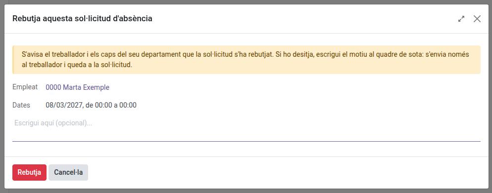
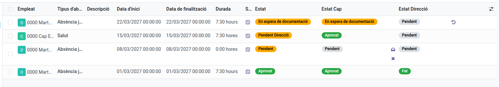
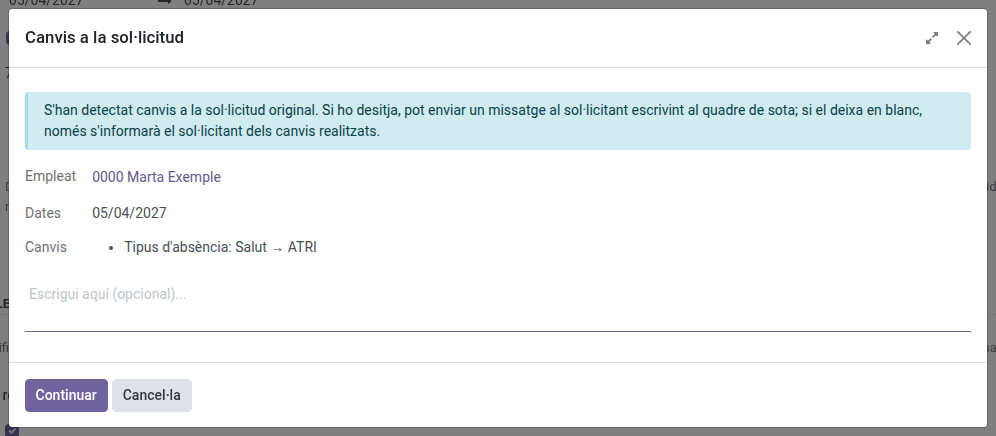
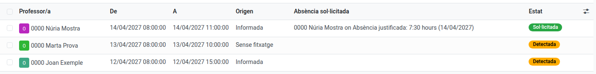

[Català](../../ca/head_of_studies/absences.md) | [Castellano](../../es/head_of_studies/absences.md) | [English](absences.md)

---

# Managing staff absences

**Role required:** Head of Studies, Deputy Head of Studies or Direction

---

## Contents

1. [Who approves each area](#who-approves-each-area)
2. [Approving or refusing](#approving-or-refusing)
3. [Adjusting what an absence counts towards](#adjusting-what-an-absence-counts-towards)
4. [Direction's approval](#directions-approval)
5. [Undoing a decision](#undoing-a-decision)
6. [Per-employee report](#per-employee-report)
7. [Monthly report](#monthly-report)
8. [Detected absences](#detected-absences)

---

## Who approves each area

| Area | Approved by |
|---|---|
| VET | Deputy Head of Studies for VET |
| ESO / BTX | Head of Studies |
| ASP | Secretary |

Everyone's approver is the manager of their top-level department, set on the department's own form in the **Area Manager** field, and it follows the post when the holder changes.

Nobody approves their own absence: an Area Manager's request is decided by Direction.

---

## Approving or refusing

When somebody in your area sends a request you receive an email with the employee, the absence type, the dates and the hours, so you can arrange the cover, and the request is added to your activities.

**Messages on the request.** While a request is in your hands, you and the employee are its only followers: what either of you writes in its message history (**Send message**) reaches the other and nobody else. The Department Chief and the Seminar Chief do not follow it: they receive the filing and, afterwards, only what changes the cover (refused, cancelled, other dates or another type). Once you validate it and it reaches Direction, the Director follows it instead of you. If Direction sends the supporting document back, or undoes its way back to one of your steps, the request is in your hands again and you receive an email saying so. An ATRI absence Direction sends back as not in ATRI (or with its ATRI documentation insufficient) stays with Direction, since the employee settles it on the portal.

**Employee Attendances > Absences > Management > Requested absences**.

That lists your area's requests, opening on **Waiting For Me**: the ones pending your acknowledgement and the ones whose supporting document you have to validate. Every absence goes through you first and then through Direction, and the list has one column for each:

| Column | Shows |
|---|---|
| **Status** | Where the request stands |
| **Head status** | Your side: Pending, Awaiting documentation, Pending validation, Approved or Refused |
| **Direction status** | Direction's: Pending, Done or Refused |

**Your side has two steps when the absence type requires a supporting document** (every type except `Health` and `ATRI`), because the document often only exists after the absence:

1. **Received: pending documentation** (inbox icon in the list, or at the top of the form). You acknowledge the request without having seen the document yet. It becomes **Awaiting documentation** and the employee is asked for the document. If they had already attached it with the request, it goes straight to **Pending validation**.
2. When the employee attaches the document, the request comes back to you on its own as **Pending validation**. Open it, check the document and use **Validate documentation** (also a tick icon in the list). It then goes to Direction.

If the document is not valid, **Documentation insufficient** asks you why (required) and sends the request back to the employee (Awaiting documentation) with a message that includes your reason. The employee also sees it at the top of the request until they attach a new document. If the new document is not valid either, the dialog opens with your previous reason so you can edit it; once you validate a document, the reason is cleared.

**If the document is not going to arrive and is not needed**, while the request is **Awaiting documentation** use **Exempt from supporting document** (at the top of the form). It asks for confirmation, and the request goes on to Direction as if the document had been validated, but its status is **Waived**, so it is told apart from a document somebody checked. The employee stops receiving reminders and gets a message saying it is no longer required. Direction and the administrator can do it too, and it is undone like any other decision.

For `Health` and `ATRI` there is a single step: **Validate** (the thumb in the list). A `Health` absence then goes straight to Direction. An `ATRI` one always stops first at **Pending ATRI confirmation**: the employee has to confirm they have requested it on the ATRI portal (**I confirm it is requested in ATRI**, at the top of the form), and only then does it reach Direction. You validate first on purpose, because ATRI is often picked for what is not, and the other way round: correct the type before validating. The employee is reminded like for a missing supporting document, and you are told once if it stays unconfirmed a few days after the absence.

The cross refuses, at any of these steps. Once you decide from the form, you are taken back to the list.

**Refusing asks for the reason first.** A dialog opens with a box for the reason of the refusal, which is optional: what you write is sent to the employee alone (not to the Department Chief, the Seminar Chief or anyone else) and stays at the top of the request, in red, while it is refused. Confirm with **Refuse**, or cancel to leave the request as it was.

The absence takes effect (absence calendar, hour balance, guard duty board) as soon as you acknowledge it, even while the document is missing or Direction has not reviewed it yet.

If the employee has not attached the document a few days after the absence (three, unless the centre has set otherwise), you receive a message and an activity to follow it up; the employee is reminded every day. Each reminder and each message waits for the start of its reader's working day: nobody gets them outside their working hours.

You see the **written reason** and the **supporting document**; the rest of the staff do not.

If you refuse by mistake, [undo it](#undoing-a-decision): the request returns to where it stood and the reason is forgotten.

You can attach a **supporting document** to any request, of any type, and at any point in its life: a certificate handed in after the absence goes on that same request.

---

## Adjusting what an absence counts towards

One field on the form, changeable at any time:

| Field | What it does | Ticked on |
|---|---|---|
| **Adds the hours to the monthly report** | Makes these hours part of the monthly count | Every type except `Sick leave` |

You can also correct the **absence type** when the employee picked one that does not apply, while the request is pending (or refused or cancelled). An approved request can no longer be changed: [undo the approval](#undoing-a-decision) first, correct it and validate it again.

**The employee is told what you change.** When you (or Direction) change the absence type, the dates or the times of a request somebody else filed, the next time you decide on it (acknowledging, validating, sending the document back, refusing) a dialog shows the changes and lets you write a message for the requester. Leave it blank and they are only told what was changed. Either way it reaches the requester alone, not the Department Chief, the Seminar Chief or anyone else. On a request that is already refused or cancelled, the requester is told as soon as you save the change.

Whether an absence is a whole day or a few hours is controlled by the **Whole day?** checkbox, which you can also correct while the request is pending: ticked counts 7.5 hours per working day, unticked counts the hours given. When the times of a request cover the employee's whole timetable for that day, the form proposes a whole day on its own (not coming in at all counts the full 7.5 hours); the employee can untick it, and you can correct it either way while the request is pending.

---

## Direction's approval

**Only Direction.** Direction reviews the supporting document of every absence and, for **ATRI** absences, checks that the request really was filed on the Generalitat's portal.

Direction goes last: a request reaches you once its Head has validated it, together with its supporting document when the type requires one.

**Employee Attendances > Absences > Management > Requested absences** opens on **Waiting For Me**: every absence **Pending Direction**, plus the Area Managers' own absences, which you handle as their Head (with the Head's buttons described above). Each one also leaves you an activity ("Direction review of the absence").

Review them from the list with the icons beside **Direction status**, or open one and use the actions at the top of the form, which takes you back to the list once done:

| Icon | Button | Result |
|---|---|---|
| Ticked box | **Direction: done** | Approved |
| Sheet | **Documentation insufficient** | Back to the employee, Awaiting documentation. It asks for the reason first, which the employee receives. On an ATRI absence the documentation is on the portal, not in EMS: it goes back to Pending ATRI confirmation and, once the employee confirms, straight back to Direction without going through the Head |
| Reply arrow | **Not in ATRI** | Only ATRI absences, when it does not appear on the portal. Back to the employee, Pending ATRI confirmation. It asks for the reason first, which the employee receives |
| Arrow back | **Undo the last decision** | Back to the previous status, see [Undoing a decision](#undoing-a-decision) |
| Cross | **Refuse** | Refused. It refuses the whole request, and it asks for confirmation first |

When an absence reaches Direction (Pending Direction) you receive an email with its summary, and from then on you follow it instead of the Head: messages written on it reach you and the employee, and nobody else.

**Status**:

| Status | Means |
|---|---|
| Pending | The Head has not acknowledged it yet |
| Awaiting documentation | Received by the Head, waiting for the employee's supporting document |
| Pending validation | The document is attached, the Head has to validate it |
| Pending ATRI confirmation | ATRI absences only: validated by the Head, waiting for the employee to confirm it is requested in ATRI |
| Pending Direction | Validated by the Head, waiting for Direction |
| Approved | Both have |
| Refused | The Head or Direction refused it |
| Cancelled | The employee withdrew it |

The search panel on the left filters by **Status**.

---

## Undoing a decision

A decision taken by mistake is taken back with **Undo the last decision**: the arrow-back icon at the end of the row in the list, or at the top of the form. It asks for confirmation and goes back one step at a time:

| Status | Undoing it leaves it |
|---|---|
| Approved | Pending Direction |
| Pending Direction | Pending validation, Awaiting documentation when the document had been waived, or Pending when the type requires no supporting document |
| Pending validation, Awaiting documentation | Pending |
| Pending ATRI confirmation | Pending, or Pending Direction when Direction had sent it back as not in ATRI |
| Refused, Cancelled | The status it had just before |
| Awaiting documentation after a *Documentation insufficient* | The status it had just before, while the employee has not attached a new document |

Who can undo what:

| Who | Undoes |
|---|---|
| The Head (Head of Studies, Deputy, Secretary) | The decisions of the Head's side, on their own area's requests |
| Direction | The Head's decisions and its own |
| Administrator | Any |

Nobody undoes a decision on their own absence, except Direction and the administrator.

Undoing the Head's first step (received, or validated when there is no document) returns the request to **Pending**, so **the absence stops counting** in the absence calendar, the hour balance and the guard duty board until it is acknowledged again. The employee is always told, and their department's chiefs too whenever the absence goes in or out of effect.

After undoing from the form you stay on the request, to correct it or decide on it again.

---

## Per-employee report

**Absences > Reporting > by employee**.

Grouped by person and filtered by the current course, 1 September to 31 August.

The **Health hours** column totals each person's `Health` hours. The limit is **15 hours per course**. Going over blocks nothing: the employee is warned and the request goes through, but it stays visible to you here.

---

## Monthly report

**Absences > Reporting > Monthly totals**.

Grouped by month, with the summed hours and the number of absences behind each. Only absences with **Adds the hours to the monthly report** ticked are included; refused and cancelled ones are left out.

To change the period, remove the **Current Course** filter and pick the one you need.

---

## Detected absences

**Employee Attendances > Absences > Management > Detected absences**.

This list holds the teachers' absences that nobody has requested yet. They come from two places, shown in the **Origin** column:

- **Informed**: you (or a Department or Seminar Chief) entered it because you already knew the teacher would be away (they phoned in this morning, or it was agreed in a meeting).
- **No check-in**: EMS added it on its own once the day was over, because the teacher did not check in at all, or checked in after their first lesson had ended. It goes from their first lesson to their last one, or to the time they checked in. Only the teachers of the areas the administrator has chosen go through this (for now, VET), and only on the days their schedule has lessons: a teacher with no schedule loaded is never detected.

### Entering one

1. Click **New**.
2. Choose the **Teacher**. Only the teachers in your own area are offered: a Head of Studies or Deputy sees their own teachers, and Direction sees everyone. Department and Seminar Chiefs can also enter them, for the teachers of their own department. Members of the management team (such as the Secretary) count as teachers of the area their department belongs to: the Secretary, who teaches in a VET department, is offered to the Head of Studies or Deputy in charge of VET. Teachers of other departments who teach a group the department manages (the **Managed by the department** field of the group's study), or who name the department in the **Also managed by the departments** field of their form, are offered too.
3. Set **From** and **To**, date and time. They start out as today, 08:00 to 15:00. An absence can span several days.
4. Optionally, add **Notes** for your own reference. The teacher can open the entry but never sees the notes.
5. Save.

From that moment the teacher appears on the guard duty schedule as absent with a request still awaiting approval (lighter italic red), for the hours you entered.

### What happens next

When the teacher requests the absence themselves, the entry is linked to it automatically and its status changes from **Detected** to **Requested**. From then on only the teacher's own request counts, with its own dates and hours: if it is later refused or cancelled, the entry does not come back onto the schedule. A requested entry can no longer be edited; it stays in the list, under the **Requested** filter, as a record.

Until then, once the absence is over, EMS reminds the teacher to request it at the start of their working day, every day unless the centre has set otherwise. The message is not the same for both origins: for a missing check-in it also tells them that, if they were at the centre and forgot to check in, they should ask you to record their check-in. If it is still not requested a few days after the absence (three, unless the centre has set otherwise), you receive a message and an activity to follow it up. These reminders reach the teachers of the areas the administrator has chosen.

**If the teacher was at the centre after all**, record their check-in for that day (**Employee Attendances → Attendance → Overview**, **New**; see also [Attendance corrections](attendance-corrections.md)): a detected absence from a missing check-in is then **Discarded** on its own, or shortened if they arrived earlier than it said. An informed one you entered by mistake is deleted by hand.

### Organising the cover

Once an absence is on the guard duty schedule, detected or requested, organise it from the schedule's **Absences table**: send a guard to each class, propose a notice to the families when the students can come in later or leave earlier (if the administrator has switched these changes on), and correct what an absence that changed afterwards made unnecessary. Whatever you organise for a detected absence stays when the teacher requests it. See [Organising an absence](../teachers/guard-duty-schedule.md#organising-an-absence).

A class whose teacher has not checked in when it starts also appears on the Absences table, to be covered with a guard. If the teacher turns out to be in the classroom, you can register their check-in from the table: see [Teachers who have not checked in](../teachers/guard-duty-schedule.md#teachers-who-have-not-checked-in).
