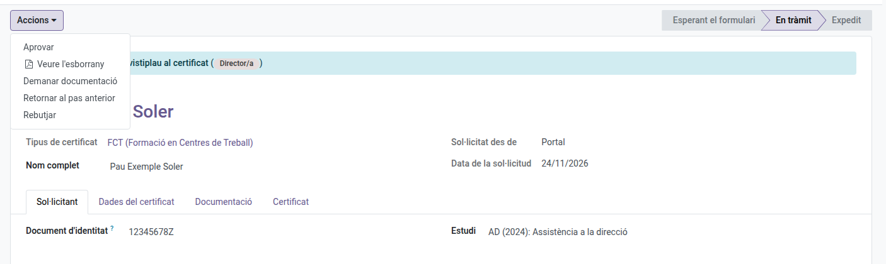
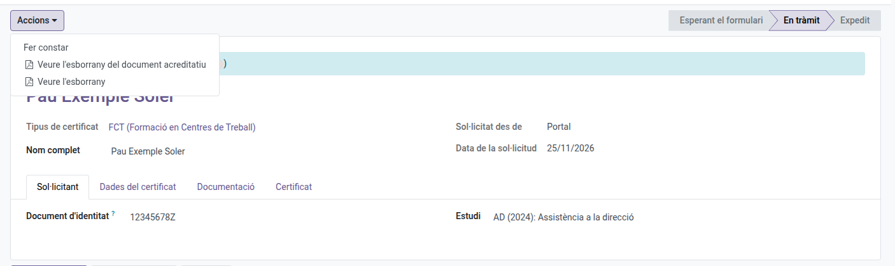

[Català](../../ca/head_of_studies/certificates.md) | [Castellano](../../es/head_of_studies/certificates.md) | [English](certificates.md)

---

# Certificates: approving

Approve the certificates the secretariat has issued. On approval, EMS generates the PDF and sends it to the applicant.

**Required role:** the Director position.

---

## When it is your turn

Once the secretariat issues a certificate, the circuit's last step is yours: you find it as a task in your daily summary and in **Academic management → Certificates**, under the **Pending for me** filter.

---

## Approving

1. Open the request.
2. Check the details in the **Applicant**, **Certificate details** and **Documentation** tabs. **Actions → See the draft** shows the certificate as it will be, marked **DRAFT**.
3. Open **Actions → Approve** and confirm.

EMS:

- adds the **Approved** stamp;
- generates the certificate's PDF, with the secretariat's and the Director's stamps and, at the end, the agreement's pages;
- emails it to the applicant, who can also download it from the portal or from the link.

The PDF is in the request's **Certificate** tab.

---

If you issued the certificate yourself (for example, as administrator), you cannot approve it: someone else has to.

---

## Attesting instead of approving

Until the certificate is issued, you may **attest** it yourself: EMS generates not a certificate but an **accrediting document** with the same text, saying that you **attest** what it states, signed by you only.

1. Open the request (remove the **Pending for me** filter if it is not on your step yet).
2. **Actions → See the accrediting document draft** shows it as it will be, marked **DRAFT**.
3. Open **Actions → Attest** and confirm.

Every mandatory detail and document must be in; if one is missing, EMS tells you which and does not generate it.

EMS:

- gives it its own number (for example `DACR-2026-27-0001`) and adds your stamp;
- generates the PDF, with the agreement's pages at the end;
- emails it to the applicant and closes the request.

---

## If something is wrong

- **Actions → Return to the previous step** — sends the request back to the secretariat with the reason; its stamp is undone.
- **Actions → Request documentation** — asks the applicant for what is missing.
- **Actions → Reject** — if the certificate cannot be issued; the applicant gets the reason by email.

You can also see every certificate request of the centre by removing the **Pending for me** filter.
