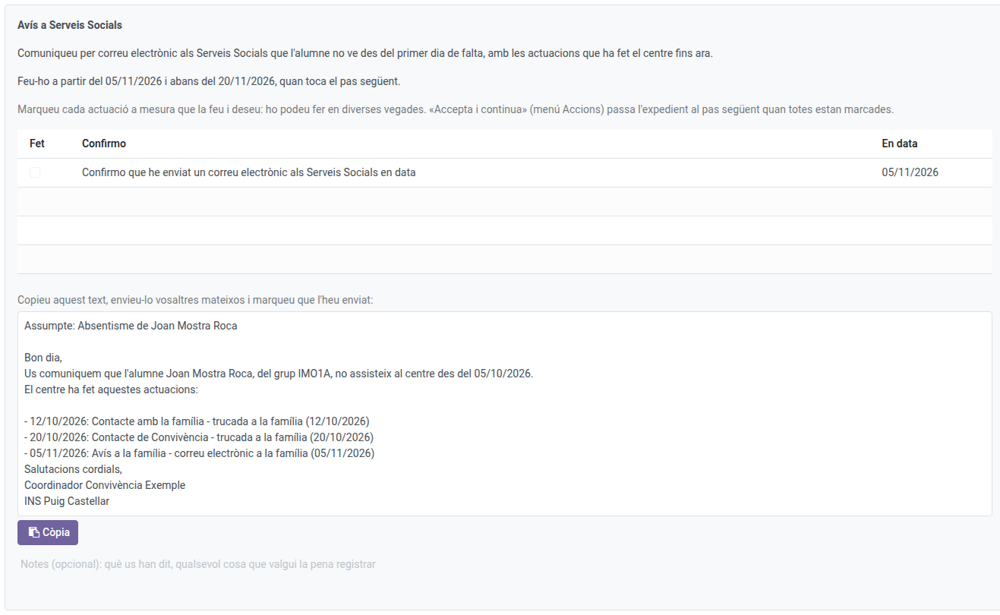
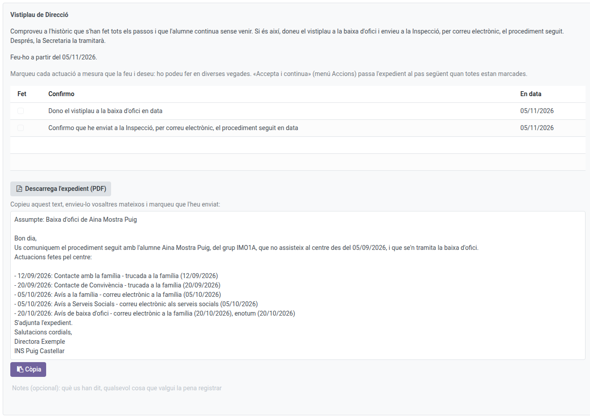
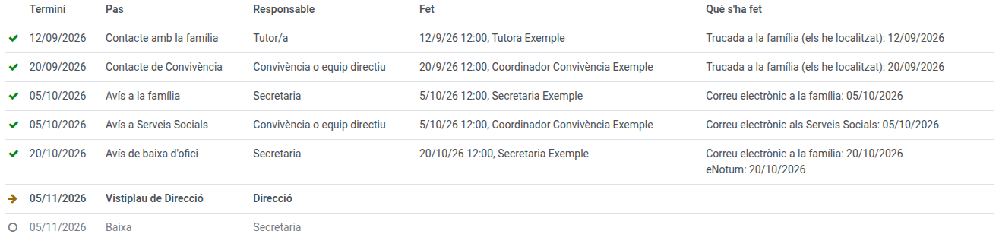

[Català](../../ca/head_of_studies/ex-officio-withdrawal.md) | [Castellano](../../es/head_of_studies/ex-officio-withdrawal.md) | [English](ex-officio-withdrawal.md)

---

# Ex Officio Withdrawal: Direction, Head of Studies and Coexistence

This guide explains what Direction (the green light), the Head of Studies (follow-up and decisions on the tutor's behalf) and Coexistence or the management team (the steps of the compulsory circuit) do in an ex officio withdrawal case file.

**Required role:** Director, Head of Studies or Deputy Head of Studies; Coexistence coordinator for their steps (also the Administrator)

---

## Contents

1. [Where to find the case files](#where-to-find-the-case-files)
2. [What the Head of Studies can do](#what-the-head-of-studies-can-do)
3. [The Coexistence steps (compulsory)](#the-coexistence-steps-compulsory)
4. [Direction's green light](#directions-green-light)
5. [The history and the case file as a PDF](#the-history-and-the-case-file-as-a-pdf)

---

## Where to find the case files

Go to: **Academic management → Ex officio withdrawals**. You see every case file of the centre, with the step each one is at. How they start and what the tutor does is explained in the [tutor's manual](../tutors/ex-officio-withdrawal.md); the Secretariat's steps, in the [Secretariat's](../secretary/ex-officio-withdrawal.md).

---

## What the Head of Studies can do

The Head of Studies and the Deputy Head of Studies can do what the tutor does in any case file: start or dismiss a proposal, do the tutor's step and review the roll-calls that say otherwise. However, they can only **open** a new case file (Request ex officio withdrawal) for the students of the tutors below them.

---

## The Coexistence steps (compulsory)

In the compulsory circuit, the tutor's Coexistence coordinator (or the management team) has two steps:

- **Contact by Coexistence, after 15 days:** a phone call to the family, with the **I reached them** / **I did not reach them** buttons, like the tutor.
- **Notice to Social Services, after a month:** the case file prepares the text of the notice, with the actions taken so far. Copy it with **Copy the text**, send it yourself by email and tick that you sent it.

Once everything is ticked, **Actions → Accept and continue**.

---

## Direction's green light

When the term ends (15 school days or 2 months), Direction gets the task. Check in the history that every step was done and that the student is still not coming:

- **Give the green light:** tick **I give the green light to the ex officio withdrawal** and accept the step. The student becomes an **Expected withdrawal** (they no longer appear in the roll-calls) and the Secretariat processes their withdrawal.
  - In compulsory, the procedure must also be sent to the Inspection: download the case file with **Download the case file (PDF)**, copy the text prepared, send it yourself by email and tick that you sent it.
- **Not giving it:** if the student came back or justified the absences, **Actions → Close without a withdrawal**, with the reason and a note. The case file closes.

---

## The history and the case file as a PDF

The **History** of each case file shows every step: when each was due, who did it and when, and what was ticked. Pending steps are greyed out.

Once the case file is over (withdrawn or cancelled), **Actions → Print the case file** generates its PDF, always in the centre language.
