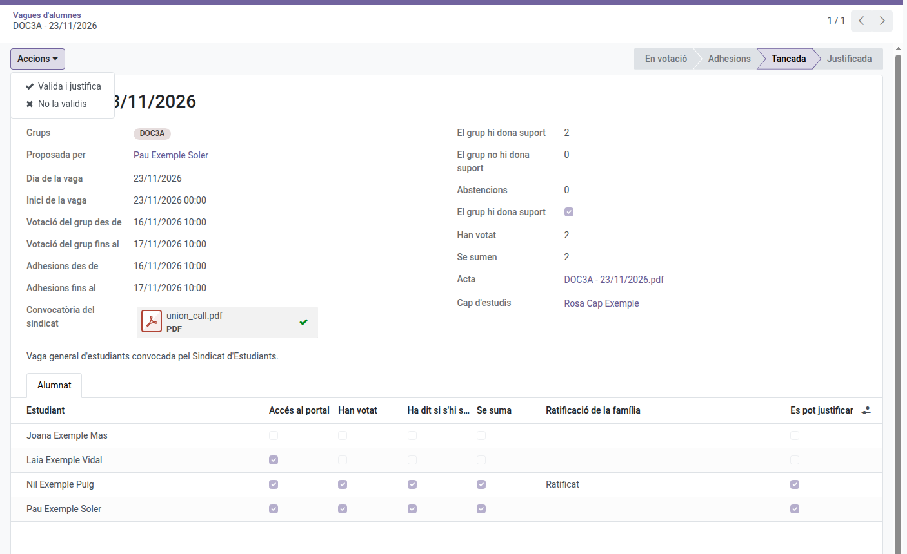

[Català](../../ca/head_of_studies/student-walkout.md) | [Castellano](../../es/head_of_studies/student-walkout.md) | [English](student-walkout.md)

---

# Student walkouts: validating them

A group's delegate proposes on the portal that the group supports a walkout called by a students' union, the group votes on it, and the group's tutor watches over the proposal. You get the minute when it closes and decide whether to validate it: validating it justifies the absences of those who join it. How students and families take part is in the [families' manual](../families/manual-vagues.md), and the tutor's part in the [tutors' manual](../tutors/student-walkout.md).

Not to be confused with **Strikes** (Coexistence), the disciplinary record, nor with the staff walkout report.

---

## What you get

- **Nothing when a proposal is made**: the tutor watches over it.
- **A notice in your daily summary** when a tutor (or someone above them) aborts a proposal, with the reason.
- **The minute, by email**, when the proposal closes: at least 48 school hours before the walkout (by default), with the vote count and the students who join it. If somebody is to be justified, you also get the task **Justify the student walkout**.

The minute reaches the Head or Deputy Head of Studies above the group's tutor; for a group with no tutor, every Head and Deputy Head of Studies.

---

## Validating it

Open the proposal from the email or from **Student's Attendances > Student walkouts**.

- **Actions > Validate and justify**: creates one full-day justification of the walkout day for the students who can be justified, and opens it. They are the adults who join it, and the minors whose family ratified it (Decret 102/2010, article 24.2: the **Can be justified** column on the **Students** tab). A student who already had a justification that day is skipped, and it is noted on the call. Every student of the group is told, the family of each justified minor too, and the tutor.
- **Actions > Do not validate**: choose a reason; nobody's absence is justified. Every student is told, and so are the tutor and the families that were asked to ratify it.
- **Actions > Undo the validation** (on a validated proposal): removes the justification, so the absences are no longer justified. Students, families and tutor are told, with the reason.

The reasons come from **Student's Attendances > Configuration > Student walkouts > Rejection reasons**, the same ones the tutor uses to abort a proposal. You can add, rename or reorder them; "Other reasons" asks for details.

---

## Settings

An administrator sets it in **Settings > Student Walkout Settings**:

- **Levels and courses**: which levels (and, optionally, which courses of them) may propose supporting a walkout. By default, from the 3rd year of ESO, baccalaureate and vocational training.
- **Calendar**: how long each phase lasts and how long before the walkout you must get the minute, in school hours (24 and 48 by default). A proposal keeps the values it was made with.

---

[← Back to the Head of Studies' manuals](index.md)
