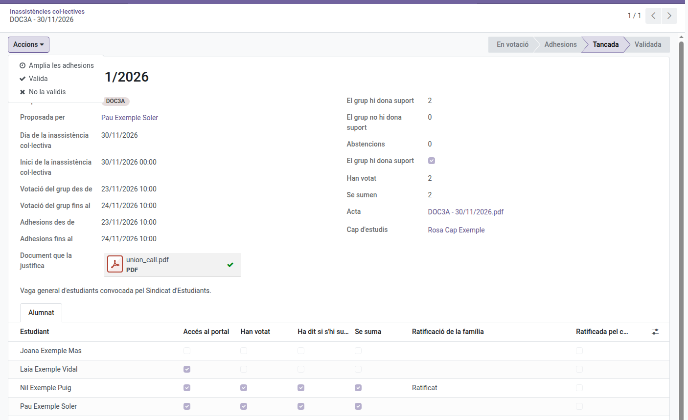
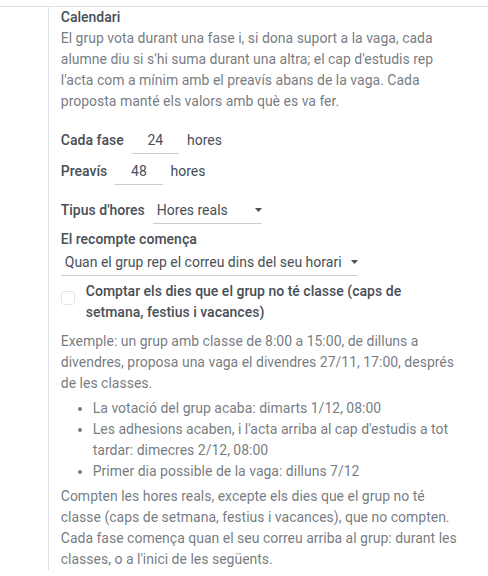

[Català](../../ca/head_of_studies/student-walkout.md) | [Castellano](../../es/head_of_studies/student-walkout.md) | [English](student-walkout.md)

---

# Student walkouts: validating them

A group's delegate proposes on the portal that the group walks out on a given day (giving the reason and attaching a supporting document, such as a students' union's call), the group votes on it, and the group's tutor watches over the proposal. You get the minute when it closes and decide whether to validate it. The students who join it are off the roll-calls of that day (neither absent nor present), and nothing is justified. How students and families take part is in the [families' manual](../families/manual-vagues.md), and the tutor's part in the [tutors' manual](../tutors/student-walkout.md).

Not to be confused with **Strikes** (Coexistence), the disciplinary record, nor with the staff walkout report.

---

## What you get

- **Nothing when a proposal is made**: the tutor watches over it.
- **A notice in your daily summary** when a tutor (or someone above them) aborts a proposal, with the reason.
- **The minute, by email**, when the proposal closes: at least 48 hours before the walkout (by default), with the vote count and the students who join it. If somebody joins it, you also get the task **Validate the student walkout**.
- **A notice in your daily summary** when a closed proposal is reopened because its joining was extended: the minute you had is withdrawn and a new one arrives when it closes again.

The minute reaches the Head or Deputy Head of Studies above the group's tutor; for a group with no tutor, every Head and Deputy Head of Studies.

---

## Validating it

Open the proposal from the email or from **Student's Attendances > Student walkouts**.

- **Actions > Validate**: confirms the walkout. The students who join it stay off the roll-calls of that day; the family's ratification of a minor changes nothing there (it only says it is aware and agrees), but a family that did not ratify it gets, for information, the notice of each class the minor does not attend. Every student of the group is told, the family of each minor who joins too, and the tutor.
- **Actions > Do not validate**: choose a reason; the classes of that day of the students who join it count as absences. Every student is told, and so are the tutor and the families that were asked to ratify it.
- **Actions > Undo the validation** (on a validated proposal): like not validating it, the classes of that day count as absences again. Students, families and tutor are told, with the reason.

The reasons come from **Student's Attendances > Configuration > Student walkouts > Rejection reasons**, the same ones the tutor uses to abort a proposal. You can add, rename or reorder them; "Other reasons" asks for details.

---

## Settings

An administrator sets it in **Settings > Student Walkout Settings**:

- **Levels and courses**: which levels (and, optionally, which courses of them) may propose supporting a walkout. By default, from the 3rd year of ESO, baccalaureate and vocational training.
- **Calendar**: how long each phase lasts and how long before the walkout you must get the minute (24 and 48 hours by default), and how those hours are counted:
  - **Kind of hours**: **real hours** (any time of the day) or **school hours** (only the hours the group is in class, according to its timetable; the calendar gets much longer).
  - **The count starts** (real hours only): **from the moment of the proposal** (the emails to the group and the tutor leave at once, whatever the time) or **when the group receives the email within its schedule**.
  - **Count the days the group has no class** (real hours only, off by default): off, weekends, public holidays and school breaks count nothing (24 hours from Friday at 9:00 end on Monday at 9:00); on, they count like any other day (they end on Saturday at 9:00).

  Below the controls, an **example** shows, before saving, when a sample proposal's vote and joining would end and its first possible walkout day with the values on screen. A proposal keeps the values it was made with.

---

[← Back to the Head of Studies' manuals](index.md)
